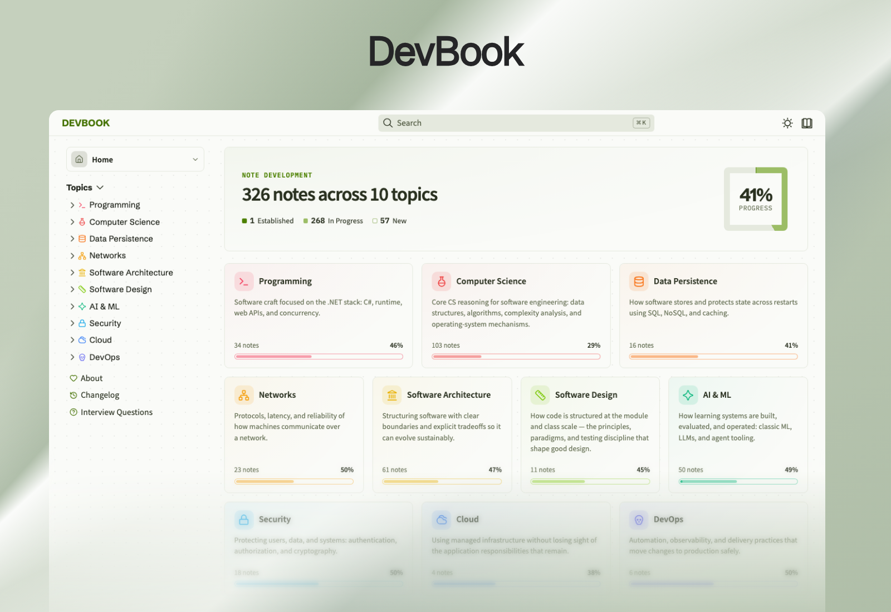
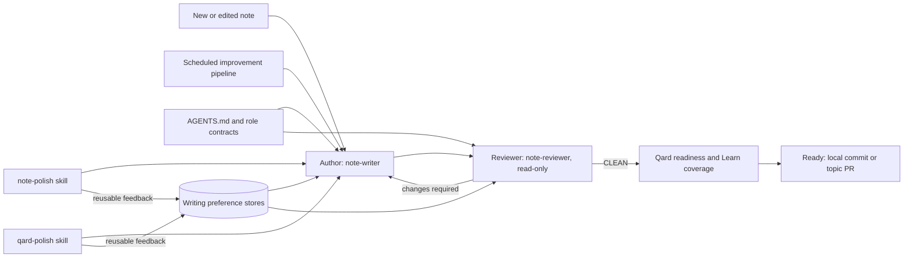

<picture>
  <source media="(prefers-color-scheme: dark)" srcset="https://raw.githubusercontent.com/grafanaKibana/devbook.zip/HEAD/docs/assets/product-captures/hero-dark.png">
  <source media="(prefers-color-scheme: light)" srcset="https://raw.githubusercontent.com/grafanaKibana/devbook.zip/HEAD/docs/assets/product-captures/hero.png">
  
</picture>

<p align="center">
A structured collection of software engineering notes covering 11 topic areas, designed for learning and interview preparation at a Senior .NET / AI engineering level.
</p>

<p align="center">
<a href="https://devbook.zip"><picture><source media="(prefers-color-scheme: dark)" srcset="https://shieldcn.dev/badge/Read_online.svg?variant=default&amp;size=sm&amp;font=geist&amp;mode=dark&amp;logo=ri%3ALuBookOpen&amp;color=84cc16&amp;logoColor=0e100f&amp;valueColor=0e100f&amp;labelTextColor=0e100f&amp;gradient=84cc16%2C95d133%2C110"></picture></a>
<a href="https://github.com/grafanaKibana/devbook.zip/releases/latest"><picture><source media="(prefers-color-scheme: dark)" srcset="https://shieldcn.dev/github/release/grafanaKibana/devbook.zip/stable.svg?variant=outline&amp;size=sm&amp;font=geist&amp;mode=dark&amp;label=Version&amp;gradient=18181b%2C18181b%2C90&amp;labelTextColor=fafafa"></picture></a>
<a href="https://github.com/grafanaKibana/devbook.zip/actions/workflows/vault-validation.yml"><picture><source media="(prefers-color-scheme: dark)" srcset="https://shieldcn.dev/github/ci/grafanaKibana/devbook.zip.svg?variant=outline&amp;size=sm&amp;font=geist&amp;mode=dark&amp;label=CI&amp;workflow=vault-validation.yml&amp;branch=main&amp;statusDot=true&amp;gradient=18181b%2C18181b%2C90&amp;labelTextColor=fafafa"></picture></a>
<a href="https://github.com/grafanaKibana/devbook.zip/issues"><picture><source media="(prefers-color-scheme: dark)" srcset="https://shieldcn.dev/badge/Report_an_issue.svg?variant=outline&amp;size=sm&amp;font=geist&amp;mode=dark&amp;logo=ri%3ALuBug&amp;gradient=18181b%2C18181b%2C90&amp;logoColor=fafafa&amp;labelTextColor=fafafa"></picture></a>
<a href="WORKFLOW.md"><picture><source media="(prefers-color-scheme: dark)" srcset="https://shieldcn.dev/badge/Contributing.svg?variant=outline&amp;size=sm&amp;font=geist&amp;mode=dark&amp;logo=ri%3ALuGitPullRequest&amp;gradient=18181b%2C18181b%2C90&amp;logoColor=fafafa&amp;labelTextColor=fafafa"></picture></a>
<a href="LICENSE"><picture><source media="(prefers-color-scheme: dark)" srcset="https://shieldcn.dev/badge/License.svg?variant=outline&amp;size=sm&amp;font=geist&amp;mode=dark&amp;logo=ri%3ALuScale&amp;gradient=18181b%2C18181b%2C90&amp;logoColor=fafafa&amp;labelTextColor=fafafa"></picture></a>
</p>

## Get started

Browse the published topic pages. The collection covers 11 areas: programming, computer science, data persistence, networks, architecture, development practices, security, SDLC, DevOps, cloud, and AI & ML. Notes support learning, recall, and interview preparation at a Senior .NET / AI engineering level.

The site publishes the eligible subset of the Obsidian vault. Reading does not require Obsidian, a database, or backend credentials.

## Local setup

### Use the Obsidian vault

Clone the repository and open `Vault/` as a vault in Obsidian:

```bash
git clone https://github.com/grafanaKibana/devbook.zip.git
cd devbook.zip
```

Start with `Vault/Home/index.md`. Notes and interview cards are authored within their owning topics.

For local authoring with the checked export workflow, install Git, Bash, .NET SDK 10.0.100, Node 22/npm, and Obsidian desktop. Allow the bundled community plugins, enable/register **Settings → General → Command line interface**, keep this vault open, then run:

```bash
bash .scripts/setup.sh
```

This installs locked Web dependencies, enables the checkout's Git hooks, and configures Quartz Syncer's local destination with Preserve enabled. Setup does not export, stage, commit, or deploy. Git identity and GitHub authentication remain manual, and Datacore must finish indexing before committing notes.

The workflow is tested on macOS; Linux is unverified, and native Windows and mobile export are unsupported. The [local development guide](Web/README.md#local-development) covers the bundled Syncer build, prerequisites, and recovery.

### Run the RAG playground

`Platform/DevBook/` is a personal .NET 10 learning proof of concept for retrieval and agent mechanics. It exposes ingestion, vector search, and an ask endpoint over the notes, with separate retrieval evaluations.

Before running it, follow the [backend prerequisites](Platform/DevBook/README.md#prerequisites): the host requires MongoDB Atlas search support and OpenAI configuration. Keep credentials in user-secrets or environment variables. Then, from the repository root:

```bash
dotnet run --project Platform/DevBook/DevBook.API/DevBook.API.csproj
```

Ingest publishable notes before trying retrieval. This playground makes the mechanics visible; it is not a production assistant. Evaluation measures retrieval of evidence, rather than grading generated answers.

## How notes and cards are written and improved

Every note and Qard card goes through the same author role, the same independent reviewer and the same rules, whether the change starts in a chat session or in the scheduled pipeline.



| Entry point | Use it for | Who accepts the change |
| --- | --- | --- |
| `note-polish` skill | Improving an existing note, one proposal at a time | The user, per proposal |
| `qard-polish` skill | Repairing cards one by one, starting with those marked **Needs fixing** | The user, per card |
| Improvement pipeline | Scheduled whole-note refinement, up to five notes per topic PR | The user, by reviewing and merging the PR |

- **Rules.** [AGENTS.md](AGENTS.md) and the [writer](.rulesync/subagents/note-writer.md) and [reviewer](.rulesync/subagents/note-reviewer.md) contracts own structure, card identity and the review protocol.
- **Preferences.** The [note](.rulesync/skill-feedback/note-polish.json) and [Qard](.rulesync/skill-feedback/qard-polish.json) stores hold the wording and explanation preferences learned from feedback. Only the two skills write them; the author, the reviewer and the pipeline read them, so no rule is copied anywhere else.
- **Review gate.** A change is finished only when the reviewer returns `CLEAN` for the complete note.
- **Qard readiness.** After a move, rename, split, merge or card change, decks, course links, lessons and checks are repaired by the [readiness procedure](docs/qard-readiness.md).
- **Pipeline.** The [improvement runbook](.scripts/DevBook.Tooling/README.md) covers selection, budgets, topic PRs and activation.

## Repository structure

| Path | Role |
| --- | --- |
| `Vault/` | Authored Obsidian notes, templates, and attachments |
| `Web/` | Quartz v5 site and generated publication output |
| `Platform/` | RAG backend, tests, and retrieval evaluations |
| `.scripts/` and `.githooks/` | Vault maintenance and checked export workflow |

A vault commit waits for Syncer export; a pushed change then follows the website's build/deployment workflow. Edit `Vault/`, not generated `Web/content/`.

## Guides

- [Website and publishing](Web/README.md) — export, local preview, dashboards, and deployment.
- [RAG playground](Platform/DevBook/README.md) — prerequisites, API endpoints, ingestion, and execution.
- [Retrieval evaluation](Platform/DevBook/DevBook.Evaluations/README.md) — datasets, methodology, and reports.
- [Project workflow](WORKFLOW.md) — issues, pull requests, review, and releases.
