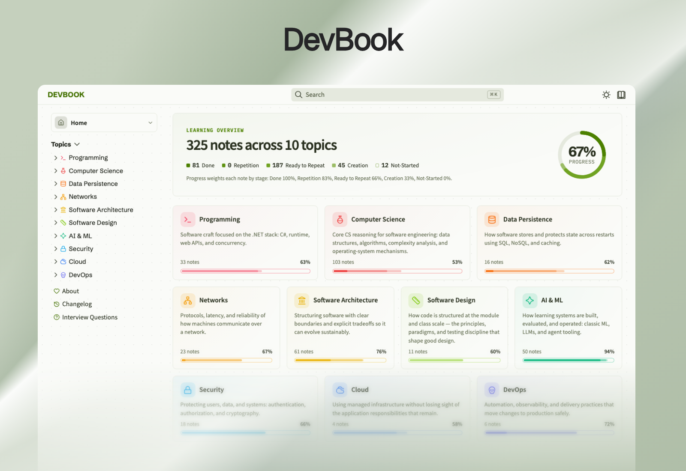

# DevBook

<a href="https://devbook.zip">
<picture>
  <source media="(prefers-color-scheme: dark)" srcset="docs/assets/product-captures/hero-dark.png">
  <source media="(prefers-color-scheme: light)" srcset="docs/assets/product-captures/hero.png">
  
</picture>
</a>

<p align="center">
<a href="https://devbook.zip"><picture><source media="(prefers-color-scheme: dark)" srcset="https://shieldcn.dev/badge/Read_online.svg?variant=default&amp;size=sm&amp;font=geist&amp;mode=dark&amp;logo=ri%3ALuBookOpen&amp;color=84cc16&amp;logoColor=0e100f&amp;valueColor=0e100f&amp;labelTextColor=0e100f&amp;gradient=84cc16%2C95d133%2C110"></picture></a>
<a href="https://github.com/grafanaKibana/devbook.zip/releases/latest"><picture><source media="(prefers-color-scheme: dark)" srcset="https://shieldcn.dev/github/release/grafanaKibana/devbook.zip/stable.svg?variant=outline&amp;size=sm&amp;font=geist&amp;mode=dark&amp;label=Version"></picture></a>
<a href="https://github.com/grafanaKibana/devbook.zip/actions/workflows/vault-validation.yml"><picture><source media="(prefers-color-scheme: dark)" srcset="https://shieldcn.dev/github/ci/grafanaKibana/devbook.zip.svg?variant=outline&amp;size=sm&amp;font=geist&amp;mode=dark&amp;label=CI&amp;workflow=vault-validation.yml&amp;branch=main&amp;statusDot=true"></picture></a>
</p>

## What It Is

A structured collection of software engineering notes covering 11 topic areas, designed for learning and interview preparation at a Senior .NET / AI engineering level. Every note follows a strict quality bar: intro in your own words, concrete examples, pitfalls, tradeoffs, interview-style questions, and curated references.

The same notes feed two things: a **static website** (write in Obsidian → publish with Quartz Syncer → auto-deploy) and a **.NET RAG backend** — a personal R&D proof of concept for learning retrieval mechanics (ingestion, chunking, embeddings, vector search, reranking, and evaluation) over real content.

### Topic Areas

| # | Topic | Scope |
|---|-------|-------|
| 01 | Programming | Languages, paradigms, .NET ecosystem |
| 02 | Computer Science | Data structures, algorithms, fundamentals |
| 03 | Data Persistence | Databases, EF Core, caching, indexing |
| 04 | Networks | Protocols, HTTP, sockets, DNS |
| 05 | Architecture | Design patterns, system design, DDD |
| 06 | Development Practices | Testing, code quality, CI/CD practices |
| 07 | Security | Auth, encryption, OWASP, identity |
| 08 | SDLC | Software development lifecycle |
| 09 | DevOps | Containers, orchestration, IaC |
| 10 | Cloud | Azure, cloud-native patterns |
| 11 | AI & ML | LLMs, RAG, embeddings, evaluation |

## The Three Pillars

| Directory | What it is | Docs |
|-----------|------------|------|
| **`Vault/`** | The Obsidian vault — where all notes live and are authored | — |
| **`Web/`** | Quartz v5 static site that publishes the vault to [devbook.zip](https://devbook.zip) | [Web/README.md](Web/README.md) |
| **`Platform/`** | .NET RAG backend (ingestion, vector search, ask agent) + retrieval evaluation over the notes | [Platform/DevBook/README.md](Platform/DevBook/README.md) |

```text
DevBook/
├── Vault/        # The Obsidian vault (open this in Obsidian)
├── Web/          # Quartz v5 site that publishes the vault       → Web/README.md
├── Platform/     # .NET RAG backend + evaluation                 → Platform/DevBook/README.md
├── .scripts/     # Vault maintenance automation (Python)
├── .githooks/    # Pre-commit hook that runs the automations
└── AGENTS.md     # AI agent operating contract
```

## Documentation

- **[WORKFLOW.md](WORKFLOW.md)** — the SDLC: issues, project board, PR review, and release automation.
- **[Web/README.md](Web/README.md)** — the content → site pipeline: Obsidian authoring, the Quartz Syncer publish step, the Quartz build, dashboards, customizations, and automations.
- **[Platform/DevBook/README.md](Platform/DevBook/README.md)** — the .NET RAG backend: ingestion, vector search, the ask agent, and the **[Evaluation](Platform/DevBook/README.md#evaluation)** section.
- **[Platform/DevBook/DevBook.Evaluations/README.md](Platform/DevBook/DevBook.Evaluations/README.md)** — the RAG retrieval evaluation deep-dive (golden dataset, metrics, methodology).

## Quick Start

```bash
git clone https://github.com/grafanaKibana/devbook.zip.git
cd devbook.zip
```

For automatic Quartz export when committing notes, first install Git, Bash, Python 3.9 or later, Node 22/npm and Obsidian desktop. Open `Vault/` in Obsidian, allow its bundled community plugins, and enable/register **Settings → General → Command line interface**. Then run:

```bash
bash .scripts/setup.sh
```

This installs the locked Web npm dependencies, enables local Git hooks and configures Syncer’s local destination with Preserve enabled. Git identity and GitHub authentication remain manual; let Datacore finish indexing before committing. Setup does not export, commit or deploy. See [new-machine prerequisites and recovery](Web/README.md#local-development), including the macOS-tested platform boundary.

- **Edit notes** — open `Vault/` as an Obsidian vault; vault commits wait for automatic Quartz export.
- **Run the website** — see [Web/README.md](Web/README.md#local-development) (after setup, `cd Web && npm run build && npx quartz build --serve`).
- **Run the backend** — see [Platform/DevBook/README.md](Platform/DevBook/README.md#run) (`dotnet run --project Platform/DevBook/DevBook.API/DevBook.API.csproj`).

## License

[MIT License](LICENSE)

[Regenerate product images](docs/product-captures.md)
