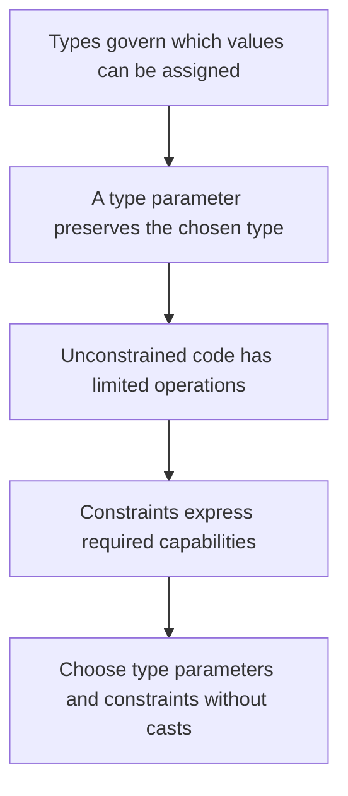

# Building type-safe generic contracts

2026-10-31 · [[Assets/Qard/Courses/Programming Mastery|Programming]] · `generic-contracts`

## Summary

The lesson connected assignment rules to generic API contracts: reference conversions versus boxing, compile-time errors versus runtime failures, how a type parameter carries a type through an API, and how constraints make required operations available without casts.

You identified the outcomes in the type-preservation check and later chose the appropriate constraint and compile-time rejection point. Your explanations still omitted some inferred type arguments and return types. You also confused reference conversion with boxing, proposed an invalid constraint, and needed corrections to generic declaration and call syntax. Explaining why extra constraints are unnecessary remains a gap.

Your confidence sometimes exceeded the accuracy or completeness of your answers. Further practice should trace the argument’s compile-time type, infer `T`, substitute it into the return type, and justify each constraint from an operation the method actually performs.

## Plan

We will start with types and assignment, connecting them to your earlier work on value and reference semantics without assuming those checks were mastered. Using the Generics note, we will then trace how a type parameter preserves a type across an API and how constraints make required operations available safely.



## Steps

### 1. Types and assignment

A variable has a type. For the assignments here, the compiler checks whether the expression on the right can be implicitly converted to the variable’s type on the left.

Start with a value type:

```csharp
int first = 4;
int second = first;
second = 9;
```

Both variables hold integer values. Assigning `first` to `second` copies its value, so changing `second` leaves `first` equal to `4`.

Reference types copy references instead. Consider:

```csharp
string name = "Ada";
object stored = name;
```

Every string is an object, so the second assignment is allowed. It copies the reference: both variables refer to the same string. It does not create a different object or change the string’s runtime type.

However, the expression `stored` has compile-time type `object`. An `object` variable can also refer to values that are not strings. Therefore, `string restored = stored;` is rejected: there is no implicit conversion from `object` to `string`.

The opening of **Generics** describes preserving types across reads and writes. This example shows why that matters: storing a string through `object` loses the compile-time guarantee that a later read produces a string.

This first step makes assignment checks and copying explicit, without assuming the earlier value and reference semantics checks were mastered. Next, a type parameter will let an API carry a chosen type through both input and output.

**Check:** Consider each assignment below:

```csharp
string name = "Ada";
object stored = name;
string restored = stored;
```

Explain why the second assignment is allowed and whether the third assignment compiles. Distinguish the compile-time type of `stored` from the runtime type of the object it refers to.

**My answer (0/3):** The second var will be boxed to the object, third one will throw, since we trying to put object to string without unboxing

**Model answer:** The second assignment is allowed because a string can be implicitly converted to `object`. It copies the reference to the string. The expression `stored` has compile-time type `object`, although the referenced object's runtime type is `string`. The third assignment fails at compile time because there is no implicit conversion from `object` to `string`.

### 2. Carry a type through an API

A method’s declared return type tells the compiler what type its result has. Returning a string through an `object` return type gives the caller an `object` expression, even though the value is still a string.

Your **Generics** note describes a type parameter as a placeholder for a type chosen by the caller. This lets one method connect its input type to its output type:

```csharp
static T Echo<T>(T value) => value;

string name = Echo<string>("Ada");
int count = Echo<int>(3);
```

For the first call, substitute `string` for every `T`: the parameter accepts a string and the result has type `string`. For the second, substitute `int`: both become `int`. One implementation preserves the type relationship in both calls.

C# can also infer the type argument from the input: `Echo("Ada")` uses `T = string`. Inference happens during compilation; it does not inspect the returned value at runtime.

An `object` parameter and return type accept many values, but their signatures do not express this relationship. A repeated `T` does, so the caller can use the result with its chosen type without a cast.

The previous step established that assignment depends on types. A type parameter carries that information across a method call, preserving the compiler’s checks as an API becomes reusable.

**Check:** Consider these methods and three independent declarations:

```csharp
static T Pass<T>(T value) => value;
static object PassObject(object value) => value;

var a = Pass("Ada");
var b = PassObject("Ada");
string c = Pass(7);
```

What are the compile-time types of `a` and `b`, and does the declaration of `c` compile? Explain each answer using the method signatures.

**My answer (2/3):** Compile time for a would be a string since we infer the type from the param and return it. b would be object since PassObject returns object, and when we pass string into it, we storing string`s refference and store it into object viriable. C will not compile, since we cannot implicitly convert int to string because we have strongly typed language

**Model answer:** `a` has compile-time type `string`: the string argument makes `T` be `string`, and `Pass` returns `T`.

`b` has compile-time type `object`: `PassObject` declares that return type. `var` uses the expression’s compile-time type, even though the returned value is a string.

The declaration of `c` does not compile. `Pass(7)` infers `T = int`, so its result has type `int`. There is no implicit conversion from `int` to `string`.

### 3. Find the operations an algorithm needs

A method body must be valid for every type its declaration permits. An unconstrained `T` permits both value types, such as `int`, and reference types, such as `string`.

Returning an existing value of type `T` requires no knowledge of its members. The input already has the promised return type. Copying or returning that value follows the chosen type’s value or reference semantics.

Reading `value.Length` requires more information: an accessible `Length` member. A string has one; an integer does not. Knowing that a value has type `T` preserves its type, but does not establish that this operation exists. Calling the method only with strings does not repair its declaration: the body must satisfy the declared contract.

This gives a way to discover the contract: examine each operation the algorithm performs and identify the capability it requires. Returning an input needs no extra capability. Reading a length needs a length contract. Comparing values needs a comparison contract.

Your **Generics** note calls constraints “capability contracts.” They make required operations available through compiler-checked guarantees. Casting through `object` supplies no such guarantee; an unsupported value can still reach a failing cast.

The previous step kept the caller’s chosen type connected across inputs and outputs. Now the algorithm’s operations determine which additional guarantees that type needs.

**Check:** Consider these declarations independently:

```csharp
static T Echo<T>(T value) => value;

static int Measure<T>(T value) => value.Length;
```

Why does `Echo` compile while `Measure` does not, and what capability must `Measure` require to read `Length` safely without casts? No constraint syntax is needed.

**My answer (1/3):** It doesnt compile because not every T have .Length, which looks like string property. To make it work we need to hav generic constaint to string

**Model answer:** `Echo` receives a `T` and returns that same value as `T`, so the return type matches without requiring any members. `Measure` permits types such as `int`, which have no `Length` member, so its body is invalid. It needs a compiler-visible contract guaranteeing an accessible `Length` member returning `int`, such as an interface constraint that declares that property.

> **Q:** Show how code will look before and after fix
> **Before:** casting through `object` makes the code compile, but it assumes every `T` is a string. An `int` causes a runtime exception.
> 
> ```csharp
> static int GetLength<T>(T value)
> {
>     return ((string)(object)value).Length;
> }
> ```
> 
> **After:** if the operation is specifically for strings, state that in the parameter type:
> 
> ```csharp
> static int GetLength(string value)
> {
>     return value.Length;
> }
> ```
> 
> The compiler now rejects an `int` at the call site. No generic parameter is needed because the method accepts one concrete type.
> 
> For an algorithm that must work with several types, the **Generics** note recommends a constraint that guarantees the required capability. Those types need to share an appropriate interface; a generic constraint cannot require a `Length` property by name alone.

### 4. Choose the smallest useful constraint

A generic method is checked against what its declaration guarantees about `T`. If its body calls `value.Validate()`, the compiler needs a guarantee that this operation exists.

Your **Generics** note calls constraints capability contracts. Given `interface IValidatable { void Validate(); }`, the constraint `where T : IValidatable` supplies exactly that guarantee. The method can call `Validate()` directly, and a type argument that does not implement the interface is rejected at compile time.

Now consider what else the method needs. If it receives an existing value, it does not need `new()`: that constraint would require a public parameterless constructor for no reason. If validation works for both classes and structs, adding `class` would exclude suitable structs without enabling any required operation.

The smallest useful constraint guarantees every operation the body needs without imposing unrelated requirements. Keeping the parameter and return type as `T` also preserves the caller's type through the API. No conversion to `object` or recovery cast is needed.

![[Assets/Qard/Figures/csharp/smallest-useful-generic-constraint.svg|700]]

*Figure: ValidateAndReturn<T> needs only where T : IValidatable to call value.Validate(). Neither new() nor class enables a required operation; accepting and returning T preserves the caller’s type.*

The previous step identified the operations the algorithm needs. This step turns those operations into a compiler-checked contract while keeping suitable type arguments available.

**Check:** Given this interface and method:

```csharp
public interface IValidatable
{
    void Validate();
}

public static T ValidateAndReturn<T>(T value)
    // Add the constraint here.
{
    value.Validate();
    return value;
}
```

Write the smallest useful constraint. Explain what makes `value.Validate()` legal, why neither `class` nor `new()` is needed, and when a call using a type that does not implement `IValidatable` is rejected.

**My answer (3/4):** where T : IValidatable will make every T inherit from the IValidatable, which guarantees T will have such method. neither class nor new() is needed since these terms not related to this problem. 

> when a call using a type that does not implement IValidatable is rejected.
compile time? Idk question is vague

**Model answer:** ```csharp
where T : IValidatable
```

The constraint guarantees that `T` implements `IValidatable`, so the compiler permits `value.Validate()`. Both classes and structs can implement this interface, so `class` would exclude suitable structs. The method receives its value and never constructs a `T`, so `new()` is unnecessary. A call using a type argument that does not implement `IValidatable` fails at compile time.

### 5. Design a contract without object casts

A method’s parameter type determines what it accepts, and its return type determines what the caller can use directly. A type parameter connects those two boundaries: accepting `T` and returning `T` preserves the chosen type through the method.

The **Generics** note adds the other half: constraints make required operations available inside the method. If the method calls `Validate()`, an `IValidatable` constraint provides that operation. Returning `T` then preserves the caller’s type without a cast.

These decisions solve separate problems. Using only `IValidatable` as the parameter and return type exposes validation, but the return contract no longer preserves a more specific type such as `Invoice`. Using unconstrained `T` preserves the type, but does not guarantee a `Validate()` method.

Combining `T` with `where T : IValidatable` provides both guarantees. No `new()` constraint is needed when the caller supplies the value. No `class` constraint is needed when the algorithm requires no reference-specific operation. The contract follows from what flows through the API and what its implementation actually does.

The previous step chose the smallest constraint needed by an algorithm. This step combines that capability guarantee with a type parameter that preserves the caller’s type across the API.

**Check:** Given this interface:

```csharp
public interface IValidatable
{
    void Validate();
}
```

Write a public static generic method `ValidateAndReturn` that accepts a caller-supplied value, calls its `Validate()` method, and returns the resulting value with the same compile-time type `T`. Use the smallest necessary constraint and no casts. Assume inputs are non-null; both classes and structs implementing the interface must be supported.

Then explain why this caller needs no cast, assuming `Invoice` implements `IValidatable` and has a public parameterless constructor:

```csharp
Invoice invoice = ValidateAndReturn(new Invoice());
```

Why would returning `IValidatable` instead weaken this caller’s contract?

**My answer (2/4):** public T ValidateAndReturn(T value) where T : IValidatable
{
    value.Validate()
    return value;
}

there is no need to cast since constraing already guaranteed that value will come with required method

**Model answer:** ```csharp
public static T ValidateAndReturn<T>(T value)
    where T : IValidatable
{
    value.Validate();
    return value;
}
```

The argument makes `T` equal to `Invoice`, so the method returns an `Invoice` and the assignment needs no cast. The constraint lets the implementation call `Validate()` safely.

Returning `IValidatable` would give the caller an interface-typed result. Even if the runtime value were an `Invoice`, direct assignment to an `Invoice` variable would fail to compile. Recovering that type would require a cast or type check.

The method receives its value, so it needs no `new()` constraint. It also requires no reference-specific behavior, so it needs no `class` constraint.
