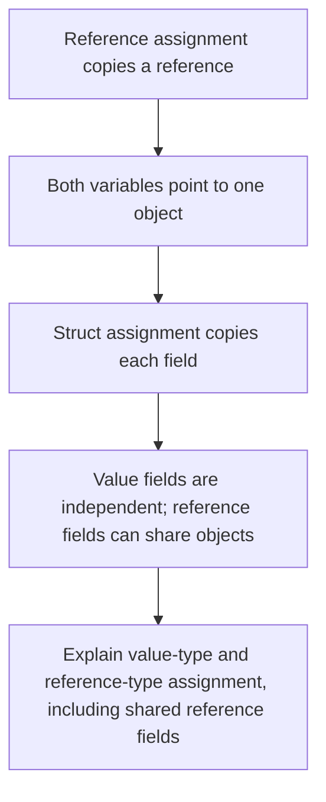

# Trace What Assignment Copies

2026-10-31 · [[Assets/Qard/Courses/Programming Mastery|Programming]] · `value-semantics`

## Summary

The lesson traced reference assignment, struct assignment, and shared reference fields. Reference assignment copies a reference, so two variables can point to one object. Struct assignment copies the struct’s field values: numeric fields become independent, while reference fields can still point to the same array or object.

You progressed from confusing assignment with object duplication or shared struct storage to correctly predicting the checked values and explaining the shared array. The remaining gap is explaining the copy boundary consistently: why changing one struct’s `Number` leaves the other unchanged, and how assigning a `Box` reference creates an alias to the original object.

## Plan

You have identified the relevant types—references and structs—but your answers suggest the copy boundary is unclear. Start by tracing a reference assignment to see that both variables point to one object, then compare it with a struct copy, including what happens when one field is itself a reference.



## Steps

### 1. Trace a reference assignment

A variable holds a value. For a class variable, that value is a reference identifying an object. The variable and the object it refers to are separate things.

Your **C# Types** note states under **Copy and Storage Boundaries** that reference-type assignment copies the object reference. Follow that rule through the example: `new Box` creates one object, and `a` holds a reference to it. Then `b = a` copies the reference stored in `a` into `b`. Both references identify the same object. This assignment creates no additional `Box`.

Next, `b.Value = 9` follows the reference in `b` and changes the object's field. Reading `a.Value` follows the reference in `a` to that same object, so it reads `9`.

The boundary is between the reference and its target: assignment copies the reference; field access follows it. There are two variables holding references to one shared object.

This first step addresses the idea that reference assignment creates another object. Locating what gets copied prepares us to trace a struct assignment and, later, a reference field inside a struct.

**Check:** What does this code print, and how does what `b = a` copies explain that result?

```csharp
var a = new Box { Value = 4 };
var b = a;
b.Value = 9;
Console.WriteLine(a.Value);

public sealed class Box
{
    public int Value;
}
```

**My answer (1/3):** 9

**Model answer:** It prints `9`. The assignment `b = a` copies the reference to the existing `Box`. Both variables refer to that one object, so `b.Value = 9` changes the field that `a.Value` then reads.

### 2. Follow a reference field

A struct stores field values. A reference-type field stores a reference to an object. These two facts let us extend the previous step without changing the assignment rule.

As **C# Types → Copy and Storage Boundaries** explains, assigning a struct copies every field. For an `int` field, the copied value is the number. For an array field, the copied value is the reference, because arrays are reference types. Assignment does not create another array.

The two structs therefore hold separate fields containing references to the same array. Changing an array element follows one of those references and changes the shared array. Reading that element through the other struct reveals the change.

Changing the copied struct’s `int` field works differently: it replaces a value inside that struct alone. This is a **shallow copy**: the struct’s fields are copied, while objects reached through reference fields remain shared.

![[Assets/Qard/Figures/csharp/struct-copy-shared-array-reference.svg|700]]

*Figure: After b = a, setting b.Number = 9 leaves a.Number at 3. Setting b.Items[0] = 7 changes the single shared array to [7, 2], so both a.Items[0] and b.Items[0] read 7.*

The previous step established that each struct copy has its own fields. This step follows what a reference field contains, explaining how separate struct values can still share one object.

**Check:** What does each `Console.WriteLine` print? Explain why changing `b.Number` and changing `b.Items[0]` affect `a` differently.

```csharp
var a = new Sample { Number = 1, Items = new int[] { 2 } };
var b = a;

b.Number = 8;
b.Items[0] = 9;

Console.WriteLine(a.Number);
Console.WriteLine(a.Items[0]);

struct Sample
{
    public int Number;
    public int[] Items;
}
```

**My answer (0/4):** It will print 8, 2

I thouhg that it would be 8,9 but you gave me a hint by saying "why changing b.Number and changing b.Items[0] affect a differently"

Changing b affects a because we are changing the object using the same reference. I would assume the same for the array, but it looks like it is not the case.

**Model answer:** The output is:

```text
1
9
```

`var b = a` copies both field values. Each struct has its own `Number` field, so assigning `8` to `b.Number` leaves `a.Number` at `1`.

The value copied from `a.Items` is a reference to the array. Both `Items` fields therefore refer to the same array. Assigning `9` to `b.Items[0]` changes that shared array, so `a.Items[0]` reads `9`.

### 3. Follow a reference field

A struct stores field values. A reference-type field stores a reference to an object. These two facts let us extend the previous step without changing the assignment rule.

As **C# Types → Copy and Storage Boundaries** explains, assigning a struct copies every field. For an `int` field, the copied value is the number. For an array field, the copied value is the reference, because arrays are reference types. Assignment does not create another array.

The two structs therefore hold separate fields containing references to the same array. Changing an array element follows one of those references and changes the shared array. Reading that element through the other struct reveals the change.

Changing the copied struct’s `int` field works differently: it replaces a value inside that struct alone. This is a **shallow copy**: the struct’s fields are copied, while objects reached through reference fields remain shared.

The previous step established that each struct copy has its own fields. This step follows what a reference field contains, explaining how separate struct values can still share one object.

**Check:** What does each `Console.WriteLine` print? Explain why changing `b.Number` and changing `b.Items[0]` affect `a` differently.

```csharp
var a = new Sample { Number = 1, Items = new int[] { 2 } };
var b = a;

b.Number = 8;
b.Items[0] = 9;

Console.WriteLine(a.Number);
Console.WriteLine(a.Items[0]);

struct Sample
{
    public int Number;
    public int[] Items;
}
```

**My answer (3/4):** It would be 1 and 9, since we are copying the struct, whcih doesnt change a object. While array is the ref type that is shared between the object, the value in it will be changed from the b, as well

**Model answer:** The output is:

```text
1
9
```

`var b = a` copies both field values. Each struct has its own `Number` field, so assigning `8` to `b.Number` leaves `a.Number` at `1`.

The value copied from `a.Items` is a reference to the array. Both `Items` fields therefore refer to the same array. Assigning `9` to `b.Items[0]` changes that shared array, so `a.Items[0]` reads `9`.

### 4. Predict what mutations affect

An assignment stores a value in its destination. For a reference variable, that value is a reference to an object. For a struct variable, it is the struct’s field values, including any references stored in those fields. This is the assignment boundary described in **C# Types**, under **Copy and Storage Boundaries**.

The previous step established that two struct copies can hold references to the same object. To predict a change, identify exactly what receives the write.

Changing an integer field in one struct updates that struct’s field. The other struct has its own integer field, so its value stays unchanged.

Changing a field of an object reached through a reference updates that object. Every reference still pointing to that object observes the change.

Assigning a different object reference to one struct’s reference field updates only that field. Other references keep pointing to the earlier object, with any mutations already made to it.

These outcomes follow from tracking the destination of each write; they need no stack-versus-heap rule.

The previous step followed the shared reference inside two struct copies. Now combine that with reference assignment to predict which writes change a local field and which change an object shared by several references.

**Check:** What does this code print? Explain how each mutation determines the final values, including the value seen through `alias`.

```csharp
using System;

var original = new Box { Value = 10 };
var alias = original;

var a = new Snapshot { Count = 1, Shared = original };
var b = a;

b.Count = 2;
b.Shared.Value = 20;
b.Shared = new Box { Value = 30 };

Console.WriteLine(
    $"{a.Count}, {b.Count}, {a.Shared.Value}, {b.Shared.Value}, {alias.Value}");

public sealed class Box
{
    public int Value;
}

public struct Snapshot
{
    public int Count;
    public Box Shared;
}
```

**My answer (3/4):** 1 (since Snapshot is a struct which doesnt get reference copy, and it wasnchaged ), 2(copy which was directly changed), 20 (when it was shared ref, b.Shared.Value changed also the a.Shared.Value via ref), 30 (Shared was reinstanced for b, with new value 30), 20 (when it was shared ref, b.Shared.Value changed also the a.Shared.Value via ref)

**Model answer:** It prints:

```text
1, 2, 20, 30, 20
```

`b = a` copies both struct fields. Each struct has its own `Count`, so `b.Count = 2` leaves `a.Count` at 1.

The copied `Shared` field contains a reference to the same `Box`. Therefore, `b.Shared.Value = 20` changes the object also reached through `a.Shared`, `original`, and `alias`.

`b.Shared = new Box { Value = 30 }` replaces only the reference stored in `b.Shared`. That field now points to the new Box. `a.Shared` and `alias` still point to the earlier Box, whose value remains 20.
