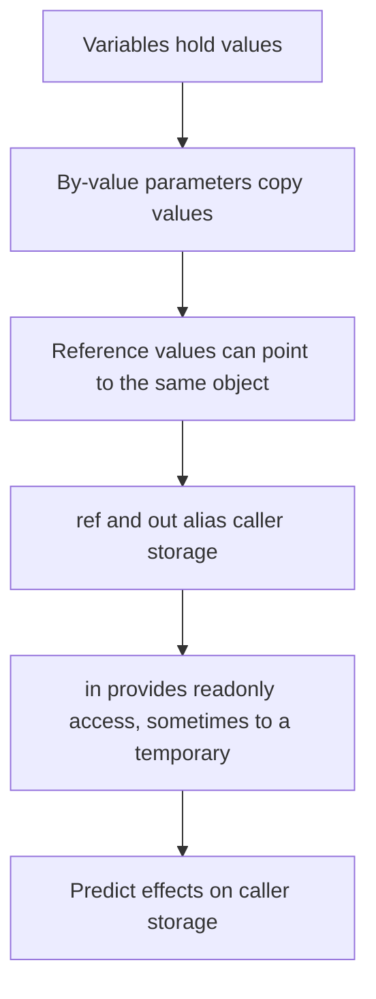

# From copied values to caller storage

2026-10-31 · [[Assets/Qard/Courses/Programming Mastery|Programming]] · `parameter-passing`

## Summary

The lesson traced variables, copied values, and caller storage through by-value, `ref`, `out`, and `in` parameters. You completed variables and copying checks at 3/3 and correctly predicted the copied integer's behavior. In by-value checks (2/4), you treated the array itself as copied; the copied value is its reference, so element changes reach the shared array. In `ref` and `out` checks (3/4), your values and aliasing explanation were correct, but the initialization rationale needs review: `ref` permits reading the existing value before writing. In `in` checks (2/4), you identified the first storage location and rejected assignment through the parameter, but missed the final output and the temporary created for an expression argument. You reported being sure throughout; tracing the exact storage each parameter refers to remains the main practice target.

## Plan

We will start with variables holding values, then revisit copying because your earlier checks showed some gaps. Using the Methods note, we will trace what each parameter modifier allows a method to do to caller storage.



## Steps

### 1. Variables and copied values

A variable provides storage for a value. With `int count = 4;`, `count` names the variable, and `4` is the value currently stored there. Assignment replaces the value in the variable named on the left.

Consider:

```csharp
int count = 4;
int saved = count;
count = 9;
```

The second line reads the current value of `count` and stores that value in a separate variable, `saved`. Both variables now hold `4`. The third line replaces the value in `count` with `9`. It does not assign anything to `saved`, which still holds `4`.

Equal values do not mean shared storage. Copying a value also creates no continuing connection between the variables.

The **Methods** note applies this distinction to calls: an ordinary by-value parameter receives a copy of the argument's value. Before tracing methods, the reliable starting point is to identify which variable each assignment changes.

This first step rebuilds the distinction between storage and its contents. We will use it to distinguish parameters that receive copied values from parameters that provide access to caller storage.

**Check:** What does this code print, and why?

```csharp
int first = 6;
int second = first;
first = 11;
second = second + 2;
Console.WriteLine($"{first}, {second}");
```

**My answer (3/3):** 11, 8, because int is a struct which copying the values, not ref, so first is not changed o addition, and second did not changed on the reassigmend of first

**Model answer:** It prints `11, 8`. `second` receives a copy of the value `6` held in `first`. Assigning `11` to `first` changes only `first`. Adding `2` to `second` changes its stored value from `6` to `8`; the variables have separate storage.

### 2. By-value parameters

A variable holds a value. Passing an argument **by value** gives the method a separate parameter variable containing a copy of that value. This is the default for the ordinary parameters discussed in the **Methods** note.

For an `int`, the copied value is the number. Assigning another number to the parameter changes the parameter's storage. The caller's variable keeps its value because the assignment does not target that variable.

For an array, the value being copied is a **reference to the array**, not the array itself. The caller's variable and the parameter are separate storage locations, but their references initially reach the same array. An assignment such as `items[0] = 8` changes an element in that shared array, so the caller can observe it.

An assignment such as `items = new[] { 99 }` targets something different: the parameter variable. It replaces only the parameter's reference. The caller's variable still refers to the original array.

The Methods note's Questions section makes this distinction: a copied reference permits mutation of the shared object, while replacing the caller's reference requires access to the caller's variable.

The previous step established that copying a value creates a separate variable. Applying that rule at a method call explains why by-value parameters cannot reassign caller variables, providing the baseline for comparing `ref`, `out`, and `in`.

**Check:** What does this code print? Explain how copying each argument leads to that result.

```csharp
int number = 3;
int[] items = { 4 };

Change(number, items);
Console.WriteLine($"{number}, {items[0]}");

static void Change(int number, int[] items)
{
    number = 7;
    items[0] = 8;
    items = new[] { 99 };
    items[0] = 100;
}
```

**My answer (2/4):** 3,4. initial var numbers were not changed coz they were passed to the void method, and value method params just have initial copies, not actual variable ref. So changing them in inner scope dont change anything. It might be confusing for the person since in the method body, outer variables visible too, but since params have the same name, they have higher priority

**Model answer:** It prints `3, 8`.

The `number` parameter receives a copy of `3`. Assigning `7` changes only that parameter, so the caller's `number` remains `3`.

The `items` parameter receives a copy of the array reference. Both references initially reach the original array, so `items[0] = 8` changes its element. Assigning a new array to the parameter replaces only the parameter's reference. The final assignment changes the new array's element to `100`; the caller still refers to the original array containing `8`.

### 3. Writable aliases: ref and out

A variable has storage that holds its current value. In the previous step, a by-value parameter received a copy: assigning the parameter changed that copy.

The **Methods** note describes another possibility: an **alias**, a second name for the same storage. With `ref` or `out`, assigning the parameter writes directly into the caller’s variable. There is no separate parameter value to copy back later.

The difference is who must supply the initial value:

- **`ref`**: the caller must supply an initialized variable. The method can read its existing value and replace it. This fits updating an existing result.
- **`out`**: the caller may supply an uninitialized variable. The method must assign the parameter before reading it and before every normal return. This fits producing a result.

An initialized variable can also be passed with `out`, but the method still cannot read that parameter before assigning it. These are compiler-enforced contracts.

For reference types, the same rule applies to the stored reference: assigning a new object through either writable alias replaces the reference in the caller’s variable.

By-value assignment changed only the parameter’s copy. `ref` and `out` explain when assignment instead replaces the value in caller storage; their initialization rules distinguish updating a value from producing one.

**Check:** Consider this C# code:

```csharp
static void Bump(ref int value)
{
    value += 2;
}

static void Produce(out int value)
{
    value = 9;
}

int a = 4;
int b;
Bump(ref a);
Produce(out b);
```

What are the final values of `a` and `b`, and why do the assignments reach those variables? Explain why `a` must be initialized before its call while `b` need not be, and what `Produce` must do before returning normally.

**My answer (3/4):** a = 6, b = 9. Assigment reached variables because we passed them in to ref/out params which passing variable by ref. a must be inititialized because if not, there is not ref to pass. While its ok to not init the b, because it can (and should) be init in the method

**Model answer:** `a` becomes **6**. `value` in `Bump` aliases `a`, so reading and adding 2 updates `a` itself.

`b` becomes **9**. `value` in `Produce` aliases `b`, so its assignment writes into `b`.

A `ref` argument must already be initialized because the method may read its incoming value, as `Bump` does. An `out` argument need not be initialized because the method must produce its value: `Produce` must assign `value` before every normal return and cannot read it before assigning it.

### 4. Readonly access with in

`ref` gives a method an alias: another way to access the same storage. Reading through it reads that storage; assigning through it changes that storage.

The **Methods** note, under **Input Parameters → In**, introduces a narrower permission: `in` provides a readonly reference. The method can read through the parameter, but cannot assign through it. A variable passed to an `in` parameter must already be initialized, because the method receives an input rather than producing an initial value.

For example, `Read(in count)` can refer directly to the initialized `int` variable `count`. Inside `Read`, assigning to its `in int` parameter is a compile-time error.

An expression such as `count + 2` produces a value but does not identify a variable whose storage can be passed directly. C# allows `Read(count + 2)` with the call-site `in` omitted: it stores the result in a temporary and passes a readonly reference to that temporary. Evaluating the addition does not change `count`.

This explains the note's warning that `in` does **not guarantee zero copies**. It can avoid copying a large struct, but some arguments require temporaries. Readonly also describes access through the parameter; it does not make a referenced object immutable.

`ref` and `out` permit assignment to caller storage through the parameter; `in` permits reading through a readonly reference. To predict a call, identify the storage being referenced and whether the parameter permits writing to it.

**Check:** Trace this code. What does it print, what storage does `value` refer to in each call, and would uncommenting the assignment compile? Explain how the parameter rules determine your answer.

```csharp
static void Show(in int value)
{
    // value = 20;
    Console.WriteLine(value);
}

int number = 6;
Show(in number);
Show(number + 3);
Console.WriteLine(number);
```

**My answer (2/4):** 6 (number storage) and 9(methid parameter storage). Commented code would not compile because in omit changing the param value/

**Model answer:** The output is:

```text
6
9
6
```

In `Show(in number)`, `value` refers to the caller's `number` storage through a readonly reference.

In `Show(number + 3)`, the expression produces `9`. The compiler stores that result in a temporary, and `value` refers to that temporary through a readonly reference. The addition does not assign to `number`, so it remains `6`.

Uncommenting `value = 20` makes the method fail to compile. Assignment through an `in` parameter is forbidden, whether the parameter refers to caller storage or a temporary.
