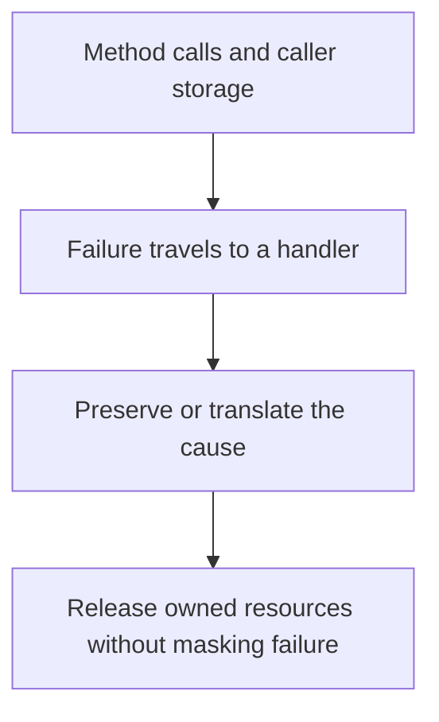

# Failure and cleanup boundaries

2026-11-01 · [[Assets/Qard/Courses/Programming Mastery|Programming]] · `failure-contracts`

## Summary

The lesson connected method calls and caller storage to exception propagation, cause preservation, and resource cleanup. You correctly identified values and explained parameter copying, but did not explain how a returned value reaches the caller through assignment. You traced failure output and the resulting value correctly, but omitted that an exception skips the remaining statements in the `try` block. Your rethrow syntax was correct; explaining the preserved exception type and stack trace, and translating a failure with report context and the original exception as `InnerException`, need more practice. Resource ownership and cleanup were the largest gap: choosing `using`, `await using`, or `finally`, releasing resources owned by the method, and preventing cleanup failures from masking the original cause.

## Plan

We will start with method calls and caller storage from your earlier parameter-passing lesson, using a small example to check what you remember. Then we will use the Exception Handling note to trace a failure, preserve its cause, and release resources owned by the method.



## Steps

### 1. Recall method calls

A variable stores a value. For an `int` parameter passed by value, a method call copies the argument's value into the parameter. The caller's variable and the parameter are separate storage locations.

In the check, `count` starts at `4`. Calling `Advance(count)` gives the parameter `value` its own copy of `4`. Adding one changes that parameter to `5`; it does not write into `count`.

Returning a value is another operation. `return value;` supplies `5` as the result of the call. The caller's assignment stores that result in `next`. Therefore, `count` remains `4`, and `next` becomes `5`.

These are standard C# parameter-passing rules. Your **Exception Handling** note builds on this call-and-return structure: an exception carries a failure across method boundaries when normal execution cannot continue. Understanding where a result normally goes gives us a starting point for tracing what happens when a call fails.

This opening check revisits method calls and caller storage from your earlier parameter-passing lesson. Next, we will trace a call that throws, then choose where to handle its failure and release resources.

**Check:** Consider this C# code:

```csharp
int count = 4;
int next = Advance(count);

static int Advance(int value)
{
    value += 1;
    return value;
}
```

After the call completes, what values do `count` and `next` contain, and how do parameter passing and the return value explain them?

**My answer (2/3):** count will be 4, next will be 5. count didnt changed because when we passing int, which is value type to the parameter, we passing copy of its value, not the reference to the variable

**Model answer:** `count` is `4`, and `next` is `5`. The parameter `value` receives a copy of `count`, so incrementing it changes only that copy. The method returns `5`, which the caller assigns to `next`.

### 2. Trace a failure to its handler

A method call normally returns control to its caller. If the call produces a value, the caller can then assign that value to its storage. A thrown exception interrupts this normal path: the call does not supply a result, so an assignment waiting for that result does not happen.

Your **Exception Handling** note explains how execution finds another path. Starting where the exception was thrown, the runtime searches outward through enclosing handlers and callers for a matching `catch`. The exception's type determines which handlers can match.

Once a handler is selected, execution unwinds toward it. Any `finally` blocks on that path run before the selected handler begins. This lets a method perform its cleanup even when a caller handles its failure. Cleanup and recovery can therefore belong to different methods.

After a `catch` finishes normally, execution continues after its associated `try`/`catch` statement. It does not return to the failed statement. Earlier changes are not automatically undone: exceptions redirect control; they do not roll back storage.

The previous step separated a method call from the caller's storage. Now that distinction explains why a failed call leaves its pending assignment unfinished, while unwinding gives the method a place to release resources it owns.

**Check:** Trace this C# code. What is printed, in order, and why does `value` have that final value? Assume the print calls succeed.

```csharp
int value = 7;
try
{
    value = Read();
    Console.WriteLine("assigned");
}
catch (InvalidOperationException)
{
    Console.WriteLine("caught");
}
Console.WriteLine(value);

static int Read()
{
    try
    {
        throw new InvalidOperationException();
    }
    finally
    {
        Console.WriteLine("cleanup");
    }
}
```

**My answer (3/4):** we will have the following:

"cleanup"
"caught"
7

the value is 7 because we Read didnt reassigned it, and rather throw an exception, after which was a cleanup. Then exception was caught

**Model answer:** The output is:

```text
cleanup
caught
7
```

The exception matches the caller's `catch`. Before that handler runs, unwinding executes `Read`'s `finally`, printing `cleanup`. The handler then prints `caught`.

`Read()` never returns a value, so `value = Read()` never completes its assignment. `value` remains `7`. The remaining statement in the `try`, which would print `assigned`, is skipped. After the handler finishes, execution continues after the `try`/`catch` and prints `7`.

### 3. Preserve or translate the cause

An exception carries information about a failed operation: its type identifies the kind of failure, and its stack trace records the path to it. A handler that cannot recover still needs to pass that information to its caller.

Your **Exception Handling** note distinguishes two choices.

If the failure already means what callers need it to mean, use `throw;` inside the `catch`. This rethrows the current exception and preserves its original stack trace. Logging the failure does not itself create a reason to change its type. Using `throw ex;` restarts the stack trace at the rethrow point, losing the original call path.

Wrapping is useful when a boundary must give the failure new meaning. A report-loading method might expose `ReportLoadException` so callers can handle report failures without depending on storage details. It can throw `new ReportLoadException("Could not load report.", ex)`. Passing `ex` as the inner exception preserves the underlying cause, including its stack trace.

That translation changes handler selection: an outer `catch (IOException)` does not match an unrelated `ReportLoadException` merely because its inner exception is an `IOException`. Wrapping therefore needs to serve the caller's failure contract.

The previous step traced a failure to a matching handler. Now that handler must decide what failure to pass onward, preserving the cause before the next step adds cleanup for owned resources.

**Check:** Both methods below catch an `IOException` and cannot recover. Complete each `catch` body, then briefly explain how each choice preserves the cause.

**A.** The method only records the failure. Its callers already handle `IOException`.

```csharp
catch (IOException ex)
{
    Log(ex);
    // Pass the failure onward.
}
```

**B.** The report-loading API promises callers a `ReportLoadException` for storage failures. Assume that type has a constructor accepting a message and an inner exception.

```csharp
catch (IOException ex)
{
    // Translate the failure for this API's callers.
}
```

**My answer (1/4):** A:
catch (IOException ex)
{
    Log(ex);
    throw; re-trowing original exception to preserve the trace
}

catch (IOException ex)
{
    throw new ReportLoadException(ex) // Assuming that ReportLoadException have construction that accepts the Exception and fills all the fields from ex, preserving trace
}

**Model answer:** **A:**

```csharp
catch (IOException ex)
{
    Log(ex);
    throw;
}
```

The failure already has the type callers expect. `throw;` preserves that exception and its original stack trace.

**B:**

```csharp
catch (IOException ex)
{
    throw new ReportLoadException("Could not load report.", ex);
}
```

The wrapper provides the API's promised `ReportLoadException`. Its `InnerException` retains the original `IOException`, including its message and stack trace.

### 4. Release owned resources

Owning a resource means being responsible for ending its lifetime. Passing a resource reference into another method does not, by itself, transfer that responsibility.

Suppose a method opens a file and then processes it. Processing can finish normally or throw. Cleanup placed after processing covers only normal completion: an exception skips that statement. Cleanup therefore needs a boundary that covers both exits.

Your **Exception Handling** note identifies `finally` as that boundary. During normal execution or stack unwinding to a handler, it runs when control leaves the protected block. For disposable resources, `using` expresses this disposal boundary directly; `await using` handles asynchronous disposal. Place the boundary around the work that needs the resource, immediately after successful acquisition. A borrowed resource stays under its owner's control unless ownership was explicitly transferred.

The previous step preserved the cause through rethrowing or translation. Cleanup must preserve it too: if disposal throws while another exception is propagating, the disposal exception can replace the original. `using` does not prevent this. Where cleanup can fail, handle and record that secondary failure without letting it replace the primary one. If the operation succeeded, a cleanup failure still needs to be reported as a failure.

These are in-process cleanup boundaries; they do not guarantee cleanup after abrupt process termination.

Rethrowing or translating preserves why the operation failed. Choosing an ownership boundary completes the design: cleanup is attempted on both success and failure, while the original cause remains available.

**Check:** A method receives a caller-owned stream and successfully opens a second stream that it owns. It processes both streams. Processing can throw `TimeoutException`, and disposing the owned stream can also throw. An outer caller handles failures.

Explain a cleanup design that respects ownership, covers successful and failed processing, and preserves the processing failure when disposal also fails. Include what should happen if processing succeeds but disposal fails. Code is optional.

**My answer (0/4):** _I didn't know._

**Model answer:** The method disposes only the stream it opened. The caller retains responsibility for the stream it supplied.

After opening its stream, the method puts processing inside a `try` with disposal in `finally`. This attempts disposal after successful processing and when an exception unwinds toward the outer handler.

The method tracks whether processing failed. If processing throws, it preserves that exception—for example, by recording that a primary failure exists and using `throw;` in the processing `catch`. During cleanup, a disposal exception is caught and recorded through a reporting path that does not itself throw. The original `TimeoutException` then continues to the caller with its stack trace preserved. An ordinary `using` alone would not prevent disposal from masking it.

If processing succeeded, there is no primary failure to preserve. A disposal exception should propagate, or be explicitly reported as a failed outcome, so the method does not claim success.
