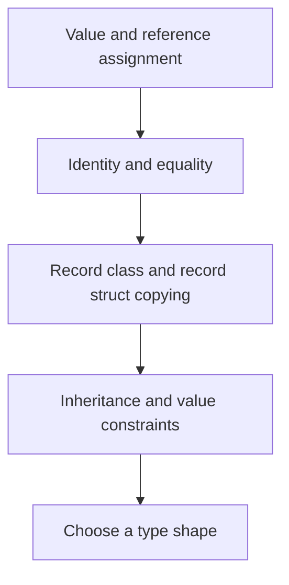

# Choosing C# type semantics

2026-11-02 · [[Assets/Qard/Courses/Programming Mastery|Programming]] · `type-shapes`

## Summary

The lesson connected assignment, identity, equality, copying, and inheritance to choosing C# type semantics. You correctly predicted the assignment example and explained the struct copy, but omitted why class assignment shares an object. You recognized that `record` means `record class`, but did not fully distinguish separate object identities from value equality. You confused record-class reference assignment with record-struct value copying. Inheritance and value-type constraints required a model answer. Your final scenario choices were correct, but two explanations omitted required behavior, and your confidence was uncertain. Further practice should focus on explaining assignment separately from equality and justifying each choice against copying and inheritance requirements.

## Plan

We will start with value and reference assignment from your earlier lesson, because your notes use that distinction to explain copying. Then you will connect identity and equality to the choice of class or record, and use copying and inheritance requirements to choose the final type shape.



## Steps

### 1. Revisit assignment

Ordinary assignment copies the value held by a variable. The key question is what that value contains.

Your **Classes** note, under **Reference Identity**, explains that a class variable holds a reference to an object. After `var b = a`, both variables refer to the same object. Changing that object's fields through `b` therefore changes what `a` observes. Assignment has not created another object.

Your **Structs** note, under **Value-Copy Semantics**, explains that a struct variable holds the struct value. Assignment copies its fields into a separate value. Changing an integer field in the copy therefore leaves the original field unchanged. This independence comes from copying; it does not require the struct to be immutable.

There is one important boundary: if a struct contains a reference field, copying that field copies the reference. The referenced object remains shared.

Your **Records** note connects this foundation to the final choice: a `record class` uses reference assignment, while a `record struct` uses value assignment. Generated value equality does not change these copying rules.

This first step revisits assignment from your earlier value-semantics lesson. Predicting shared state and independent copies provides the foundation for choosing a type shape before considering equality and inheritance.

**Check:** What does this code print, and why does changing `b.Count` affect `a.Count` while changing `y.Count` leaves `x.Count` unchanged?

```csharp
using System;

var a = new Counter { Count = 2 };
var b = a;
b.Count = 7;

var x = new CounterValue { Count = 2 };
var y = x;
y.Count = 7;

Console.WriteLine($"{a.Count}, {x.Count}");

public class Counter
{
    public int Count;
}

public struct CounterValue
{
    public int Count;
}
```

**My answer (3/4):** The code will print "7, 2". It will be unchanged because CounterValue is value type which copies value instead of reference on copy

**Model answer:** It prints `7, 2`.

`b = a` copies the reference. Both variables refer to the same `Counter` object, so changing its `Count` through `b` is visible through `a`.

`y = x` copies the struct value, including its integer field. Changing `y.Count` changes that separate value; `x.Count` remains `2`.

### 2. Separate identity from equality

Assignment determines what a variable receives. Equality determines when two values count as equal. These answer different questions.

**Object identity** asks whether two references point to the same object. In **Classes**, assigning `var b = a;` copies the reference. Both variables then identify one object. Creating another object with matching fields does not give it the same identity.

**Value equality** asks whether the data satisfies the type’s comparison rule. Two separately created price quotes can carry the same amount and currency, so a model can treat them as equal while they remain separate objects.

The **Records** note shows how these requirements coexist: a `record class` is a reference type with generated value equality. Assignment still copies a reference. Equality compares runtime types and fields, using each field type’s own equality. Equal records therefore need not share object identity.

This gives the next design decision: should comparison distinguish individual objects, or treat matching data as equal? An ordinary class provides reference equality by default; a record class supplies value equality. A class can also customize equality. Choosing value equality does not, by itself, require the value-copy behavior described in **Structs**.

The previous step established what assignment copies. Now equality becomes a separate requirement, so the final type choice can account for both copying behavior and what should count as equal.

**Check:** A `record class` is a reference type with generated value equality. Consider:

```csharp
public record class PriceQuote(decimal Amount, string Currency);

var first = new PriceQuote(10m, "USD");
var second = new PriceQuote(10m, "USD");
var alias = first;
```

Can `first` and `second` compare equal while remaining different objects? Explain why, then explain what the assignment to `alias` copies and which object `alias` refers to.

**My answer (1/3):** Yes, first and second can compare equal, because they are record types, which has been compared by their properties, not references. alias copies the reference of the first so both alias and first refer to the same object now.

**Model answer:** Yes. `first` and `second` compare equal because they have the same record type and matching amount and currency. They remain different objects because each `new` creates a separate instance. `var alias = first;` copies the reference, so `alias` refers to the same object as `first`, not the object referenced by `second`.

> **Q:** whats the difference between class, record, struct, record class, record struct, readonly record struct
> The difference comes from two separate choices: **what assignment copies** and **how equality works**.
> 
> | Type | Assignment | Default equality |
> |---|---|---|
> | `class` | Copies a reference to the same object | Reference equality unless customized |
> | `struct` | Copies the value’s fields | Field-based `Equals` |
> | `record` / `record class` | Copies a reference to the same object | Generated value equality |
> | `record struct` | Copies the value’s fields | Generated value equality |
> | `readonly record struct` | Copies the value’s fields | Generated value equality; its fields cannot be reassigned after construction |
> 
> `record` is shorthand for `record class`. Two separate record-class objects can compare equal, even though they have different identities. A positional `record struct` is mutable by default; its `readonly` variant is not.
> 
> Classes and record classes can support inheritance; structs cannot. As the **Structs** and **Records** notes explain, copying is shallow: reference fields still point to the same objects.

### 3. Compare record variants

Equality decides whether two values count as equal. Assignment decides what another variable receives. These are separate rules.

Your **Classes** note establishes that class assignment copies a reference. Your **Structs** note establishes that struct assignment copies the fields. Your **Records** note combines these foundations with generated value equality:

- `record class` is a reference type. After `b = a`, both variables refer to the same object, even though separately created objects can compare equal.
- `record struct` is a value type. After `b = a`, each variable holds its own field values. Changing an integer property in one leaves the other unchanged.

This explains why generated value equality does not imply value-copy assignment.

When a separate copy is needed, both variants support `with`. For a record class, `a with { }` creates a separate record object; ordinary assignment does not. For a record struct, `with` starts from a value copy. These copies are shallow: a field containing a reference still points to the same nested object.

Mutability is another choice. Positional `record class` properties are init-only by default; positional `record struct` properties are settable. `readonly record struct` makes those properties init-only while retaining value-copy assignment. None of these forms automatically freezes referenced objects.

The previous step separated object identity from equality. Now, even after choosing generated value equality, assignment and copying requirements still decide between a record class and a record struct.

**Check:** Both record declarations below generate value equality. What does each of the four `WriteLine` calls print, and why?

```csharp
var a = new RefReading { Value = 10 };
var b = a;
var x = new ValueReading(10);
var y = x;

b.Value = 20;
y.Value = 20;

Console.WriteLine(a.Value);
Console.WriteLine(x.Value);
Console.WriteLine(a == new RefReading { Value = 20 });
Console.WriteLine(x == y);

public record class RefReading
{
    public int Value { get; set; }
}

public record struct ValueReading(int Value);
```

**My answer (0/4):** THe output:
- 10 because it was the value with what a was initiated
- 10 because it was the value with what a was initiated
- false, because RefReading is record, which compares object by their properties, which are unequal 10 != 20.
- true, because x.Value was 10, then was changed through y.Value, which also changed x since it is the reference type, so x and y refere to the same object, so y.Value = 20 changed both. And because these are recordsm they are compared by their properties values, which are equal

**Model answer:** The output is:

```text
20
10
True
False
```

`RefReading` is a reference type, so `b = a` copies the reference. Changing `b.Value` changes the object also referenced by `a`.

`ValueReading` is a value type, so `y = x` copies its integer field. Changing `y.Value` does not change `x.Value`.

The third comparison is `True`: record-class equality compares the stored values, so two separate `RefReading` objects containing 20 compare equal.

The fourth comparison is `False`: the record structs now contain different values, 10 and 20.

### 4. Apply inheritance and value constraints

Assignment gives the starting point: a struct assignment copies the value's fields; a class assignment copies a reference. Generated record equality does not change that distinction.

Now apply inheritance requirements. **Classes.md** explains that an ordinary class can extend an ordinary class. **Records.md**, under **Record Inheritance**, adds a stricter boundary: a record class can extend another record class, while an ordinary class cannot extend a record. Structs, including record structs, cannot serve as user-defined base types or extend them. Implementing an interface is still possible; it does not provide a shared base object's state.

Next consider values created without a constructor call. **Structs.md** explains that `default(T)` sets every struct field to its default: numeric fields become zero and reference fields become `null`. Constructor validation cannot prevent this state. A struct representing a positive quantity therefore needs a deliberate policy for its zero value. For a class, `default(T)` is a null reference, rather than an instance with zeroed fields.

Finally, consider copying. A large record struct has value-copy semantics even when it is `readonly`. A record class assignment copies only its reference. This makes a record class worth considering when copying is expensive, but **Records.md** stresses that performance decisions need measurements from the actual workload.

![[Assets/Qard/Figures/csharp/csharp-inheritance-default-and-copy-constraints.svg|700]]

*Figure: Ordinary classes and record classes form separate inheritance families; structs cannot participate in user-defined type inheritance. default(T) produces null for classes and default-valued fields for structs, while assignment copies references or fields respectively—even for readonly record structs.*

The previous step separated record equality from reference or value copying. Inheritance and default-value requirements now eliminate incompatible shapes, while measured copying costs help choose among the remaining ones.

**Check:** An immutable `Reading` must extend an existing non-sealed record class named `Sample`, which has an accessible parameterless constructor. Generated record equality matches the required equality.

`Reading` contains many inline numeric fields, including `Count`, which must be positive. Measurements show that copying the whole value during ordinary by-value calls is costly. A teammate proposes a `readonly record struct` with a constructor that rejects `Count <= 0`.

Write a suitable C# declaration header for `Reading` (omit its body). Explain the inheritance restriction, whether constructor validation prevents an invalid `default(Reading)` under the proposed struct design, and what ordinary assignment copies in your chosen design.

**My answer (0/4):** _I didn't know._

**Model answer:** ```csharp
public record class Reading : Sample
```

A record class preserves generated record equality and can derive from the record class `Sample`. A record struct cannot inherit from `Sample`; an ordinary class cannot inherit from a record class either.

Under the proposed struct design, `default(Reading)` would set all numeric fields, including `Count`, to zero without running the validating constructor. That constructor therefore cannot prevent the invalid default value. With the chosen record class, `default(Reading)` is `null`, which still needs appropriate handling.

Ordinary assignment copies the record-class reference, rather than every numeric field. That avoids the whole-value copying identified by the measurements. It does not establish that every operation on the record class is cheaper.

### 5. Choose from a scenario

A type choice follows from its required behaviour. Assignment copies a reference for a reference type and copies the fields for a value type. Equality answers a separate question: when should two values count as equal?

Your **Classes** note connects shared identity with ordinary classes. Two objects can have identical data yet represent different entities. Copying a reference preserves access to the same entity as its state changes.

Your **Records** note shows why value equality does not settle the copying decision. Both record classes and record structs generate equality, but assignment copies a reference for one and a value for the other. A record class supports a record inheritance hierarchy; a record struct cannot participate in that hierarchy.

Your **Structs** note makes copying part of the design: a small value can reasonably be copied on assignment. A `readonly record struct` combines that behaviour with generated equality and restrictions on mutation.

The final choice must satisfy all the requirements together. For record classes, ordinary assignment still shares the object; a `with` expression creates a separate, shallow copy with selected members changed.

The previous step established inheritance and value-type constraints. This scenario combines those constraints with identity, equality and copying to choose each type’s shape.

**Check:** A delivery simulator needs three types:

- **DeliverySession:** two sessions with identical fields are still distinct entities. Assigning a session to another variable must let both variables observe changes to the same session.
- **Cell:** two integer coordinates identify a grid position. Equal coordinates must compare equal. Assignment must copy the coordinate value, later property mutation must be prevented, and inheritance is unnecessary. `(0, 0)` is valid.
- **DeliveryEvent:** an immutable data carrier containing only integer values. Events of the same concrete type with matching fields must compare equal. It must derive from an existing `abstract record Event(int Tick)`.

Choose an ordinary `class`, `struct` variant or `record` variant for each type, and justify each choice. Prefer compiler-generated equality where it fits.

For a `DeliveryEvent a`, also explain whether `var b = a;` creates a separate event and how to create a separate event with a different `Tick` while preserving `a`.

**My answer (2/4):** DeliverySession - class - if objects are different no matter the fields, that mean the only thing that allows us identify them is a references, which class using for the comparison. Record and struct doesnt give us this ability
Cell - readonly record struct - all requirements exactly matching the struct features and constraints, including copy by values
DeliveryEvent - record - it must compare by the fields, not by the ref, and must derive, which only possible with record

> For a DeliveryEvent a, also explain whether var b = a; creates a separate event and how to create a separate event with a different Tick while preserving a.

No, var b = a will not create separate even, b will just ref to the a, since record is a reference type. To create separate event we need to use `with { Tick = 1234 }`

**Model answer:** **DeliverySession:** an ordinary `class`. Each instance represents a distinct session even when its fields match another session’s fields. Assignment copies the reference, so both variables observe mutations to the same instance.

**Cell:** a `readonly record struct`, for example `public readonly record struct Cell(int X, int Y);`. Assignment copies the coordinate fields, generated equality compares their values, and the positional properties are init-only. No inheritance is needed, and its default `(0, 0)` value is valid.

**DeliveryEvent:** a `record class`. It supplies value equality and can derive from the existing record-class base. For example:

```csharp
public sealed record DeliveryEvent(int Tick, int Code) : Event(Tick);
```

`var b = a;` copies a reference, so it does not create a separate event. A changed copy can be created with:

```csharp
var b = a with { Tick = a.Tick + 1 };
```

This creates a separate record object and leaves `a.Tick` unchanged. The copy is shallow; here all stored data consists of integers.
