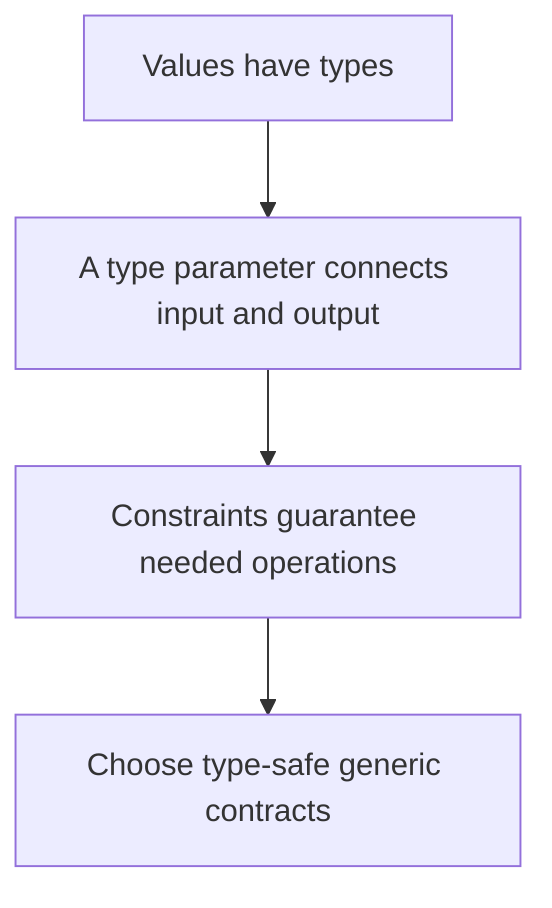

# Build type-safe generic contracts

2026-11-04 · [[Assets/Qard/Courses/Programming Mastery|Programming]] · `generic-contracts`

## Summary

The lesson connected assignment and compile-time types to generic methods and capability-based constraints. A generic type parameter preserves the relationship between input and output without recovering types through `object` casts. Constraints supply only the capabilities a method needs.

You identified the failing assignment, but confused a variable’s compile-time type with its boxed value’s runtime type and left A and B unanswered. You preserved the generic input/output relationship, but omitted the method’s `<T>` declaration and the explanation of type inference. You completed the capability check correctly. In the final contract check, your constraint and body were correct, but you omitted the requested `public` modifier and the reasons for excluding other constraints.

Keep practising complete method declarations, compile-time versus runtime types, and explaining why each constraint is necessary.

## Plan

We will start with assignment and types, drawing on what you have shown about value and reference types. Then we will use the Generics note to connect a caller-chosen type to a generic method, and add constraints only when the method needs a specific capability.



## Steps

### 1. Start with types and assignment

A variable has a compile-time type. That type determines which assignments and operations the compiler accepts. This applies to both value types, such as `int`, and reference types, such as `string`.

Consider:

```csharp
int number = 7;
object stored = number;
```

The first assignment stores an integer in an `int` variable. The second is also valid: C# allows an integer to become an `object` through boxing. Boxing wraps a copy of the value in an object.

Now consider reading it back:

```csharp
int recovered = stored; // Does not compile
```

The expression `stored` has compile-time type `object`. Its current contents do not change that type. An `object` variable could also hold a string, so its type alone cannot guarantee an integer. An explicit cast would require a runtime check.

Your **Generics** note describes the stronger alternative: preserve the specific type through an API so the compiler can check values entering and leaving it. First, distinguish the type an expression guarantees from the value it currently holds.

This first step builds on your understanding of value and reference types. Next, we will use a caller-chosen type parameter to preserve an assignment guarantee through a method.

**Check:** Consider these lines in order:

```csharp
int number = 12;          // A
object stored = number;  // B
int recovered = stored;  // C
```

Which lines compile, and why is any other line rejected even though the original value is an integer?

**My answer (0/3):** it will not compile since third line missing unboxing. object doesnt store what type i was before the boxing, so it will trust no values unless they explicitly converted to expected type from object

**Model answer:** A compiles because `12` is an `int`. B compiles because converting an `int` to `object` boxes the value. C fails because `stored` has compile-time type `object`, and there is no implicit conversion from `object` to `int`. Holding a boxed integer does not change the variable's compile-time type.

### 2. Carry a type through a method

A method’s declared return type determines the type the caller receives. Consider a method that returns its input:

```csharp
static object Echo(object value) => value;
```

Even when the input is `"Ada"`, the return type is `object`. Assigning that result to a `string` variable requires a cast: the signature does not preserve the relationship between the input type and the output type.

The **Generics** note introduces `T` as a type chosen by the caller. Use the same type parameter for the input and output:

```csharp
static T Echo<T>(T value) => value;

string name = Echo<string>("Ada");
int count = Echo<int>(42);
```

For `Echo<string>`, both occurrences of `T` mean `string`; for `Echo<int>`, both mean `int`. The compiler can therefore check each assignment without casts.

C# can also infer the type argument from the argument expression, allowing `Echo("Ada")` and `Echo(42)`. This uses compile-time types, not inspection of the value’s runtime type.

No constraint is needed: returning an input of type `T` as `T` requires no additional capability.

The previous step established that assignment depends on types. A generic method preserves the type relationship needed for assignment, moving toward a reusable contract that needs no recovery casts.

**Check:** This method only returns its input:

```csharp
static object Echo(object value) => value;
```

Rewrite it as one generic method so both assignments compile without casts:

```csharp
string name = Echo("Ada");
int count = Echo(42);
```

Explain how your signature makes those assignments possible.

**My answer (2/4):** static T Echo (T value) => value

**Model answer:** ```csharp
static T Echo<T>(T value) => value;
```

The compiler infers `T` as `string` for `Echo("Ada")` and `int` for `Echo(42)`. Because the input and return type use the same `T`, each call returns the type required by its assignment. Returning the input needs no constraint or cast.

### 3. Add a needed capability

A method body must be valid for every type its contract permits. Passing a value in and returning it requires no special capability. Calling `Validate()` does: the compiler needs evidence that the member exists.

The **Constraints** section of your **Generics** note describes constraints as the operations guaranteed for `T`. An interface can provide that guarantee:

```csharp
public interface IValidatable
{
    void Validate();
}

public static T ValidateAndReturn<T>(T value)
    where T : IValidatable
{
    value.Validate();
    return value;
}
```

The needed operation leads to the constraint: this method calls `Validate()`, so it requires `IValidatable`. The caller still chooses `T`, but that type must implement the interface. The compiler can therefore check the call inside the method and reject unsuitable type arguments at the call site.

A `class` constraint would establish only that `T` is a reference type; it would provide no `Validate()` member. A `new()` constraint is unnecessary because the method receives its value rather than constructing one. Choose the capability the body actually uses.

The previous step carried the caller’s chosen type from input to output. This step keeps that relationship and adds the guarantee needed to call a member safely, without an `object` cast.

**Check:** Given this interface and method:

```csharp
public interface IValidatable
{
    void Validate();
}

public static T ValidateAndReturn<T>(T value)
{
    value.Validate();
    return value;
}
```

Add the smallest constraint that makes `value.Validate()` compile without casts. Explain what it guarantees and why `where T : class` alone would not suffice.

**My answer (3/3):** where T : IValidatable, which will guarantee that T has Validate(); without casting. where T : class can guarantee that T will be a some class, which do not have to have Validate();

**Model answer:** ```csharp
public static T ValidateAndReturn<T>(T value)
    where T : IValidatable
{
    value.Validate();
    return value;
}
```

The constraint requires the chosen type to implement `IValidatable`, so the compiler knows that `value.Validate()` is available. `where T : class` only requires a reference type; reference types do not all provide `Validate()`.

### 4. Choose the contract

A method’s contract describes which inputs it accepts and what it returns. A type parameter connects those types: `T Process<T>(T value)` preserves the caller’s chosen type from input to output.

Next, inspect what the body must do. Returning the supplied value needs no constraint. Calling a particular member needs a guarantee that the member exists. As **Generics.md**, under **Constraints**, explains, an interface constraint supplies that capability to the compiler.

Each extra constraint needs its own reason. Receiving an existing value does not require `new()`: that constraint supports creating a value with `new T()`. Calling an interface member does not require `class`: both structs and classes can implement interfaces. A base-class constraint is appropriate when the required contract includes that inheritance relationship.

This gives a way to discover the signature: identify the type relationship to preserve, list the operations the body performs, then require only the capabilities those operations need. Converting to `object` and casting later loses compile-time information that the generic contract can carry directly.

The previous step made a required capability available through a constraint. Now combine that capability with the input/output type relationship, keeping every restriction tied to a requirement.

**Check:** Given this interface:

```csharp
public interface ICheckable
{
    void Check();
}
```

Write a public static generic method named `CheckAndReturn` that accepts an existing value, calls its `Check()` method, then returns that value with the caller’s chosen type preserved. It must accept both structs and classes that implement `ICheckable`, use no casts, and impose only the constraints it needs.

Explain why its constraints are sufficient and why neither `class` nor `new()` belongs in the contract.

**My answer (2/4):** static T CheckAndReturn<T>(T value) where T : ICheckable
{
    value.Check();
    return value;
}

where T : ICheckable is sufficient since it will guarantee that T will have Check methods, becaus eT must implement it. class & new() doesnt guarantee that

**Model answer:** ```csharp
public static T CheckAndReturn<T>(T value)
    where T : ICheckable
{
    value.Check();
    return value;
}
```

Using `T` for both input and output preserves the caller’s chosen type. `ICheckable` guarantees that `Check()` is available. Adding `class` would exclude structs that implement the interface. Adding `new()` would require a public parameterless constructor even though this method receives its value and creates no instance.
