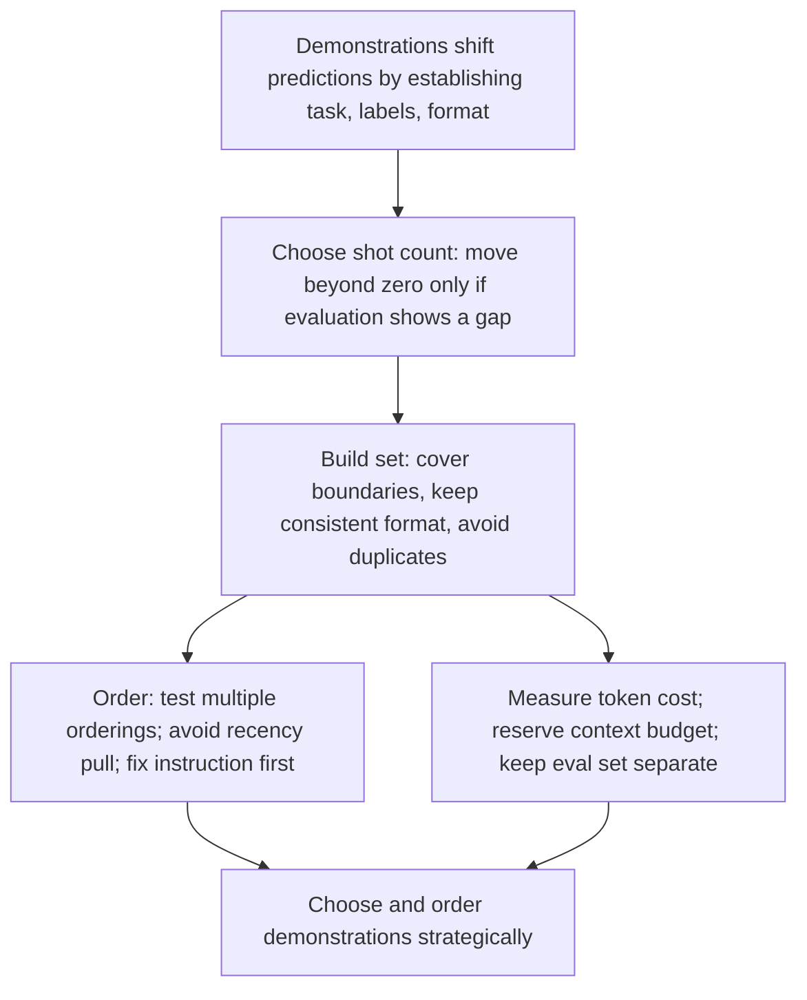

# Demonstrations: choosing, ordering, and budgets

2026-11-05 · [[Assets/Qard/Courses/AI & ML Mastery|AI & ML]] · `demonstration-effects`

## Summary

Lesson on how demonstrations fill a task interface in in-context learning: how zero, one and few shots work, when to move up from zero-shot, how to build a demonstration set, ordering pitfalls, and context-budget and leakage limits.

**What the student showed**
- Named few-shot prompting and one cost, but did not explain the mechanism. Demonstrations establish the task, output format and label space without any weight update.
- Diagnosed format problems and token cost correctly. Skipped the step of evaluating a zero-shot baseline first, then checking whether extra shots close a real gap.
- Dropped duplicate examples correctly. Missed that a reformatted example teaches format consistency.
- Spotted recency bias and knew that reordering tests it. Did not check first whether an ambiguous instruction or a format conflict is the real cause.
- Identified leakage and the need to separate demonstrations from evaluation data. Did not do the token-cost analysis that decides whether shots are worth keeping.

**Gaps to revisit**
- The mechanism: what demonstrations establish.
- The zero-shot baseline gate.
- Token cost against evaluation budget.

## Plan

You've mastered specifying task interfaces. Now you'll learn how demonstrations fill that interface—shifting the model's predictions through examples without expensive retraining. Start with how zero, one, and few shots work, then learn what makes a demonstration set effective: coverage of decision boundaries, consistent format, and avoiding wasted tokens. Finally, you'll trace the pitfalls—recency bias in ordering, and when to fix the instruction instead of adding more shots—and how to measure context cost against evaluation budget.

## Steps

### 1. How demonstrations work

Start with what never changes: an LLM predicts the next token. Its weights are fixed at inference time. So a prompt can change behaviour only by changing the text the model continues.

A demonstration is text of that kind. An input-output pair inside the prompt makes some continuations much more likely than others. Compare the two prompts below.

- **Instruction only:** "Extract customer, issue, severity." The model still has to guess the schema.
- **Instruction plus one pair:** the model now sees the JSON keys, the casing, and what a "low" severity looks like. The nearest pattern to continue is obvious.

So demonstrations establish three things: the **task**, the **label space** (the allowed outputs), and the **output shape** (format). *In-Context Learning* says this directly. The examples shift the prediction. They do not retrain the model, and the effect lasts only while the examples are in that request.

The shot count names the visible control:

- **Zero-shot:** instructions only.
- **One-shot:** one pair.
- **Few-shot:** several pairs.

Count is only part of the story. Min et al. (2022), cited in the note, found that format, label space and input distribution explain much of the gain. Example choice, order and formatting matter at least as much as the number of shots.

There is also a cost. Every example uses context that could have held the real input.

This opens the lesson. The task interface you already specified (instructions, inputs, constraints, outputs) is what demonstrations fill in. The later steps on choosing, ordering and budgeting examples all rest on this mechanism.

**Check:** A prompt says "Classify sentiment as Positive, Neutral, or Negative" and the model sometimes answers with a full sentence instead of one label. You add two input-output examples, and the answers become single labels. No model weights were updated.

Explain what the examples changed and why the effect appeared. Then name one cost of adding them.

**My answer (1/3):** It calls one-show/few-shot prompting, when we guide model by giving examples of expected output.  The cost is token usage, latency

**Model answer:** The model's weights never changed. It still predicts the next token, but the prompt now contains two input-output pairs. Those pairs show the allowed labels and the expected output shape, a single word, so the most likely continuation is now one label instead of a sentence. The effect is local: it applies only to requests that include the examples.

Cost: the examples take up context tokens on every request, leaving less room for the actual input. Behaviour can also shift if the examples are reordered or reformatted.

### 2. Decision gate: zero, one, or few

Two facts are already accepted. Demonstrations shift the next-token prediction without changing weights. Every demonstration also costs context tokens on every request.

A cost paid on every request needs a measured gain. So shot count is not a style choice. Evidence decides it, starting from the cheapest option.

1. **Zero-shot first.** *In-Context Learning* calls it the cheapest useful baseline. Every later technique must beat it by enough to justify the extra tokens and upkeep. It is enough when the instruction and labels already define the task.
2. **Evaluate, then read the failure.** The failure type picks the fix:
   - Task understood, **output shape** wrong (JSON keys, field order) → **one-shot**. One complete input-output pair shows the contract.
   - **Class boundaries** wrong between easily confused labels → **few-shot**. Several diverse examples show what prose describes poorly.
   - Inconsistent output from an **ambiguous instruction or mismatched example formats** → fix the instruction or format first. More shots amplify the problem.
3. **Keep a shot only if it earns its place.** Re-test on a representative evaluation set. Near-duplicate easy examples add tokens but no information.

Examples make a format likely, not guaranteed. A strict schema still needs structured outputs or validation.

Step 1 showed that demonstrations shift predictions by fixing task, label space and format. This step turns that into a decision rule: add shots only for a measured gap a demonstration can close, so the context budget is not wasted.

**Check:** A zero-shot support-ticket extractor gets the content right, but the JSON keys vary between runs (`issue`, `problem`, `description`). A teammate proposes adding 8 examples "just to be safe". What would you do instead, and why? Name the cost of the teammate's plan.

**My answer (2/3):** Teammates plan would improve the JSON keys in the reponses by leaning token prediction to the tokens we expect, but will not guarantee them, more over it will spend more tokens spending token context, increase the cost, and increase chance for the hallucinations. I would better pass expected json schema to the structured output parameter

**Model answer:** Add one complete input-output example showing the exact keys (`customer`, `issue`, `severity`). The content is already correct, so the gap is the output shape, and one pair is the lightest thing that closes it. Fix the instruction wording first if it does not name the keys. Then re-run the evaluation set to confirm the keys are stable.

Eight examples is a guess. Each shot costs context tokens on every request and leaves less room for the real input. Similar easy examples add tokens but no information. Add more shots only if evaluation shows a remaining gap, such as confused class boundaries. If strict keys are required, use structured outputs or schema validation, because examples only make the format likely.

### 3. Building an effective set

Each demonstration costs context on every request. The In-Context Learning note: "every demonstration also consumes context that could have held the actual input." So each example must teach something the others don't.

Ask what a demonstration can teach: the task, the label space, the output shape. Once an example has shown that, a near-copy shows nothing new. The note says it directly: "repeated easy examples mostly burn tokens."

What earns tokens:

- **Decision boundaries.** Prose describes the line between easily confused classes badly. Examples on either side of it describe it well. Easy cases the model already gets right teach nothing.
- **Consistent format.** Separators, casing and field order stay identical across examples. The model continues the nearest pattern, so a mismatched example gives it two patterns to choose from. Min et al. found that format, label space and input distribution explain much of few-shot performance.
- **Diversity over volume.** A few representative examples beat many near-duplicates.

What to drop: near-duplicates, trivially easy cases, and anything added to supply facts the model lacks. Demonstrations condition behavior; they do not store facts.

Selection rule: add an example for a measured format or boundary failure.

Step 2 decided when to move beyond zero-shot; this step decides what goes into the shots once you do, since every one costs tokens.

**Check:** A prompt extracts `severity` (low / medium / high) from support messages as JSON. The budget allows 4 demonstrations. Candidate pool:

1. "Tom reports typo in footer link." → `{"severity":"low"}`
2. "Sam reports typo in header link." → `{"severity":"low"}`
3. "Lee reports typo in sidebar text." → `{"severity":"low"}`
4. "Export is slow for one user; a workaround exists." → `{"severity":"medium"}`
5. "Ava is blocked from login after SSO migration." → `{"severity":"high"}`
6. "Checkout crashes on payment for all EU users." → `Severity: HIGH`

Which 4 would you use, what would you change, and why?

**My answer (1/3):** 1, 4, 5 - to show example of each severity example, and i thing that is enough. I was thinking adding 6 as bad example, but i think it might produce more hallucinations that prevent, i would better add example with case where severity impossible to identify with null response

**Model answer:** Keep one typo example (say 1), plus 4, 5 and 6.

- 1–3 are near-duplicates; one shows the low class and the other two only burn tokens.
- 4, 5 and 6 cover the medium/high boundary, which is where the model is most likely to err and which prose describes poorly.
- Example 6 uses `Severity: HIGH` while all others use lowercase JSON. Rewrite it as `{"severity":"high"}` so the format is consistent.

### 4. Pitfalls: ordering and iteration

A few-shot prompt is read top to bottom, and the model predicts the next token right after the last example. That makes the **last demonstration** the closest evidence when it answers. *In-Context Learning* calls this recency bias: later examples can get disproportionate influence.

Suppose the last three examples all carry the label `negative`. The model may lean toward `negative` on a new input, whatever the input says. The set is the same and only the order changed, but behaviour shifts. So order is tested, not assumed: run several fixed orderings on the same evaluation set. Randomising order can reduce systematic bias, but failures become harder to reproduce, so measure that tradeoff first.

The second trap is a wrong diagnosis. When output is inconsistent, adding shots feels like the fix. If the real cause is an ambiguous instruction or examples with mismatched formats, more shots **amplify** the problem, because each new example repeats the confusion. Each also costs context on every request.

Rule of thumb: check the instruction and example format first. Add or reorder shots only after both are clear, and re-evaluate after any reorder, format change, or model upgrade.

Step 3 built a set that covers boundaries in a consistent format; this step shows how that set still fails (order) and when to stop adding to it (fix the instruction first), which protects the context and evaluation budget.

**Check:** A 6-shot classifier gives inconsistent labels, and most predictions match the label of the last two demonstrations. A teammate proposes adding 6 more shots. (a) What does the pattern suggest, and how would you test it? (b) What would you check before adding shots, and why can adding them make things worse?

**My answer (2/4):** it is recency bias, instead of adding shots which will aplify the confusing, i would reorder shots, evaluation for each reorder, with choosing option where order produced least bias

**Model answer:** (a) The predictions track the last demonstrations, which points to recency bias: later examples are weighted more. Test it by running several fixed orderings of the same examples against the same evaluation set and comparing accuracy and label distribution. (b) Before adding shots, check whether the instruction is ambiguous or the examples use inconsistent formats or labels. If so, 6 more shots repeat and amplify the confusion rather than resolve it, and they also consume context on every request. Fix the instruction and format first, then re-evaluate.

### 5. Context and evaluation boundaries

Demonstrations are not free. Every example is sent on **every request**, so it consumes context that the real input, source material and output also need. In *In-Context Learning*, the fix is to measure the fixed token cost of the prompt and reserve room for the largest supported input and output. If that budget no longer fits, shorten the demonstrations or retrieve only the relevant ones.\n\nNow the second boundary. A demonstration set is tuned against an evaluation set. Ask what happens if an evaluation item (or a near-copy) is used as a demonstration. The model copies the label instead of solving the task, and the score rises without the prompt getting better. That is **leakage**. Demonstrations and evaluation items must therefore come from separate pools.\n\nThe same evaluation set also decides whether a shot stays. The note's gate: a prompt moves beyond zero-shot only when evaluation shows a gap that examples can close, and each added example stays only if it improves results on a *representative* held-out set. A model upgrade, reorder or format change means re-running it.\n\nSo each demonstration is judged on two numbers: tokens it costs per request, and score it adds on data it was not copied from.

Step 4 showed that order and iteration change results; this step gives the two constraints, token budget and clean evaluation, that decide which changes are worth keeping.

**Check:** A team has 40 labelled support tickets. They put 8 of them in a few-shot prompt, then score the prompt on all 40 and see accuracy jump from 70% to 95%. Each extra shot also adds about 150 tokens to every request.

Give **two** problems with how they measured this, and say what they should do instead.

**My answer (2/4):** 1. They need to separate tickets that they are using for shots, and for testing to prevent prompt overfitting, which probably produced high result.
2. I think they can start with fewer shots, and evaluate each variation of addition, and stop adding shots when accuracy improvement doesnt improve accuracy

**Model answer:** 1. **Leakage.** 8 of the 40 scored tickets are in the prompt as demonstrations. The model can copy their labels, so 95% overstates real performance. Fix: split the tickets into a demonstration pool and a held-out evaluation set, and score only on the held-out set.
2. **Cost not weighed.** 8 shots at ~150 tokens add ~1,200 tokens to every request, shrinking room for the ticket and the answer. Fix: compare zero-shot, 1-, 2- and 4-shot variants on the held-out set and keep only the shots whose gain justifies their tokens. Re-run after any model, order or format change.
