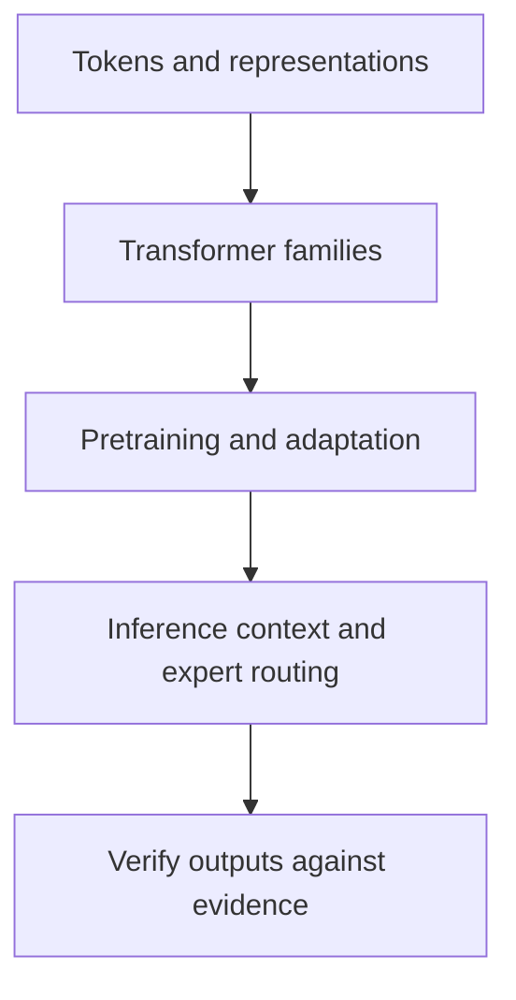

# From representations to LLM systems

2026-11-05 · [[Assets/Qard/Courses/AI & ML Mastery|AI & ML]] · `llm-mechanics`

## Summary

The lesson connected tokens and contextual representations to transformer families, training stages, inference context, sparse-expert routing, and verification. You passed all three tokens-and-representations checks, but reported guessing, so secure recall is not yet established. You reported not knowing the answers for transformer families (0/4), pretraining and adaptation (0/3), and inference context and sparse experts (0/4). These distinctions need further practice. The fluency-and-verification checks were also unsuccessful (0/4): your timing comparison was a useful starting point, but needed controlled conditions and checks that the source supports the claim. The central takeaway is that architecture determines attention and output structure, training changes learned parameters, context supplies information during inference, and sparse routing selects experts within a model. Fluent output alone does not establish correctness or verified reasoning.

## Plan

We’ll start with tokens and representations from your earlier lesson, checking what you remember before building on it. Then we’ll use the LLM note to connect model architecture and training to inference, expert routing, and verification.

## Steps

### 1. Tokens and representations

A neural network computes with numbers, so text must first be represented numerically. Your **LLM** note defines a token as an integer-ID unit produced by a particular tokenizer. A token can correspond to a word, part of a word, or punctuation; it is not necessarily one whole word.

The ID identifies a vocabulary entry. Its numerical size does not express meaning: token 200 is not twice as meaningful as token 100. To supply useful numerical features, the model looks up a learned vector for each token ID. This is its token embedding.

That lookup alone cannot distinguish different uses of the same token. Consider “They sat beside the bank” and “They deposited cash at the bank.” Assuming “bank” receives the same token ID, its lookup embedding is the same, but the surrounding words differ. Transformer layers combine information from the context their architecture permits, producing a contextual representation that can differ between these uses.

This explains why your note describes encoder-only models as producing contextual representations: their useful output can be vectors representing the input, without generating a new sentence.

This checks the numerical-representation foundation from your earlier lesson. Next, we can distinguish transformer families by which context they can use and whether they produce representations or generated text.

**Check:** Suppose the same tokenizer assigns “bank” the same token ID in “They sat beside the bank” and “They deposited cash at the bank.” Must its contextual representation also be identical? Explain using the distinction between a token ID and a contextual representation.

**My answer (3/3):** The contextual represention will not be identical because surrounding context changing meaning of the "bank". Token id represents just an id of a token, i assume for the performance to not calculate vector of the same token twice. Contextual representation vector should represent meaning of the tokens including attention of the tokens between each other which will produce different vectors based on the context

**Model answer:** No. The token ID identifies the same vocabulary entry in both inputs; it does not fix the word’s meaning in context. Although its token lookup embedding is the same, transformer layers incorporate surrounding context. The contextual representations can therefore differ, reflecting a river bank in one input and a financial institution in the other.

> **Q:** what is contextual representation?
> A **contextual representation** is a vector of numbers that represents a token after the transformer has processed it together with the context it can attend to.
> 
> For example, “bank” starts with the same token embedding in “river bank” and “bank account,” assuming the tokenizer assigns it the same token ID. Transformer layers combine information from surrounding tokens, so its resulting representation can differ between the two phrases. The vector captures features useful for interpreting the token in that context; it is not a human-readable definition.
> 
> Your **LLM** note describes encoder-only models as producing these representations. A task head can use them for classification or extraction without generating a sentence.
> 
> What information would help distinguish “bank” in “river bank” from “bank account”?

> **Q:** the surrounding tokens?
> Yes. The surrounding tokens provide clues: “river” points toward land beside water, while “account” points toward a financial institution.
> 
> As your **LLM** note describes, an encoder can attend to tokens on both sides. Its layers use that context to build a different representation of “bank” in each phrase. A decoder-only model has a different boundary: it can use earlier tokens, but not later ones.

### 2. Transformer families

Tokens become vectors, as in the previous step. **Attention** lets a token’s representation incorporate information from permitted positions. Two questions now separate transformer families: which positions are visible, and what does the model produce?

Your **LLM** note, under **Transformer Families**, distinguishes three designs:

- **Encoder-only**, such as BERT, reads an input bidirectionally: a token can use context on both sides. Its output is contextual representations. A task head uses these vectors for classification or extraction. There is no autoregressive decoder to keep generating text.
- **Encoder-decoder**, such as T5, separates reading from writing. The encoder reads the complete source bidirectionally. The decoder generates a separate target sequence, using earlier target tokens and attending to the encoder’s output. This fits translation: the source is already available while its translation is still being written.
- **Decoder-only**, such as GPT-style models, uses one causal stack to continue a prompt. Each next-token prediction uses the available prefix; future tokens are unavailable. Repeating this operation produces a continuation.

These are common task fits, not exclusive abilities: a decoder-only model can also translate. Architecture determines information flow and output structure; it does not establish whether a fluent answer is correct.

The previous step established tokens and vector representations; this step explains how attention connects those representations and how outputs emerge. These distinctions prepare us to separate architecture from training, inference context, and verification.

**Check:** An application translates a complete source sentence into a new target sentence. Explain why an encoder-decoder architecture fits this task, including what information its encoder and decoder can use. Then contrast its output path with those of encoder-only and decoder-only models.

**My answer (0/4):** _I didn't know._

**Model answer:** The complete source is available, so the encoder can build representations using context from both directions. The decoder then generates a separate translation one token at a time, attending to the encoded source and using earlier target tokens without seeing future target tokens.

An encoder-only model produces contextual representations for a task head and has no autoregressive decoder. A decoder-only model uses one causal stack to generate a continuation of its prompt. It can also translate when prompted; translation is not exclusive to encoder-decoder models.

### 3. Pretraining and adaptation

A model’s architecture defines its computation. Its learned parameters determine how that computation responds to inputs. Training adjusts those parameters toward an objective.

Your **LLM** note’s **Training Pipeline** separates three stages. **Pretraining** learns from a large corpus using a language objective: predicting masked tokens for BERT, reconstructing missing spans for T5, or predicting the next token for GPT-style models. These tasks develop language representations and patterns useful across many tasks. Their output is a **base checkpoint**; predicting text does not automatically make it a conversational assistant.

To encourage instruction-following, training can use examples pairing instructions with desired responses. This is **supervised fine-tuning (SFT)**: parameter updates make those responses more likely. Full fine-tuning updates the model’s weights; parameter-efficient methods train a smaller set of parameters.

A later **preference or reward optimization** stage uses output comparisons or reward signals to favor particular behavior. It provides a different training signal from SFT’s example responses.

These stages can change behavior while keeping the same transformer family. Unlike ordinary prompting, they update learned parameters. Better instruction-following and fluent explanations still do not establish correctness: a training signal encourages behavior, while verification checks a particular result.

The previous step distinguished transformer families by their computation and attention boundaries. This step separates that architecture from the training stages that shape behavior, explaining why the same family can produce different behavior without guaranteeing verified reasoning.

**Check:** Checkpoint A is a decoder-only model pretrained to predict the next token in a large text corpus. Checkpoint B starts from A and receives further training on instruction–response examples, keeping the same architecture. Explain why B may follow instructions better, and whether its fluent answers establish correctness.

**My answer (0/3):** _I didn't know._

**Model answer:** A learns to predict text continuations; that objective does not directly require helpful responses to instructions. B receives supervised fine-tuning on desired instruction–response pairs, which updates learned parameters toward that behavior while preserving its decoder-only architecture. B may therefore follow instructions better, but fluent answers can still be wrong. Correctness needs support from evidence or checks appropriate to the answer.

### 4. Inference context and sparse experts

Training changes model parameters. Inference executes the trained model on an input. This distinction explains how a model can use new information without another training stage.

Your **LLM** note defines the context window as a limited token budget covering instructions, conversation history, evidence, tool results, and output allowance. Suppose a document changes after training. Placing its updated text into the request gives the model that evidence during inference; it does not update the model’s weights. Retrieval-augmented generation (RAG) selects relevant material and puts it into this context. The evidence can guide an answer, but its presence does not prove the answer used it correctly.

Context determines what information is available. Sparse mixture-of-experts (MoE) routing determines which internal expert networks process a token’s representation. At an MoE layer, a learned router scores experts, selects a small subset, and combines their outputs. These experts are parts of one model, not separate assistants retrieving documents or checking facts.

Activating fewer experts saves feed-forward arithmetic compared with evaluating every expert. All expert parameters still need storage, and routing, communication, and uneven workloads add costs. Therefore, sparse activation alone cannot establish lower response latency; that requires measurement.

Pretraining and adaptation explain how the model’s parameters were learned. Context and expert routing explain how a trained model uses request-time information and computation, while leaving answer verification as a separate task.

**Check:** An application retrieves an updated policy document and includes it in a request to a frozen sparse MoE model. At each routed layer, the router selects two of eight experts for each token.

Explain how the updated policy can affect the answer without training, what the router selects, and why selecting two experts does not by itself prove a faster response.

**My answer (0/4):** _I didn't know._

**Model answer:** The updated policy enters the context as request-time evidence. It can influence generated tokens even though the model’s weights remain unchanged.

At each routed layer, the learned router selects two internal expert networks for each token’s hidden representation and combines their outputs. It is not selecting policy documents or separate assistants.

Evaluating two experts requires less expert feed-forward arithmetic than evaluating all eight. Actual response time also includes routing, communication and load imbalance, so faster responses require measurement on the intended workload.

### 5. Fluency and verification

Generating a claim and checking that claim are different operations. From the previous step, a decoder produces tokens using its learned weights and available context. Those mechanisms explain how an answer is produced; they do not establish whether its claims match reality.

Your **LLM** note states that “Fluent output remains a candidate result until grounding and validation support it.” A clear explanation can contain a false premise, an unsupported inference, or an invented citation. Adding more explanation does not independently check those weaknesses.

Verification therefore starts with the claim being made. For a factual claim, inspect a reliable source and check that it supports that exact claim. For a performance claim, measure the relevant workload under comparable conditions. A citation supports only what its source establishes; a benchmark supports conclusions within its tested conditions.

For example, fewer active MoE parameters can reduce some arithmetic. They do not establish lower latency because routing, communication, and batching also affect execution. Fluent reasoning makes the proposed explanation readable. Evidence and measured results determine how much confidence it deserves.

The previous step explained what context supplies and how sparse experts process tokens. This step separates those generation mechanisms from the evidence needed to trust an answer, completing the distinction between model capability and verified results.

**Check:** An assistant writes: “Model A uses half as many active parameters per token as Model B, so it will answer our requests twice as fast.” It gives a polished explanation and cites a technical report, but provides no timing results.

How would you assess and verify this claim before relying on it?

**My answer (0/4):** I would infer the model with the same input with monitoring inference time and compare them

**Model answer:** The twofold speedup is unverified. A polished explanation and a citation do not establish it. Active parameter count describes only part of computation; routing, communication, batching, and kernels can also affect latency.

I would inspect the report to see whether it actually demonstrates the speedup or only lists parameter counts. Then I would measure both models on representative requests using comparable hardware, precision, input and output lengths, and serving load. Any resulting speed claim should be limited to those tested conditions.
