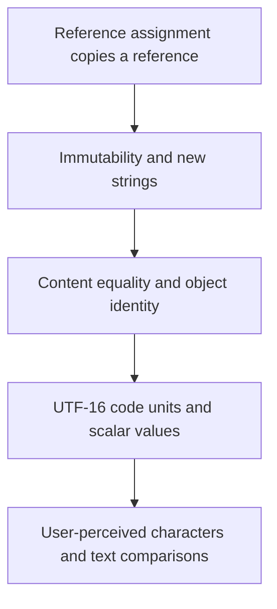

# From references to text semantics

2026-11-05 · [[Assets/Qard/Courses/Programming Mastery|Programming]] · `text-semantics`

## Summary

The lesson connected reference assignment and string immutability to allocation, equality, and Unicode representation. You correctly traced initial reference sharing, but confused reassignment with changing the shared string object. During repeated concatenation, you traced outputs and references correctly but did not identify the string constructed in each iteration. You distinguished content equality from object identity correctly throughout those checks. You correctly counted UTF-16 code units and Unicode scalar values in the dedicated check, though your confidence was low. In the grapheme check, you recognized the user-perceived character and equality result correctly but miscounted scalar values. Keep practicing reassignment, intermediate string construction, and the distinction between code units, scalar values, and grapheme clusters.

## Plan

We will start with reference assignment, which you have practiced, and use it to trace immutable strings. Then you will connect allocation and equality to how strings are represented, using your Strings note as the guide.



## Steps

### 1. Trace reference assignment

A reference-type variable holds a reference to an object. Assignment copies the value held by the variable, so assigning one reference-type variable to another copies the reference.

Your **Strings** note identifies `string` as a reference type. Apply the assignment rule:

```csharp
string first = "hello";
string second = first;
```

After the second line, both variables refer to the same string object. Copying the reference does not create another string object. The variables themselves remain separate: each holds its own copy of the reference.

Now consider:

```csharp
second = "goodbye";
```

This assignment replaces the reference held by `second`. It does not assign anything to `first`, so `first` still refers to the string containing `"hello"`.

The note also states that strings are immutable: an existing string's contents cannot change. Reassigning a variable changes which string it refers to. Keeping the variable separate from the object it refers to lets us trace both facts without confusing them.

This builds on the reference assignment you have practiced. Tracking references first gives us the foundation for predicting string allocations and distinguishing shared objects from equal text.

**Check:** Trace this code:

```csharp
string a = "north";
string b = a;
a = "south";
Console.WriteLine(b);
```

Immediately after `string b = a;`, how are the two variables related to the string object? What does the final line print, and why?

**My answer (1/3):** both a and b storing references to the string object (since it is reference type), so final print of b will product "south" since we changed object from the reference stored in a which changed b as well

**Model answer:** After `b = a`, both variables refer to the same string object containing `"north"`. The final line prints `north`. Assigning `"south"` to `a` changes only the reference held by `a`; `b` still refers to the original string.

### 2. Trace immutable string construction

In **Strings.md → Core Properties**, a string is a reference type whose contents are immutable: once a string exists, its text cannot change. A variable holding its reference can still be assigned a different reference.

Start with two variables referring to the same string:

```csharp
var original = "cat";
var text = original;
text = text + "s";
```

Assignment copied the reference, so both variables initially refer to `"cat"`. Concatenation needs the text `"cats"`. Because the existing string cannot change, concatenation creates a different string containing that result. Assignment then makes `text` refer to it. `original` still refers to `"cat"`.

Now suppose another statement appends `"!"`. It creates `"cats!"` and assigns that reference to `text`. The earlier `"cats"` string was an intermediate result; it was never extended in place.

This explains the repeated-concatenation cost described in **Strings.md → Pitfalls**: successive appends can allocate successive strings and copy the growing text repeatedly. A `StringBuilder` supports mutable construction when that repeated work matters.

The previous step traced how assignment copies a reference. Keeping that rule while adding immutability lets us predict which variables change references and where constructing changed text requires another string.

**Check:** A string's contents cannot change, but a variable can receive a different reference. Use that rule and reference assignment to trace this code:

```csharp
var original = "go";
var text = original;

for (var i = 0; i < 2; i++)
{
    text += "!";
}

Console.WriteLine(original);
Console.WriteLine(text);
```

What two lines are printed? Which string does each loop iteration construct, and why does `original` keep its initial text?

**My answer (3/4):** the output will be:
go
go!!

It will happen because on first text += "!" we will basically do text = text + "!" which is basically text = new String(text + "!") on each iteration , so we will re-instantiate variable with new reference, which unlinks text from original.

**Model answer:** The output is:

```text
go
go!!
```

Initially, both variables refer to `"go"`. The first iteration constructs `"go!"` and assigns its reference to `text`. The second constructs `"go!!"` and assigns that reference to `text`.

`original` still refers to `"go"`. Neither concatenation changes an existing string, and assigning a new reference to `text` does not change `original`.

### 3. Compare content and identity

Assignment copies a reference. Two variables can therefore point to one string object. Immutability means that object's text cannot change; it does not mean every equal piece of text must share one object.

This gives us two different questions: **Do these strings contain equal text?** and **Do these references point to the same object?** Your **Strings** note distinguishes them under **Core Properties** and **String Interning**.

For variables typed as `string`, `==` compares content: the same UTF-16 code units in the same order, with case respected. `object.ReferenceEquals(a, b)` checks object identity. Two separately constructed strings can therefore make `a == b` true while `ReferenceEquals(a, b)` is false.

Interning connects these ideas. `string.Intern(s)` returns the pool's shared reference for that content. Interning two equal strings returns the same reference, even if the original objects were separate. It does not change their text or reassign the original variables. Identical literals typically share an interned object too, so content alone cannot tell us whether references share an object.

The previous step traced how constructing changed text leaves the original object unchanged. Now we can distinguish whether construction produced equal content, a shared object, or both—separate questions when predicting string behavior.

**Check:** Predict the four printed Boolean values in order. Give a brief reason for each.

```csharp
string a = new string(new char[] { 'h', 'i' });
string b = new string(new char[] { 'h', 'i' });
string c = a;

Console.WriteLine(a == b);
Console.WriteLine(object.ReferenceEquals(a, b));
Console.WriteLine(object.ReferenceEquals(a, c));
Console.WriteLine(object.ReferenceEquals(
    string.Intern(a), string.Intern(b)));
```

**My answer (4/4):** true - bause the content are ideantical
false - since we are comparing references, not a content, which is different for both object
true - because by doing c = a we assigned ref stored in a to c, then compared them, and they are equal
true - Interning two equal strings will return the same reference, even if the original objects were separate, so comparing their references will return true

**Model answer:** The outputs are **True, False, True, True**.

1. `a == b` is `True`: both strings contain `hi`, and string `==` compares content.
2. `ReferenceEquals(a, b)` is `False`: each constructor call creates a separate string object.
3. `ReferenceEquals(a, c)` is `True`: `c = a` copies the reference, so both point to the same object.
4. The final comparison is `True`: both `Intern` calls return the pool's shared reference for `hi`. The original variables `a` and `b` still refer to their separate objects.

### 4. Count UTF-16 code units and scalar values

The previous step separated a string's content from the identity of its object. Now we need to identify what units make up that content.

Your **Strings** note, under **Encoding and Unicode**, states that a .NET string stores UTF-16 code units. Each code unit is 16 bits, and a C# `char` holds exactly one. `Length` counts these units; indexing retrieves one unit.

Unicode uses numbered code points to represent text. A Unicode scalar value is a code point other than a surrogate code point. UTF-16 represents a scalar value using either one code unit or two. The two-unit representation is called a **surrogate pair**: its two halves together encode one scalar value.

For example, `"X👍"` contains one code unit for `X` and two for `👍`. Its `Length` is therefore 3, although it contains 2 scalar values. Indexing at `[1]` retrieves the first surrogate, so that `char` alone does not represent the complete emoji.

`EnumerateRunes()` reads scalar values, combining valid surrogate pairs. Even scalar values do not always match user-perceived characters; combining marks introduce another boundary.

Content equality and object identity answer different questions; code-unit counts and scalar-value counts do too. Understanding the stored units makes string length and indexing predictable.

**Check:** Given `var s = "A👍B";`, determine `s.Length`, the number of Unicode scalar values returned by `s.EnumerateRunes()`, and whether `s[1]` represents the complete thumbs-up emoji. Explain using UTF-16 code units.

**My answer (3/3):** The length will be 4 since 👍 contain 2 code units for emoji. s.EnumerateRunes() will return 3 because we have 3 scalar values here, s[1] will will return first surrogate of the emoji

**Model answer:** `s.Length` is **4**: one code unit for `A`, two for `👍`, and one for `B`. `s.EnumerateRunes()` returns **3 scalar values**: `A`, `👍`, and `B`. `s[1]` is the high surrogate—the first half of the pair—so it does not represent the complete emoji.

### 5. Recognize user-perceived characters

A Unicode scalar value identifies one Unicode value. It does not necessarily represent a complete visible character. Your **Strings** note, under **Encoding and Unicode**, introduces the next boundary: a **grapheme cluster**, which approximates one user-perceived character.

Consider `"e\u0301"`. The scalar value `e` supplies the base letter; `\u0301` supplies a combining acute accent. Together they display as **é**. Both values fit into one UTF-16 code unit each, so this string contains two code units, two scalar values, and one grapheme cluster.

This explains why counting runes does not always give the visible character count. It also explains why deleting one rune can remove only the accent. To count or cut text at user-perceived character boundaries, use text-element APIs such as `System.Globalization.StringInfo`.

Appearance also differs from stored content. `"\u00E9"` stores the precomposed **é** as one scalar value. It is canonically equivalent to `"e\u0301"`, but their UTF-16 sequences differ, so string `==` returns `false`. Normalizing both strings to the same Unicode normalization form makes these two sequences equal. Normalization handles canonical equivalence; it does not make every pair of lookalike symbols equal.

The previous step separated UTF-16 code units from scalar values. Grapheme clusters add the boundary needed for visible text operations, while normalization explains why matching appearance alone does not establish string equality.

**Check:** In `s = "e\u0301"`, the combining acute accent joins the preceding `e`, displaying **é**. Let `t = "\u00E9"`, the precomposed **é**.

Which description correctly gives `s`'s UTF-16 code-unit count, scalar-value count, grapheme-cluster count, and the result of string `s == t`?

**My answer (2/3):** 2 code units, 1 scalar value, 1 grapheme cluster; equality is false.

**Model answer:** The first option is correct. `e` and the combining accent are separate scalar values, each occupying one UTF-16 code unit. Together they form one grapheme cluster. String `==` returns `false` because `s` stores two code units while `t` stores one. Normalizing both to the same normalization form makes this canonically equivalent pair equal.
