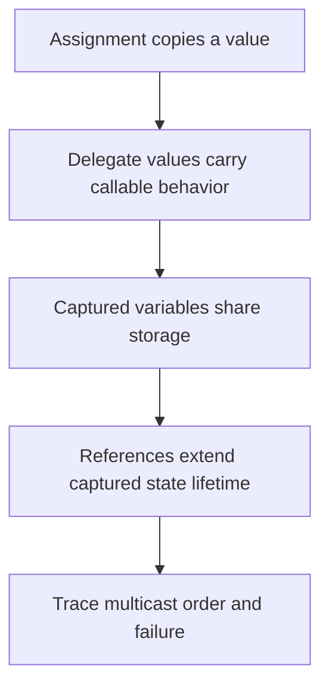

# Trace delegates and captured state

2026-11-05 · [[Assets/Qard/Courses/Programming Mastery|Programming]] · `delegate-contracts`

## Summary

The lesson covered delegate assignment and invocation, shared captured variables, captured-state lifetime, and multicast execution when a handler throws. You correctly traced a copied delegate reference, but treated later reassignment as changing both variables. You traced captured values correctly, but did not explain that the delegates share captured storage. Captured-state lifetime remained a gap. For multicast calls, you tracked successful state changes, but missed parts of the printed output and the effect of an exception on the receiving assignment. Further practice should connect each trace to the underlying rule: assignment copies a reference, closures retain variables, and exceptions interrupt execution without undoing earlier effects.

## Plan

We will start with your existing understanding that assignment copies a value, because a delegate can be stored and passed as a value. Using the Delegates note, we will build toward tracing captured variables, their lifetime, and multicast calls when a handler fails.



## Steps

### 1. Delegate values and invocation

Assignment copies a value into a variable. To trace delegates, first identify what that value represents.

Your **Delegates** note defines a delegate type as a callable method signature: the parameter types it accepts and the return type it produces. For example:

```csharp
static int Double(int x) => x * 2;

Transform operation = Double;
int result = operation(3); // 6

public delegate int Transform(int value);
```

`Transform` describes a call that takes one `int` and returns an `int`. `Double` fits that contract. Assigning `Double` creates a delegate referring to that method; it does not execute the method. The parentheses in `operation(3)` invoke it, supplying `3` as the argument.

Delegate types are reference types. Assigning `saved = operation` copies the reference to the delegate object. Both variables then refer to the same callable object; neither contains a previously calculated result.

The variables remain separate storage locations. Reassigning `operation` changes which delegate that variable refers to. It does not reassign `saved`. This distinction lets us trace which method a later invocation actually calls.

This first step builds on your understanding that assignment copies a value. Separating the delegate object from the variable holding its reference prepares us to trace captured state and multicast invocation.

**Check:** A `Transform` delegate refers to a method taking one `int` and returning an `int`. Trace this code: what value does `result` receive, and why?

```csharp
static int Twice(int x) => x * 2;
static int PlusOne(int x) => x + 1;

Transform first = Twice;
Transform second = first;
first = PlusOne;
int result = second(4);

public delegate int Transform(int value);
```

**My answer (1/3):** result will be 5.
first initially will have ref to Twice, second will have ref from the first, to the same method, then methond under first reference was changed, and since the same ref is in the second too, it will be changed as well, so method will be not PlusOne for both, and result will be 5

**Model answer:** `result` is `8`. `second = first` copies the reference to the delegate referring to `Twice`. Reassigning `first` to a delegate referring to `PlusOne` changes only `first`. Therefore, `second(4)` still calls `Twice(4)`, which returns `8`.

### 2. Captured variables

A variable provides storage for a value. With `int snapshot = count;`, assignment copies the current integer into separate storage. Later assignments to `count` do not change `snapshot`.

A lambda can also use a variable declared outside its body. This is called **capturing** the variable. Your **Delegates** note, under **Closures**, states that delegates capturing the same variable share its storage.

Consider:

```csharp
int threshold = 10;
Func<int, bool> above = x => x > threshold;
threshold = 20;
bool result = above(15);
```

Creating `above` stores callable behavior; it does not run the comparison. When `above(15)` runs, it reads `threshold` from the captured storage. That storage now contains `20`, so the result is `false`.

The distinction is between copying a value into another variable and creating behavior that accesses an existing variable. To trace a callback, first identify which variable it captures, then follow changes to that variable until invocation.

Step 1 established that creating or storing a delegate does not invoke it. Captured storage explains which state its behavior reads when it eventually runs, preparing us to trace that state beyond the creating scope.

**Check:** Here, `Func<int>` represents a call with no arguments that returns an integer; `Action` represents a call with no arguments and no return value.

```csharp
int count = 2;
int snapshot = count;
Func<int> read = () => count;
Action increment = () => count++;

count = 5;
increment();
Console.WriteLine(read());
Console.WriteLine(snapshot);
```

What two numbers are printed, in order? Explain which storage `read` and `increment` access and why `snapshot` behaves as it does.

**My answer (2/3):** output will be:
6 - 2 was changed to 5, then incremented via increment(); to 6
2 - int is the value type, so in snapshot will be copy of the current count value, which is 2.

**Model answer:** The output is:

```text
6
2
```

Both lambdas capture the same `count` storage. Assignment changes it to `5`; calling `increment()` changes it to `6`; calling `read()` reads that `6`. The earlier assignment to `snapshot` copied the integer `2` into separate storage, which remains unchanged.

### 3. Captured state lifetime

A variable's scope determines where its name can be used. Its lifetime determines how long its storage remains available. These are different questions.

Your **Delegates** note, under **Closures**, establishes that a capturing delegate uses the captured variable's storage. Suppose a method creates `count`, then returns a delegate that increments it. Returning ends the method call, but the returned delegate still needs that storage when invoked later. The captured storage therefore survives the method's return.

Follow the references: the caller holds the delegate, and the delegate keeps the captured state reachable. Each invocation accesses the same `count`, so changes persist between calls. Copying the delegate reference gives another way to reach that same state; it does not create another counter.

This extends the note's capture rule using standard C# lifetime behavior. When nothing reachable retains the captured state, it becomes eligible for garbage collection. Collection need not happen immediately. Leaving the original scope alone does not make captured state unreachable.

The previous step established which variable a delegate accesses. Following references now explains why that variable remains available for later calls, preparing us to trace state changes across multicast handlers.

**Check:** Here, `Func<int>` means a delegate that takes no arguments and returns an `int`.

```csharp
static Func<int> MakeCounter()
{
    int count = 0;
    return () => ++count;
}

var first = MakeCounter();
var second = first;

Console.WriteLine(first());
Console.WriteLine(second());
```

What does this print, and why can both calls access `count` after `MakeCounter` has returned? (`++count` increments first, then returns the new value.)

**My answer (0/3):** _I didn't know._

**Model answer:** It prints:

```text
1
2
```

`second = first` copies the delegate reference, so both calls use the same captured `count`. The first call changes it from 0 to 1; the second changes it from 1 to 2. Although `MakeCounter` has returned, the caller retains the delegate, which keeps the captured storage reachable.

### 4. Multicast invocation and failure

A delegate invocation is a method call. If that method changes a captured variable, the change remains after the method returns.

Your **Delegates** note, under **Multicast Delegates**, extends this to an ordered list of handlers. Combining delegates with `+=` adds handlers to that list. A direct invocation calls them synchronously, one after another, in registration order. If handlers capture the same variable, each sees the changes made by earlier handlers.

For a delegate that returns a value, each handler computes its own result. If every handler completes normally, the whole invocation returns only the last handler’s result. Earlier results are discarded; their changes to shared state remain.

Now consider a handler that throws an exception which it does not catch. Its call cannot finish normally, so the multicast invocation stops there. Later handlers do not run, and the exception propagates to the caller. The whole invocation returns no value, even if earlier handlers returned successfully. Changes already made to captured state remain: an exception does not automatically undo them.

A `try/catch` around the whole invocation catches that failure, but does not resume the remaining handlers.

The previous step established why captured storage can remain alive with a delegate. This step traces how an ordered list of handlers reads and changes that storage, including where a failure stops execution.

**Check:** Trace this code twice: first with `fail = false`, then with `fail = true`. Each run starts fresh with `state = 0` and `result = -1`.

```csharp
bool fail = false;
int state = 0;

Func<int> pipeline = () =>
{
    state += 1;
    return state;
};

pipeline += () =>
{
    state += 10;
    if (fail)
        throw new InvalidOperationException();
    return state;
};

pipeline += () =>
{
    state += 100;
    return state;
};

int result = -1;
try
{
    result = pipeline();
}
catch (InvalidOperationException)
{
}

Console.WriteLine($"{state}, {result}");
```

What line is printed in each run? Explain which handlers run and why `result` ends with that value.

**My answer (1/4):** false - it will print 111, since we made multicast delegate that capture state variable, and modifies it per each delegate we registred.
true - it will print -1, since state didnt reached return on the second delegate, and was thrown, so state wasnt assigned to the return, and default -1 value was used

**Model answer:** With `fail = false`, the output is `111, 111`. The handlers run in registration order, changing `state` to 1, then 11, then 111. The whole invocation returns the third handler’s value, 111.

With `fail = true`, the output is `11, -1`. The first handler makes `state` 1. The second makes it 11, then throws. That change remains, but the third handler is skipped. The exception reaches the surrounding catch. Because `pipeline()` never returns a value, `result = pipeline()` never completes its assignment, leaving `result` at -1.
