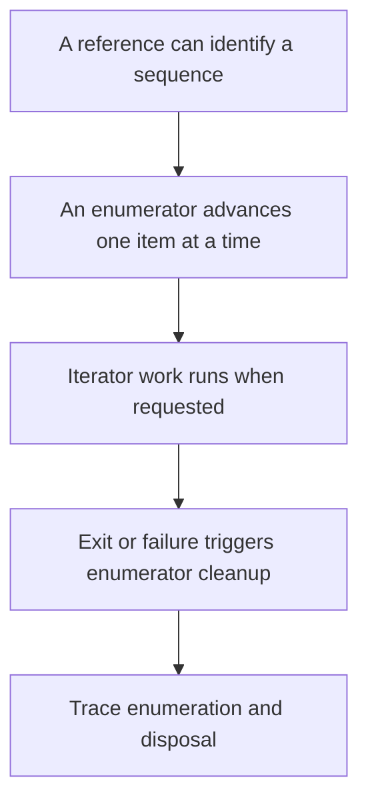

# Trace iteration and cleanup

2026-11-05 · [[Assets/Qard/Courses/Programming Mastery|Programming]] · `iteration-contracts`

## Summary

The lesson connected sequences and enumerators to value and reference semantics, then traced `MoveNext()`, `Current`, deferred iterator execution, and cleanup.

You traced individual iterations correctly (4/4, sure). Enumerator setup remains a gap (0/3, guess): a new enumerator starts **before** the first element. Deferred execution also needs practice (0/4, sure): you started the iterator body too early and missed the work performed by the second `MoveNext()`. Cleanup was omitted in all four exit and failure runs (0/4, sure).

The main practice targets are separating sequence creation from execution, resuming after each `yield return`, and including cleanup on completion, early exit, and exceptions. High confidence on the last two checks did not match the results.

## Plan

We will start with the value and reference semantics you have already practised, then connect them to a sequence and its enumerator in the Foreach note. We will build a trace one request at a time, including when iterator code runs and how cleanup follows completion, early exit, or failure.



## Steps

### 1. Connect a sequence to an enumerator

A reference variable identifies an object. Assigning that reference to another variable gives both variables access to the same object; it does not copy the object.

The **Foreach** note introduces a second role: the **enumerator**, which tracks progress through a sequence. The source provides access to values; the enumerator records where one traversal has reached. This distinction lets two loops traverse the same list without sharing a position.

For a `List<int>`, each call to `GetEnumerator()` obtains independent traversal state. Initially, an enumerator is positioned before the first element. Calling `MoveNext()` attempts to advance it: `true` means an element is available, and `Current` supplies that element. A later `MoveNext()` returning `false` means the traversal has finished.

Consequently, sharing a list reference does not make separately obtained enumerators advance together. Moving one changes its traversal position, while the other retains its own position. Neither movement changes the list's elements.

This gives us the first tracing rule: identify the source, then track each enumerator's position separately. For each successful `MoveNext()`, determine which value `Current` now supplies.

Your reference practice explains why two variables can identify the same list. Tracking traversal state separately prepares us to trace when iterator code runs and which enumerator must be cleaned up.

**Check:** Each call to a list's `GetEnumerator()` starts an independent traversal before its first element. `MoveNext()` advances that traversal; after success, `Current` supplies its element.

What does this code print, and how do the shared references and traversal positions explain the result?

```csharp
var source = new List<int> { 10, 20 };
var alias = source;

var first = source.GetEnumerator();
var second = alias.GetEnumerator();

first.MoveNext();
first.MoveNext();
second.MoveNext();

Console.WriteLine($"{first.Current}, {second.Current}");
```

**My answer (0/3):** i think it will return "null, 20". I thing current for enumerator starts from the first element, and moving forward twice will go out of the list bounds. Second will traverse to the second element on single call.

**Model answer:** It prints `20, 10`. `source` and `alias` reference the same list, but the two `GetEnumerator()` calls obtain independent traversal state. `first` advances to `10`, then `20`; `second` advances only to `10`.

### 2. Trace each iteration

An enumerator holds the position of one traversal. As the **Foreach** note explains, `GetEnumerator()` obtains it before the first item. Obtaining an enumerator does not give the loop an item yet.

The loop needs to know whether an item exists before using it. It therefore calls `MoveNext()` first. If the result is `true`, the loop reads `Current`, assigns that value to the iteration variable, and runs the body. Only after the body finishes does the loop request another item through `MoveNext()`.

This gives a repeating order: **advance → read → use**. Each successful advance permits one execution of the body. A `false` result ends the repetition: the loop neither reads `Current` nor executes the body for that request.

For two items, completing the loop therefore requires three calls to `MoveNext()`: two successful requests and one final request that discovers exhaustion. Keeping requests separate from successful iterations makes the trace predictable.

The previous step separated the sequence from its enumerator. Now we follow that enumerator’s requests in order, establishing where deferred producer work and cleanup will fit later.

**Check:** A custom enumerable produces `4`, then `7`, then ends. Its members log each call as follows:

- `GetEnumerator()` logs `GetEnumerator`.
- `MoveNext()` logs `MoveNext: true` or `MoveNext: false`, matching its result.
- Reading `Current` logs `Current: 4` or `Current: 7`, matching the current item.

The consumer runs:

```csharp
foreach (var item in source)
{
    Console.WriteLine($"Body: {item}");
}
```

Write the complete log in order, ending with the `MoveNext()` call that returns `false`. No call throws, and the loop runs to completion. Leave disposal out of this trace.

**My answer (4/4):** GetEnumerator
MoveNext: true
Current: 4
Body: 4
MoveNext: true
Current: 7
Body: 7
MoveNext: false

**Model answer:** ```text
GetEnumerator
MoveNext: true
Current: 4
Body: 4
MoveNext: true
Current: 7
Body: 7
MoveNext: false
```

Each successful request is followed by a `Current` read and the body. The final unsuccessful request ends the loop.

### 3. Trace deferred iterator execution

The **Foreach** note’s “Iterators and Yield” section connects the requests you already traced to execution inside an iterator method.

An enumerator tracks progress through a sequence. For a method returning `IEnumerable<int>` through `yield`, that progress includes a saved position in the method body. Calling the method obtains the sequence without running its body. `GetEnumerator()` obtains the enumerator; the first `MoveNext()` starts the body.

Execution continues until `yield return` supplies a value. The enumerator makes that value available through `Current`, and `MoveNext()` returns `true`. The body is now suspended. Reading `Current` does not resume it.

Another `MoveNext()` resumes execution immediately after the suspended `yield return`. It runs until another yield, completion, or an exception. Completion returns `false`; an exception escapes from that particular `MoveNext()` call.

This gives a way to discover the trace: move through the consumer until it requests an item, then follow the iterator until it yields, finishes, or throws. Side effects occur only when execution reaches their statements.

Previously, you traced `MoveNext()`, `Current`, and the loop body. Now you can trace the work each request triggers inside the iterator, locating failures before following their cleanup in the final step.

**Check:** Trace this code. What lines are printed, in order, and which operation causes the iterator to reach `throw`?

```csharp
IEnumerable<int> Values()
{
    Console.WriteLine("start");
    yield return 7;
    Console.WriteLine("resume");
    throw new InvalidOperationException();
}

var sequence = Values();
Console.WriteLine("created");
using var e = sequence.GetEnumerator();
Console.WriteLine("obtained");
e.MoveNext();
Console.WriteLine(e.Current);

try
{
    e.MoveNext();
}
catch (InvalidOperationException)
{
    Console.WriteLine("caught");
}
```

**My answer (0/4):** it will print:
created
start
obtained
7
caught

**Model answer:** ```text
created
obtained
start
7
resume
caught
```

Neither `Values()` nor `GetEnumerator()` runs this iterator body. The first `MoveNext()` prints `start` and suspends at `yield return 7`. Reading `Current` supplies 7 without resuming execution. The second `MoveNext()` resumes after the yield, prints `resume`, and reaches `throw`. The exception escapes that call, so the caller’s catch prints `caught`.

### 4. Trace disposal on exit and failure

A `finally` block runs when control leaves its associated `try`, including through an exception. In **Foreach.md**, the conceptual `foreach` expansion places enumeration inside `try` and enumerator disposal inside `finally`. That gives cleanup a path even when the loop stops early.

From the previous step, `yield return` suspends the iterator. Suspension does not leave its `try`, so it does not run the iterator’s `finally` yet. The consumer might request another value.

Now follow each exit. On exhaustion, the iterator finishes its body, running its `finally`, and `MoveNext()` returns `false`. The loop then disposes the enumerator. On `break` or an exception in the loop body, `foreach` disposes the suspended iterator, which runs its pending `finally` without executing the ordinary statements after `yield return`.

If the iterator itself throws, its `finally` runs as the failing `MoveNext()` unwinds. The enclosing `foreach` also follows its disposal path; the iterator’s completed cleanup does not run twice. Cleanup does not swallow the exception: it continues to the matching `catch`.

The previous step traced how `MoveNext()` resumes deferred work. Adding cleanup completes that trace: every exit must account for both the last executed statement and the iterator’s pending `finally`.

**Check:** Trace this program for four separate runs with `mode` equal to `"normal"`, `"break"`, `"body"`, and `"iterator"`. What lines are printed, in order, in each run?

```csharp
static IEnumerable<int> Values(bool fail)
{
    try
    {
        yield return 1;
        Console.WriteLine("resume");
        if (fail)
            throw new InvalidOperationException();
        yield return 2;
    }
    finally
    {
        Console.WriteLine("cleanup");
    }
}

try
{
    foreach (int value in Values(mode == "iterator"))
    {
        Console.WriteLine(value);
        if (mode == "break")
            break;
        if (mode == "body")
            throw new InvalidOperationException();
    }
    Console.WriteLine("after");
}
catch (InvalidOperationException)
{
    Console.WriteLine("caught");
}
```

**My answer (0/4):** normal: 1, resume, 2, after
break: 1, after
body: 1, caught
iterator: 1, resume, caught

**Model answer:** `"normal"`:
```text
1
resume
2
cleanup
after
```
The next request after `2` finishes the iterator, running its `finally` before `MoveNext()` returns `false`.

`"break"`:
```text
1
cleanup
after
```
Disposal runs the suspended iterator’s pending `finally`. It does not resume the ordinary code that prints `resume`.

`"body"`:
```text
1
cleanup
caught
```
The loop body throws. Enumeration cleanup runs before control reaches `catch`; `after` is skipped.

`"iterator"`:
```text
1
resume
cleanup
caught
```
The second `MoveNext()` resumes the iterator and throws. Its `finally` runs during unwinding. The loop’s disposal path does not run that completed cleanup again.
