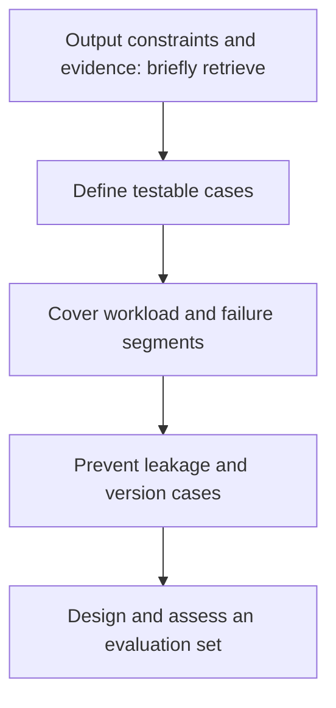

# Build a trustworthy evaluation set

2026-11-08 · [[Assets/Qard/Courses/AI & ML Mastery|AI & ML]] · `workload-cases`

## Summary

The lesson went from an output contract to testable cases, then covered workload coverage, protecting the set, and designing a set for a new workload.

**Define a testable case (3/3, sure):** Solid. Each case pairs an input with a reference, rubric, or hard constraints, plus supporting evidence when the answer must be grounded in a source.

**Cover the workload (2/4, unsure):** You spotted that synthetic cases leave a coverage gap. You missed two things: confirmed production incidents should go in as regression cases, and you didn't say what human reviewers should check (label correctness, realistic phrasing, difficulty).

**Protect and maintain the set (0/4, didn't know):** This is the main gap. You asked to see the actual prompt and case shapes, so the idea is still abstract for you. Cases used to tune prompts or few-shot examples can't also score the result. A held-out split, versioning with the data and policy, and checks that referenced sources still exist all keep score changes attributable.

**Design for a new workload (3/4, unsure):** Good reference routes and a deterministic pass rule. You didn't say what a small pilot can't show: it doesn't prove production coverage or separate close configurations.

Next: go over leakage and holdout separation using a concrete example case.

## Plan

Start by connecting an output contract to a testable case, briefly checking what you remember about constraints and supporting evidence. Then build coverage from real and synthetic inputs, protect the comparison from leakage, and version the set. Finish by designing a small set for a new workload and explaining its limits.



## Steps

### 1. Define a testable case

An output constraint limits what an answer may contain; supporting evidence establishes which claims it can justify. A testable evaluation case makes these expectations explicit for one input.

In **Building an Evaluation Set**, the **Structure** section defines a case as an input plus a testable description of acceptable behavior. A reference gives an expected answer. A rubric states criteria that allow several valid answers. Hard constraints specify mandatory requirements, such as an output format. When answers must use a particular source, retain that evidence with the case.

For example, a support assistant receives “When will support reply?” with source S7: “Support replies within two business days.” A reference could be “Within two business days.” A rubric could accept any wording that preserves both the deadline and the business-day qualification. A hard constraint could require one sentence. Keeping S7 makes the factual expectation inspectable.

These checks measure different properties: an answer can satisfy the sentence limit while making an unsupported promise. The case must define acceptable content as well as required form.

This builds on your earlier work with output constraints and evidence by turning them into explicit expectations for one case. Next comes choosing cases that represent the workload.

**Check:** An assistant must answer using only the supplied policy. If the policy does not establish the answer, it must use `unknown`. Every response must be a JSON object containing exactly two string fields: `answer` and `source`; `source` must contain the supplied policy ID.

Case input: “Is the office open on public holidays?”

Supplied evidence P4: “The office opens Monday through Friday, 09:00–17:00.” No other evidence is available.

Candidate response: `{"answer":"No","source":"P4"}`

Assess this candidate using three lines:
- **Format:** compliant or noncompliant with the required JSON structure, field types and source ID.
- **Answer:** supported or unsupported by P4.
- **Reason:** one sentence explaining your answer-support decision.

**My answer (3/3):** { "compliant": true, "supported": false, "reason": "The supplied information doesn't contain information about public holidays, so P4 doesnt support the answer"}

**Model answer:** **Format:** compliant.
**Answer:** unsupported.
**Reason:** P4 gives weekday hours but does not establish whether public holidays are exceptions.

### 2. Cover the workload and its failures

Output constraints and supporting evidence describe what an acceptable answer must satisfy. Coverage asks whether the chosen inputs exercise the situations that matter.

**Building an Evaluation Set** recommends combining synthetic breadth, human-reviewed cases, and regression cases from real failures. Group production inputs into meaningful segments: common tasks, difficult input forms, and failures with serious consequences. Ordinary traffic measures everyday usefulness; rare failure cases test important boundaries. Inspect failure segments separately so frequent easy cases cannot hide them.

For example, a booking assistant receives clear cancellation requests and ambiguous forwarded emails. Sample both from real traffic and retain incidents where it incorrectly promised a refund. Generate additional requests from known policies to exercise less-used rules, keeping each request linked to its source. Human reviewers determine whether a refund is permitted when interpreting the request requires domain judgment.

These sources complement each other: synthetic generation expands coverage cheaply; production cases reveal real phrasing and difficulty; human labels establish trustworthy expectations and expose incorrect generated labels. More synthetic cases do not establish representativeness when they repeat the same easy patterns. Adding difficult cases improves failure coverage, but their deliberately increased frequency should not be mistaken for their frequency in production.

The previous step defined acceptable behavior for one case. This step selects cases that exercise the workload and its failures; the next step protects the comparison from leakage and keeps the set versioned.

**Check:** A delivery assistant must use the customer's final confirmed address. Its evaluation contains 1,000 synthetic, single-message requests generated from delivery instructions, each with a correct reference answer. Production traffic includes routine requests and conversations where customers correct an earlier address. Confirmed incidents show that the assistant sometimes books delivery to the earlier address.

A teammate proposes generating another 5,000 single-message requests using the same method, claiming this will establish representative coverage. The team has already selected routine production requests and address-correction conversations to add to the set.

Assess this coverage plan in four short bullets:
- State whether the extra synthetic cases alone establish representative coverage.
- Explain the coverage gap in that synthetic-only proposal.
- State whether to include the confirmed wrong-address incidents as regression cases alongside the selected production samples.
- State what human reviewers should establish or verify when labeling address-correction conversations.

**My answer (2/4):** It will not help, because current and propesed synthetic cases are covering non conversational single message cases, while the problem arrives on cases when there is more than one message conversation, which looks like different cases group. I would include production conversations as regression cases + use them as an examle to extend the set with synthetic casees that have the same problem.

**Model answer:** - No.
- Single-message cases leave address corrections across messages untested.
- Include the confirmed wrong-address incidents as regression cases.
- Have humans verify the final confirmed address used as each conversation's expected answer.

### 3. Protect and maintain the set

A case ties an input to acceptable behavior; protecting the set preserves what its score can tell us about that behavior.

**Building an Evaluation Set** says to version cases with their data and policies, check that referenced sources still exist, and review cases when the product contract changes. Standard evaluation practice adds a development/held-out split: development cases guide prompt, retrieval, and model changes; held-out cases estimate performance on examples that did not guide those choices.

For example, suppose a developer puts a held-out support request and its reference answer into a few-shot prompt. Testing on that request now measures performance with prior exposure. Paraphrasing it does not restore independence. Split closely related variants together, restrict access to held-out material, and avoid repeatedly selecting changes using held-out results. Once results guide tuning, reserve fresh cases for independent confirmation.

Maintenance preserves the meaning of the comparison. If a refund policy changes from 30 days to 14, an old reference answer becomes wrong for the current product. Keep the old evaluation version reproducible, create a reviewed version with the new policy and references, and record source revisions, rubrics, and hard constraints. Compare systems on the same evaluation version and source snapshot to isolate a system change.

The previous step selected workload and failure segments. Separating development from held-out cases protects that coverage from tuning, while versioning keeps its labels meaningful as sources and policies change.

**Check:** Assess this report: **“Our score rose from 72% to 85%, proving that the new prompt generalizes better under the same product contract.”**

The team initially reserved evaluation cases from development. Developers never saw their inputs or reference answers, but selected the best of twelve prompt revisions using aggregate scores from those reserved cases. The 72% baseline used a policy allowing cancellation within 48 hours. Before the 85% run, the policy changed to 24 hours and the reference answers were updated. Both runs were recorded under the same evaluation-set identifier; no source or reference revisions were retained.

Write four short sentences assessing the claim: give your verdict, explain how prompt selection affects the evaluation's independence, explain how the policy and reference changes affect the evaluation target, and explain how missing revision records affect reconstructing a matched comparison.

**My answer (0/4):** _I didn't know._

**Model answer:** The scores do not establish better generalization under the same contract. Selecting prompts using reserved-set scores makes that set part of development, so it no longer provides independent confirmation. Changing the policy and references changes what counts as correct. Missing revision records prevent reconstructing a matched comparison on the same evaluation version and source snapshot to isolate the prompt's effect.

> **Q:** How the prompt looks like?
> Two prompts matter here.
> 
> **1. Generation prompt** (in your note, *Building an Evaluation Set*, "Synthetic Generation"): the model plays a real user, reads one source item, and writes 1–3 natural questions that the material fully satisfies. It must paraphrase, not copy phrasing, and skip boilerplate. Each case keeps `expected_source_id`.
> 
> ```text
> You are a real user of this system. Read the material and
> write 1-3 natural questions or tasks it fully satisfies.
> Paraphrase — do not copy phrasing. Skip boilerplate.
> 
> Material:
> {item.text}
> ```
> 
> **2. Few-shot prompt** (the leakage example in this step): a prompt with example input → reference answer pairs. Putting a held-out case there makes testing on it unreliable. Prior exposure inflates the score, even if the case is paraphrased.

> **Q:** I mean. prompt for this question?
> Ah, the **few-shot prompt** from the leakage example. It would look like this:
> 
> ```text
> Answer support requests using the examples.
> 
> Request: Can I return a gadget after 20 days?
> Answer: Yes, returns are accepted within 30 days.
> 
> Request: <held-out request>      ← leaked case
> Answer: <held-out reference>     ← leaked reference
> 
> Request: <new request>
> Answer:
> ```
> 
> The model sees the held-out request and its answer as an example. Testing on that same request then measures recall of the prompt, not generalization. Paraphrasing it doesn't fix this.
> 
> Fix: put only **development** cases in the prompt examples. Keep held-out cases out of every prompt, and out of tuning decisions too.

> **Q:** How the test cases looked like in this case?
> Each case is an input plus a reference answer, as in your note's **Structure** section. In the support example, the cases are request → reference answer pairs:
> 
> ```text
> Case A (development, may go in prompt):
>   Request: Can I return a gadget after 20 days?
>   Reference: Yes, returns are accepted within 30 days.
> 
> Case B (held-out, must stay hidden):
>   Request: I bought headphones 25 days ago. Can I send them back?
>   Reference: Yes, within the 30-day window.
> ```
> 
> Leakage happens when Case B's request and reference appear in the few-shot prompt. Testing on B then measures prompt recall.
> 
> Rewording B as "Can I return earbuds bought 25 days ago?" doesn't fix it, because the case is still the same one. Keep close variants together in the same split, either all development or all held-out.

### 4. Design a set for a new workload

An output contract gives each case something testable: required behavior and evidence supporting it. **Building an Evaluation Set** adds the wider requirement: the cases must represent the workload whose performance is being claimed.

For a refund assistant, a six-case pilot might contain four ordinary customer requests, one real dispute about eligibility, and one synthetic request probing a missing policy condition. Each case keeps its input, policy evidence, and reviewed expectation. Check a required decision field deterministically; grade an explanation against a rubric that allows different wording but requires the correct policy reasoning.

Keep the pilot held out from prompt tuning, and version its cases alongside the policy snapshot and scoring rules. If a failed case becomes a development example, use fresh held-out cases for the next comparison.

Report results by segment as well as overall. Five successes out of six can hide failure on the only dispute. This pilot can reveal defects; six cases cannot establish broad reliability or distinguish small performance improvements. Synthetic variety also does not establish that real disputes are covered.

The previous step protected the comparison through separation and versioning. Now those controls support a complete design whose cases, scoring, and claimed coverage agree.

**Check:** Design the remaining parts of a six-case pilot for a parcel-routing assistant.

The versioned policy says: route a request to `standard` only if **every parcel** weighs at most 20 kg and has a destination. If any parcel exceeds 20 kg, route the whole request to `manual`, even if another parcel lacks a destination. Otherwise, a missing destination requires `clarify`. The output is one JSON object containing only a `route` field.

Four human-reviewed ordinary production cases already have references. Add these two cases:

- **A — real production failure:** one parcel weighs 24 kg and has a destination; another weighs 3 kg and lacks a destination.
- **B — synthetic boundary case:** one parcel weighs exactly 20 kg and has a destination.

All six cases are held out from tuning and frozen with policy version P3 and the scoring rules. No real missing-destination-only requests are represented.

Give a four-line evaluation plan: A's reference output; B's reference output; a pass rule for scoring each case; and one concrete limit on what this pilot establishes about production coverage.

**My answer (3/4):** - manual - since one parcel exceeding the 20 kg rule
- standart - since the rule worded as "at most 20 kg" which is allowed top bound
- pass rule is true or false of matching actual and expected route
- i dont get the question

**Model answer:** A: `{"route":"manual"}`.
B: `{"route":"standard"}`.
Scoring: pass only valid JSON with exactly the `route` field and its reference value; ignore whitespace.
Limit: no real missing-destination-only cases test production requests requiring `clarify`.
