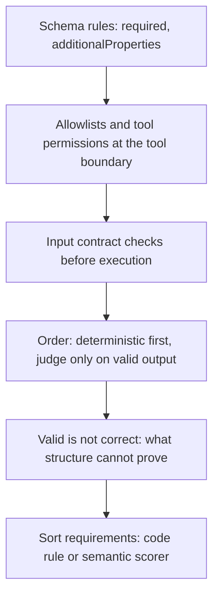
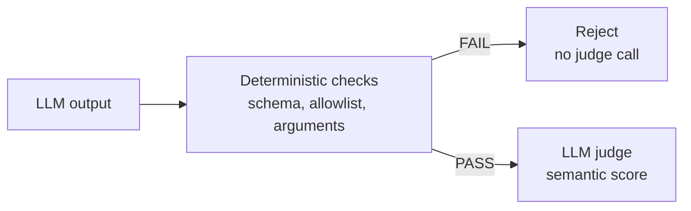

# Contracts first, then what they miss

2026-11-08 · [[Assets/Qard/Courses/AI & ML Mastery|AI & ML]] · `executable-contracts`

## Summary

The lesson started from what the student already knew (a schema's `required` and `additionalProperties` rules) and went past it. It covered:

- **Tool boundary:** permission/allowlist checks and argument contracts run *before* execution, because no later output check can undo a side effect. The student got this right with confidence.
- **Deterministic gate before the judge:** schema and policy checks run first, so malformed or forbidden outputs never cost a judge call. The student reached the right verdict but treated the problem as one of bad weighting. They missed the key point: a deterministic failure is a hard pass/fail contract, and no favourable judge score can offset it.
- **What a valid output cannot prove:** a schema-valid output can still pick the wrong permitted action, e.g. `search` when the case needed `escalate`. The student answered correctly but was unsure.
- **Classification:** the student correctly sorted requirements into code-checkable rules and ones that need judgment (2/2).

**Gap to revisit:** say plainly that deterministic failures are gates, not inputs to a weighted score.

## Plan

You already read a schema's required and extra-field rules correctly, so the lesson starts after that. First, which exact properties code can enforce, including tool permissions and input arguments, and why those checks run before any judge call. Then the limit: a valid output can still be the wrong one. The last step sorts requirements into code-checkable and judgment-needed.



## Steps

### 1. Permissions and argument contracts at the tool boundary

You already apply a schema's `required` and `additionalProperties` rules to a model's **final output**. The same rules also apply to a different object: the **tool call** an agent makes on the way to that output.

Code can check two separate parts of a tool call:

- **Which tool:** a permission rule, also called an allowlist. It is an enum over tool names, such as "this agent may call only `lookup_customer` and `send_email`". If the name is not on the list, the call is rejected. The arguments do not matter.
- **With what arguments:** an argument contract. This is a JSON Schema for the tool's inputs. It rejects missing fields (`required`), wrong types such as a `count` sent as a string, and out-of-range values such as a number above a stated `maximum`. It rejects extra fields only if the arguments object sets `additionalProperties: false`. JSON Schema allows extra properties by default.

The two checks are independent. Passing one says nothing about the other. Both are exact pass/fail rules, and no model gives an opinion ([[Home/AI & ML/LLM/Evaluation/Deterministic Checks#Types of Deterministic Checks|types of deterministic checks]]).

**Timing.** These checks must run **before the tool executes**. A tool can change the world through a side effect: an email is sent, a record is deleted, money moves. Once that has happened, a later check can only report it. It cannot undo it.

Example: an agent may call `send_email(to, subject, body)`, and the argument contract requires `to` to match the company's domain. Without that check, the agent sends to an outside address. The email goes out, and the agent then returns perfectly valid JSON: `{"action": "search", "reason": "done"}`. Validating that final output finds nothing wrong, even though the harm has already happened. Argument validation at the tool boundary would have blocked the call ([[Home/AI & ML/LLM/Evaluation/Deterministic Checks#Forgetting to Check Tool Inputs, Not Just Outputs|tool inputs, not just outputs]]).

The checks run in this order:
1. Before execution: the permission check, then argument validation.
2. The tool runs.
3. After execution: the returned data is validated against the schema the next step expects.

This takes the schema rules you already apply to final outputs and moves them earlier, to each tool call. Next comes the other ordering rule: hard checks run before any judge does.

**Check:** A read-only support agent is allowed to call only two tools: `search_orders` and `get_order`. The system has four checks:

- a permission check before any tool runs
- argument validation against the called tool's argument schema, also before the tool runs
- validation of the tool's returned result after it runs
- validation of the agent's final JSON reply against the output schema

The system also defines a tool called `cancel_order`. Its argument schema is `{order_id: string}`, with `order_id` required. Calling it cancels the order immediately, and a cancellation cannot be reversed.

During one run, the agent asks to call `cancel_order` with `{"order_id": "A-17"}`.

Which outcome is correct?

**My answer (1/1):** The permission check rejects the call before it runs, because `cancel_order` is not on this agent's allowlist.

**Model answer:** **B.** The arguments are valid, so argument validation passes. But `cancel_order` is not on the agent's allowlist, so the permission check rejects the call before it runs and the order is never cancelled.

### 2. Deterministic gate before the judge

You already know how a schema rejects an output: a missing `required` field or an extra field under `additionalProperties: false` fails, with no judgement involved. Step 1 placed permission and argument checks at the tool boundary. This step covers what the pipeline does with those failures.

**The gate.** Deterministic checks run first. Any hard failure rejects the output on the spot, and only outputs that pass go on to the LLM judge ([[Home/AI & ML/LLM/Evaluation/Deterministic Checks#Where Deterministic Checks Fit in the Evaluation Pipeline|pipeline order]]):



There are two reasons for this order.

1. **Cost.** A judge call is a slow, paid model call. If the outcome is already decided, the call buys nothing.
2. **The kind of verdict.** A schema or allowlist rule is a contract: the output either meets it or it doesn't. It is not one more quality dimension that can be traded against the others. A judge scores things like relevance and tone, and none of those can turn a broken contract into a valid one. In the note's words, [[Home/AI & ML/LLM/Evaluation/Deterministic Checks#Treating Deterministic Failures as Soft Warnings|a failed policy rule cannot be repaired by a favorable semantic score]].

**Example.** The contract allows `action` to be only `"search"` or `"escalate"`. The model returns `{"action": "refund", "reason": "Customer was double-charged; refund is clearly the right fix."}`. The reason is well argued, and a judge might score it highly. But the enum check fails, so the output is rejected and the judge is never called. Downstream code cannot run a `refund` action, however good the explanation is.

**Boundary.** This holds for exact rules such as schemas, allowlists and argument contracts. Heuristic scanners, such as PII detectors, can misclassify. For those, the attached policy may send the output to quarantine or human review instead of rejecting it automatically. That is a policy choice about what to do on failure. It still does not let a semantic score cancel the flag.

Step 1 decided which contract checks exist and where they run. This step decides what a failure means for the rest of the pipeline: the output stops before the judge. Step 3 looks at the opposite case, an output that passes the gate but is still wrong.

**Check:** An agent's output must match a JSON schema that lists `action` and `reason` as `required`. A team's evaluation pipeline runs the schema check and an LLM judge on every output and combines them into one score:

$$\text{final} = 0.2 \times \text{schema} + 0.8 \times \text{judge}$$

Here `schema` is 1 if the schema check passes and 0 if it fails, and `judge` is the judge's semantic score from 0 to 1. An output passes evaluation if $\text{final} \ge 0.7$.

One output is `{"action": "escalate"}`, with no `reason` field. The judge scores it 0.95, so $\text{final} = 0.76$ and the pipeline marks it as passing.

In a pipeline designed with a deterministic gate before the judge, what verdict should this output get? Give the verdict and explain why the team's scoring rule is wrong.

**My answer (1/2):** The weight are incorrect, even is schema is not followed, it possible to pass threshold. It would be better to have schema weight at least 0.31, so if judge marks perfectly, final will be 0.69, right under threshold.  Or have deterministic gate before judge scoring, if schema is failed, no need to check judge, and consider full case failed. The passing schema + low score of the judge != no passing schema + perfect judge even score are equal

**Model answer:** **Verdict:** reject.

**Why the rule is wrong:** the output is missing the required `reason`, a hard schema failure. That is a pass/fail contract violation, not one quality signal among several, so mixing it into a weighted score lets a high judge score (0.95) outweigh it. A deterministic gate rejects the output before any judge call, so no semantic score can rescue it.

### 3. What a valid output cannot prove

You already know how a schema decides validity: required fields must be present, no extra fields are allowed, and `action` must be one of the values listed in its `enum`. A schema answers one question: **is this output well-formed?** It does not answer a second one: **is this the right output for this case?**

Take the contract from the note, where `action` is `"search"` or `"escalate"` and `reason` is a non-empty string. Suppose the case is a customer reporting a suspected account takeover, and the expected behaviour is to escalate. The agent returns:

```json
{"action": "search", "reason": "Looking up account login history"}
```

Every schema rule passes. Both required fields are present, there are no extra fields, `search` is in the enum, and `reason` is not empty. The output is still wrong, because the schema allows **both** actions and has no information about which one this case needs. See [[Home/AI & ML/LLM/Evaluation/Deterministic Checks#Over-Relying on Schema Validation Alone|Over-relying on schema validation alone]].

This gap can be closed in one of two ways. Which one fits depends on whether the right answer can be stated exactly:

- **Explicit business rule (still code).** If the expected action follows from known inputs, write it as a rule. For example: `if case.category == "account_takeover" then action must be "escalate"`. This is deterministic and needs no judge, but it only works where the expected behaviour is spelled out.
- **Rubric scorer (judgment).** If the right action depends on interpreting the situation, such as how urgent a free-text complaint sounds, a judge applies a rubric. Matching strings in code here would hide a semantic decision behind a brittle rule.

In short, a schema proves the output is in the allowed set. Choosing the right member of that set needs either a rule that encodes the choice or a scorer that judges it.

The previous step showed that a deterministic failure ends evaluation before any judge runs. This step covers the other direction: passing those checks only means the output is valid, not that it is right. That sets up sorting requirements into code rules and judgment in the final step.

**Check:** A support agent must return JSON matching this schema: `action` is required and must be one of `"reply"` or `"handoff"`, `reason` is a required non-empty string, and no other fields are allowed.

Each incoming ticket has structured fields, including `tier` and `priority`. Company policy states exactly: *every ticket with `tier = "enterprise"` and `priority = "P1"` must be handed off to a human.*

For one ticket with `tier = "enterprise"` and `priority = "P1"`, the agent returns:

```json
{"action": "reply", "reason": "Sharing the reset steps directly"}
```

Which statement correctly describes how this output should be evaluated?

**My answer (1/1):** The schema passes, and because the policy is stated exactly in terms of the ticket's fields, a deterministic business rule can fail the output without a judge.

**Model answer:** **B.** The output passes the schema: both required fields are present, there are no extra fields, and `reply` is in the enum. It is still the wrong action. Because the policy is an exact condition on structured fields (`tier = "enterprise"` and `priority = "P1"` means `handoff`), it can be written as a code rule that fails this output, with no judge needed.

### 4. Classify requirements: code rule or judgment

Sort one requirement at a time with one test: **can the pass/fail rule be stated exactly, using only data the checker has at that moment?** If it can, the requirement belongs in code. If deciding it means interpreting meaning, intent or quality, it needs a rubric scorer (an LLM judge) or human review.

Take a support agent with a `close_ticket(ticket_id)` tool and an output schema with fields `action` and `reply`:

| Requirement | Exact rule over available data? | Layer |
|---|---|---|
| Only agents with role `support` may call `close_ticket` | Yes: role vs allowlist | Code, at the tool boundary |
| `ticket_id` must exist and be open | Yes: lookup in the ticket store | Code, at the tool boundary |
| Output is JSON with `action` and `reply`, no extra fields | Yes: schema | Code, on the output |
| `action` = `escalate` whenever `account_tier` is `enterprise` and `severity` is `1` | Yes: both fields are recorded | Code, an explicit business rule |
| `reply` actually resolves what the customer asked | No: depends on meaning | Judge |

The fourth row matters. Choosing between valid actions is usually a judgment, but here the expected action has been written as an exact rule over known fields, so code can enforce it. Without that rule, a schema-valid `search` instead of `escalate` requires semantic assessment by a rubric scorer or human reviewer ([[Home/AI & ML/LLM/Evaluation/Deterministic Checks#Over-Relying on Schema Validation Alone|Over-relying on schema validation]]).

The layers then run in this order:

1. **Before a tool executes:** permission and argument checks, because a side effect cannot be undone later ([[Home/AI & ML/LLM/Evaluation/Deterministic Checks#Forgetting to Check Tool Inputs, Not Just Outputs|tool inputs]]).
2. **On the final output:** schema and other deterministic rules. A failure here rejects the output.
3. **Only on outputs that pass:** the semantic judge, then human review for high-stakes or ambiguous cases ([[Home/AI & ML/LLM/Evaluation/Deterministic Checks#Where Deterministic Checks Fit in the Evaluation Pipeline|pipeline]]).

Step 3 showed that a valid output can still be the wrong one. This step uses that limit as a sorting rule: anything that can be stated exactly goes to code and runs first, and whatever is left goes to the judge.

**Check:** A refund agent can call `issue_refund(order_id, amount)`. Each order record stores a `delivered_at` date, and each case records the date it was opened. When the checks run, the checker can read the order record, the case's opened date, and the agent's tool calls and output.

Requirement: *the agent must not call `issue_refund` for an order whose `delivered_at` is more than 30 days before the case was opened.*

Should this requirement be enforced by a **deterministic code check** or by **judgment** (a rubric scorer or human review)? Give your classification and the reason for it.

**My answer (2/2):** This is deterministic rule, so it should be enforced by the deterministic check, to ensure 100% accuracy. Judgement still can hallucinate, human review is redundant, one simple `if` can replace human here

**Model answer:** **Code.** The rule is exact and uses only recorded data: compute the gap between `delivered_at` and the case's opened date, and if it exceeds 30 days, any `issue_refund` call fails. Nothing needs interpreting.

*Optional:* it fits best at the tool boundary, rejecting the call before the refund executes.
