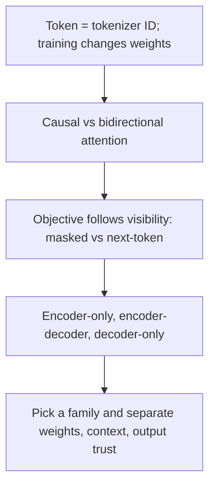

# Attention visibility and transformer families

2026-11-09 · [[Assets/Qard/Courses/AI & ML Mastery|AI & ML]] · `llm-mechanics`

## Summary

Lesson built from the gap in the probe: what each attention type lets a position see. Causal attention lets a position attend only to earlier tokens. Bidirectional attention lets every token attend to the whole input. Visibility decides the pretraining objective. Causal attention pairs with next-token prediction. Bidirectional attention pairs with masked-token prediction, as in BERT, or with T5-style span corruption, where the encoder reads the corrupted input and the decoder generates the missing spans. Those pairings give the three families. Encoder-only models produce representations. Encoder-decoder models generate a target from an encoded source. Decoder-only models generate a continuation. The lesson then separated training, which changes weights, from inference, where the prompt and context only condition a fixed model. It placed MoE routing inside one model, not as a choice between models. Fluent output was treated as unverified.

**What the student showed:** they answered "didn't know" on all four steps (0/6 checks). The probe also showed a reversed idea: they picked bidirectional attention for next-token generation. Everything here needs early review, starting with how causal masking links to next-token prediction.

## Plan

You already know tokens and weight updates, so we start at the gap: which positions each attention type can see. Then we link that to pretraining objectives and the three families. We finish by applying the families and the inference-versus-training split to a new case, treating fluent output as unverified.

## Steps

### 1. Causal versus bidirectional attention

A model reads a sequence of token IDs. Attention is how each position collects information from other positions. An **attention mask** decides which positions each token may look at.

**Bidirectional attention** (no restriction): every position can attend to every position in the input, both earlier and later.

**Causal attention**: position $i$ can attend only to positions $1 \dots i$, meaning itself and everything before it. Later positions are blocked.

Example with the four tokens `the cat sat down` at positions 1–4:

| Query position | Bidirectional sees | Causal sees |
|---|---|---|
| 1 `the` | 1, 2, 3, 4 | 1 |
| 2 `cat` | 1, 2, 3, 4 | 1, 2 |
| 3 `sat` | 1, 2, 3, 4 | 1, 2, 3 |
| 4 `down` | 1, 2, 3, 4 | 1, 2, 3, 4 |

**Why next-token prediction needs the causal mask.** In training the whole sentence goes in at once, and each position is trained to predict the token that comes after it. Position 2 (`cat`) must predict `sat`. Under bidirectional attention, position 2 can see position 3, which holds `sat`. The answer is then part of its input, so a copying shortcut is available. This is called **target leakage**. Training loss can drop because the model reads the answer, not because it predicts well, so a low loss no longer tells you how well it predicts. The shortcut also disappears at generation time: when the model writes text one token at a time, the next token does not exist yet, so there is nothing to copy.

The causal mask hides everything after position $i$, so each position must predict its target from earlier tokens alone. All positions still train in parallel, and none of them can see its own answer. Training then matches what generation can actually provide.

The general rule: leakage happens whenever the token a position must predict sits inside the set of positions it is allowed to see. The causal mask prevents this for next-token prediction because the target ($i+1$) lies just outside $1 \dots i$.

Bidirectional attention is not wrong. It suits tasks where the whole input is already given and nothing hidden needs predicting from what came earlier. The next step covers which objectives fit it.

Your notes put it this way: a causal mask "makes each position predict from earlier positions" ([[Home/AI & ML/LLM/LLM#Transformer Families|Transformer Families]]).

You know a token is an ID at a position in a sequence. This step sets which positions each token may read, and that visibility rule decides which training objectives (step 2) and which model families (step 3) make sense.

**Check:** A team keeps a standard **causal** mask (position $i$ attends to positions $1 \dots i$) but changes the training target: each position $i$ is now trained to output **the token at position $i$ itself**, not the next token. The whole sentence is fed in at once.

Is a copying shortcut available to the model during this training, and why?

**My answer (0/1):** _I didn't know._

**Model answer:** Yes — position $i$ can see positions $1 \dots i$, which includes position $i$, so its target is already in its input.

### 2. Objectives that follow from visibility

From step 1: under a **causal** mask, a position sees itself and earlier positions only. Under **bidirectional** attention, it sees the whole input, both left and right.

A pretraining objective works like a fill-in game. The model gets an input and guesses a target token, and the loss scores the guess. The guess only exercises inference from context if **the target is hidden from the position making the guess**. If the target is visible, the model has a shortcut: it can copy it. Low loss then no longer shows that the model learned to predict from context. The two objectives hide the target in different places, and that decides which visibility fits.

**Example sentence:** `the cat sat on the mat`

**Next-token prediction (target = the token after the current position).** At the position of `cat`, the target is `sat`. The input is left intact, so `sat` is still in the sequence, one step to the right.
- With bidirectional attention, the `cat` position could attend to `sat`. The target leaks, and copying becomes an available shortcut to low loss.
- With a causal mask, the `cat` position sees only `the cat`. The mask hides the target. Every position can be trained in parallel on its own next token, and no future target leaks.

**Masked-token prediction (target = a token removed from the input).** The input becomes `the cat [MASK] on the mat`. The target is hidden because it was **replaced in the input**, not because of the attention pattern.
- With bidirectional attention, the `[MASK]` position uses evidence from both sides: `the cat` on the left and `on the mat` on the right. Both sides constrain the missing word.
- A causal mask would also be safe here, because nothing leaks. But it would discard `on the mat`, which is useful evidence.

So hiding happens in one of two places. Next-token prediction leaves the input intact, so the **attention mask** must hide the future. Masked-token prediction hides the target **in the input**, so attention can be fully bidirectional and use both sides. That is why the notes pair masked-token pretraining with bidirectional encoders, and next-token prediction with causal attention: [[Home/AI & ML/LLM/LLM#Transformer Families|Transformer Families]].

Step 1 set out what each mask lets a position see. This step shows the pairing that follows. Bidirectional attention lets a model reconstruct a hidden token from both sides once the input hides it. Causal attention stops future targets leaking in next-token prediction. Step 3 uses these pairings to tell BERT, T5 and GPT-style models apart.

**Check:** An encoder is pretrained with **bidirectional attention**: every position can attend to every position in the input, including itself. In each training sentence, some positions are chosen as targets, and the model is trained to output the original token at each chosen position.

Because of a bug, the chosen tokens are **left unchanged in the input**. They are never replaced with `[MASK]`.

The training loss on the chosen positions turns out to be low. Does this low loss show that the model has learned to infer tokens from their surrounding context? Give your verdict and explain it in terms of what each chosen position can see.

**My answer (0/2):** _I didn't know._

**Model answer:** No. Each chosen token is still in the input, and bidirectional attention lets its position see it. Copying the visible token is an available shortcut to low loss, so the low loss does not show that the model predicts from context.

### 3. Encoder-only, encoder-decoder, decoder-only

Steps 1–2 gave you two pairings. **Bidirectional** attention means every token sees the whole input, and it suits **masked-token prediction**. **Causal** attention means each token sees only earlier tokens, and it suits **next-token prediction**.

A transformer family is defined by its stacks: whether the model has an encoder, a decoder or both. That choice sets which positions each stack can see and what kind of output the model produces. The training objective is a separate choice made when the model is pretrained. The family does not dictate it. The three standard examples below each use a different objective: masked-token prediction for BERT, span corruption for T5 and next-token prediction for GPT-style models.

| Family (example) | Stacks and attention | The example's pretraining objective | Output |
|---|---|---|---|
| Encoder-only (BERT) | One encoder, bidirectional | Masked-token prediction (BERT also uses sentence-level objectives) | One contextual vector per token, or a pooled vector. No open-ended text |
| Encoder-decoder (T5) | The encoder reads the source bidirectionally. The decoder is causal over its own earlier tokens and also attends to the encoder output | Span corruption: the encoder reads input with spans removed, and the decoder generates the missing spans | A generated target sequence, separate from the source |
| Decoder-only (GPT-style) | One decoder, causal | Next-token prediction | A continuation of the prompt, one token at a time |

**Example: the same input in all three families.** The input is "The cat sat on the mat."

- **Encoder-only:** "cat" can attend to "mat" as well as to "The", so its vector uses context from both sides. A task head reads those vectors and, for example, labels the sentence. No new text is written, because there is no autoregressive decoder.
- **Encoder-decoder:** the encoder builds bidirectional vectors for the whole sentence. The decoder then writes a *different* sequence, such as a French translation. Each new target token sees the target tokens already written plus the full encoded source.
- **Decoder-only:** the sentence is the prompt. The model predicts the next token from everything before it, appends that token and repeats. GPT-style training already used the causal mask, so the same stack can generate text without any change.

Two boundaries matter. First, "generates text" does not mean decoder-only: an encoder-decoder also generates, but from a separately encoded source. Second, the typical uses (classification for BERT, translation for T5, chat for GPT) are common fits, not hard limits. See [[Home/AI & ML/LLM/LLM#Transformer Families|Transformer Families]].

Step 2 matched each kind of visibility to an objective. Here, the stacks a model has and the attention each stack uses define the three families, and BERT, T5 and GPT show which objective each example uses. Step 4 uses these families to choose one for a new task.

**Check:** A hypothetical transformer model turns a bug report into a short title. It has two stacks. The first stack reads the whole bug report, and every position can attend to every other position in the report. The second stack writes the title one token at a time. Each title token attends causally to the title tokens already written and also attends to the first stack's output.

Fill in the blank with the transformer family this model belongs to: encoder-only, encoder-decoder or decoder-only.

The model is {{family}}.

**My answer (0/1):** _I didn't know._

**Model answer:** The model is **encoder-decoder**.

### 4. Apply families, weights and context to a new case

You already know that only further training changes a model's weights. Two more questions decide most design choices.

**1. Which family?** Pick the family by the output the task needs, not by which model is most popular ([[Home/AI & ML/LLM/LLM#Transformer Families|Transformer Families]]):
- You need a label, a score or an embedding for an input you already have. An **encoder-only** model (BERT-style) fits, because bidirectional attention lets every token use the whole input.
- You need a new text generated from a separate source text, such as a translation or a summary. An **encoder-decoder** model (T5-style) fits.
- You need an open-ended continuation, such as a chat reply, code or a tool call. A **decoder-only** model (GPT-style) fits, because its causal mask lets it generate one token at a time.

**2. Does this change alter the weights or only the context?** The **context window** is the token budget visible to one model call: instructions, history, evidence, tool results and room for the output ([[Home/AI & ML/LLM/LLM#Minimal Vocabulary|Minimal Vocabulary]]). Anything you put in the prompt conditions *that call only*. The weights stay as they were. Pretraining, supervised fine-tuning and preference optimisation are training stages, so they do change the weights ([[Home/AI & ML/LLM/LLM#Training Pipeline|Training Pipeline]]).

**Example: a policy assistant.** Staff ask questions about an internal policy handbook that changes every month.
- First, the system has to decide which handbook passages are relevant. Scoring passages against a question is a scoring task, so an encoder-only reranker fits.
- Next, it has to write an answer in prose. That is open-ended generation, so a decoder-only model fits.
- On each request, the current passages are pasted into the prompt. That is inference context. When the handbook changes, no retraining is needed: the next request simply carries the new text.
- Fine-tuning the model on example answers would change its weights. That can make the style more consistent, but facts stored in weights are harder to update than retrieved text.
- The answer may read smoothly and still misstate a rule. The model produces likely-sounding tokens, not checked facts. So the answer stays a candidate until it is checked against the retrieved passage ([[Home/AI & ML/LLM/LLM|LLM]]: "Fluent output remains a candidate result until grounding and validation support it").

Steps 1–3 showed how the mask and the pretraining objective define each family. This step uses that to choose a model for a task. It also separates changes to the weights from changes to the context, and treats fluent output as unverified, which completes the lesson goal.

**Check:** A team uses a deployed decoder-only model to sort support tickets into categories. No training or fine-tuning is run. For request A, the prompt contains three example tickets with their correct categories, followed by a new ticket. The model labels the new ticket correctly. Each request is a separate model call. Request B, sent afterwards, contains only a new ticket with no examples.

Predict whether the model's behaviour on request B benefits from the examples in request A, and explain why.

**My answer (0/2):** _I didn't know._

**Model answer:** No. Request B gets no benefit from request A's examples. Those examples were only part of request A's context window. They conditioned that one call and did not change the weights, because only training updates weights. Request B is a separate call without the examples, so the model behaves as it did before request A.
