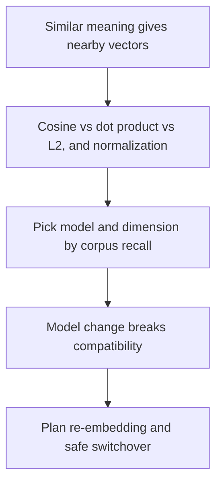
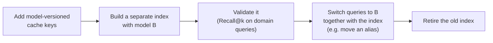

# Choosing embeddings and planning re-embedding

2026-11-10 · [[Assets/Qard/Courses/AI & ML Mastery|AI & ML]] · `semantic-geometry`

## Summary

Lesson covered three parts of embedding-based retrieval: how similarity is measured, how to pick a model and dimension, and how to plan re-embedding when a model changes.

**Similarity measures:** The student started out knowing that similar meanings produce nearby vectors. They did not know how cosine and dot product differ (0/2, "didn't know"). The key points: cosine looks only at the angle between vectors. Dot product also grows with vector length. For L2-normalized vectors, cosine, dot product and L2 distance all give the same ranking. Whether a model's vectors are normalized depends on the model's documentation.

**Model and dimension choice:** The student answered correctly and confidently (1/1). A model is chosen by testing it on your own corpus and queries, not by its MTEB ranking.

**Re-embedding:** Partly right (1/2). The student correctly predicted that ranking becomes unreliable. They did not explain why: each model learns its own coordinate space, so similarity between an old-model vector and a new-model vector means nothing. Search can still run without errors when the dimensions match. The fix is to re-embed the whole corpus, check the new index, then switch traffic and key the cache by model and version.

**Gaps to revisit:** cosine versus dot product with vector length, and why scores across models mean nothing.

## Plan

You already know that similar meaning gives nearby vectors. The first gap is how similarity is measured: cosine versus dot product and why length matters. Then you'll choose a model and dimension using corpus-specific evidence. Last, you'll plan a re-embedding when a model change breaks compatibility.

## Steps

### 1. Measuring closeness: cosine, dot product, L2

Nearby vectors mean similar text. To rank stored chunks against a query, the index needs a number for "nearby". Three common choices can score the same pair of vectors differently. The difference comes down to **vector length** (magnitude, $\|v\|$).

- **Cosine similarity** measures only the angle: $\cos(q,d) = \dfrac{q \cdot d}{\|q\|\,\|d\|}$. It ranges from −1 to 1, and length cancels out.
- **Dot product**: $q \cdot d = \|q\|\,\|d\|\cos(q,d)$. This is cosine scaled by both lengths. When the cosine with the query is positive, a longer vector pointing the same way scores higher. When the cosine is negative, extra length makes the score more negative. When the cosine is zero (orthogonal vectors), the score stays 0 at any length.
- **Euclidean (L2) distance** is the straight-line gap $\|q-d\|$, where smaller means closer. It also depends on length.

**Example.** Query $q=(1,0)$, length 1. Two stored chunk vectors, both with positive cosine to $q$:

| | vector | length | cosine | dot | L2 distance |
|---|---|---|---|---|---|
| A | $(0.8,\,0.6)$ | 1 | $0.8$ | $0.8$ | $\sqrt{0.4}\approx0.63$ |
| B | $(1.2,\,1.6)$ | 2 | $1.2/2 = 0.6$ | $1.2$ | $\sqrt{2.6}\approx1.61$ |

A points closer to $q$'s direction, so cosine ranks **A first**. Dot product ranks **B first** only because B is twice as long. B's cosine is positive, so its extra length inflates the score even though its direction matches $q$ less well.

**Normalize** B to length 1: $(0.6,\,0.8)$. Its dot product is now $0.6$, which equals its cosine, so both metrics rank A first. When query and stored vectors are all unit length:
- dot product = cosine;
- squared L2 = $2 - 2\cos$. Here A gives $2-1.6=0.4$ and normalized B gives $2-1.2=0.8$, so L2 also ranks A first.

All three metrics then produce the same ranking. Without normalization, dot product and L2 also respond to magnitude and can reorder neighbours.

Whether vectors arrive normalized depends on the model. OpenAI documents its embeddings as length-normalized, while another model may keep magnitude as part of the signal. The model's documentation decides the metric, and cosine is the safe default when it says nothing ([[Home/AI & ML/LLM/Embeddings#Similarity Metrics|Similarity Metrics]]). A vector shortened by hand is re-normalized before cosine or dot-product search ([[Home/AI & ML/LLM/Embeddings#Questions|Embeddings: Questions]]).

You already know that closeness in vector space means similar meaning. This step shows how closeness is scored and when vector length distorts the score. The next step compares candidate models using this scoring, and the last step plans a re-embedding.

**Check:** A retrieval index stores chunk vectors that are **not** normalized, and their lengths differ from chunk to chunk. Search ranks chunks by **dot product** with the query vector, highest first. To make the results match a cosine-similarity ranking, the team L2-normalizes **only the query vector** (scales it to length 1) before each search. The stored chunk vectors are left unchanged.

Does this guarantee that the dot-product ranking of the chunks equals their cosine-similarity ranking? Give your verdict and explain why.

**My answer (0/2):** _I didn't know._

**Model answer:** **No.** Dot product is $\|q\|\,\|d\|\cos\theta$. The query's length multiplies every chunk's score by the same amount, so normalizing it never reorders anything. Each chunk's own length $\|d\|$ still scales its score, so a long chunk can beat a better-aligned short one. Normalizing the stored chunk vectors as well guarantees that dot product equals cosine.

### 2. Choosing a model and dimension on your corpus

From step 1: the model's documentation fixes the similarity measure. Cosine is the default unless the docs say otherwise. Choosing the model itself is a separate question, and a leaderboard can't answer it for your corpus.

**Why leaderboard rank is not enough.** MTEB averages several task families, including classification, semantic similarity and retrieval. A model can rank first overall while being weaker at retrieval. Even its `Retrieval` score comes from public text. Internal acronyms and product names may barely appear in its training data, so queries and documents that use them can land far apart in vector space ([[Home/AI & ML/LLM/Embeddings#Benchmark Leaderboard Overfitting|leaderboard overfitting]], [[Home/AI & ML/LLM/Embeddings#Distribution Shift on Internal Terminology|distribution shift]]). Use the leaderboard's Retrieval category to build a shortlist, then test the shortlist on your own data.

**The test.**
1. Build a labeled set of real domain queries. For each query, record every chunk that holds the answer. Include queries that use internal terminology.
2. Embed the corpus with each candidate, using that model's documented similarity measure.
3. Run every query and measure two things:
   - **Recall@k** (quality): for one query, the number of its labeled relevant chunks that appear in the top $k$ results, divided by the total number of labeled relevant chunks for that query. Average this over all queries. For example, if a query has 2 relevant chunks and only 1 is in the top 10, that query's Recall@10 is $1/2 = 0.5$.
   - **Latency** (cost): the time to embed the query and search the index. Count it alongside storage of 4 bytes × dimensions per vector and the API or hosting price.
4. Choose the simplest, cheapest configuration that meets **both** targets you set beforehand.

**Dimension is a separate decision.** Matryoshka-trained models, such as OpenAI's `text-embedding-3` with its `dimensions` parameter, keep meaning in shorter prefixes of the vector. Shorter vectors take less storage and less search work, but they may lose recall on your corpus. So treat each dimension as another candidate: run the same labeled queries and keep the smallest size that still meets the targets ([[Home/AI & ML/LLM/Embeddings#Dimensionality|Dimensionality]]). Re-normalize a manually truncated vector before cosine or dot-product search.

**Example.** The note cites a Databricks experiment on FinanceBench, a finance question-answering benchmark. There, `gte-large-en-v1.5` (0.4B parameters), fine-tuned on synthetic finance data, reached Recall@10 of 0.552. The general-purpose `text-embedding-3-large` reached 0.44 ([[Home/AI & ML/LLM/Embeddings#Model Families|Model Families]]). The lesson is that a model's general reputation did not predict which one retrieved better on finance queries. Only a measurement on domain queries showed that. A team with its own corpus would run the same kind of comparison on its own labeled queries, and would also check each candidate against its latency target before choosing.

One boundary: evaluate the retrieval pipeline, not the embeddings alone. If failed queries are caused by bad chunk boundaries, changing the model will not fix them ([[Home/AI & ML/LLM/Embeddings#Tradeoffs|Tradeoffs]]).

Step 1 fixed how closeness is scored for a given model. This step chooses which model and vector size produce that geometry for your corpus, and the next step deals with what breaks when that choice later changes.

**Check:** A team is choosing an embedding configuration for retrieval over internal engineering documents. They set two targets in advance:

- Recall@10 of at least 0.80, averaged over their labeled domain queries
- Query latency of at most 50 ms, covering query embedding plus index search

They run the same labeled set of domain queries against four configurations. Model X ranks first in the MTEB Retrieval category and supports Matryoshka truncation. Model Y ranks ninth.

| Config | Model | Dimensions | Recall@10 | Latency |
|---|---|---|---|---|
| A | X | 3072 (full) | 0.84 | 70 ms |
| B | X | 1024 (truncated, re-normalized) | 0.82 | 40 ms |
| C | X | 256 (truncated, re-normalized) | 0.71 | 20 ms |
| D | Y | 768 (full) | 0.78 | 30 ms |

Which configuration should they choose, and why?

**My answer (1/1):** Config B, because it is the only configuration that meets both the recall and the latency targets

**Model answer:** **Config B.** It is the only configuration that meets both targets: Recall@10 of 0.82 ≥ 0.80 and latency of 40 ms ≤ 50 ms. A fails the latency target, C fails the recall target, and D fails the recall target.

### 3. Planning re-embedding after a model change

You already accept that an embedding model places texts with similar meaning close together. That closeness exists only *inside one model's space*. Each model learns its own coordinate system during training, so the axes of model A have no correspondence to the axes of model B. The same sentence gets unrelated vectors from the two models.

**Example.** A help-centre index holds a vector for every article, made by model A. The team replaces model A with model B but switches only the query side. The query "reset my password" is now embedded by B and compared with article vectors made by A. Cosine or dot product still produces scores and a ranking. Those scores, however, compare coordinates from two unrelated systems. It is like reading a street address from one city's grid on a map of another city. Sometimes the right article still lands near the top by chance, but the ranking no longer reliably reflects meaning. When both models output the same number of dimensions, the comparison can run normally, so nothing obviously signals the problem.

The note says this directly: changing the model, *even a minor version*, invalidates every stored vector, so the whole corpus must be re-embedded ([[Home/AI & ML/LLM/Embeddings#Embedding Model Swap Invalidation|Embedding Model Swap Invalidation]]). Order the migration so that a query vector and the document vectors it is compared with always come from one model:

1. **Model-versioned cache keys first.** A cache keyed only by text could hand a stored model-A vector to the model-B pipeline. Before any model-B vector is generated, key the cache by *model name + version + text*, so model-A and model-B entries can never be confused ([[Home/AI & ML/LLM/Embeddings#Embedding Model Swap Invalidation|same section]]).
2. **New index beside the old one.** The old index keeps serving model-A queries while model B re-embeds everything.
3. **Validate before the switch.** Run the labelled domain queries from the model-choice step against the new index.
4. **Switch atomically.** Queries start using model B at the same moment they start reading the model-B index.
5. **Retire the old index** once the new one is serving well.

The cost is real but bounded. The note's example estimates about \$100 and hours of ingestion for 10M chunks. That is why the change is planned rather than made casually.

The previous step chose a model using evidence from your own corpus. When that choice changes, every stored vector belongs to the old model's space, so a new model has to come with a re-embedding plan that never lets the two spaces meet.

**Check:** A team runs semantic search over a single vector index of document chunks. Every chunk was embedded with model A, and live queries are also embedded with model A. The team moves to model B, which outputs vectors with the **same number of dimensions** as model A.

To avoid running a second index, they re-embed chunks **in place**. A background job overwrites each chunk's stored vector with its model-B vector, one batch at a time. Live queries keep using model A until the job finishes, and then they switch to model B.

Predict how reliable the search results for live queries are **while the job is halfway through**, and explain why.

**My answer (1/2):** half of the data will be embedded with B, while search is done with A, which are different models, that have totally different internal structure, that can match only by a chance

**Model answer:** The results are unreliable. Chunks that have not been processed yet still compare correctly with model-A queries. Overwritten chunks, however, get scores that do not track relevance, so relevant chunks can be missed and unrelated ones can rank high.

Why: each model has its own coordinate system. Cosine or dot product between a model-A query vector and a model-B chunk vector compares unrelated coordinates.

*(Optional: a separate model-B index, validated before queries and index switch together, avoids the mixed state.)*
