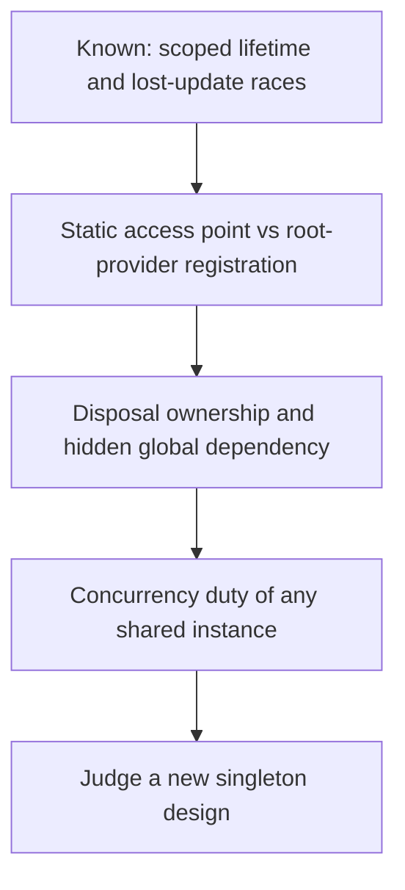

# Singleton: access point versus container lifetime

2026-11-10 · [[Assets/Qard/Courses/Software Architecture Mastery|Software Architecture]] · `singleton-scope`

## Summary

The lesson distinguished a classical static access point from a DI singleton lifetime, then covered disposal ownership, hidden dependencies, and using a scoped unit of work inside a singleton.

Earlier probing showed understanding of scoped lifetime and lost-update races. The lesson checks did not yet demonstrate the static-versus-container distinction (0/1), disposal ownership, or dependency visibility (0/2). The scoped-operation check also scored 0/1: creating and disposing a scope per operation prevents the singleton from retaining the unit of work; it does not synchronize shared state. The final design question was unanswered, so applying these ideas to a new design remains unverified.

## Plan

You already know scoped lifetime and why unsynchronized shared state races, so the lesson skips both. It starts by separating a static access point from a container registration, which is the idea you haven't shown yet. It then covers who disposes the instance and why a static access point hides a dependency. The last step applies all of this to a new case.



## Steps

### 1. Process-wide access vs registration lifetime

Both forms are called "singleton", but they answer different questions. One asks **who can reach the instance**. The other asks **who caches it, and for how long**. You already know how a scope bounds one instance. A singleton registration has the same kind of boundary, just a wider one.

**Classical (static) singleton.** The type stores its own instance in a `static` field and exposes it as `Instance`, with a private constructor. Any code in the process that reads `Clock.Instance` gets the same object. The type enforces this itself, and no container is involved.

**Container singleton.** `services.AddSingleton<Clock>()` is a lifetime rule. The **root provider** (the `ServiceProvider` built from the registrations) creates `Clock` on the first request, caches it, and returns that cached object for later resolutions *from that provider and that registration*. Nothing stops another instance from existing elsewhere.

```csharp
var services = new ServiceCollection();
services.AddSingleton<Clock>();          // Clock has a public constructor

var rootA = services.BuildServiceProvider();
var rootB = services.BuildServiceProvider();

Console.WriteLine(object.ReferenceEquals(
    rootA.GetRequiredService<Clock>(), rootA.GetRequiredService<Clock>())); // True: same provider
Console.WriteLine(object.ReferenceEquals(
    rootA.GetRequiredService<Clock>(), rootB.GetRequiredService<Clock>())); // False: each root has its own cache
Console.WriteLine(object.ReferenceEquals(
    new Clock(), rootA.GetRequiredService<Clock>()));                        // False: new bypasses the container
```

`object.ReferenceEquals` checks whether two references point to the same object, so the output shows object identity directly.

So the rule is "one per root provider and registration", not "one per process". A second provider (for example, from calling `BuildServiceProvider` again) or a direct `new` creates another object. The static form gives one per process because the type owns creation and the access point. See [[Home/Software Architecture/Patterns/Design Patterns/Creational/Singleton|Singleton]] and [[Home/Software Architecture/Patterns/Design Patterns/Creational/Singleton#Singleton Lifetime in .NET|Singleton lifetime in .NET]] ("a lifetime rule, not proof that no other instance can exist"). The [[Home/Software Architecture/Patterns/Design Patterns/Creational/Singleton#Pitfalls|Multiple roots pitfall]] covers the same case.

To find the instance count, ask **where the object is actually created**. If the container constructs it, count the root providers. If something outside the container creates it, follow that code.

This builds on scoped lifetime: a singleton registration is also bounded, by the root provider instead of the scope. The next step uses the same distinction to show who disposes each form and why a static access point hides a dependency.

**Check:** `AppConfig` is a classical singleton. It has a private constructor and a static `AppConfig.Instance` property that always returns the same object once it has been created.

An application builds **two separate root providers**. Each one comes from its own `ServiceCollection` with this factory registration:

```csharp
services.AddSingleton<AppConfig>(_ => AppConfig.Instance);
```

Code then resolves `AppConfig` several times from each provider. How many distinct `AppConfig` objects exist, and why?

**My answer (0/1):** _I didn't know._

**Model answer:** **One.** Each root provider calls its factory once and caches the result, but both factories return the same static `AppConfig.Instance`. Both caches therefore hold a reference to the same object.

### 2. Disposal and hidden dependencies

You already distinguish lifetimes by how long an instance is reused. Cleanup adds another question: **who owns the instance?**

With Microsoft’s built-in DI container, `AddSingleton<IAppConfig, AppConfig>()` lets the container create the configuration. If that instance implements `IDisposable`, disposing the root provider disposes it. Consumers use the shared instance without disposing it themselves. An existing instance supplied through `AddSingleton(existingInstance)` remains the caller’s disposal responsibility. The note describes container-owned cleanup in [[Home/Software Architecture/Patterns/Design Patterns/Creational/Singleton#Questions|the singleton comparison]].

A static `AppConfig.Instance` has no automatic connection to provider disposal. If it owns a resource requiring cleanup, its owning library or application must arrange that cleanup explicitly. The note’s current `AppConfig` only holds configuration values; this disposal concern applies if it acquires disposable resources.

Consider `OrderService` checking an order limit. When its method reads `AppConfig.Instance.MaxOrdersPerHour`, configuration affects its behaviour even though its constructor declares no configuration dependency. A test cannot pass a substitute to that access point; it inherits the shared configuration and its environment-based initialization. This is the [[Home/Software Architecture/Patterns/Design Patterns/Creational/Singleton#Problem|hidden dependency in the classical example]].

With `OrderService(IAppConfig config, IOrderRepository repository)`, the constructor exposes what the service needs. Production can receive the container’s shared configuration, while a test supplies a fake configuration with a controlled limit. Sharing remains possible without requiring global access, as shown in [[Home/Software Architecture/Patterns/Design Patterns/Creational/Singleton#Solution|the injected solution]].

The previous step separated a static access point from a provider’s reuse rule. That distinction now explains why disposal ownership and visible dependencies must be designed separately from instance sharing.

**Check:** An application uses Microsoft’s built-in DI container. `AppConfig.Instance` is a static instance that implements `IDisposable` and owns an open file handle. It is never registered with the container.

The application registers `OrderService` with `AddSingleton<OrderService>()`. Its constructor takes no parameters; its methods obtain configuration through `AppConfig.Instance`. `OrderService` has no cleanup logic, and no other code disposes the configuration.

A developer claims: “Disposing the root provider will dispose `AppConfig.Instance`, because the container created `OrderService`.” Is this claim correct? Explain why.

**My answer (0/2):** _I didn't know._

**Model answer:** No. `OrderService` accesses an independently owned static object; creating the consumer does not give the container ownership of that object’s disposal.

### 3. Concurrency duty of a shared instance

You already know the lost-update race. Two threads read the same field, both add one, and one write overwrites the other. Singleton lifetime alone does not cause that race. It becomes possible when one instance serves concurrent callers **and** those callers perform unsynchronized conflicting operations on shared mutable state, such as two writes, or a read and a write, to the same field. A stateless or immutable singleton can be shared safely.

The container guarantees less than it may seem to. If two requests resolve a singleton at the same moment, the container still creates only one instance and gives that same object to both. This is **thread-safe resolution**, and it ends once the object has been handed over. After that, both requests call methods on the same object, and the container does not lock or serialize those calls.

```csharp
builder.Services.AddSingleton<VisitCounter>();

public class VisitCounter
{
    private int _count;
    public void Record() => _count++;   // read, add, write: not atomic
}
```

Here `_count` is shared mutable state. If two requests call `Record()` together, both can read 41 and both can write 42. One visit is lost, even though the container resolved the counter correctly. Protecting this state is the class's job. It can use `Interlocked.Increment(ref _count)` or a lock, keep its state immutable, or avoid shared mutable state altogether. The same duty covers anything the singleton holds: a non-thread-safe object stored in a singleton field is shared by every caller too. See [[Home/Software Architecture/Patterns/Design Patterns/Creational/Singleton#Pitfalls|Singleton pitfalls]].

**Captive dependency.** Now suppose the singleton receives a *scoped* service through its constructor. A scoped service is meant to live for one request scope. Constructor injection runs only once, when the singleton is created, and the scoped instance passed in at that moment stays in the singleton's field. With Microsoft's default container and scope validation turned off, the app starts. The singleton is built from the root provider, so the captured service is resolved from the root scope and lives until the root provider is disposed, usually at application shutdown. Nothing has to crash for this to be wrong. The service's lifetime has been stretched far beyond what its registration intended. Every later request, including concurrent ones, also uses that one object instead of getting a fresh one. Scoped services such as a `DbContext` are usually not thread-safe, so the stretched lifetime also creates the sharing risk above. With scope validation turned on, the container rejects this dependency graph.

There are two sound fixes. One is to make the consumer scoped. The other is for the singleton to create a scope for each operation, resolve the scoped service inside it, and dispose the scope when the operation ends. See [[Home/Software Architecture/Patterns/Design Patterns/Creational/Singleton#Singleton Lifetime in .NET|Singleton lifetime in .NET]].

Step 1 showed that one singleton instance serves everything resolved from its provider, and step 2 covered who disposes that instance and how callers reach it. This step adds the remaining duty: any mutable state the shared instance holds must be safe for concurrent callers, and it must not capture a scoped service in a field (a transient it keeps must itself suit a shared, long lifetime and concurrent use). Step 4 combines all three in a new design.

**Check:** An ASP.NET Core app registers `ReportScheduler` with `AddSingleton`. `ReportScheduler` injects `IServiceScopeFactory`, which can create new DI scopes. For each call to `Run()`, it does the following in order:

1. Creates a new scope.
2. Resolves `IUnitOfWork` from that scope. `IUnitOfWork` is registered with `AddScoped`. Each resolution creates its own database context, which is not thread-safe and is used only inside that one `Run()` call; no context is shared with other calls.
3. Uses the unit of work.
4. Disposes the scope.
5. Executes `_runs++` on a private `int` field of the scheduler, with no lock or `Interlocked`.

Many requests call `Run()` on the scheduler at the same time. Which statement correctly predicts the concurrency risk?

**My answer (0/1):** The unit of work is still captive: because the scheduler is a singleton, every unit of work it resolves is shared by all calls.

**Model answer:** **B.** Each `Run()` resolves `IUnitOfWork` from its own scope, with its own database context used only in that call, and disposes it afterwards, so no unit of work or context is captured or shared. The scheduler is still one shared instance, though, and `_runs` is shared mutable state. Concurrent `_runs++` calls are unsynchronized read-add-write operations on that field, so updates can be lost. The container's thread-safe resolution does not cover calls into the scheduler.

### 4. Judge a new design

You already know that concurrent updates can race. To judge a singleton design, also trace which instance each caller reaches and which owner controls its lifetime.

Suppose startup registers a cache with `AddSingleton<Cache>()`, builds a temporary root provider, and fills its cache. The application then builds another root provider from those registrations and resolves its cache. These are two container-created instances: warming the temporary provider's cache does not warm the application's cache. Each provider disposes the disposable instance it created when that provider is disposed. See [[Home/Software Architecture/Patterns/Design Patterns/Creational/Singleton#Pitfalls|multiple roots and lifetime pitfalls]] and [[Home/Software Architecture/Patterns/Design Patterns/Creational/Singleton#Questions|creation and disposal ownership]].

One application provider gives consumers a shared instance, but its mutable operations still need synchronization, its retained memory needs bounds, and it must not capture scoped state. Constructor injection makes that dependency visible. A method that reads a static cache instead can silently use a different instance, regardless of what its constructor receives. See [[Home/Software Architecture/Patterns/Design Patterns/Creational/Singleton#Problem|hidden static dependencies]].

The previous step established that safe resolution does not make shared state safe. This step combines that boundary with instance identity, disposal ownership, and the dependency the consumer actually uses.

**Check:** An application registers a disposable `Cache` with `AddSingleton<Cache>()`. Startup performs these operations in order:

1. Builds a temporary root provider, resolves its cache, and stores that instance in the static property `CacheAccess.Current`.
2. Disposes the temporary provider.
3. Builds the application's root provider from the same registrations and resolves its cache. This provider remains alive.
4. Constructs a handler, passing the application's cache into its constructor.

The handler stores its constructor argument, but its `Read` method calls `CacheAccess.Current.Get(key)`. Nothing reassigns `CacheAccess.Current`. Every cache operation is synchronized, and `Get` throws `ObjectDisposedException` when called on a disposed cache.

Will the handler's cache read succeed after startup? Give the outcome and explain which instance determines it.

**My answer:** _I didn't know._

**Model answer:** It throws `ObjectDisposedException`. `Read` uses the temporary provider's disposed cache through `CacheAccess.Current`, regardless of the live cache passed into the constructor.
