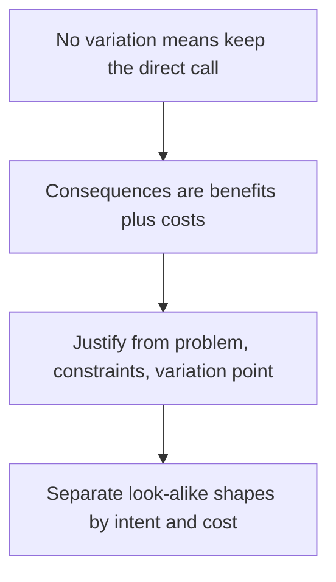

# Justify a Pattern by Pressure and Cost

2026-11-10 · [[Assets/Qard/Courses/Software Architecture Mastery|Software Architecture]] · `pattern-selection`

## Summary

The lesson covered how to justify a design pattern and tell it apart from look-alike structures. It had three parts. First, a pattern's consequences are a two-sided tradeoff: what the pattern buys and what it costs. Second, a pattern is justified by a recurring problem, the constraints on it, and a concrete variation point. Third, patterns with the same wrapper or delegation shape are told apart by intent and cost.

**What you showed:** In the probe you judged intent over shape correctly. You rejected patterns where nothing really varies, and you recognised Proxy by its intent. The checks showed the same gap each time: the right instinct but no precise reason.
- **Consequences (0/2):** You had the right ingredients but never ruled on the teammate's claim. You also didn't name undo/redo as the benefit they left out. Calling consequences "drawbacks" (from the probe) is the same slip.
- **Justification (1/2):** Your verdict was right, but you backed it with Observer's general purpose instead of naming the variation point.
- **Look-alikes (0/2):** Leaning toward State was right, but you gave no reason based on intent.

**Next:** For every pattern judgement, give a verdict, name the specific variation point or benefit, and say how it differs from the look-alike by intent.

## Plan

You already reject patterns with no real variation and identify a Proxy by its intent. The lesson starts by restating a pattern's consequences as a two-sided tradeoff. Then it builds the justification from a recurring problem, constraints and variation point. It ends by applying that justification to look-alike shapes.

## Steps

### 1. Consequences are a two-sided tradeoff

You already reject a pattern when no real variation exists. That judgement compares two things: what the pattern would give you and what it would cost. A pattern's **consequences** are both sides of that comparison, not just its drawbacks.

- **What it buys:** the problem it makes easier, such as replaceable behaviour, a protected boundary or decoupled parts.
- **What it costs:** the price of that help, such as extra types, an extra hop between caller and behaviour, or control flow that is harder to follow.

Your notes frame pattern selection as this pair of columns. See [[Home/Software Architecture/Patterns/Design Patterns/Design Patterns#Choose a Pattern by Intent and Cost|Choose a pattern by intent and cost]]. [[Home/Software Architecture/Patterns/Patterns|Patterns]] calls the decision "a cost comparison".

**Example: Observer.** An object's state changes, and an unknown, changing set of other objects needs to react.
- *Buys:* the publisher does not know who its subscribers are. Subscribers can be added or removed without editing the publisher.
- *Costs:* notification order, subscriber lifetime and error handling are no longer visible at the call site. They happen indirectly.

If you list only the costs, Observer looks like pure overhead. If you list only the benefit, it looks free. Neither version lets you decide. The verdict comes from weighing both sides against the pressure in the code.

Now change one premise. Suppose exactly one dependent reacts, it is fixed and known in advance, and the publisher can call it directly. Nothing needs to subscribe or unsubscribe, and there is no boundary between publisher and dependent to keep. The benefit side is now empty, but the cost of indirect notification is still there, so a direct call wins. If that single dependent still had to be swappable, or the publisher had to stay unaware of it, the benefit would come back and you would need to weigh the two sides again.

This fixes the earlier "drawbacks" wording: consequences are a benefit and a cost together. The next step looks at the benefit side. It names the recurring problem, the constraints and the variation point that let the benefit outweigh the cost.

**Check:** A text editor wraps each edit operation (insert, delete, format) in a **Command** object so that edits can be undone and redone. In a design review, a teammate writes:

> *Consequences of Command here: one extra class per operation and boilerplate around what used to be simple method calls.*

Is this a complete statement of the pattern's consequences in this design? Give your verdict and say what, if anything, is missing.

**My answer (0/2):** Without shared contract it would be bigger overhead to support operation history for undo/redo, and each new operation will require changing the code with huge switch, that was already done in some moment which will violate open/close principle.

**Model answer:** Incomplete. It lists only the costs. The missing side is what Command buys here: it makes undo/redo of edits possible.

### 2. Justify a pattern from problem, constraints and variation point

You already reject a pattern when nothing varies. Turn that test around and you get a useful way to argue *for* one. It has three parts, each visible in the code as it is today:

- **Recurring problem:** a design pressure the code already has, not one you expect later. For example, the same place keeps needing different behaviour.
- **Constraints:** what must stay fixed while that pressure is handled. For example, callers must not change, or each variant must be testable on its own.
- **Variation point:** the one place that changes, named precisely, behind a contract that stays stable.

When all three are present, the candidate is the pattern whose intent fits that variation point. You then weigh what it buys against what it costs, as in the previous step.

Variation is the most common justification, but not the only one. The notes list three kinds of pressure: recurring variation, a **responsibility boundary** (one concern must be kept apart from another), and a **failure mode** (the direct design keeps producing the same defect or cost). See [[Home/Software Architecture/Patterns/Patterns#Questions|evidence that justifies a pattern]]. The selection rule is to pick "the smallest pattern that makes a real variation or responsibility boundary explicit" ([[Home/Software Architecture/Patterns/Design Patterns/Design Patterns#Choose a Pattern by Intent and Cost|choose a pattern by intent and cost]]). So if you find no variation point, look for those other pressures before you conclude the pattern is unjustified.

**Example: a checkout that prices shipping.**

- *Before:* there is one carrier with one fixed rate. Nothing creates pressure, so a direct calculation is correct. A Strategy would add indirection and solve nothing.
- *After:* the shop now uses several carriers, and each carrier changes its rate rules on its own schedule.
  - **Problem:** the same calculation repeatedly needs different behaviour.
  - **Constraints:** checkout code must stay unchanged when a carrier is changed or added, and each carrier's rules must be tested on their own.
  - **Variation point:** "how shipping cost is computed for an order", behind one stable contract such as `decimal Quote(Order order)`.

That phrasing matches Strategy's intent: interchangeable algorithms behind a stable contract. What it buys is that carriers plug in without touching checkout. What it costs is extra implementations (classes or delegates, one per algorithm) and one more level of indirection between checkout and the rule it runs.

The same reasoning tells you when to revisit the decision. Suppose the shop goes back to one carrier. The swap between carriers is gone, but that carrier's rules may still change independently of checkout, and the testing constraint may still hold. So you check whether that remaining pressure still costs more than the indirection, and only then decide whether to inline the Strategy.

The previous step framed a pattern's consequences as benefits weighed against costs. This step names the evidence that makes the benefits real: a recurring problem, its constraints and, most often, a specific variation point. The next step uses that intent to tell apart patterns that look alike.

**Check:** An `OrderService` places orders. After each order it calls `Inventory.Reserve(order)` directly, and that reservation must always happen. Three new requirements arrive: the email team, the analytics team and the loyalty team each want to react when an order is placed. More teams are expected to join over time. Each team owns its own handler. `OrderService` must not be edited every time a team starts or stops listening.

The **Observer** pattern lets a publisher notify a changing set of subscribers through a common interface, without knowing who they are.

Is introducing Observer for these team reactions justified? Give your verdict and name the variation point that supports it.

**My answer (1/2):** It looks justified for me, the observer pattern is created directly for the case when some action should notify someone about it, which trigger another action

**Model answer:** Yes, it is justified. The variation point is **which handlers react to "order placed"**: the changing set of team-owned subscribers.

*Optional detail:* that set grows and shrinks while `OrderService` publishes through one stable contract, so it needs no edit when a team joins or leaves. The required inventory reservation can stay a direct call.

### 3. Distinguish look-alike shapes by intent and cost

You already identify a Proxy by what the wrapper is *for*, not by how it is built. Proxy and Decorator have the same structure: each wraps an object with the same interface. Forwarding the call doesn't tell them apart, because both normally forward and either one can stop a call in some cases. For example, a Decorator that adds input validation may reject a bad request. The difference is intent. A Proxy exists to **control access** to the real object: whether, when or how a call reaches it. A Decorator exists to **add a responsibility**, such as logging, validation or caching, around the object it wraps. The same rule settles other look-alike pairs: [[Home/Software Architecture/Patterns/Design Patterns/Design Patterns#Choose a Pattern by Intent and Cost|similar structure does not imply the same pattern]].

**State vs Strategy.** In both, an object (the *context*) delegates part of its behaviour to another object behind an interface. In a class diagram they look identical. They solve different problems:

- **Strategy:** the delegate is an interchangeable *algorithm*, a policy for how one job gets done. A client usually supplies it. It can still be swapped at runtime, for example when a user changes a setting. Swapping it changes the policy. It does not mean the object has moved to a new stage.
- **State:** behaviour depends on the context's *current condition*, and that condition changes over the object's lifetime. The delegate is replaced as the object moves from one condition to the next. The transition rules may live in the context or in the state objects.

The note says that who picks the delegate is not the real test. The test is whether the delegate represents an **interchangeable policy** or a **condition in the object's lifecycle**.

**Example.** Two classes each delegate one call:

1. An `Invoice` calls `pricing.Calculate(order)`. The caller supplies `StandardPricing` or `DiscountPricing`, and an admin may switch it later. Each option is just a different way to compute a price. That is **Strategy**.
2. A `Document` calls `stage.Publish(doc)`. In `Draft`, the call sends the document to review and the stage becomes `InReview`. In `InReview`, it publishes and the stage becomes `Published`. In `Published`, it does nothing. That is **State**: the same call does different things depending on how far the document has progressed, and operations move it between conditions.

**Cost follows intent.** A pattern's consequences come from its intent. The [[Home/Software Architecture/Patterns/Design Patterns/Design Patterns#Choose a Pattern by Intent and Cost|selection table]] gives some of them:

- Strategy makes policy selection explicit and testable. It costs more types or delegates, and a small, stable conditional can be clearer.
- Decorator composes responsibilities at runtime. It costs nested wrappers that hide the order of execution.

The same reasoning covers the other two:

- State can move condition-specific branching out of the context's methods. Depending on the implementation, it may add a class per state, and transition logic may be split between the context and the states.
- Proxy centralises an access rule. It costs an extra indirection on every call.

If you name the wrong pattern, you expect the wrong benefits and pay costs that the problem never called for.

Step 2 justified a pattern from its problem, constraints and variation point. This step uses the same justification to separate patterns whose class shapes are identical. That completes the goal of choosing a pattern by intent and cost rather than by structure.

**Check:** A `VendingMachine` class delegates `InsertCoin()` and `SelectItem()` to a handler object behind an `IMachineHandler` interface. There are three handlers: `NoCoin`, `HasCoin` and `SoldOut`. When a coin is inserted, `NoCoin` stores it and replaces the machine's handler with `HasCoin`. `HasCoin.SelectItem()` dispenses the item and then sets the handler back to `NoCoin`, or to `SoldOut` if stock reached zero. No caller of `VendingMachine` ever chooses or passes in a handler.

A colleague calls this the Strategy pattern "because the behaviour sits in an interchangeable object behind an interface."

Is this State or Strategy? Give your verdict and a reason based on intent.

**My answer (0/2):** I would assume it can be state pattern, but i wouldnt recall it if you wasnt mention it. Cant explain why this pattern

**Model answer:** **State.** Each handler stands for a condition the machine is in: no coin, has coin or sold out. Operations move the machine from one condition to the next, so `SelectItem()` behaves according to the current condition. A Strategy would be an interchangeable algorithm chosen as a policy for doing one job. Both patterns delegate behind an interface, so the shape cannot decide between them.
