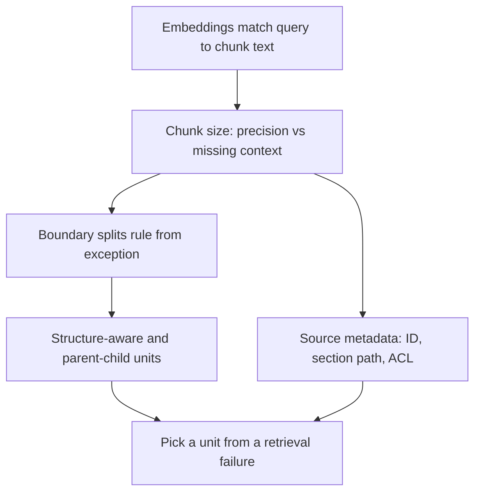

# Retrieval units that keep rules with conditions

2026-11-16 · [[Assets/Qard/Courses/AI & ML Mastery|AI & ML]] · `retrieval-units`

## Summary

The lesson covered how to choose retrieval units in RAG chunking. It started with chunk size as a tradeoff: small chunks match precisely but can split a rule from its exception, while large chunks keep context but blur the embedding. Next came structure-aware and parent-child chunking as ways to keep conditions attached to their rules. It then covered the metadata each chunk needs to be traced back to its source (document ID, section path, timestamp, ACL), and how to pick a unit from an observed failure.

**What you showed:**
- **Chunk size (1/2):** You gave the right verdict and spotted the missing base number. You did not explain that chunk 2 depended on chunk 1, which was never retrieved because each chunk is scored on its own.
- **Keeping conditions (0/2):** You expected parent expansion to recover an exception that sat in a *different* section. Expansion only returns the matched child's own parent, so it never reaches that exception. This is the main gap.
- **Metadata (2/2):** Correct, but you marked yourself unsure, so it is worth reviewing.
- **Choosing from a failure (1/1):** Solid.

## Plan

You haven't been tested on chunking, so the lesson starts with why chunk size is a tradeoff, using a rule and its exception. It then covers how structure-aware and parent-child units keep conditions attached. It ends with metadata and picking a unit from an observed failure.



## Steps

### 1. Chunk size as a precision vs context tradeoff

Recall the retrieval step. The query is embedded as one vector, and each stored piece of text is embedded as one vector. The pieces whose vectors are most similar to the query are passed to the model. The piece that is embedded, scored and returned is the **retrieval unit**, usually called a chunk. Chunking decides where the edges of each chunk fall ([[Home/AI & ML/LLM/Context Engineering/RAG/Chunking|Chunking]]).

Each chunk gets **one** vector, however much text it holds. That is why chunk size involves a tradeoff in both directions.

**Large chunk: the match can be diluted.** Suppose a whole "Data Retention" section is one chunk. It covers log retention, backup schedules, deletion requests and audit duties. One vector has to represent all of those topics. Against a narrow query such as "How long are security logs kept?", it can score lower than a chunk about log retention alone would. Even when it is retrieved, most of its text is unrelated and still takes up the model's context. The note describes this for oversized structural units: unrelated text "can dilute retrieval precision" ([[Home/AI & ML/LLM/Context Engineering/RAG/Chunking#Structure-Aware Chunking|Structure-Aware Chunking]]).

**Small chunk: a condition can be cut off.** Take the policy *"Keep logs for 90 days. Exception: security investigations require 365 days."* A small fixed-size split can produce two chunks:

- Chunk A: "Keep logs for 90 days."
- Chunk B: "Exception: security investigations require 365 days."

Each chunk now has a focused vector, which can help it match a query precisely. But each chunk is scored on its own. If retrieval returns chunk A and not chunk B, the model sees "90 days" and has no sign that an exception exists. Its answer can then miss the 365-day case. The note's diagram shows this failure ([[Home/AI & ML/LLM/Context Engineering/RAG/Chunking#Fixed-Size Chunking|Fixed-Size Chunking]]).

No chunk size is right by default. Smaller units **can** sharpen the match but hold less context. Larger units keep related statements together but **can** blur the match and add noise. These are tendencies, not guarantees, and their effect on a given corpus is measured by retrieval evaluation. The aim is a unit that keeps one complete idea together. In this example, that means keeping the rule with the condition that changes it.

This builds on embedding similarity: a chunk is matched only through its single vector. The tradeoff is the problem the next steps address. They show how to keep conditions with their rules, how to make each chunk traceable to its source, and how to choose a unit from an observed failure.

**Check:** A shop's returns policy is chunked **one sentence per chunk**, so two adjacent sentences become separate chunks:

- Chunk 1: "Items may be returned within 30 days of purchase."
- Chunk 2: "For sale items, this window is halved."

Each chunk is embedded on its own, with no heading or neighbouring text added. No other document mentions return periods, and the model has no outside knowledge of this shop's policy.

A user asks: *"How many days do I have to return a sale item?"* The retriever returns **chunk 2 only**, because it mentions sale items, and only that text is passed to the model.

Can the model correctly state the number of days from what it receives? Give a verdict and explain why.

**My answer (1/2):** Nope, the chunks are too small and context was lost between two chunks.Model had only "halved" which is not a number, and doesnt reflect from what number it is halved. To fix this, either chunk size should be increased, or chunk intersection should be increased

**Model answer:** **No.** Chunk 2 only says the window is halved. "This window" refers to the 30-day rule in chunk 1, which was split into a separate chunk and not retrieved, so the model has no base period to halve and cannot arrive at 15 days.

### 2. Keeping conditions with their rules

Step 1 ended on a tension. A small chunk matches a query precisely, but it can leave the exception behind. A large chunk keeps the exception, but extra text dilutes the match. There are two ways to keep the condition with its rule, and each adds its own cost.

**Running example.** A policy document has a heading *Data Retention*. Under it are two sentences: "Keep logs for 90 days. Exception: security investigations require 365 days." A blind split at a fixed position can cut between them. A query about logs then retrieves only the 90-day sentence.

**1. Structure-aware splitting: make the unit match the document's logic.** A parser for the format (Markdown headings, HTML DOM, PDF layout) reads the document as typed blocks such as heading + prose, table, code block and list. Each block becomes one chunk. The rule and its exception sit in the same *Data Retention* block, so they become one chunk, and that chunk is both searched and returned. Each chunk also inherits its heading path as metadata. ([[Home/AI & ML/LLM/Context Engineering/RAG/Chunking#Structure-Aware Chunking|Chunking: Structure-Aware]])

Costs:
- **Dilution from large blocks.** A long section becomes one big chunk. Its unrelated text weakens the match, and it may exceed the embedding model's input limit. A maximum chunk size bounds this by splitting oversized blocks.
- **Parser maintenance.** Each source format needs its own parser. A parser can also misparse silently when a source changes format, which shifts chunk boundaries without any error.

**2. Parent-child: search one unit, return another.** Ingestion cuts small *children* (about 100–200 tokens) for searching. Each child records the ID of its *parent*, a larger span such as the whole *Data Retention* section. At query time:

1. The query matches the 90-day child.
2. A lookup by parent ID fetches the section. This is not a second similarity search.
3. The generator receives the section, which includes the exception.

The search stays precise because only the small children are compared with the query. ([[Home/AI & ML/LLM/Context Engineering/RAG/Chunking#Parent-Child Chunking|Chunking: Parent-Child]])

Costs:
- **Noise from broad parents.** If the parent is too large, expansion fills the context window with irrelevant text. That gives back the precision the small children gained. A size limit on parents bounds this.
- **Pipeline and storage.** The pipeline needs an expansion step that maps children to parents, keeps a parent shared by several children only once, and assembles the context. It also stores the mapping and the parent text. This adds latency and code.

**The shared boundary.** Each method recovers only what lies inside the unit it hands back. Structure-aware returns the parsed block. Parent-child returns the matched child's own parent. A condition outside that unit stays missing.

Step 1 showed that the chunk boundary decides whether an exception stays with its rule. This step gives two ways to keep them together and the cost of each. Step 4 needs exactly these costs to pick a unit for an observed failure.

**Check:** A RAG system uses parent-child chunking on a policy document. Each **parent** is one heading section. Each **child** is a single clause inside that section and stores its parent's ID.

The document has a section *Log Retention* containing "Keep logs for 90 days." Several unrelated sections later, a separate section *Exceptions* contains "Security-investigation logs: 365 days."

For the query "How long must security-investigation logs be kept?", assume only the 90-day clause's child is retrieved.

Will the generator's context contain the 365-day exception? Give a yes/no verdict and explain why.

**My answer (0/2):** Yes, because the parent chunk contain this info, and it will be retrieved via child chunk

**Model answer:** No. Expansion looks up the parent ID stored on the matched child, so it returns only the *Log Retention* section. The exception is in the separate *Exceptions* section. That section is not this child's parent and was not retrieved, so it never reaches the generator.

### 3. Metadata that traces a chunk to its source

Once a document is cut into chunks, each chunk is just a short piece of text with an embedding. On its own, it can't say which document it came from, where it sat in that document or who may read it. That information has to be attached as **metadata** at ingestion time, while the splitter still knows it. This applies to every splitter: fixed-size, structure-aware or parent-child.

The note's baseline is that [[Home/AI & ML/LLM/Context Engineering/RAG/Chunking#Practical Baselines|each chunk carries its source document ID, section path, ingestion timestamp and ACL scope]]. Adding these fields during ingestion is cheaper than reconstructing them later. Three of them do most of the work:

| Field | What it records | What it enables |
|---|---|---|
| **Document ID** | Which source file the text came from | **Citation**: the answer can point to the exact document, and the chunk can be traced back for review or re-ingestion |
| **Section path** | The heading chain above the text, e.g. `Handbook > Leave > Parental leave` | **Filtering** to a section, e.g. search only under `Leave`, plus section-level citation |
| **ACL scope** | Who may read the source (an *access-control list*: the groups or roles allowed to see it) | **Access control**: chunks the user may not see are excluded at retrieval, so their text never enters the prompt |

**Example.** An internal handbook has a public section `Leave > Parental leave` and a section `Managers > Pay bands` that only managers may read. After splitting, a chunk from the restricted section is stored like this:

```text
text:         "Band C covers ..."
doc_id:       handbook-v4
section_path: Managers > Pay bands
acl_scope:    managers
```

Suppose a regular employee asks about pay. In this pipeline, the retriever runs the similarity search with a filter that keeps only chunks whose `acl_scope` includes the user's groups. This chunk is dropped before the model sees it, so the answer can't quote or paraphrase it. When a manager asks, the chunk is kept, and the answer can cite `handbook-v4 › Managers > Pay bands` so a reader can check the source.

In this illustrated pipeline, the fields are stored beside the text and checked as exact filter conditions, separate from the similarity score. Similarity decides which chunks are *relevant*; the filter decides which are *allowed*; the stored IDs record *where each came from*. Other pipelines may also prepend a heading path to the embedded text or use metadata to boost ranking, but an access check still needs the scope to be present on each chunk. Structure-aware splitting fills these fields naturally because [[Home/AI & ML/LLM/Context Engineering/RAG/Chunking#Structure-Aware Chunking|each chunk inherits the section title, heading path and document ID of its structural ancestors]]. A plain fixed-size splitter has to copy them onto each chunk explicitly.

Steps 1–2 decided how big a retrieval unit is and what text it keeps together. This step adds what every unit must carry regardless of that choice, so that a retrieved chunk can be cited, filtered and access-checked. Step 4 relies on this, because a unit that answers correctly but can't be traced or secured still fails.

**Check:** A company indexes its internal handbook for a RAG assistant. One section, *Managers > Pay bands*, may only be read by managers. That section is too long for one chunk, so the ingestion pipeline splits it into two chunks, A and B. Because of a bug, **only chunk A** gets the section's metadata (document ID, section path, ACL scope `managers`). Chunk B gets its text and embedding but **no metadata fields**. Ranking uses only the similarity between the query and the chunk's embedding.

At query time, the retriever applies an access filter: it **removes chunks whose ACL scope does not include the user's groups**. A chunk with **no** ACL scope field is **not removed** by this filter.

A regular (non-manager) employee asks a question whose best similarity match is chunk B. Predict what happens to chunk B's restricted text, and explain why.

**My answer (2/2):** AS per "A chunk with no ACL scope field is not removed by this filter." i would assume that B chunk will be returned as well since i assume here access filter also include null values, even metadata is missing. If is not the case, and i misudnerstood the question, then B will not be returned since it doesnt have acl metadata because of the bug.

**Model answer:** Chunk B is retrieved and passed into the prompt, so restricted pay-band content can leak into the non-manager's answer. The filter checks each chunk's own ACL scope. B has no scope field, and this filter does not remove unscoped chunks, so B passes.

### 4. Choose a retrieval unit from an observed failure

The earlier steps gave you three tools. Chunk size trades a sharp match against missing context. Structure-aware and parent-child units keep a condition attached to its rule. Metadata traces a chunk back to its source. In practice you don't pick a unit up front. You read a failure, work out **what got separated from what**, and choose the cheapest unit that keeps those pieces together ([[Home/AI & ML/LLM/Context Engineering/RAG/Chunking#How to Choose a Strategy|Chunking: How to Choose a Strategy]]).

Three questions diagnose the failure:

1. **Did retrieval find the right passage?** If it didn't, the match is the problem, so look at chunk size or boundaries. If it did, the missing piece is context next to the match.
2. **Is the separated piece inside one layout block**, such as a table, a code block, or a clause with its exception? If so, the boundary cut that block apart.
3. **Is the block small enough to stay one chunk?** It has to fit the embedding model's input limit without burying the match in unrelated text.

**Example: a table split from its header.** An API doc has a parameter table. Its header row is `Name | Type | Default`, and parameter rows follow it. A Markdown table has no blank lines between rows, so recursive splitting falls back to single newlines and can put a boundary partway down the table. A query about a parameter's default then retrieves a later row such as `timeout | int | 30`, but that chunk has no header. The model can't tell which column holds the default ([[Home/AI & ML/LLM/Context Engineering/RAG/Chunking#Recursive Chunking|Chunking: Recursive Chunking]]).

- **What was separated:** rows from their header, inside one layout block (a table).
- **Unit:** structure-aware, with the table kept atomic as its own chunk. The header and rows stay together, and the chunk carries its section path ([[Home/AI & ML/LLM/Context Engineering/RAG/Chunking#Structure-Aware Chunking|Chunking: Structure-Aware Chunking]]).
- **Cost:** you maintain a parser for each source format, and a format change can break it without any visible error.
- **Boundary:** a table larger than the size limit still has to be split. Copying the section path onto each fragment is not enough. The path tells you where a fragment came from, but it doesn't say what the columns mean. A later fragment without the header row reproduces the original failure. So each fragment must repeat the header row, so its rows can be read on their own.

**Contrast: the right clause is found, but the answer misses the exception in the next paragraph.** Here the match was fine and the context was missing. **Parent-child** keeps the small searched unit and expands each match to a stored parent span ([[Home/AI & ML/LLM/Context Engineering/RAG/Chunking#Parent-Child Chunking|Chunking: Parent-Child Chunking]]). The fix works only if parent boundaries are drawn so that the clause and its exception fall in the same parent. If a parent ends between the two paragraphs, expansion returns the clause without its exception. Expansion costs extra tokens per hit and needs an expansion and deduplication step. A parent-size limit caps how much extra text each hit adds. It does not guarantee that the added text is relevant, so citation precision is still tracked before and after expansion.

| Observed failure | What was separated | Unit | Main cost |
| --- | --- | --- | --- |
| Rows returned without their header | Parts of one table | Structure-aware, table kept atomic (header repeated if it must be split) | Parser maintenance |
| Rule found, nearby exception missing | The match and its neighbouring context | Parent-child, with parents spanning rule and exception | Tokens and noise from expansion |

Metadata such as document ID, section path and ACL scope goes on every unit, whichever splitter you choose. It supports citation, filtering and access control. On its own, it never puts missing text into the context.

Steps 1–3 gave you the size tradeoff, the two units that keep conditions attached, and the metadata every chunk carries. This step uses all three to diagnose a failure, choose a unit and weigh it against its cost, which is the goal of the objective.

**Check:** A RAG system indexes technical specifications written in Markdown. Each section is about 3,000 tokens, which is more than the embedding model's input limit. Within a section, a parameter is described in one paragraph and its constraint (for example, "must not exceed the connection pool size") is in the next paragraph. Evaluation shows that retrieval finds the correct parameter paragraph, but answers often leave out the constraint.

Which retrieval unit, with its stated cost, best fixes this failure?

**My answer (1/1):** Parent-child: small searched children, each expanded to a size-limited parent that spans the parameter and its constraint; the cost is extra tokens and possible noise per hit

**Model answer:** **Parent-child: small searched children, each expanded to a size-limited parent that spans the parameter and its constraint.** Retrieval already finds the right paragraph, so the search unit can stay small. Expanding each match to a parent drawn to include the following paragraph brings in the constraint. The cost is extra tokens and possible noise per hit; the size limit caps how much text is added. A whole-section chunk would exceed the embedding model's input limit.
