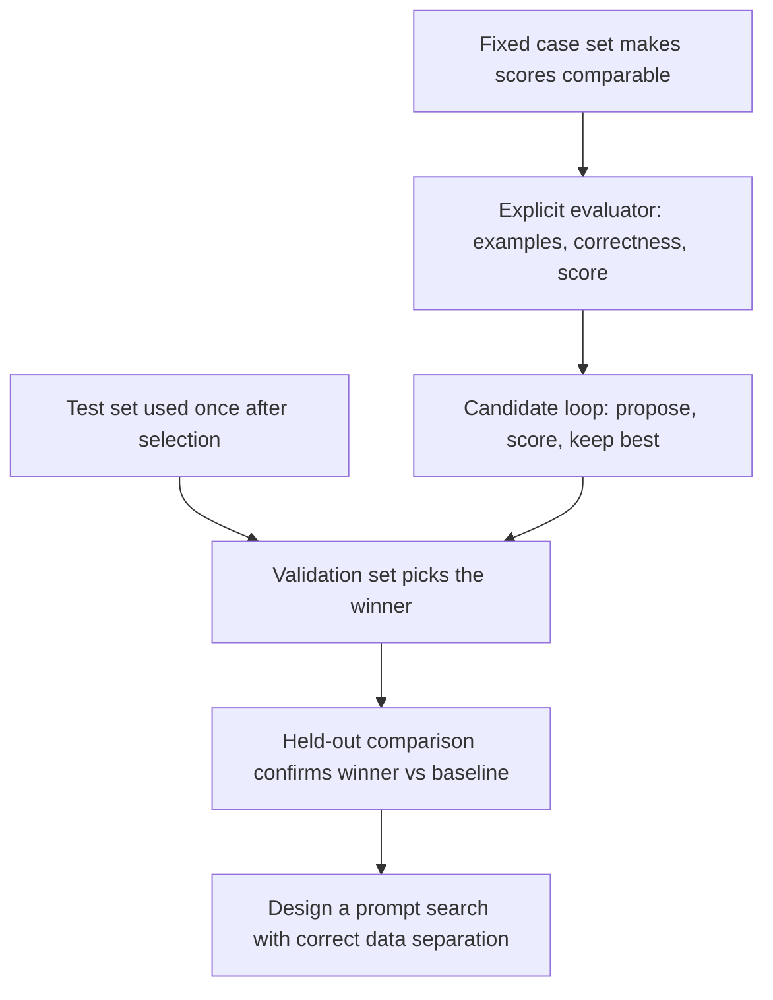
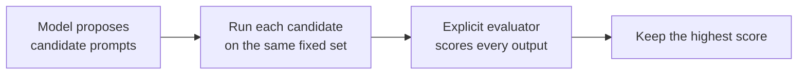
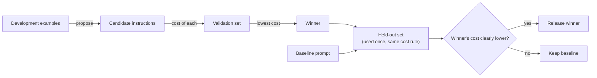

# Searching prompts without fitting the evaluator

2026-11-22 · [[Assets/Qard/Courses/AI & ML Mastery|AI & ML]] · `prompt-search`

## Summary

The lesson built the prompt-search loop from the note's APE section: an explicit evaluator scores every candidate against known answers on a shared validation set, the highest scorer wins, and the winner is compared once on a held-out set the search never touched. It then covered why the winner's validation score is inflated (the maximum of several noisy scores carries the luck that put it on top, and more candidates mean more inflation) and closed with designing the full split for a new task.

Coming in, the student knew a final test set stays untouched and that comparisons need a fixed shared case set. In the checks, the student treated format compliance as correctness and did not compare the candidate's values against the known totals, so a wrong invoice passed. On selection bias the student reversed the direction, saying fewer candidates inflate more. The end-to-end split design was not attempted. The core gap is the evaluator's role (reference comparison, not format checking) and the mechanics of winner bias; the validation/held-out roles themselves are still only partly shown.

## Plan

You already know that a fixed case set makes scores comparable and that a final test set is used once. The lesson builds the search loop on that: an explicit evaluator scores candidates on validation data, then the winner is compared once on held-out data. It ends with a scenario where you design the whole split.



## Steps

### 1. The evaluator and the candidate loop

You already know that scores can only be compared when every prompt runs on the same fixed set of cases. Prompt optimization builds a loop on that rule ([[Home/AI & ML/LLM/Prompt Engineering/Automated Prompt Optimization|Automated Prompt Optimization]]):

1. **Propose candidates.** A model writes many versions of the part being tuned. That can be the instruction wording (as in [[Home/AI & ML/LLM/Prompt Engineering/Automated Prompt Optimization#Automatic Prompt Engineer (APE)|APE]]) or the set of demonstrations, meaning the worked input→output examples placed in the prompt.
2. **Run each candidate on the same fixed set.** Every case in the set has a known correct answer.
3. **Score with an explicit evaluator.** The evaluator is a rule written down in advance, usually code, that turns each output into a score: exact match, a label check, a JSON validity check, and so on. The same evaluator scores every candidate.
4. **Keep the highest scorer.**



The evaluator has to be explicit because it is the only thing doing the choosing. Nobody reads the outputs and picks the one that seems best. The loop keeps whatever the rule rewards, so the rule has to say exactly what counts as correct.

**Example.** The task is to label customer messages as `refund`, `delivery` or `account`. The evaluator counts a case as correct only when the output is exactly the known label. Here two candidate sets of demonstrations run on the same set of cases:

- Candidate 1 gets most labels right but sometimes replies with a full sentence, like "This is a refund request." The evaluator counts that sentence as wrong.
- Candidate 2 always outputs a bare label and gets slightly more cases right under that rule.

The loop keeps Candidate 2. A person skimming the outputs might have preferred Candidate 1's readable sentences, but the evaluator's rule decides. If sentences should count as correct, the evaluator has to be changed before the search runs, not overruled afterwards.

The note's own worked case is three instructions scored 3, 4 and 5 out of 5 by code that counts correct labels. There C is kept "because the count decided and nobody compared wordings by eye". A loop like this is only as good as the score it follows. Which data it should be scored on comes next.

This step puts your fixed-set rule to work: a search proposes candidates, an explicit evaluator scores them all on the same set, and the best is kept. Later steps ask whether that winner's score can be trusted, and which data each stage should use.

**Check:** A prompt search tunes a prompt that pulls the total out of an invoice. The **evaluator** is code that counts an output as correct only if the output is exactly the known total, written as a bare number with two decimals (for example `120.00`). Anything else counts as wrong.

The fixed set has four invoices. Their known totals are `120.00`, `45.50`, `980.00` and `12.99`. Three candidates, each with a different set of demonstrations, produce these outputs in that order:

| Candidate | Invoice 1 | Invoice 2 | Invoice 3 | Invoice 4 |
|---|---|---|---|---|
| P | `120.00` | `45.50` | `980` | `12.99 EUR` |
| Q | `Total: 120.00` | `Total: 45.50` | `Total: 980.00` | `Total: 12.99` |
| R | `120.00` | `54.50` | `980.00` | `12.99` |

Which candidate does the search keep, and what is its score out of 4?

**My answer (0/2):** The candidate R should have max score since all its results are in the expected format, so score sould be 4/4 if all labels have correct value. P and Q candidates have fluctuation in format that will be scored as failed on check

**Model answer:** The search keeps **R**, with a score of **3 out of 4**.

For reference, P scores 2 (`980` and `12.99 EUR` break the format), Q scores 0 (every output has a `Total:` prefix), and R scores 3 (only `54.50` is wrong).

> **Q:** How i would know that correct answer is 54.50?
> You wouldn't know it from the loop itself. The "known correct answer" has to come from outside the loop, before any candidate runs.
> 
> Typical sources:
> - A person labels each case by hand. For the refund/delivery/account task, someone reads each message and writes down its label.
> - Existing records already hold the truth, such as past tickets with the label an agent assigned.
> 
> The evaluator only compares a candidate's output to that stored answer. It doesn't work out the answer itself.
> 
> The note says this too: the set has "examples with known answers", and someone still decides "what counts as a correct output" ([[Home/AI & ML/LLM/Prompt Engineering/Automated Prompt Optimization|Automated Prompt Optimization]]).
> 
> I don't see a 54.50 in this note or in this step's example, so I can't say where that figure comes from. If you saw it in another exercise, tell me which one. The same rule applies: the value is only "correct" because someone fixed it in advance, for example by calculating it or taking it from a record.

> **Q:** But if not, why my answer is 4/4 considered wrong, while all formats are correct?
> I can't see your answer or the evaluator's rule, so I can't say exactly why it failed. The likely cause is that the evaluator doesn't judge "format correct." It compares each output to one stored answer under a fixed rule, such as exact match.
> 
> In the example, "This is a refund request." counts as wrong because it isn't exactly `refund`, even though a person would accept it.
> 
> A 4/4 that looks right to you can still be marked wrong for three reasons:
> - the rule is stricter than you assumed, for example exact string match
> - the stored answers differ from what you expected
> - the evaluator checks something other than format
> 
> Paste your answer, the expected answers and the rule. Then I can point to the exact mismatch.
> 
> If your outputs should count as correct, the rule has to change before the search runs. The note says someone still decides "what counts as a correct output" ([[Home/AI & ML/LLM/Prompt Engineering/Automated Prompt Optimization|Automated Prompt Optimization]]).

### 2. Why the search winner is biased

The loop from the previous step keeps the candidate with the highest score on a fixed set. That rule has a side effect: on average, the winner's score on that set is too optimistic.

**Why.** A candidate's score on a small set mixes two things:

- **Real quality.** How well the wording works on messages of this kind in general.
- **Evaluation noise.** Whether the particular examples in the set happen to suit that wording. On a borderline message, a wording can get the right label by chance. On a different set of examples, the same wording could score a little higher or lower.

Picking the top score picks on the sum of the two. A candidate whose noise happened to be positive is more likely to come first than one whose noise was negative. So selection favours positive noise, and the winner's score tends to sit above its real level. This holds on average across searches. It does not prove that any particular winner was lucky, and the winner may also be truly the best. The same reason explains why a final test set is used only once: after a set has been used to make a choice, its score for that choice is no longer a fair measurement.

How much the score is inflated depends on the candidates and the set:

- **Set size.** On a small set each example moves the score a lot, so noise is large compared with real differences.
- **Number of independent chances.** More candidates with separate noise give more chances for one of them to draw a high score. Near-copies of one wording mostly share the same noise, so they add few new chances.
- **Quality gaps.** If one candidate is clearly better than the rest, it tends to win on quality and noise matters less. If candidates are close, noise decides more often.

**Example from the note.** An APE-style search sorts shop messages into three labels, using five examples:

```text
Search set (5 messages):           B 4/5   C 5/5    -> C wins by one message
200 messages the search never saw: B 176   C 171    -> the lead is gone
```

C's one-message lead did not hold on new messages. Only messages that played no part in the choice could show that. This is why the data is split: one set to choose the candidate, and a separate one to measure the winner ([[Home/AI & ML/LLM/Prompt Engineering/Automated Prompt Optimization#A small example set rewards luck|A small example set rewards luck]]). The note adds that no fixed set size is always enough. The right size depends on the metric, on the smallest difference between candidates that still matters, and on how much error is acceptable.

Step 1 built the loop that keeps the best-scoring candidate. This step shows that keeping the best tends to inflate its score on the selection set. That is why step 3 gives selection and the final comparison separate data.

**Check:** Two teams run prompt searches for the same classification task. Each team scores its candidate instructions on the **same 20 labelled examples** and keeps the candidate with the highest score. Team X compares **2** candidates. Team Y compares **60** candidates.

Assume every candidate in both teams has **the same true performance** on new messages. Each candidate's score on the 20 examples equals that true performance plus evaluation noise. The noise is nonzero, has zero mean, is independent across candidates and has the same distribution for every candidate.

Averaged over many such searches, which team's winning score on those 20 examples tends to overstate the winner's performance on new messages more? New messages are ones that neither search used. Choose the team and the reason.

**My answer (0/1):** Team X, because with only two candidates the winner's lead comes from a single comparison, so that lead is more likely to be pure chance.

**Model answer:** **Team Y.** All candidates are equally good, so the top score is true performance plus the largest noise draw. The largest of 60 independent draws is on average higher than the largest of 2, so Team Y's winning score overstates new-message performance more.

### 4. Design a prompt search end to end

Two rules you already accept carry this design. Candidates can only be compared on one fixed set. A final test set is used once. A full prompt search needs four decisions, and each one follows from those rules.

**Example task.** A shop wants a prompt that labels product reviews `safety_issue` or `no_safety_issue`. The current prompt is the **baseline**. The team has a few hundred production reviews that people have labelled.

**1. Evaluator.** Code compares each predicted label with the known label and turns the errors into one number. The number has to reflect what each error costs. A missed safety report costs far more than a false alarm, so plain accuracy is the wrong score. One workable rule is a weighted cost: each missed `safety_issue` review adds 10, each false alarm adds 1, and **lower cost ranks higher**. The weight of 10 is the team's judgement of the relative cost. It isn't a law. With one number per candidate, a trade-off has a defined result. A candidate with 1 fewer miss and 5 more false alarms comes out ahead (−10 + 5), and one with 1 fewer miss and 15 more false alarms comes out behind. The same cost rule is used for selection and for the final comparison. The reviews come from production rather than a public benchmark, because a benchmark win may not carry over to the product ([[Home/AI & ML/LLM/Prompt Engineering/Automated Prompt Optimization#A benchmark win that is not a product win|benchmark win vs product win]]).

**2. Split.** The labelled reviews are divided into separate pools before the search starts:
- **Development examples.** A handful of reviews the current prompt gets wrong. A model reads them to propose new instructions.
- **Validation set.** The fixed set that scores every candidate and picks the winner.
- **Held-out set.** Nobody looks at it during the search.

One rule decides where each review goes: **data a candidate was built from, or selected on, can't give that candidate a trustworthy score.** A candidate written from certain reviews is shaped to handle those reviews. Its score on them says little about other reviews ([[Home/AI & ML/LLM/Prompt Engineering/Automated Prompt Optimization#A rewrite that fixes the failure and breaks other reports|a rewrite that breaks other reports]]).

**3. Candidates.** A model proposes many instructions from the development examples. Each candidate labels every validation review, and the evaluator computes its cost. The lowest validation cost wins. This is the APE loop ([[Home/AI & ML/LLM/Prompt Engineering/Automated Prompt Optimization#Automatic Prompt Engineer (APE)|APE]]).

**4. Release comparison.** The winner and the baseline each run once on the held-out set and are scored with the same cost rule. The winner is released only if its cost is lower than the baseline's by a margin that matters. Otherwise the current prompt stays. The winner was chosen *for* its validation score, so only reviews the search never touched can confirm it ([[Home/AI & ML/LLM/Prompt Engineering/Automated Prompt Optimization#A small example set rewards luck|small sets reward luck]]). The prompt is versioned together with its evaluator, and the search is rerun when the model or the task changes.



The earlier steps built the loop, explained why its winner is biased, and gave validation data and held-out data separate jobs. This step combines those pieces into one design for a new task: one ranking rule throughout, a job for every pool, and no candidate scored on data it was built from.

**Check:** A team searches for the best **few-shot prompt** for routing support tickets to the right team. A candidate is a fixed instruction plus 5 demonstrations. A demonstration is a labelled ticket copied into the prompt as a worked example, so its correct route is visible to the model. The evaluator is code that counts correctly routed tickets, and a higher count ranks higher.

They have 400 tickets with known routes:
- 100 tickets are set aside as a held-out set. Nobody touches them until the final comparison against the current prompt.
- Each of 30 candidates gets 5 demonstrations drawn at random from the other 300 tickets.
- Every candidate is then scored on those same 300 tickets, and the highest count wins the search.

Explain what is wrong with how the 300 tickets are used, and how it can affect which candidate wins the search.

**My answer (0/2):** _I didn't know._

**Model answer:** Each candidate's 5 demonstrations come from the same 300 tickets it is scored on, so part of its score comes from tickets whose correct routes sit in its own prompt. Those visible answers can raise its count. Candidates may gain different amounts from that exposure, so the ranking can partly reflect that gain rather than how well each candidate routes unseen tickets. The validation scores are contaminated, and the search winner isn't a trustworthy pick.

*(Optional, not required: each candidate has exactly 5 demonstration tickets among the scored tickets, so the problem is unequal benefit, not unequal overlap. The fix is to split the 300 into a demonstration pool and a separate validation set.)*
