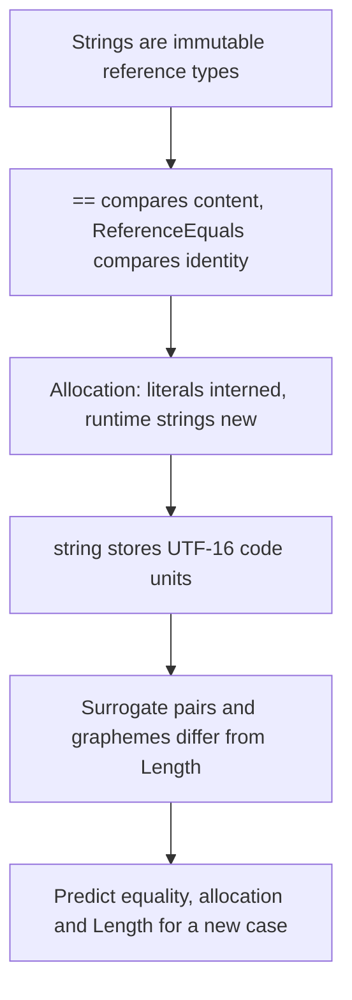

# Strings: identity, equality and UTF-16 units

2026-11-22 · [[Assets/Qard/Courses/Programming Mastery|Programming]] · `text-semantics`

## Summary

The lesson covered three things about .NET strings: reference identity versus content equality, when strings are interned or newly allocated, and how UTF-16 code units, surrogate pairs, Unicode scalars (`Rune`) and graphemes relate to `Length` and indexing.

You got every check right and were sure on identity versus equality, interning and allocation, UTF-16 code units versus characters, and the final mixed prediction. So the earlier misconception about identity and equality looks resolved.

One gap remains, in normalization. You handled runes and graphemes correctly but mispredicted `Length` after `Normalize()`, and you were unsure there. NFC composes `e` + U+0301 (combining acute) into the single precomposed code unit U+00E9, so `Length` drops by one. Normalization changes the code-unit sequence, and that can change `Length` and what each index returns. It does not change the grapheme count. Not every combining sequence has a precomposed form, so NFC can't always shorten a string.

## Plan

Start with reference identity versus content equality, since your evidence suggests it is shaky. Then cover when strings are interned or newly allocated. Finish with UTF-16 code units, surrogate pairs and graphemes, and use them to predict Length and indexing for a new string.



## Steps

### 1. Identity versus content equality

A `string` variable holds a **reference**, which points to a string object on the heap. Assigning one string variable to another copies the reference, not the text. That raises two separate questions:

- **Content equality:** do both objects hold the same characters in the same order? For strings, `==` and `Equals` answer this. By default they compare ordinally (character by character) and are case-sensitive.
- **Identity:** do both references point to the *same object*? `object.ReferenceEquals` answers this, and only this.

The same text can sit in two separate objects, so the two answers can differ. See [[Home/Programming/NET/CSharp/Fundamentals/Types/Strings#Core Properties|Core Properties]].

```csharp
string a = new string('h', 2);   // "hh"; a nonempty new string(...) allocates a fresh object
string b = a;                    // copies the reference: b points to a's object
string c = new string('h', 2);   // a second, separate object with the same text

Console.WriteLine(a == b);                       // True  – same text
Console.WriteLine(object.ReferenceEquals(a, b)); // True  – same object
Console.WriteLine(a == c);                       // True  – same text
Console.WriteLine(object.ReferenceEquals(a, c)); // False – two objects
```

**Immutability** makes this sharing safe. No operation can change the characters inside an existing string object. An operation that seems to modify text returns a reference to a different object instead:

```csharp
a = a + "!";   // joining two nonempty strings at run time allocates a new "hh!" object; a now points to it
// b still points to the original "hh" object, unchanged
```

After that line, `a` and `b` no longer share an object, and their contents differ too. Code that holds `b` never sees an edit made through `a`, because nothing is edited. `a` is simply pointed at a different object.

So `ReferenceEquals` tells you how an object was produced and passed around, not what text it holds. To compare text, use `==` or `string.Equals`. See [[Home/Programming/NET/CSharp/Fundamentals/Types/Strings#Pitfalls|Pitfalls]].

These allocation claims cover the cases shown: `new string(...)` with a nonzero length, and run-time concatenation of two nonempty strings. Edge cases can reuse an existing object. Concatenating with `""` can return the other operand unchanged, and a zero-length `new string(...)` can return `string.Empty`. Literals such as `"!"` are another case, because the runtime can share one object for equal literals. That rule is the next step's topic.

This step opens the lesson. Separating "same text" from "same object" is what you need to predict when strings share an instance (next step) and, later, what `Length` and indexing report.

**Check:** Consider this C# code. A `new string(...)` call with a nonzero length allocates a fresh object, and run-time concatenation (`+`) of two nonempty strings allocates a new result object. No `string.Intern` call is made.

```csharp
string a = new string('x', 3);  // "xxx"
string b = a;
a = a + "y";
b = b + "y";
```

After the last line, what does `object.ReferenceEquals(a, b)` return, and why?

**My answer (1/1):** False, because each concatenation allocated its own new "xxxy" object, so equal text sits in two objects

**Model answer:** **False.** `b = a` copied the reference once. Then each `+ "y"` joined two nonempty strings and allocated its own new "xxxy" object. `a` and `b` hold equal text in two different objects. The original "xxx" object was never modified.

### 2. When strings are interned or allocated

Previous step: `==` compares text and `ReferenceEquals` compares objects. Equal text can live in one shared object or in two separate ones. Which case applies depends on **how each string was produced**.

**Interning** means keeping one shared instance per distinct text value in a runtime-wide table called the *intern pool*. Interning and allocation are separate questions. A string that is not interned is not automatically a new object.

| How the string is produced | Interned? | Same object as an equal literal? |
|---|---|---|
| String literal, e.g. `"ab"` | Typically yes | Typically yes. Identical literals usually share one pooled instance. |
| Concatenation of constants, e.g. `"a" + "b"` | Typically yes | Typically yes. The compiler folds it into the literal `"ab"` before the program runs. |
| Built at run time (`+` with a non-constant operand, `string.Concat`, `StringBuilder`, file or network input) | Never automatically | Usually no. Building new text allocates a new object. Some operations hand back an existing instance, though: `s.ToString()` returns `s` itself, and `s + ""` can return `s`. |
| Passed through `string.Intern(s)` | Yes | Only if that literal was pooled. Intern returns the pool's instance for the text and adds `s` first if the text is absent. |

The dependable guarantee belongs to `string.Intern`. Equal values passed through it always come back as **the same reference**, wherever each value came from.

Example: one value produced four ways.

```csharp
string lit    = "ab";
string folded = "a" + "b";                     // compiler emits the literal "ab"
string built  = new StringBuilder("a").Append("b").ToString();
string pooled = string.Intern(built);

Console.WriteLine(object.ReferenceEquals(lit, folded)); // typically True: same pooled literal
Console.WriteLine(object.ReferenceEquals(lit, built));  // False: StringBuilder made new text at run time
Console.WriteLine(object.ReferenceEquals(lit, pooled)); // typically True: Intern returns the pooled "ab" if the literal was pooled
Console.WriteLine(lit == built);                        // True: same contents
```

The rule turns on **when the text is known**. When the compiler can compute the text, the result becomes a literal and is normally pooled. When the text only exists at run time, it stays out of the pool unless the code calls `string.Intern`. Run-time code creating new text usually allocates a new object.

Two boundaries:

- **Identity is not contractual.** Literal sharing is typical, not guaranteed. A compilation can request `NoStringInterning`, and runtime behavior can vary. Code must never decide equality with `ReferenceEquals`. See [[Home/Programming/NET/CSharp/Fundamentals/Types/Strings#String Interning|String Interning]].
- **The pool keeps what it holds.** Interned entries are generally retained until the runtime terminates. Interning a small, bounded set of repeated values, such as status codes, can remove duplicates. Interning high-cardinality text, such as user IDs or request paths from traffic, turns short-lived garbage into memory that lasts for the life of the process. It needs a bounded value set and measured evidence first. See [[Home/Programming/NET/CSharp/Fundamentals/Types/Strings#Tradeoffs|Tradeoffs]].

Step 1 showed that equal strings can be different objects. This step predicts when they share an object and which of those cases are guaranteed, which supplies the allocation half of the final mixed prediction.

**Check:** A C# service reads two values at run time, `region` and `id`, from a request. Neither value is a compile-time constant. The service builds the same text twice, in two separate calls, and then interns both results:

```csharp
string x = string.Concat(region, "/", id);
string y = string.Concat(region, "/", id);

string px = string.Intern(x);
string py = string.Intern(y);
```

The program contains no string literal with the same text as `x`. What does `object.ReferenceEquals(px, py)` return?

**My answer (1/1):** True, because string.Intern returns one pooled instance for every equal value it receives

**Model answer:** **True, because string.Intern returns one pooled instance for every equal value it receives.**

`x` and `y` are separate run-time allocations, so `ReferenceEquals(x, y)` would be False. If earlier code already interned this text, both Intern calls return that existing pooled instance. If not, the first call adds `x` and returns it, and the second call returns `x` too. Either way `px` and `py` are the same object. No literal is needed.

### 3. UTF-16 code units versus characters

Known foundation: `s[i]` indexes a string and `s.Length` counts its elements. The open question is what one element is.

A `char` is a 16-bit UTF-16 **code unit**, and `Length` counts code units, not characters. Unicode defines far more than the 65,536 values a 16-bit slot can hold, so .NET splits the range:

- Code points up to U+FFFF (the Basic Multilingual Plane: Latin, Cyrillic, CJK, most punctuation and symbols) fit in **one** `char`.
- Code points above U+FFFF (almost every emoji, plus some historic scripts and mathematical symbols) are stored as a **surrogate pair**: two code units, a *high surrogate* in U+D800–U+DBFF followed by a *low surrogate* in U+DC00–U+DFFF. Neither half is a character on its own.

Example: 👍 is the single code point U+1F44D. It lies above U+FFFF, so the string holds two code units, `\uD83D` then `\uDC4D`:

```csharp
var s = "👍";
Console.WriteLine(s.Length);                   // 2
Console.WriteLine((int)s[0] == 0xD83D);        // True: the high surrogate, half of the pair
Console.WriteLine(char.IsHighSurrogate(s[0])); // True
Console.WriteLine(char.IsLowSurrogate(s[1]));  // True
```

Prediction rule: `Length` = (count of code points ≤ U+FFFF) + 2 × (count of code points > U+FFFF). Indexing walks those slots, so whatever follows a pair sits two positions after the pair's start.

Two different things can happen at a pair. Indexing or a `foreach (char c in s)` loop only *exposes* the individual code units: `s[i]` on a pair slot hands back half a character as a value, and `char.IsSurrogate(s[i])` flags such a slot, but the original string is untouched and still well-formed. Slicing or rebuilding text across the boundary is what produces broken text: `"👍".Substring(0, 1)`, or copying `char`s into a new string and stopping between the halves, yields a string holding a lone surrogate, which is ill-formed UTF-16. Reassembling the halves into one scalar (`Rune`) is the next step.

Source: [[Home/Programming/NET/CSharp/Fundamentals/Types/Strings#Encoding and Unicode|Strings: Encoding and Unicode]].

The previous step predicted which strings share an instance; this step turns from identity to the contents, where `Length` and indexing count 16-bit code units rather than characters. The next step adds scalars and graphemes on top of this unit count, and the final step combines allocation and Unicode boundaries in one prediction.

**Check:** In C#, `var s = "x🎵y";` where 🎵 is the single Unicode code point U+1F3B5 (above U+FFFF) and `x`, `y` are plain ASCII letters.

What kind of `char` does `s[2]` return? State whether it is a letter, the whole emoji, or part of the emoji, and if it is part of the emoji, which half. An exact hex value is not required.

**My answer (2/2):** it will return low surrogate of the emoji

**Model answer:** `s[2]` is a surrogate code unit, half of 🎵's pair: the **low (second) surrogate** (`\uDFB5`). It is not `y`, which sits at `s[3]`, and an indexer can never return the whole emoji.

Optional: slots are x = `s[0]`, high surrogate `\uD83C` = `s[1]`, low surrogate `\uDFB5` = `s[2]`, y = `s[3]`.

### 4. Scalars, graphemes and normalization

The previous step established that `char` is one UTF-16 code unit, so `"👍".Length` is 2. Grouping code units correctly still leaves two higher boundaries.

**Three ways to count the same text:**

| Unit | What it is | .NET API |
|---|---|---|
| Code unit | one 16-bit `char` | `Length`, `s[i]` |
| Scalar value | one Unicode code point, with a surrogate pair rejoined | `Rune`, `EnumerateRunes()` |
| Grapheme (text element) | what a reader sees as one character | `StringInfo` |

A `Rune` fixes the surrogate-pair problem: 👍 is 2 code units but 1 rune. It does not fix **combining marks**. A combining mark is a scalar value that is normally displayed with the base character before it. For example, U+0301 is the combining acute accent. When it follows `e`, it joins the grapheme of that `e`. One grapheme can hold a base plus several marks, so one visible character can be several runes ([[Home/Programming/NET/CSharp/Fundamentals/Types/Strings#Encoding and Unicode|Encoding and Unicode]]).

**Example.** Unicode can represent "é" in two ways. U+00E9 is one precomposed scalar. The pair `e` followed by U+0301 is the decomposed form. Both display the same:

```csharp
string a = "é";   // precomposed é
string b = "é";  // e + combining acute

a.Length                                 // 1
b.Length                                 // 2  (both scalars are in the BMP: one char each)
b.EnumerateRunes().Count()               // 2  (two scalars)
new StringInfo(b).LengthInTextElements   // 1  (one visible character)

a == b                                   // False
a.Normalize() == b.Normalize()           // True
```

`==` on strings compares ordinally, code unit by code unit. `a` holds `00E9` and `b` holds `0065 0301`, so they differ. Unicode defines the two sequences as **canonically equivalent**: they represent the same text. `Normalize()` uses Form C (NFC) by default. NFC composes a base plus mark into a single precomposed scalar where one exists, so `b.Normalize()` becomes `00E9`. After both sides are in the same form, ordinal comparison treats them as equal.

This is a normalization question, not an encoding question. UTF-8 versus UTF-16 is how scalars are stored as bytes. Composed versus decomposed is which scalars are used. Normalization only merges canonically equivalent sequences. It does not make every pair of similar-looking strings equal, such as Latin `a` and Cyrillic `а`.

**When each tool is needed:**
- Counting or slicing *visible characters* (length limits, truncating, reversing, cursor movement): use `StringInfo`. Using `Length` or runes can split a base from its accent.
- Comparing or looking up text where canonically equivalent sequences should count as equal, such as user input or file names from different systems: normalize both sides to the same form before comparing.
- Processing whole code points (encoding, classifying a scalar): use `Rune`. It is enough when the code needs whole scalars, not whole graphemes.

Step 3 showed that `Length` counts code units rather than characters. This step adds two more boundaries, scalar values and graphemes, and shows that canonically equivalent sequences compare unequal until they are normalized. Step 5 uses all three counts to predict `Length` and equality for new strings.

**Check:** A .NET string `s` contains three Unicode scalar values in this order:

- U+0065 (`e`), in the Basic Multilingual Plane (BMP)
- U+0301 (combining acute accent), in the BMP
- U+1F44D (👍), outside the BMP

On screen, `s` reads as "é👍". The code then runs `string t = s.Normalize();`, which uses Normalization Form C. Unicode has a precomposed scalar for `e` + U+0301: U+00E9 (é), in the BMP. Normalization does not change 👍.

Give each value for `t` as a whole number.

- `t.Length` = {{length}}
- `t.EnumerateRunes().Count()` = {{runes}}
- `new StringInfo(t).LengthInTextElements` = {{graphemes}}

**My answer (2/3):** A .NET string `s` contains three Unicode scalar values in this order:

- U+0065 (`e`), in the Basic Multilingual Plane (BMP)
- U+0301 (combining acute accent), in the BMP
- U+1F44D (👍), outside the BMP

On screen, `s` reads as "é👍". The code then runs `string t = s.Normalize();`, which uses Normalization Form C. Unicode has a precomposed scalar for `e` + U+0301: U+00E9 (é), in the BMP. Normalization does not change 👍.

Give each value for `t` as a whole number.

- `t.Length` = 4
- `t.EnumerateRunes().Count()` = 2
- `new StringInfo(t).LengthInTextElements` = 2

**Model answer:** - `t.Length` = **3**
- `t.EnumerateRunes().Count()` = **2**
- `new StringInfo(t).LengthInTextElements` = **2**

*Optional feedback, not required:* NFC turns `e` + U+0301 into the single scalar U+00E9, which is 1 code unit. 👍 still takes 2 code units, so the total is 3. That leaves 2 scalars, and the reader still sees 2 characters.

### 5. Mixed prediction case

Any pair of strings raises three separate questions, and each has its own API:

1. **Content:** do they hold the same UTF-16 code units? `==` and `string.Equals` compare ordinally and case-sensitively by default.
2. **Identity:** are they the same object? `ReferenceEquals` answers this, and the answer depends on how each string was produced.
3. **Size:** how many `char` code units does each one have? `Length` answers this. It counts code units, not user-perceived characters.

Some answers imply others, but only in one direction:

- **Same reference → equal content and equal `Length`.** There is only one object, so there is only one sequence of code units.
- **Ordinally equal content → equal `Length`.** It does **not** imply the same object, because a runtime copy has equal content but is a separate object.
- **Different code units → different objects.** One object cannot hold two different sequences.

So first work out the code units, which settle content and Length. Then work out identity from where each object came from.

**Example 1: a runtime copy of an emoji literal**

```csharp
string thumbs = "\U0001F44D";                     // 👍, one surrogate pair
string built  = new string(thumbs.ToCharArray()); // allocated at run time

thumbs == built                    // True: same code units
ReferenceEquals(thumbs, built)     // False: built is a new object
built.Length                       // 2: high + low surrogate
built[0]                           // '\uD83D': only the high surrogate
ReferenceEquals(string.Intern(built), string.Intern(thumbs)) // True
```

The last line passes **both** values through `string.Intern`. `Intern` looks a string up by its content. It returns the pool's single reference for that content, and adds the string to the pool first if it is missing. So two strings with equal content always come back from `Intern` as the same object.

**Example 2: two spellings of é**

```csharp
string decomposed = "é"; // 'e' + combining acute accent
string composed   = "é";  // precomposed 'é'

decomposed.Length                   // 2
composed.Length                     // 1
decomposed == composed              // False: different code units
decomposed.Normalize() == composed  // True: Form C turns e + ◌́ into é
```

Both strings display as one grapheme, so `StringInfo` counts one text element in each. Even so, `decomposed` has two code units. When `Normalize()` has to change the text, it returns a **newly allocated** string. Like any other runtime-built string, that result is not interned automatically.

Sources: [[Home/Programming/NET/CSharp/Fundamentals/Types/Strings#Core Properties|Core properties]] · [[Home/Programming/NET/CSharp/Fundamentals/Types/Strings#String Interning|String interning]] · [[Home/Programming/NET/CSharp/Fundamentals/Types/Strings#Encoding and Unicode|Encoding and Unicode]]

Step 4 showed that text which looks the same can differ in code units until it is normalized. This step combines that with the interning rules from steps 1–2, so you can predict identity for strings whose content may or may not match.

**Check:** In this C# code, `"Å"` is the letter `A` followed by U+030A, a combining ring above. It displays as `Å`. `Normalize()` uses its default form (Form C), which turns `A` + combining ring into the single precomposed character U+00C5 `Å`.

```csharp
string x = "Å";
string y = x.Normalize();

Console.WriteLine(object.ReferenceEquals(string.Intern(x), string.Intern(y)));
```

What is printed, and why?

**My answer (1/1):** `False`: `x` and `y` hold different code units, so `Intern` returns a different pooled string for each.

**Model answer:** `False`: `x` and `y` hold different code units, so `Intern` returns a different pooled string for each.

`x` is two code units and `y` is one. `Intern` matches strings by their code units, not by how they look, so it treats them as two separate contents.
