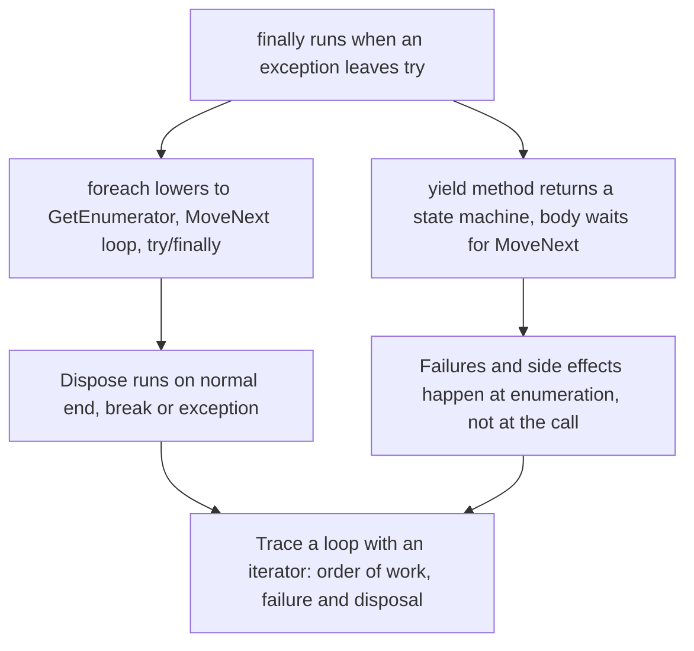

# Enumeration, deferred iterators, and disposal

2026-11-23 · [[Assets/Qard/Courses/Programming Mastery|Programming]] · `iteration-contracts`

## Summary

Lesson built on the student's solid grasp of `finally` and applied it to `foreach` and iterators.

- **foreach lowering (2/2):** traced `GetEnumerator()` → `try { while (MoveNext()) … Current … } finally { Dispose }` correctly.
- **Disposal on exit (1/2):** gave right verdicts for normal completion, `break` and exceptions, but one answer skipped the mechanism: `break` leaves the `try` block, so the `finally` runs and calls `e.Dispose()`.
- **Iterator timing (2/2):** understood that calling an iterator method only creates the state machine. The body runs inside `MoveNext()`, up to the next `yield return`.
- **Failure placement (1/1):** saw that an exception in an iterator surfaces at the `MoveNext()` call during enumeration, not at the method call, and that disposal runs the iterator's pending `finally` blocks.
- **Whole-loop trace (2/2):** combined both ideas on a loop with `break` and an exception.

Confidence was "sure" throughout and matched the results, except for the one incomplete explanation. This is a clear improvement on the earlier iteration checks (0/3). The remaining gap is explaining *how* `break` reaches disposal, not knowing *that* it does.

## Plan

You already know `finally` runs on exit by exception, so we start by applying it to `foreach`. First you trace the `foreach` lowering and when the enumerator is disposed. Then you trace when an iterator body actually runs and why failures move. Last, you combine both on one loop with `break` and an exception.



## Steps

### 1. What foreach lowers to

A `foreach` loop hides its machinery. You write one line, and the compiler turns it into calls on an object you never see. If you cannot see those calls, you cannot say when cleanup runs or what happens when the loop stops early.

In plain words, the loop asks the source for a helper object. It then asks that helper for the next item, one at a time, until the helper says there are no more. That helper is called the **enumerator**. The whole walk sits inside a `try`, and the cleanup sits in its `finally`.

For a `List<string>`, the compiler writes roughly this:

```csharp
var e = list.GetEnumerator();
try
{
    while (e.MoveNext())
    {
        var item = e.Current;
        Console.WriteLine(item);
    }
}
finally
{
    e.Dispose();
}
```

The `List<string>` enumerator needs disposal, so the `finally` calls `Dispose()`.

Here is the trace for `foreach (var item in list) Console.WriteLine(item);` with `List<string> list = new() { "a", "b" };`:

| Move | Call | Result |
|---|---|---|
| 1 | `GetEnumerator()` | enumerator `e` created, once |
| 2 | `MoveNext()` | `true`; `Current` is `"a"`; body prints `a` |
| 3 | `MoveNext()` | `true`; `Current` is `"b"`; body prints `b` |
| 4 | `MoveNext()` | `false`; the `while` ends |
| 5 | `finally` | `e.Dispose()` runs |

`MoveNext()` runs one more time than there are items. That last call returns `false` and ends the loop. `Current` is read only after a `true`.

The rule, for an ordinary enumerable such as `List<T>`: `foreach` calls `GetEnumerator()` once, loops on `while (MoveNext())`, and reads `Current` for each item. If the enumerator needs disposal, it is disposed in the `finally`. You already know `finally` runs however control leaves the `try`, so that disposal does not depend on how the loop ends. Arrays are the exception: the compiler gives them index-based handling instead. See [[Home/Programming/NET/CSharp/Fundamentals/Foreach|the foreach lowering]].

You already trust `finally` to run when an exception leaves a `try`. Here you see that `foreach` over a list is built on a `try`/`finally`, so the next steps can predict when the enumerator is disposed and when an iterator's body runs.

**Check:** `list` is an empty `List<string>`. This loop runs:

```csharp
foreach (var item in list)
{
    Console.WriteLine(item);
}
```

How many times are `MoveNext()` and `Dispose()` each called?

**My answer (2/2):** both one time

**Model answer:** `MoveNext()` is called once (it returns `false`), and `Dispose()` is called once.

### 2. Disposal on normal exit, break and failure

An enumerator can hold something that must be released, such as an open file. If the loop ends and nobody calls `Dispose()`, the file stays open. A loop can end in three ways: it runs out of items, it hits `break`, or the body throws.

`foreach` covers all three exits in one place. The lowered loop sits inside a `try`. When the enumerator requires disposal, the `Dispose()` call sits in that `try`'s `finally`. Some enumerators need no disposal, so nothing is called for them. You already know `finally` runs however control leaves the `try`. So every exit passes through the cleanup.

Suppose `ReadLines()` returns an enumerable, and the enumerator it hands out keeps a file open until that enumerator is disposed. Here is the same loop written two ways:

```csharp
// A: foreach
foreach (var line in ReadLines()) { Process(line); }

// B: hand-written
var e = ReadLines().GetEnumerator();
while (e.MoveNext()) { Process(e.Current); }
e.Dispose();
```

Trace both when `Process` throws on the second line:

| Move | A: `foreach` | B: hand-written |
|---|---|---|
| 1. `MoveNext()` → `true`, line 1 processed | same | same |
| 2. `MoveNext()` → `true`, `Process` throws | exception leaves the `try` | exception leaves the `while` |
| 3. Cleanup | `finally` runs → `Dispose()` called | `e.Dispose();` skipped: control never reaches it |
| 4. Result | file closed, exception continues upward | file still open, exception continues upward |

The rule: when the enumerator requires disposal, `foreach` disposes it on a normal end, on `break` and on an exception, because the disposal is in a `finally`. A hand-written `while (MoveNext())` loop disposes only when control actually reaches its `Dispose()` call. To match `foreach`, it needs its own `try`/`finally` ([[Home/Programming/NET/CSharp/Fundamentals/Foreach|Foreach]]).

Step 1 showed the `try`/`finally` that `foreach` lowers to; here you saw what that `finally` buys on each way out of the loop. Later in the lesson, the same `Dispose()` call is what runs an iterator's pending cleanup when a loop stops early.

**Check:** `ReadLines()` returns an enumerable. The enumerator it hands out keeps a file open until that enumerator is disposed. Nothing throws in this code:

```csharp
var e = ReadLines().GetEnumerator();
while (e.MoveNext())
{
    if (e.Current == "END") break;
    Process(e.Current);
}
e.Dispose();
```

The second line is `"END"`. Is `e.Dispose()` called, and why?

**My answer (1/2):** yes its called because while is finished, and dispose it right after the while

**Model answer:** Yes. `break` jumps to the statement right after the loop, so control reaches `e.Dispose();` and the file is closed.

### 3. When an iterator body runs

A method with `yield return` looks like an ordinary method, so you expect its body to run when you call it. It does not. If you assume it does, your trace puts output, side effects and failures at the wrong point.

In plain words: calling a `yield` method only gives you an object that *can* produce the values. The body runs bit by bit, and only when someone asks for the next value by calling `MoveNext()`. Each call runs the body until the next `yield return`, or until the body ends. The compiler builds that object for you. It is a **state machine**: it remembers where the body stopped and resumes there. See [[Home/Programming/NET/CSharp/Fundamentals/Foreach#Iterators and Yield|Iterators and Yield]].

```csharp
static IEnumerable<int> Numbers()
{
    Console.WriteLine("start");
    yield return 1;
    yield return 2;
}

var seq = Numbers();
Console.WriteLine("called");
foreach (var n in seq) Console.WriteLine(n);
foreach (var n in seq) Console.WriteLine(n);
```

| Move | What runs | Output during this move |
|---|---|---|
| 1. `Numbers()` | Nothing in the body. You get the state machine. | — |
| 2. `"called"` line | Plain statement | `called` |
| 3. First loop, `MoveNext()` #1 | Body from the top to `yield return 1`; returns `true` | `start` |
| 4. Loop body | Reads `Current` (1) and prints it | `1` |
| 5. `MoveNext()` #2 | Resumes after `yield return 1`, stops at `yield return 2`; returns `true` | — |
| 6. Loop body | Reads `Current` (2) and prints it | `2` |
| 7. `MoveNext()` #3 | Resumes and reaches the end; returns `false` | — |
| 8. Second loop | A fresh enumerator, so moves 3–7 repeat from the top of the body | `start`, `1`, `2` |

So `called` prints before `start`, and `start` prints twice.

The rule: calling an iterator method runs none of its body. Advancing it, from one `yield return` to the next, happens only inside `MoveNext()`. Each new enumeration gets a new enumerator and runs the body again from the start. One exception remains: disposing an unfinished iterator can run a pending `finally` from its body. That is cleanup, not advancing.

The `foreach` lowering gave you the `MoveNext()` loop, and an iterator advances only inside those calls. The next step uses this to place an iterator's failures and to show when disposal runs its pending `finally`.

**Check:** ```csharp
static IEnumerable<int> Numbers()
{
    Console.WriteLine("start");
    yield return 1;
    yield return 2;
}

var items = Numbers().ToList();
foreach (var n in items) { }
foreach (var n in items) { }
```

`ToList()` enumerates its source to the end once and stores the values in a new `List<int>`. How many times is `start` printed, and why?

**My answer (2/2):** it is printed once on tolist, in a place where enumerator materialized to the list. later foreachs just iteration over the list collection, without on demand logic

**Model answer:** Once, during `ToList()`. That is the only enumeration of the iterator, and the body runs only when it is enumerated. The two loops walk the stored list, so the body does not run again.

### 4. Where failures and cleanup land

A `yield` method can check its data and throw. It can also hold cleanup in a `finally`. Neither runs where it appears to run. If you guess wrong, you expect an error at the call but get it inside the loop. You may also think cleanup was skipped when it already ran.

In plain words, an iterator's code runs only while something pulls from it. Each `MoveNext()` runs the body up to the next `yield return`. So a throw happens in the `MoveNext()` that reaches it, not in the call that created the sequence. A `finally` runs at the first exit that leaves its `try`.

```csharp
IEnumerable<int> Read(int[] values)
{
    Console.WriteLine("start");
    try
    {
        foreach (var v in values)
        {
            if (v < 0) throw new InvalidDataException("negative");
            yield return v;
        }
    }
    finally { Console.WriteLine("cleanup"); }
}

var seq = Read(new[] { 1, -2 });
Console.WriteLine("created");
foreach (var x in seq) Console.WriteLine(x);
```

| Move | What runs | Output |
|---|---|---|
| 1. `Read(...)` | Nothing in the body runs. You get back an enumerable. | |
| 2. `WriteLine` | The caller's line runs. | `created` |
| 3. `GetEnumerator()` | `foreach` gets the enumerator. No body code runs yet. | |
| 4. First `MoveNext()` | The body starts, enters the `try` and pauses at `yield return 1`. `MoveNext()` returns `true`. | `start` |
| 5. Loop body | The loop prints `Current`. | `1` |
| 6. Second `MoveNext()` | The body resumes. `-2` fails the check and throws inside the `try`. The exception leaves the `try`, so the `finally` runs now, inside this `MoveNext()`. | `cleanup` |
| 7. Loop's `finally` | `foreach` calls `Dispose()`. No `finally` is still pending, so nothing prints. The exception continues out of the loop. | |

The rule: **iterator code, including validation, runs inside `MoveNext()`. A pending `finally` runs at whichever comes first. If enumeration resumes, a later `MoveNext()` can finish or throw out of the `try` and run it there. If the enumerator is disposed while the body is paused at a `yield return` inside the `try`, `Dispose()` runs it.** To make a bad argument fail at the call, check it in an ordinary method that then returns a private iterator. See [[Home/Programming/NET/CSharp/Fundamentals/Foreach#Iterators and Yield|Iterators and Yield]].

You saw that `foreach` over this iterator disposes its enumerator on every exit, and that an iterator body waits for `MoveNext()`. Together they tell you where a throw and a `finally` land, which the whole-loop trace next depends on.

**Check:** `Read` is this iterator:

```csharp
IEnumerable<int> Read(int[] values)
{
    Console.WriteLine("start");
    try
    {
        foreach (var v in values)
        {
            if (v < 0) throw new InvalidDataException("negative");
            yield return v;
        }
    }
    finally { Console.WriteLine("cleanup"); }
}
```

The program runs:

```csharp
var seq = Read(new[] { 1, -2 });
Console.WriteLine("created");
foreach (var x in seq)
{
    Console.WriteLine(x);
    break;
}
```

What does it print, and is an exception thrown?

**My answer (1/1):** `created`, `start`, `1`, `cleanup`, and no exception is thrown.

**Model answer:** `created`, `start`, `1`, `cleanup`, and no exception is thrown. After `break`, no `MoveNext()` reaches `-2`, so the check never fails. The body is paused inside the `try`, so the loop's `Dispose()` runs the pending `finally`.

### 5. Trace a whole loop

When a `foreach` runs over an iterator, two pieces of code take turns: your loop body and the iterator body. If you read the code top to bottom, you get the output order wrong. You also miss when the iterator's cleanup runs.

The idea: the iterator body only moves forward when `foreach` calls `MoveNext()`. However the loop ends, the `foreach` `finally` disposes the enumerator, and that runs the iterator's pending `finally`. You already know a `finally` runs on every exit from its `try`.

```csharp
IEnumerable<int> Numbers()
{
    Console.WriteLine("start");
    try
    {
        yield return 1;
        yield return 2;
        yield return 3;
    }
    finally { Console.WriteLine("cleanup"); }
}

var seq = Numbers();
Console.WriteLine("called");
foreach (var x in seq)
{
    Console.WriteLine(x);
    if (x == 2) break;
}
Console.WriteLine("after");
```

| Move | What runs | Output |
|---|---|---|
| 1 | `Numbers()` returns the state machine; no body runs | — |
| 2 | `Console.WriteLine("called")` | `called` |
| 3 | First `MoveNext()`: body runs to `yield return 1` | `start` |
| 4 | Loop body prints `x` | `1` |
| 5 | `MoveNext()`: body resumes to `yield return 2`; loop prints it, then `break` | `2` |
| 6 | `break` leaves the `foreach` `try`; its `finally` disposes the enumerator, which runs the iterator's pending `finally` | `cleanup` |
| 7 | Code after the loop | `after` |

Output: `called`, `start`, `1`, `2`, `cleanup`, `after`. `yield return 3` never runs.

The rule: the iterator runs one stretch per `MoveNext()`, starting at the first one. When the loop exits early, by `break` or by an exception, disposal runs the iterator's pending `finally` before control leaves the loop. See [[Home/Programming/NET/CSharp/Fundamentals/Foreach#Iterators and Yield|Iterators and Yield]].

Earlier you saw where an iterator's work and its pending `finally` happen. Now you put the lowered `foreach` and the lazy iterator together on one loop, which is the trace this lesson set out to teach.

**Check:** `Numbers()` is the same iterator as before: it prints `start`, then yields 1, 2, 3 inside a `try` whose `finally` prints `cleanup`. This time the loop body throws instead of breaking, and a `catch` outside the loop handles it:

```csharp
try
{
    foreach (var x in Numbers())
    {
        Console.WriteLine(x);
        if (x == 1) throw new Exception();
    }
}
catch { Console.WriteLine("caught"); }
```

What are the last two lines this code prints, in order?

**My answer (2/2):** cleanup and caught

**Model answer:** `cleanup`, then `caught`.
