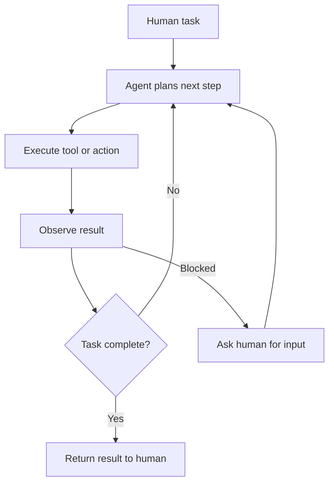

An agentic system gives an LLM control over part of a workflow: calling tools, making decisions, or directing other LLMs. The term "agent" is used loosely, so system design starts with one practical boundary:

- **Workflows** are systems where LLMs and tools are orchestrated through predefined code paths. The developer controls the sequence. The LLM handles individual steps.
- **Agents** are systems where the LLM dynamically directs its own process and tool usage, deciding what to do next based on results so far.

The simplest design that meets the need is usually the better choice. A single LLM call with good prompting and retrieval is the simplest starting point. Workflow orchestration belongs next, once a single call falls short. Autonomous agents earn their extra complexity only when the task is genuinely open-ended and unpredictable.

An agent joins the four steering disciplines of the [[Home/AI & ML/LLM/LLM|engineering ladder]]: precise instructions ([[Home/AI & ML/LLM/Prompt Engineering/Prompt Engineering|Prompt Engineering]]), a curated window ([[Home/AI & ML/LLM/Context Engineering/Context Engineering|Context Engineering]]), a capability surface ([[Home/AI & ML/LLM/Harness Engineering/Harness Engineering|Harness Engineering]] — [[Tool Design]] and [[Model Context Protocol|MCP]]), and a controlled runtime ([[Home/AI & ML/LLM/Loop Engineering/Loop Engineering|Loop Engineering]] — the [[Agent Loop]] and [[Multi-Agentic Systems|multi-agent topologies]]). The design question is how much control to place in code and how much to give the model. Measuring the result is [[Home/AI & ML/LLM/Agents/Evaluation/Evaluation|Agent Evaluation]].

```datacorejsx
const { FolderStructureMap } = await dc.require("Assets/components/devbook-folder-map.jsx");
return FolderStructureMap;
```

# The Augmented LLM

An augmented LLM can use retrieval, [[Tool Design|tools]], and memory. The model decides what to say or which tool to request. The surrounding harness builds the context, validates and runs tool calls, enforces operational limits, and carries selected state into later calls. [[Agent Loop]] follows that boundary across repeated decisions. This single-agent unit should work well before orchestration is added. Model choice, prompts, and clear tool contracts usually matter more than another control layer.

[[Model Context Protocol|Model Context Protocol (MCP)]] standardizes how an augmented LLM connects to external tools and data sources.

# Workflow Patterns

When one augmented LLM is not enough and full autonomy is excessive, five workflow patterns cover the middle ground: **prompt chaining**, **routing**, **parallelization**, **orchestrator-workers**, and **evaluator-optimizer**. The first pattern that fits is usually enough. Orchestrator-workers decides subtasks at runtime, making it a useful bridge into [[Multi-Agentic Systems]] for complex coding or research.

[[Home/AI & ML/LLM/Agents/Workflow Patterns|Workflow Patterns]] describes each pattern, its control flow, and the conditions that make it fit.

# Autonomous Agents

Autonomy fits tasks whose steps cannot be predicted and whose control flow cannot be expressed as a fixed workflow. The model uses tools in a loop: observe the latest result, choose an action, execute it, and repeat.



That flexibility costs more model calls and introduces compounding error. A small mistake can become the premise for every later step. Three design principles contain the risk:

1. **Simplicity** — the control loop stays small. Extra branches make failures harder to isolate.
2. **Transparency** — the runtime records decisions, tool calls, results, and validation outcomes. A useful trace shows where the run diverged without depending on hidden model reasoning.
3. **Tool quality** — tool descriptions, parameters, errors, and outputs form an API contract. Ambiguous tools produce ambiguous actions.

Agents work best when progress is observable. Tests constrain coding tasks, resolution criteria constrain support work, and cited evidence constrains research. Without a checkable success signal, the loop has no reliable way to distinguish progress from drift. Measuring task success, trajectory quality, tool-call correctness, and reliability across stochastic runs is [[Home/AI & ML/LLM/Agents/Evaluation/Evaluation|Agent Evaluation]].

For patterns on coordinating multiple agents, see [[Multi-Agentic Systems]].

# Memory Systems

Agent memory is durable state with explicit rules for storage and reuse. It is more than a transcript replayed on every turn or a vector index. Raw messages, tool calls, and results remain trace evidence. A promotion step chooses which observations become durable records, adds scope and provenance, and rejects unverified or duplicate entries. Later calls rebuild a bounded context from applicable rules, stable preferences, relevant memories, and recent state.

A useful design separates five kinds of record. This is an architectural choice, not a universal standard. The separation makes one problem visible: each kind of memory needs a different read path.

| Memory | Represents | Read path |
| --- | --- | --- |
| Policy | Authoritative constraints and procedures | Exact, exhaustive lookup |
| Preference | Stable user or tenant parameters | Exact, exhaustive lookup |
| Fact | Durable assertions with provenance | Scoped lexical, semantic, or hybrid retrieval |
| Episode | A completed task or reusable experience | Scoped retrieval over a compact summary |
| Trace | Raw execution and conversation events | Replay, audit, and extraction source |

Durable records need rules for status, supersession, retention, and deletion. When a record changes, derived indexes and caches must be invalidated. Embeddings are a rebuildable search projection over canonical content, not the only copy of a fact. Authorization scope must be checked before ranking. Relevance metadata cannot enforce access.

Memory systems usually repeat three operations: `record → recall → consolidate`. Consolidation turns raw observations into smaller durable records. Scheduled summaries are another form of derived state. Neither changes model weights or makes answers more accurate by itself. Promoted facts still need provenance, privacy controls, and evaluation.

# Questions

<!-- qard-id: ea50cefb-21a2-42d5-8eed-b2ddc02f1151 -->
> [!qard]- When does a workflow fit better than an autonomous agent?
> A workflow fits better when the steps and branches can be defined in advance. Code then controls the path, and the model handles individual steps inside it. An autonomous agent is justified only when the next action must depend on intermediate results that cannot be anticipated, and that flexibility is worth its extra cost and risk.
>
> | Aspect | Workflow | Autonomous agent |
> |---|---|---|
> | Who chooses the next step | Application code follows predefined paths. The model works inside individual steps or picks one of several predefined branches. | The model decides its next action and tool use from the results so far. |
> | Predictability | The possible paths are known before the run, so each one can be tested and reproduced. | The path emerges at runtime, so two runs of the same task can take different routes. |
> | Cost and latency | Easier to predict, because the possible calls follow from the defined paths. | Depend on how many model and tool calls the agent decides to make. |
> | Failure exposure | Failures occur at known steps, where code can add checks before the next step runs. | An early mistake can become the premise for later steps and compound. |
>
> The usual default is the simplest design that meets the need: a single well-prompted call first, a workflow when one call is not enough, and an agent only when no fixed path can express the task.
>
> [Building Effective AI Agents](https://www.anthropic.com/engineering/building-effective-agents)

<!-- qard-id: 33550e71-28d8-4ee2-b8c5-28bc5fc1d793 -->
> [!qard]- How can errors compound during an autonomous agent run, and what controls contain them?
> Errors compound because each step builds on what earlier steps produced. An agent reasons over earlier observations, acts, and feeds the new result into its next decision. A wrong assumption or misread tool result therefore does not stay one bad output: it becomes the premise for later actions. For example, an agent that looks up the wrong order can then refund, email and log against that order, with every step consistent with the original mistake.
>
> Several design controls contain this risk:
>
> - **Step, cost or time limits** set for the task end a run that keeps acting without converging, so drift has a bounded cost.
> - **Checks against expected outcomes**, such as tests or validation of tool results, can catch bad progress before more steps depend on it.
> - **Recovery or escalation paths** define what happens when the run cannot proceed safely, such as stopping with a report or asking a human for input.
> - **Traces** of decisions, tool calls and results show where the run diverged, which makes the failure diagnosable.
> 
> These controls reduce risk; they do not guarantee that the agent recovers or reaches a correct result.
>
> [ReAct: Synergizing Reasoning and Acting in Language Models](https://arxiv.org/abs/2210.03629) · [Building Effective AI Agents](https://www.anthropic.com/engineering/building-effective-agents)

<!-- qard-id: c989c5db-9cf9-4d2e-ae61-774921321d33 -->
> [!qard]- What makes a task a good fit for an autonomous agent?
> An agent is useful when the path cannot be fully specified in advance and intermediate results must influence the next action. The outcome still needs criteria that can eventually determine success or failure; delayed feedback can work when execution has a timeout, checkpoints, and a recovery plan. If success stays vague, the system cannot tell whether another action helped. [Building Effective AI Agents](https://www.anthropic.com/engineering/building-effective-agents)

# References

- [Building Effective Agents (Anthropic Engineering)](https://www.anthropic.com/engineering/building-effective-agents)
- [Microsoft Agent Framework — Overview (Microsoft Learn)](https://learn.microsoft.com/en-us/agent-framework/overview/)
