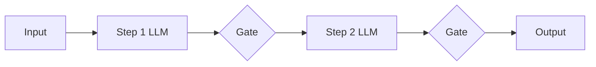
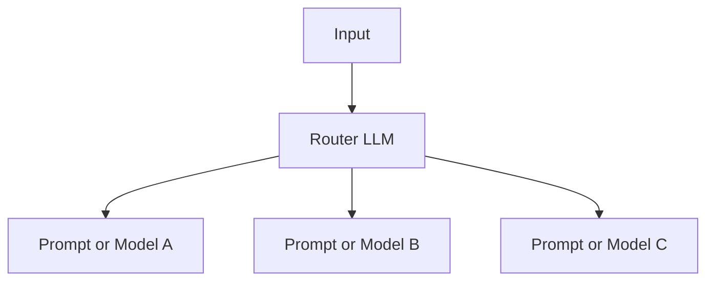
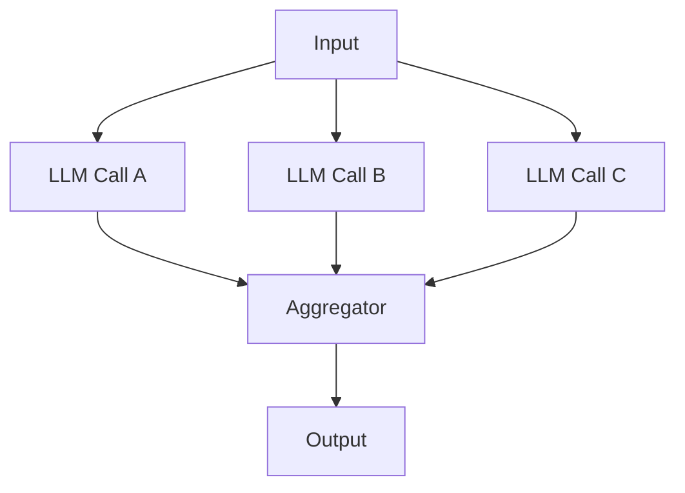
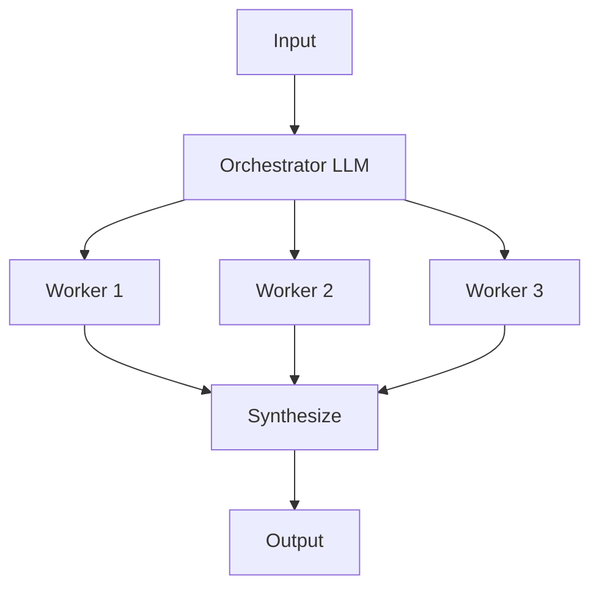
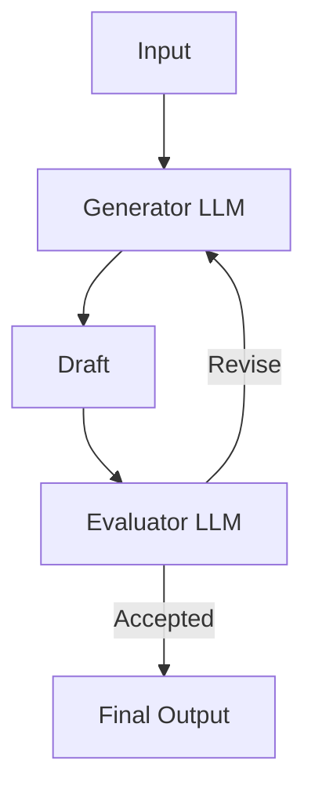

Five workflow patterns cover the space between one [[Home/AI & ML/LLM/Agents/Agents|augmented LLM]] call and an autonomous loop. Application code still owns the outer control flow. The model handles bounded decisions inside it. This middle of the [[Home/AI & ML/LLM/Agents/Agents|agentic]] spectrum is usually easier to test and operate because the allowed paths remain visible.

The patterns differ in where the next step is chosen. Prompt chaining fixes every stage in code. Routing chooses among predefined branches. Parallelization fixes the work but runs it concurrently. Orchestrator-workers lets a model decide the decomposition at runtime, while evaluator-optimizer adds a feedback loop. The smallest pattern that solves the task is normally the most reliable one.

## Prompt Chaining

Prompt chaining passes one model output into the next fixed stage. Programmatic gates between calls reject a bad intermediate result before it contaminates later work.

It fits tasks with a stable sequence, such as drafting an outline, validating required sections, and expanding the accepted outline. Chaining adds latency, so it earns its place only when narrower calls or early gates improve reliability.

## Routing

Routing classifies the input and sends it to one predefined path. Each branch can use a different prompt, tool set, or model. A refund path can become stricter without changing general question answering. Applying the same decision to model choice produces [[Home/AI & ML/LLM/Model Selection and Routing|model routing]].

It fits distinct categories with different handling. General questions might use a small model, technical cases a larger one, and refunds a constrained workflow with explicit policy checks. The router now becomes a failure boundary: a perfect specialist cannot recover a request sent to the wrong branch.

## Parallelization

Parallelization starts several model calls together and combines their outputs. Sectioning assigns independent pieces of work to different calls. Voting runs the same decision more than once and aggregates the answers.

It reduces wall-clock time when subtasks are independent, for example separate code-review concerns. Voting can reduce variance when disagreement is meaningful. Both variants spend more tokens, and sectioning fails when workers silently depend on shared intermediate state.

## Orchestrator-Workers

An orchestrator reads the task, decides how to decompose it, delegates the pieces, and synthesizes the results. The worker count and assignments do not exist until runtime. That is the boundary from parallelization, where application code defines every branch in advance.

Anthropic reports this design in its Research system: a lead agent starts three to five subagents in parallel and improved an internal research evaluation by 90.2% over a single-agent setup. The number belongs to that system and evaluation, not to the pattern in general. Runtime decomposition makes orchestrator-workers useful for complex coding or research, and it is the simplest pattern here that crosses into [[Multi-Agentic Systems]].

## Evaluator-Optimizer

One model produces a draft and another evaluates it against explicit criteria. Rejected drafts return to the generator with feedback. Approval or an iteration cap ends the loop.

This pattern fits work where feedback improves the output and the evaluator can recognize improvement. Code review and policy checking often qualify. A vague rubric produces a confident loop with no stable stopping condition, so both criteria and the cap are part of the design.

# Questions

<!-- qard-id: 6d82467a-87cc-4efd-b831-9eeab32bdbc5 -->
> [!qard]- How do prompt chaining, routing, parallelization, orchestrator-workers, and evaluator-optimizer differ in who controls the next step?
> They differ in how much of the control flow code fixes in advance. In prompt chaining, routing and parallelization, application code defines every possible path, and a model at most picks one predefined branch. In orchestrator-workers, a model decides the subtasks at runtime. In evaluator-optimizer, a model's evaluation decides whether the loop repeats, within a cap set in code.
>
> | Pattern | Who decides the next step | What code fixes in advance |
> |---|---|---|
> | Prompt chaining | Code. Each step always follows the previous one, and programmatic gates can stop a bad intermediate result. | The whole sequence of steps. |
> | Routing | A classifier, often an LLM, reads the input and picks one branch. | The set of branches and how each one is handled. |
> | Parallelization | Code. It starts the calls together and aggregates them, either splitting independent sections or voting over repeated runs. | The subtasks and how their results are combined. |
> | Orchestrator-workers | The orchestrator model decides how to split the task, what to delegate and how to synthesize the results. | Only the outer frame; worker count and assignments appear at runtime. |
> | Evaluator-optimizer | An evaluator model decides whether a draft passes explicit criteria or returns to the generator with feedback. | The acceptance criteria and an iteration cap that ends the loop. |
>
> Each additional model-owned decision tends to make cost less predictable and failures harder to reproduce, so the simplest pattern that fits is usually the easiest to test.
>
> [Building Effective AI Agents](https://www.anthropic.com/engineering/building-effective-agents)

<!-- qard-id: c1c8ac97-e367-45a7-9727-9a1da6e9a126 -->
> [!qard]- Why is the orchestrator-workers pattern harder to operate than ordinary parallelization, even though both fan out work to several calls?
> Orchestrator-workers is harder to operate because a model, not code, decides the structure of the fan-out. In ordinary parallelization, code defines the subtasks and the aggregation in advance. In orchestrator-workers, a model chooses the subtasks for each input at runtime and also synthesizes the results, so the set of calls is not known before the run.
>
> - **Ordinary parallelization:** application code starts a predefined set of independent calls, such as one per code-review concern, and aggregates their outputs programmatically. The split and aggregation rules can be read, reviewed and tested before any run.
> - **Orchestrator-workers:** an orchestrator model reads the input, decides how to split it and what to delegate, then synthesizes the workers' results. The worker count and assignments exist only at runtime.
> 
> Fixed rules make the structure inspectable, but they do not make outcomes repeatable. In both patterns, the workers are model calls whose outputs can differ between runs, and how well a split suits the task depends on the input. Orchestrator-workers adds model-chosen structure on top of that variability:
>
> - **Work and cost vary:** the number of workers, and therefore the calls and tokens spent, can change between inputs and even between runs on the same input.
> - **The split itself can fail per run:** any fan-out can miss part of the task, duplicate work or combine results poorly. With a fixed fan-out, the split and aggregation rules can be checked before deployment. With orchestrator-workers, a flawed decomposition or synthesis exists only in a particular run's decisions. It cannot be reviewed in advance and can appear for some inputs or runs but not others. It is therefore harder to reproduce and to catch with a few fixed test cases.
> 
> These are risks, not guaranteed outcomes. A trace of each run's decomposition and synthesis shows where a particular run went wrong.
>
> [Building Effective AI Agents](https://www.anthropic.com/engineering/building-effective-agents)

# References

- [Patterns for Basic Agent Workflows — cookbook (Anthropic)](https://platform.claude.com/cookbook/patterns-agents-basic-workflows)
