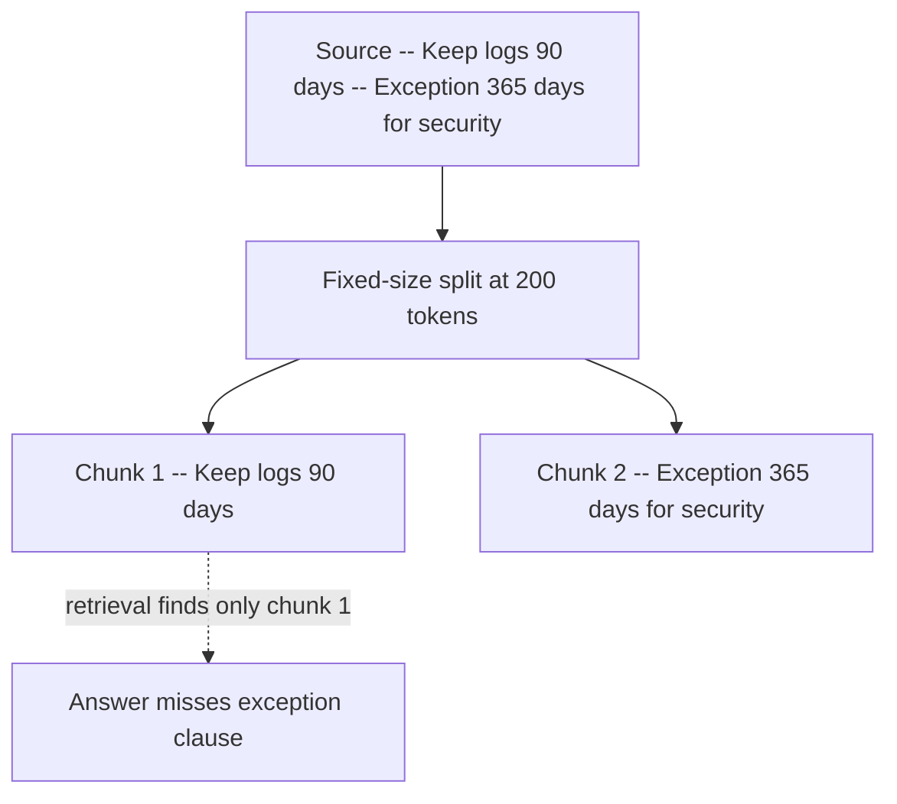
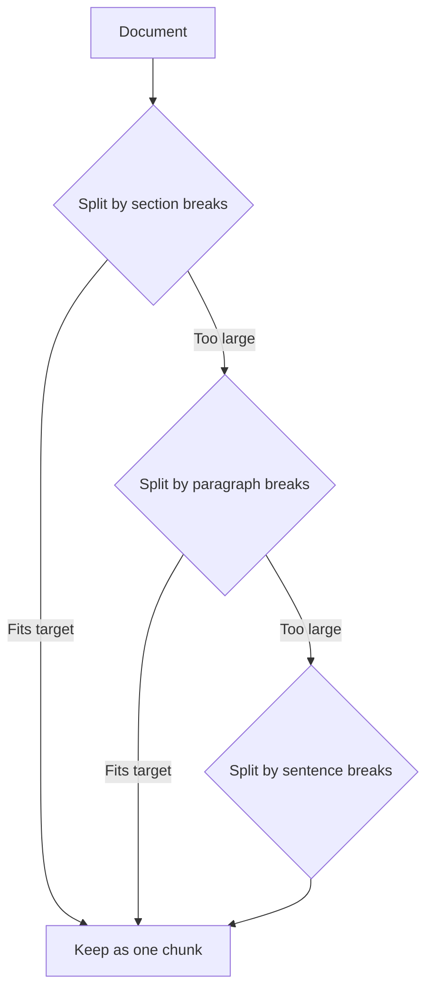
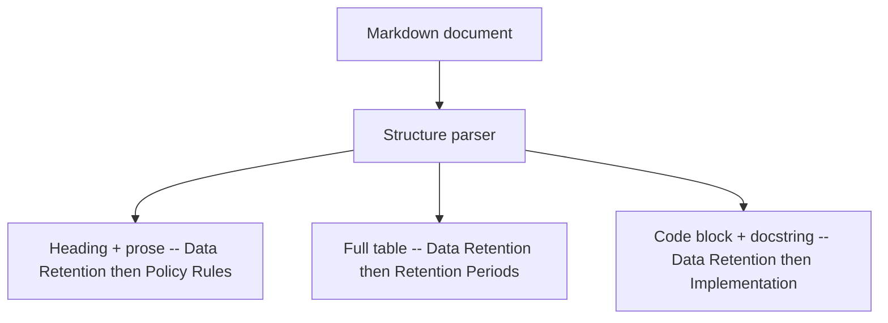
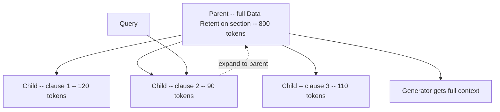
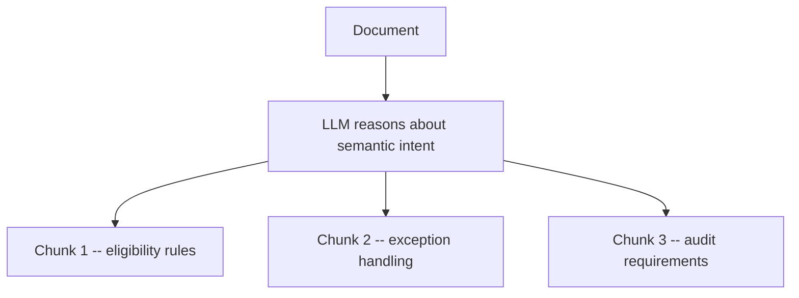

---
topic:
  - AI & ML
subtopic:
  - LLM
summary: "Sets the unit of retrieval: too wide adds noise, too narrow splits meaning."
level:
  - "2"
priority: High
status: Done
publish: true
qard-deck: "AI & ML"
qard-topic: "LLM/Context Engineering/RAG/Chunking"
flashcard_uid: "6bf1b415"
---

Chunking sets the unit of retrieval. Large chunks carry more surrounding text but waste context on noise. Small chunks can match a query more precisely, yet can separate a rule from the condition that changes it. A useful chunk keeps one recoverable idea together and retains enough source metadata to trace it.

A policy might state, "Keep logs for 90 days. Exception: security investigations require 365 days." A raw character split can put the exception in another chunk. Retrieval finds the first fragment, and the answer quietly loses the condition that mattered.

# How to Choose a Strategy

The strategy follows from observed retrieval failures. There is no universally best splitter.

| Observed evaluation failure | Start with | Why | Upgrade trigger |
| --- | --- | --- | --- |
| Split clauses, tables, or code blocks break answer correctness | Structure-aware | Preserves logical units and improves citation traceability | Parser misses important layouts or ingestion cost gets too high |
| Answers miss adjacent constraints even when relevant docs are found | Parent-child | Searching small children can keep matches precise, while parent expansion restores broader synthesis context | Storage and orchestration overhead outweigh quality gains |
| Queries drift across topics inside long prose | Semantic | Places boundaries around topic shifts | Ingestion becomes too slow or unstable across model updates |
| Need a fast, predictable baseline now | Recursive | Better boundaries than fixed-size with low implementation cost | Quality plateaus on mixed-format or highly structured corpora |
| Tight latency and simple homogeneous corpus | Fixed-size | Most operationally predictable ingestion | Faithfulness drops from boundary cuts |

# Chunking Strategies

## Fixed-Size Chunking

Fixed-size chunking is the blunt baseline.

- The splitter cuts every document into windows of N tokens (or characters), with a configurable overlap between adjacent windows. Every document follows the same split rule regardless of content structure.
- The overlap parameter controls how much context is shared between neighboring chunks. Typical values are 10-20% of chunk size. Zero overlap is fastest but maximizes the chance of splitting a sentence mid-thought.
- The work scales predictably with document size, and uniform chunks make capacity planning straightforward.

It fits when:

- A working baseline matters more than perfect boundaries.
- Homogeneous text corpora (blog posts, news articles) where documents have consistent structure and few tables or code blocks.

Its weaknesses are structural.

- **Boundary cuts through logical units.** A policy clause, code block, or table row gets split at an arbitrary token offset. The retriever returns a fragment that looks relevant but is incomplete, and the model generates a confidently wrong answer. Increasing overlap reduces this damage, and auditing retrieval on structured documents exposes the cuts that remain.
- **No awareness of document structure.** Headers, sections, and paragraphs are invisible to the splitter. A chunk may start mid-paragraph and end mid-sentence. This hurts both retrieval precision (partial matches) and generation quality (decontextualized evidence).

## Recursive Chunking

Recursive chunking adds boundary awareness without a document parser.

- The splitter applies a hierarchy of separators from largest to smallest: section breaks (`\n# `), paragraph breaks (`\n\n`), sentence breaks (`. `), then character-level splits. At each level it tries the largest separator first, and it recurses to smaller separators only when a chunk still exceeds the target size.
- This preserves the largest coherent units possible. A short section stays as one chunk. A long section gets split at paragraph boundaries, not arbitrary offsets.
- LangChain provides `RecursiveCharacterTextSplitter` as its recommended generic-text splitter, with a separator hierarchy configurable for the document format. Other frameworks choose different defaults. LlamaIndex, for example, uses a sentence-oriented splitter.

It is a good fit for:

- Strong general-purpose default for mixed prose documents (wiki pages, runbooks, knowledge base articles).
- The first upgrade from fixed-size when format-specific parsers are not justified.

The separator hierarchy can still be wrong for the source format.

- **Tables and code blocks can still be split** when the separator hierarchy is text-centric. A Markdown table has no `\n\n` between rows, so the generic hierarchy falls back to `\n` and can place a chunk boundary between rows, which separates later rows from the header row; a single row longer than the target size is cut further at spaces. A blank line inside a code block can likewise become a boundary. Custom separators for table and code-block delimiters only make those positions preferred split points: a table or code block larger than the target size still falls back to smaller separators. Keeping such blocks whole requires an atomic-unit policy, in which tables and code blocks are extracted before recursive splitting and stored as their own chunks instead of passing through the separator hierarchy; a block that exceeds the embedding model's input limit still needs its own splitting rule.
- **Separator ordering is format-dependent.** The generic LangChain default uses paragraph breaks, newlines, spaces, and finally individual characters. HTML, PDF-extracted text, or Slack exports need different separator lists. A wrong hierarchy degrades to character-level splitting silently.

## Structure-Aware Chunking

Structure-aware chunking starts from the document's syntax tree or layout model.

- A format parser identifies headings, tables, code blocks, and list items as logical units. Each unit becomes a chunk with its structural context preserved.
- Different source formats need different parsers: markdown heading hierarchy, HTML DOM tree, PDF layout analysis (Unstructured, PyMuPDF), DOCX paragraph styles. The parser output is a sequence of typed blocks (heading + prose, table, code block, list).
- Each chunk inherits metadata from its structural ancestors: section title, heading path, document ID. This enables section-level filtering at retrieval time and improves citation traceability.

It earns its maintenance cost for:

- Documents where layout carries meaning: policies with clause/exception structure, API docs with endpoint/parameter tables, runbooks with step/command pairs, legal contracts with nested clauses.
- Corpora with heavy table or code content where recursive splitting consistently breaks structured elements.

The parser becomes part of retrieval correctness.

- **Parser drift across format versions.** A parser tuned for one markdown flavor may silently misparse another. When document sources change format (e.g., Confluence to Notion export), chunk boundaries degrade without visible errors. Parsers versioned per source type, with ingestion QA snapshots that compare expected and actual chunk boundaries on sample documents, expose this drift.
- **Oversized chunks from large structural units.** A long section, such as one of 2000 tokens, becomes a single chunk. Depending on the embedding model, that chunk can exceed the model's input limit, and its unrelated text can dilute retrieval precision. A maximum chunk size bounds this: oversized blocks are split recursively, and each resulting chunk keeps the block's structural metadata.
- **Parser complexity and maintenance.** Each document format needs its own parser or extraction pipeline. Parser updates are ongoing work as source formats evolve.

## Semantic Chunking

Semantic chunking looks for topic changes in the text itself.

- The splitter computes embedding similarity between adjacent text spans (sentences or small windows), walking through the document and measuring how semantically similar each span is to its neighbor. When similarity drops below a threshold, it inserts a chunk boundary at that point.
- The core assumption: spans that are semantically similar belong together, and a drop in similarity signals a topic shift. The boundary is placed where the content actually changes, not where a fixed window happens to end.
- Threshold selection is critical. Too aggressive (high threshold) fragments the document into single-sentence chunks. Too conservative (low threshold) produces oversized chunks that span multiple topics. The threshold is therefore calibrated per corpus on a held-out evaluation set.

It helps most with:

- Long narrative text that changes topic without reliable headings: transcripts, meeting notes, email threads, unstructured knowledge base articles.
- Corpora where recursive splitting produces chunks that mix unrelated topics because the text lacks structural markers.

Its boundary rule depends on the embedding distribution.

- **Threshold instability.** The optimal threshold varies by embedding model, document domain, and even writing style. A threshold tuned on technical docs may over-fragment conversational text. Thresholds are therefore fixed per corpus and re-evaluated when the embedding model changes.
- **Ingestion cost.** Every span needs an embedding call during chunking (not just at retrieval time). For large corpora, this can be significantly slower and more expensive than rule-based strategies. Batching the embedding calls and caching their results reduce this cost.
- **Embedding model sensitivity.** Different embedding models produce different similarity distributions for the same text. Switching models requires re-tuning thresholds and potentially re-chunking the entire corpus.

## Parent-Child Chunking

Parent-child chunking separates the search unit from the generation unit.

- Ingestion creates small child chunks as precise retrieval units (100-200 tokens) and maps them to larger parent spans (500-1000 tokens) from the source document.
- Retrieval searches the smaller children for precision. A match expands to its parent before generation, restoring context that the child alone may lack.
- The parent-child mapping is stored as metadata. Each child stores its parent ID. Expansion uses a parent lookup rather than another similarity search.

It fits when:

- Domains where child-only retrieval is precise but answers consistently miss adjacent constraints or context. Common in policy docs (rule + exception), technical specs (parameter + constraint), and legal text (clause + condition).
- Answer completeness needs more context without changing the precise search unit.

Expansion can undo the precision gained by small children.

- **Parent expansion reintroduces noise.** If the parent span is too broad (entire document section), expanding to parent floods the context window with irrelevant content. A limit on parent size bounds this noise, and citation precision is tracked before and after expansion.
- **Storage overhead.** Only child chunks need vector entries in the common design. Parents can live once in the document store, with each child carrying a parent ID. The extra cost is the child index, mapping metadata, and parent text retained for expansion; duplicating parents in the vector index is optional and increases the overhead.
- **Orchestration complexity.** The retrieval pipeline needs a post-retrieval expansion step that maps children to parents, deduplicates overlapping parents, and assembles final context. This adds latency and code to maintain.

## Agentic Chunking

Agentic chunking delegates boundary decisions to an LLM.

- An LLM reads the document and decides where to place chunk boundaries based on semantic intent, not fixed rules. The model reasons about document structure, identifies self-contained units of meaning, and outputs boundary positions with optional metadata tags.
- A fully agentic splitter lets the model decide every boundary. A less expensive hybrid starts with recursive candidates and asks the model only to merge or split them.
- Boundary decisions are non-deterministic. The same document can produce different chunks on re-processing unless the LLM's boundary decisions are cached and versioned alongside the prompts and model used.

The cost is defensible for:

- High-stakes domains where chunk quality directly affects business risk: medical guidelines, financial compliance, safety procedures. The higher ingestion cost is justified only when held-out retrieval evaluation shows a gain over a simpler baseline on that corpus.
- Documents with complex implicit structure that rule-based parsers cannot capture — e.g., narrative documents where the logical structure does not follow heading conventions.

The output is expensive and harder to reproduce.

- **Non-deterministic boundaries.** Re-running ingestion can produce different chunks, which breaks diff-based cache invalidation and makes regressions hard to reproduce. Cached boundary decisions, a versioned prompt and model, and chunk definitions kept as versioned artifacts make results reproducible.
- **Cost at scale.** Every document requires LLM inference during ingestion (not just at query time). For large corpora, this can be orders of magnitude more expensive than rule-based chunking. The cost usually restricts it to high-value documents.
- **Prompt sensitivity.** Small changes to the chunking prompt can shift boundaries across the corpus. The prompt therefore needs the same controls as production code: versioning, tests on a sample set, and chunk-quality monitoring after changes.

# Practical Baselines

- Recursive chunking at 300-800 tokens with 10-20% overlap is a reasonable baseline, not a universal optimum.
- A strategy switch is based on per-source retrieval failure modes. Aggregate metrics hide format-specific problems — a retriever can perform well on prose while consistently breaking on table-heavy docs.
- Each chunk carries its source document ID, section path, ingestion timestamp, and ACL scope. Adding this during ingestion is cheaper than reconstructing it later.
- The strategy is re-evaluated when corpus format changes (e.g., prose-heavy docs to table-heavy docs) or when retrieval metrics plateau despite query translation improvements.

# Tradeoffs

| Strategy | Retrieval precision | Ingestion cost | Implementation complexity | Best corpus type |
| --- | --- | --- | --- | --- |
| Fixed-size | Often low on structured text — arbitrary cuts can split logical units | Lowest — no parsing, constant throughput | Trivial — one parameter (window + overlap) | Homogeneous prose with uniform structure |
| Recursive | Depends on separator fit — respects paragraph and sentence boundaries where the separators match the format | Low — rule-based, no model calls | Low — configurable separator list per format | Mixed prose without heavy tables or code |
| Structure-aware | Often higher where layout carries meaning — preserves tables, code, clauses as atomic units | Medium — requires format-specific parsers | Medium-High — one parser per source format, ongoing maintenance | Documents where layout carries meaning (policies, API docs, contracts) |
| Semantic | Can improve on unstructured prose — boundaries follow topic shifts when breakpoints are tuned | High — embedding call per span during ingestion | Medium — threshold tuning per corpus and embedding model | Long narrative text without reliable structural markers |
| Parent-child | Precise child search; parent expansion can add noise | Medium — child indexing, parent storage, metadata mapping | Medium — retrieval pipeline needs expansion and deduplication step | Domains where answers depend on adjacent constraints (policy, legal, specs) |
| Agentic | Task-dependent — can preserve implicit semantic units | Highest — LLM inference per document at ingestion | High — prompt versioning, non-deterministic output, caching infra | High-stakes documents where measured gains justify model-driven boundaries |

The ratings describe typical tendencies, not guaranteed results; a strategy's precision on a given corpus is established by retrieval evaluation. A practical rollout starts with recursive chunking, records failures by source type, and replaces only the splitter responsible for those failures. Agentic precision must beat that corpus baseline in held-out retrieval evaluation; model-selected boundaries are not inherently more accurate.

# Questions

<!-- qard-id: 13f048ca-dbcc-49b1-8bbe-b502736ffee0 -->
> [!qard]- How should chunking be chosen for a RAG corpus?
> Chunking should be chosen from the corpus's structure, the queries it must answer and the failures that evaluation exposes. No splitter or chunk size is best for every corpus.
> 
> Chunk size sets the basic trade-off:
> 
> - **Larger chunks** keep related statements together, but they can dilute the match and spend context on irrelevant text.
> - **Smaller chunks** can match a query more precisely, but they can also separate a rule from the condition or exception that changes it.
> 
> Each chunk must also fit the embedding model's input limit. Overlap between neighboring chunks lowers the chance that a boundary cuts a statement apart, at the cost of some duplicated text.
> 
> A simple rule-based splitter, such as fixed-size or recursive splitting, provides a cheap baseline. A more specialized strategy earns its extra ingestion and maintenance cost only when evaluation traces failures to the problem it addresses:
> 
> | Observed failure | Strategy that targets it | Why it helps |
> |---|---|---|
> | Tables, code blocks or clause–exception pairs are split apart | Structure-aware splitting | A format parser keeps those layout units intact. |
> | The right passage is found, but nearby constraints are missing from the answer | Parent-child retrieval | Small chunks are searched, and their larger surrounding section is passed to generation. |
> | Long prose without reliable headings mixes several topics in one chunk | Semantic splitting | Boundaries are placed where adjacent text stops being similar. |
> 
> A change is kept only when it improves retrieval and end-to-end answers on that corpus.
> 
> Sources:
> - [Chunk large documents for vector search (Azure AI Search)](https://learn.microsoft.com/en-us/azure/search/vector-search-how-to-chunk-documents)
> - [[Chunking#How to Choose a Strategy|Chunking: How to Choose a Strategy]]

<!-- qard-id: f1dcfdda-8d4e-4e58-bea0-32b47bf5fc89 -->
> [!qard]- How does parent-child chunking change the context returned for a matching passage?
> Parent-child chunking searches small child chunks but gives the generator the larger parent section that contains the match. Searching small children can keep matches precise, while generation receives surrounding text that the child alone may lack.
> 
> The flow:
> 
> 1. Ingestion splits each parent section into small child chunks and stores the parent's identifier with every child.
> 2. A query is matched against the child chunks.
> 3. The application maps each matched child to its parent through that identifier. This is a lookup, not another similarity search, and a parent shared by several matched children is included once.
> 4. The parent text, rather than the child alone, is assembled into the generator's context.
> 
> The parent can restore a nearby prerequisite, condition or exception that the matching child omitted, such as an exception clause that follows a retention rule. It also adds tokens. A parent that is too broad brings back the irrelevant text that small children were meant to avoid. Expansion therefore helps only when evaluation on the corpus shows better retrieval and end-to-end answers.
> 
> In Azure AI Search, index projections can index child chunks with a field that links each one to its parent document. Expanding results to parent text is logic the application implements.
> 
> Sources:
> - [Define index projections (Azure AI Search)](https://learn.microsoft.com/en-us/azure/search/search-how-to-define-index-projections)
> - [Chunk large documents for vector search (Azure AI Search)](https://learn.microsoft.com/en-us/azure/search/vector-search-how-to-chunk-documents)
> - [[Chunking#Parent-Child Chunking|Chunking: Parent-Child Chunking]]

<!-- qard-id: 942a2714-803d-4e65-b5ee-7d973d370ecc -->
> [!qard]- When should a team move from recursive to structure-aware chunking?
> The move is justified when evaluation repeatedly traces retrieval or answer failures to document structure that the recursive splitter breaks, and the measured gain outweighs the cost of maintaining parsers.
> 
> | Aspect | Recursive splitting | Structure-aware splitting |
> |---|---|---|
> | How boundaries are found | An ordered list of separator strings is tried, such as blank lines, then newlines, then spaces. Smaller separators are used only when a piece is still too large. | A parser for the source format identifies headings, tables, code blocks and list items. |
> | What it keeps together | Paragraphs and sentences, as far as the separators match the format. | Logical units such as a whole table or a clause with its exception, plus metadata such as the heading path. |
> | Typical failure | Boundaries fall wherever a separator occurs. Table rows can be separated from their header, and code blocks or clause–exception pairs can be divided. | A parser can misparse silently when a source changes format, and very large units still need a size limit. |
> | Cost | Low: rule-based, with separators configurable per format. | Higher: one parser per source format, plus ongoing maintenance. |
> 
> A generic recursive splitter, such as LangChain's `RecursiveCharacterTextSplitter`, works on separator strings and does not parse the document format. Some failures can be fixed within recursive splitting by adding format-specific separators, or by extracting tables and code blocks as whole units first. Structure-aware splitting earns its cost when those adjustments are not enough.
> 
> Sources:
> - [LangChain `RecursiveCharacterTextSplitter` implementation](https://github.com/langchain-ai/langchain/blob/master/libs/text-splitters/langchain_text_splitters/character.py)
> - [Chunk large documents for vector search (Azure AI Search)](https://learn.microsoft.com/en-us/azure/search/vector-search-how-to-chunk-documents)
> - [[Chunking#Structure-Aware Chunking|Chunking: Structure-Aware Chunking]]

<!-- qard-id: 9cff4a1c-e06f-4a37-ad57-9a0e012b56fa -->
> [!qard]- Why is semantic chunking not always superior to simpler rule-based approaches?
> Semantic chunking places boundaries from embedding scores and a tuned breakpoint rule. That adds ingestion cost and a setting whose behavior can shift with the model and corpus. It adds little when the document's structure already marks the topic boundaries.
> 
> How a semantic splitter places boundaries:
> 
> 1. The text is split into sentences or small groups of sentences.
> 2. Each group is embedded, and the distance between neighboring groups is computed.
> 3. A boundary is placed where a distance exceeds a breakpoint, such as a percentile or a number of standard deviations computed over that text's distances.
> 
> Why that is not automatically better:
> 
> - **Cost:** every span needs an embedding call during ingestion, which rule-based splitters avoid.
> - **Instability:** the distribution of distances depends on the embedding model and the corpus. A breakpoint tuned in one setting can, in another, fragment text into tiny chunks or leave several topics in one chunk. It must therefore be re-evaluated after the model or corpus changes.
> - **Redundancy:** when reliable headings or markup already separate topics, a structure-aware or recursive splitter finds the same boundaries more cheaply and predictably.
> 
> Semantic splitting earns its cost for long prose that changes topic without structural markers, such as transcripts or email threads, when evaluation shows better retrieval.
> 
> Sources:
> - [LangChain `SemanticChunker` implementation](https://github.com/langchain-ai/langchain-experimental/blob/main/libs/experimental/langchain_experimental/text_splitter.py)
> - [Chunk large documents for vector search (Azure AI Search)](https://learn.microsoft.com/en-us/azure/search/vector-search-how-to-chunk-documents)
> - [[Chunking#Semantic Chunking|Chunking: Semantic Chunking]]

# References

- [Chunking and integrated vectorization (Azure AI Search)](https://learn.microsoft.com/en-us/azure/search/vector-search-how-to-chunk-documents)
- [Chunking strategies for RAG (Pinecone)](https://www.pinecone.io/learn/chunking-strategies/)
- [5 Levels of Text Splitting (Greg Kamradt)](https://github.com/FullStackRetrieval-com/RetrievalTutorials/blob/main/tutorials/LevelsOfTextSplitting/5_Levels_Of_Text_Splitting.ipynb)
- [Unstructured: Document preprocessing and chunking](https://docs.unstructured.io/open-source/core-functionality/chunking)
