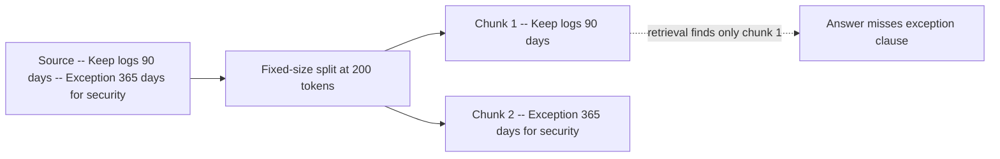
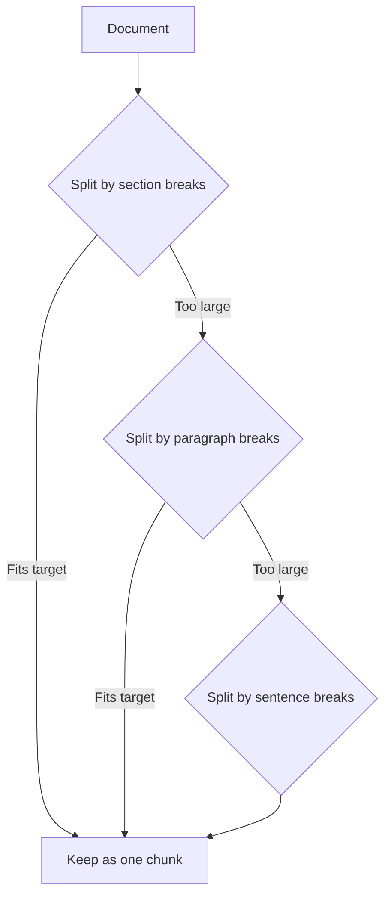
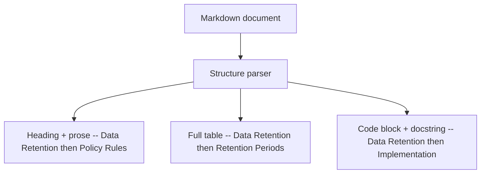
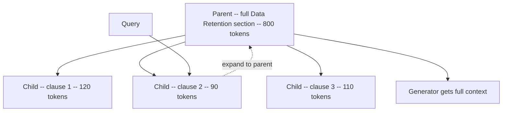
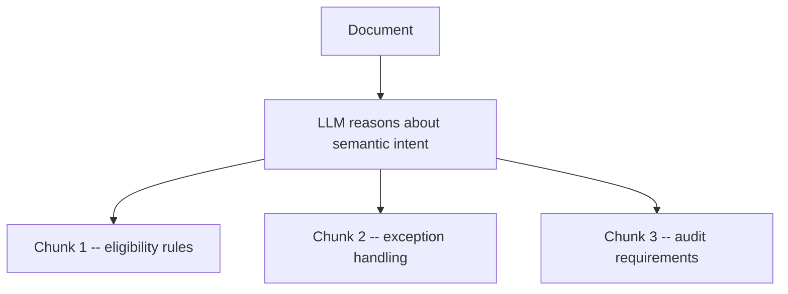

Chunking sets the unit of retrieval: whatever the splitter emits is what gets embedded, matched against a query and passed to the model. Large chunks carry more surrounding text but waste context on noise. Small chunks can match a query more precisely, yet they can separate a rule from the condition that changes it. A useful chunk keeps one complete idea together and carries enough source metadata to trace it back to the document.

A policy might state, "Keep logs for 90 days. Exception: security investigations require 365 days." A raw character split can put the exception in a different chunk from the rule. Retrieval then finds only the first fragment, and the answer quietly loses the condition that mattered.

# How to Choose a Strategy

No splitter is best for every corpus, so the choice follows from the retrieval failures that evaluation actually shows. The table maps each failure to the strategy that targets it, and to the sign that it is time to move on from that strategy.

| Observed evaluation failure | Start with | Why | Upgrade trigger |
| --- | --- | --- | --- |
| Split clauses, tables, or code blocks break answer correctness | Structure-aware | Preserves logical units and improves citation traceability | Parser misses important layouts or ingestion cost gets too high |
| Answers miss adjacent constraints even when relevant docs are found | Parent-child | Searching small children can keep matches precise, while parent expansion restores broader synthesis context | Storage and orchestration overhead outweigh quality gains |
| Queries drift across topics inside long prose | Semantic | Places boundaries around topic shifts | Ingestion becomes too slow or unstable across model updates |
| Need a fast, predictable baseline now | Recursive | Better boundaries than fixed-size with low implementation cost | Quality plateaus on mixed-format or highly structured corpora |
| Tight latency and simple homogeneous corpus | Fixed-size | Most operationally predictable ingestion | Faithfulness drops from boundary cuts |

# Chunking Strategies

## Fixed-Size Chunking

Fixed-size chunking cuts every document into windows of N tokens (or characters), with a configurable overlap between adjacent windows. The same rule applies to every document regardless of its content structure. That makes it the blunt baseline: the work scales predictably with document size and uniform chunks make capacity planning straightforward, but nothing in the rule knows where a sentence, a clause or a table ends.

Overlap is the only protection against a bad cut. It controls how much text neighboring chunks share, typically 10-20% of the chunk size, so a statement that straddles a cut has a chance of appearing whole in one of the two chunks. Zero overlap is fastest but maximizes the chance of splitting a sentence mid-thought.

Fixed-size splitting is a reasonable choice when a working baseline matters more than perfect boundaries, or when the corpus is homogeneous text such as blog posts and news articles, where documents have consistent structure and few tables or code blocks.

On anything structured, the cuts land inside logical units. A policy clause, code block or table row gets split at an arbitrary token offset. The retriever returns a fragment that looks relevant but is incomplete, and the model generates a confidently wrong answer from it. Increasing overlap reduces this damage, and auditing retrieval on structured documents exposes the cuts that remain. Headers, sections and paragraphs are just as invisible to the splitter, so a chunk may start mid-paragraph and end mid-sentence. That hurts retrieval precision, because the match is only partial, and generation quality, because the evidence arrives without its context.

## Recursive Chunking

Recursive chunking gets better boundaries without a document parser. The splitter works through a hierarchy of separators from largest to smallest, for example section breaks (`\n# `), paragraph breaks (`\n\n`), sentence breaks (`. `) and finally character-level splits. It tries the largest separator first and recurses to a smaller one only for a piece that still exceeds the target size. This preserves the largest coherent units that fit: a short section stays as one chunk, and a long section is split at paragraph boundaries rather than at arbitrary offsets.

LangChain provides `RecursiveCharacterTextSplitter` as its recommended generic-text splitter, with a separator hierarchy configurable for the document format. Other frameworks choose different defaults. LlamaIndex, for example, uses a sentence-oriented splitter.

Recursive splitting is a strong general-purpose default for mixed prose such as wiki pages, runbooks and knowledge base articles. It is also the first upgrade from fixed-size when format-specific parsers are not justified.

Its weakness is that the separator hierarchy can be wrong for the source format, and nothing reports the mismatch. The generic LangChain default uses paragraph breaks, newlines, spaces and finally individual characters. HTML, PDF-extracted text and Slack exports need different separator lists, and a hierarchy that does not match the format degrades to character-level splitting silently.

Tables and code blocks are what a text-centric hierarchy breaks most often. A Markdown table has no `\n\n` between rows, so the generic hierarchy falls back to `\n` and can place a chunk boundary between rows, which separates later rows from the header row. A single row longer than the target size is cut further at spaces. A blank line inside a code block can become a boundary in the same way. Custom separators for table and code-block delimiters only make those positions preferred split points, so a table or code block larger than the target size still falls back to the smaller separators. Keeping such blocks whole requires an atomic-unit policy: tables and code blocks are extracted before recursive splitting and stored as their own chunks instead of passing through the separator hierarchy. A block that exceeds the embedding model's input limit still needs its own splitting rule.

## Structure-Aware Chunking

Structure-aware chunking starts from the document's syntax tree or layout model instead of its raw text. A format parser identifies headings, tables, code blocks and list items as logical units and outputs a sequence of typed blocks (heading plus prose, table, code block, list). Each block becomes a chunk with its structural context preserved. Different source formats need different parsers:

- Markdown: the heading hierarchy.
- HTML: the DOM tree.
- PDF: layout analysis, with tools such as Unstructured or PyMuPDF.
- DOCX: paragraph styles.

Each chunk also inherits metadata from its structural ancestors: section title, heading path and document ID. This metadata enables section-level filtering at retrieval time and makes a citation traceable to a specific place in the source.

The approach earns its maintenance cost where layout carries meaning: policies with clause and exception structure, API docs with endpoint and parameter tables, runbooks with step and command pairs, legal contracts with nested clauses. It also suits corpora with heavy table or code content where recursive splitting consistently breaks structured elements.

The price is that the parser becomes part of retrieval correctness. Each document format needs its own parser or extraction pipeline, and updating them is ongoing work as source formats evolve. The hardest failure to notice is drift. A parser tuned for one Markdown flavor may silently misparse another, and when a document source changes format (e.g., Confluence to Notion export), chunk boundaries degrade without visible errors. Versioning parsers per source type, with ingestion QA snapshots that compare expected and actual chunk boundaries on sample documents, exposes this drift.

Structural units can also be too large. A long section, such as one of 2000 tokens, becomes a single chunk. Depending on the embedding model, that chunk can exceed the model's input limit, and its unrelated text can dilute retrieval precision. A maximum chunk size bounds this: oversized blocks are split recursively, and each resulting chunk keeps the block's structural metadata.

## Semantic Chunking

Semantic chunking looks for topic changes in the text itself. The splitter walks through the document, embeds adjacent text spans (sentences or small windows) and measures how semantically similar each span is to its neighbor. When similarity drops below a threshold, it inserts a chunk boundary at that point. Implementations set that threshold either as a fixed similarity value or relative to the document's own scores, for example as a percentile of the distances between its neighboring spans. The assumption is that similar spans belong together and that a drop in similarity signals a topic shift, so the boundary lands where the content actually changes, not where a fixed window happens to end.

Everything depends on the threshold, and which direction is aggressive depends on how it is expressed. A similarity threshold set too high is too aggressive: ordinary variation between sentences counts as a topic shift, and the document fragments into single-sentence chunks. Set too low, it is too conservative: real shifts are missed, and the chunks grow oversized and span multiple topics. A distance breakpoint runs the other way, so a higher percentile produces fewer, larger chunks.

A value that works in one setting does not carry over to another. The optimal threshold varies by embedding model, document domain and even writing style, so a threshold tuned on technical docs may over-fragment conversational text. Different embedding models also produce different similarity distributions for the same text, which means switching models requires re-tuning the threshold and potentially re-chunking the entire corpus. The threshold is therefore calibrated per corpus on a held-out evaluation set and re-evaluated when the embedding model changes.

Ingestion is costly as well, because every span needs its own embedding during chunking, in addition to embedding the finished chunks. For large corpora this can be significantly slower and more expensive than rule-based strategies. Batching the embedding calls and caching their results reduce the cost.

Semantic chunking helps most with long narrative text that changes topic without reliable headings: transcripts, meeting notes, email threads, unstructured knowledge base articles. More generally, it suits corpora where recursive splitting produces chunks that mix unrelated topics because the text lacks structural markers.

## Parent-Child Chunking

Parent-child chunking separates the unit that is searched from the unit that is passed to the generator. Ingestion creates small child chunks (100-200 tokens) as precise retrieval units and maps each one to a larger parent span (500-1000 tokens) from the source document. Retrieval searches the children for precision, and a match is expanded to its parent before generation, which restores context the child alone may lack. The mapping is stored as metadata: each child stores its parent ID, so expansion is a parent lookup rather than another similarity search.

The strategy fits domains where child-only retrieval is precise but answers consistently miss adjacent constraints or context. This is common in policy docs (rule and exception), technical specs (parameter and constraint) and legal text (clause and condition). Expansion gives the generator the surrounding context while the search unit stays small and precise.

Expansion can undo the precision gained by small children. If the parent span is too broad, such as an entire document section, expanding to it floods the context window with irrelevant content. A limit on parent size bounds this noise, and citation precision is tracked before and after expansion.

The other costs are storage and pipeline code. In the common design only child chunks need vector entries. Parents can live once in the document store, with each child carrying a parent ID, so the extra cost is the child index, the mapping metadata and the parent text retained for expansion. Duplicating parents in the vector index is optional and increases the overhead. The retrieval pipeline also needs a post-retrieval expansion step that maps children to parents, deduplicates overlapping parents and assembles the final context, which adds latency and code to maintain.

## Agentic Chunking

Agentic chunking delegates boundary decisions to an LLM. The model reads the document, reasons about its structure, identifies self-contained units of meaning and outputs boundary positions with optional metadata tags. Boundaries therefore follow semantic intent rather than fixed rules. A fully agentic splitter lets the model decide every boundary. A less expensive hybrid starts with recursive candidates and asks the model only to merge or split them.

The output is hard to reproduce because boundary decisions are non-deterministic. The same document can produce different chunks on re-processing, which breaks diff-based cache invalidation and makes regressions hard to reproduce. Results become reproducible only when the LLM's boundary decisions are cached and versioned alongside the prompt and model used, with chunk definitions kept as versioned artifacts. The prompt is a second source of instability: a small change to it can shift boundaries across the whole corpus. It therefore needs the same controls as production code, meaning versioning, tests on a sample set and chunk-quality monitoring after changes.

It is also the most expensive strategy to run. Every document requires LLM inference during ingestion, which rule-based strategies avoid entirely, and for large corpora this can be orders of magnitude more expensive than rule-based chunking. The cost usually restricts it to high-value documents.

That cost is defensible in high-stakes domains where chunk quality directly affects business risk, such as medical guidelines, financial compliance and safety procedures. It is also defensible for documents with complex implicit structure that rule-based parsers cannot capture, for example narrative documents whose logical structure does not follow heading conventions. Even then, the higher ingestion cost is justified only when held-out retrieval evaluation shows a gain over a simpler baseline on that corpus.

# Practical Baselines

Recursive chunking at 300-800 tokens with 10-20% overlap is a reasonable baseline, not a universal optimum. The decision to switch strategy is based on retrieval failure modes per source, because aggregate metrics hide format-specific problems: a retriever can perform well on prose while consistently breaking on table-heavy docs. The strategy is re-evaluated when the corpus format changes (e.g., prose-heavy docs to table-heavy docs) or when retrieval metrics plateau despite query translation improvements.

Whatever the splitter, each chunk carries its source document ID, section path, ingestion timestamp and ACL scope. Adding this metadata during ingestion is cheaper than reconstructing it later.

# Tradeoffs

| Strategy | Retrieval precision | Ingestion cost | Implementation complexity | Best corpus type |
| --- | --- | --- | --- | --- |
| Fixed-size | Often low on structured text: arbitrary cuts can split logical units | Lowest: no parsing, constant throughput | Trivial: one parameter (window + overlap) | Homogeneous prose with uniform structure |
| Recursive | Depends on separator fit: respects paragraph and sentence boundaries where the separators match the format | Low: rule-based, no model calls | Low: configurable separator list per format | Mixed prose without heavy tables or code |
| Structure-aware | Often higher where layout carries meaning: preserves tables, code, clauses as atomic units | Medium: requires format-specific parsers | Medium-High: one parser per source format, ongoing maintenance | Documents where layout carries meaning (policies, API docs, contracts) |
| Semantic | Can improve on unstructured prose: boundaries follow topic shifts when breakpoints are tuned | High: embedding call per span during ingestion | Medium: threshold tuning per corpus and embedding model | Long narrative text without reliable structural markers |
| Parent-child | Precise child search; parent expansion can add noise | Medium: child indexing, parent storage, metadata mapping | Medium: retrieval pipeline needs expansion and deduplication step | Domains where answers depend on adjacent constraints (policy, legal, specs) |
| Agentic | Task-dependent: can preserve implicit semantic units | Highest: LLM inference per document at ingestion | High: prompt versioning, non-deterministic output, caching infra | High-stakes documents where measured gains justify model-driven boundaries |

The ratings describe typical tendencies, not guaranteed results. A strategy's precision on a given corpus is established by retrieval evaluation. A practical rollout starts with recursive chunking, records failures by source type, and replaces only the splitter responsible for those failures. Model-selected boundaries are not inherently more accurate, so agentic chunking has to beat that corpus baseline in held-out retrieval evaluation before it is adopted.

# Questions

<!-- qard-id: 13f048ca-dbcc-49b1-8bbe-b502736ffee0 -->
> [!qard]- How should a chunking strategy be chosen for a RAG corpus?
> A chunking strategy is chosen from the retrieval failures that evaluation exposes on that corpus. It is not picked up front, because no splitter or chunk size is best for every corpus.
>
> Every choice trades one failure for another, such as a diluted match from larger chunks against a lost exception from smaller ones. Which side hurts more depends on how the documents are laid out and what the queries ask, and that only shows up in evaluation.
>
> The practical method is to start with a cheap rule-based baseline, typically recursive splitting with some overlap, and to record failures per source type. An aggregate metric can look healthy while one format, such as table-heavy documents, breaks consistently. A more specialized strategy then replaces the splitter only for the sources whose failures it addresses: structure-aware splitting when tables, code blocks or clauses are cut apart, parent-child retrieval when the right passage is found but nearby conditions are missing, and semantic splitting when long prose without headings mixes several topics in one chunk. Each of these adds ingestion or maintenance cost, so the change is kept only when retrieval and end-to-end answers improve on that corpus.
>
> Sources:
> - [Chunk large documents for vector search (Azure AI Search)](https://learn.microsoft.com/en-us/azure/search/vector-search-how-to-chunk-documents)
> - [[Chunking#How to Choose a Strategy|Chunking: How to Choose a Strategy]]

> [!qard]- How does chunk size affect retrieval quality in RAG?
> Chunk size trades match precision against completeness. A large chunk keeps related statements together but matches a query less sharply, and a small chunk matches precisely but can leave out the neighboring text that changes its meaning.
>
> The loss of sharpness comes from embedding each chunk as a single vector: a chunk that covers several ideas represents none of them sharply, and retrieving it also spends context on text the question did not need. The text a small chunk leaves out can be the exception to the rule it states.
>
> Size has a hard upper bound, because each chunk has to fit the embedding model's input limit. A common starting point is recursive splitting at 300 to 800 tokens, which is a baseline to evaluate against and not an optimum.
>
> Sources:
> - [Chunk large documents for vector search (Azure AI Search)](https://learn.microsoft.com/en-us/azure/search/vector-search-how-to-chunk-documents)
> - [[Chunking#Practical Baselines|Chunking: Practical Baselines]]

> [!qard]- What does chunk overlap do, and what does it cost?
> Overlap repeats the end of one chunk at the start of the next, so a statement that a boundary would cut is likely to appear whole in one of the two chunks. The cost is duplicated text in the index.
>
> A common setting is 10 to 20 percent of the chunk size. The duplication means more text to embed and store, and neighboring chunks retrieved together repeat the shared passage in the context. Overlap lowers the risk of a bad cut without removing it: a unit longer than the overlap, such as a table, is still split.
>
> Sources:
> - [Chunk large documents for vector search (Azure AI Search)](https://learn.microsoft.com/en-us/azure/search/vector-search-how-to-chunk-documents)
> - [[Chunking#Fixed-Size Chunking|Chunking: Fixed-Size Chunking]]

<!-- qard-id: f1dcfdda-8d4e-4e58-bea0-32b47bf5fc89 -->
> [!qard]- How does parent-child chunking work in RAG?
> Parent-child chunking searches small child chunks but passes the generator the larger parent section that contains the match. The unit that is searched and the unit that is read are no longer the same.
>
> Each child stores its parent's identifier at ingestion. A query is matched only against the children, and a small chunk covers one idea, so the match stays precise. Following the stored identifier from child to parent is a lookup, not a second similarity search, and a parent hit through several children is included once.
>
> The parent returns the condition, prerequisite or exception adjacent to the match, such as the exception clause after a retention rule. It also costs more tokens per hit, and too broad a parent brings back the irrelevant text small children were meant to keep out. Parent size therefore needs a limit, and expansion is kept only when evaluation on that corpus shows better answers.
>
> Sources:
> - [Define index projections (Azure AI Search)](https://learn.microsoft.com/en-us/azure/search/search-how-to-define-index-projections)
> - [Chunk large documents for vector search (Azure AI Search)](https://learn.microsoft.com/en-us/azure/search/vector-search-how-to-chunk-documents)
> - [[Chunking#Parent-Child Chunking|Chunking: Parent-Child Chunking]]

<!-- qard-id: 9cff4a1c-e06f-4a37-ad57-9a0e012b56fa -->
> [!qard]- Why is semantic chunking not always superior to simpler rule-based approaches?
> Semantic chunking is not automatically better because its boundaries come from embedding distances and a tuned breakpoint. That costs more at ingestion, behaves differently across embedding models and corpora, and adds little when the document's structure already marks the topic changes.
>
> The splitter cuts the text into sentences or small groups, embeds each, and places a boundary where the distance between neighbors exceeds a breakpoint, such as a percentile or a number of standard deviations over that text's distances. Every span is embedded at ingestion, which rule-based splitters never do.
>
> Those distances depend on the embedding model and the kind of text, so a breakpoint tuned in one setting can, in another, over-fragment the text or leave several topics in one chunk, and it needs re-evaluation after a model or corpus change.
>
> Where headings or markup already separate topics, a recursive or structure-aware splitter is cheaper and more predictable. Semantic splitting is worth its cost for long prose without structural markers, such as transcripts or email threads, when evaluation shows better retrieval.
>
> Sources:
> - [LangChain `SemanticChunker` implementation](https://github.com/langchain-ai/langchain-experimental/blob/main/libs/experimental/langchain_experimental/text_splitter.py)
> - [Chunk large documents for vector search (Azure AI Search)](https://learn.microsoft.com/en-us/azure/search/vector-search-how-to-chunk-documents)
> - [[Chunking#Semantic Chunking|Chunking: Semantic Chunking]]

<!-- qard-id: d60aa6f4-362a-41f6-a301-14954f2a836e -->
> [!qard]- What is the core tradeoff in choosing chunk size?
> Small chunks match precisely but can lose adjacent context, such as an exception or a referenced value. Large chunks keep that context, but one vector covering several ideas represents none of them sharply, and they cost more tokens. Which failure hurts more only shows up in evaluation on your corpus.

# References

- [Chunking and integrated vectorization (Azure AI Search)](https://learn.microsoft.com/en-us/azure/search/vector-search-how-to-chunk-documents)
- [Chunking strategies for RAG (Pinecone)](https://www.pinecone.io/learn/chunking-strategies/)
- [5 Levels of Text Splitting (Greg Kamradt)](https://github.com/FullStackRetrieval-com/RetrievalTutorials/blob/main/tutorials/LevelsOfTextSplitting/5_Levels_Of_Text_Splitting.ipynb)
- [Unstructured: Document preprocessing and chunking](https://docs.unstructured.io/open-source/core-functionality/chunking)
