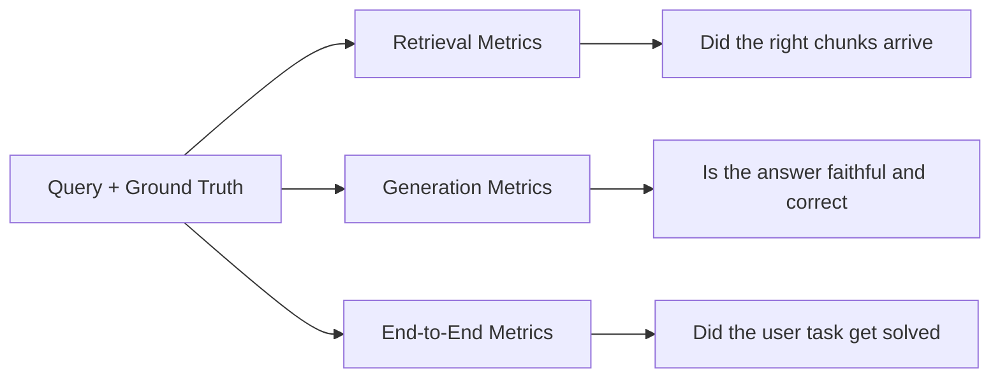

RAG can fail before generation starts. It can also retrieve the right evidence and still produce a bad answer. Evaluation therefore separates retrieval from generation, then checks the finished system against the user's task. One blended quality score cannot show which part needs repair.

Retrieval metrics ask whether relevant chunks reached the model and whether they were ranked well. Generation metrics check that the answer uses those chunks faithfully. End-to-end evaluation looks at the actual outcome. The distinction matters because prompt changes cannot recover a document that retrieval never found, while another embedding model will not fix a generator that ignores clear evidence already in context.



A support bot may retrieve the correct policy and still misread its date constraint. Retrieval passes. Generation fails. Without separate scores, that defect looks like a search problem and sends work toward the wrong component.

```datacorejsx
const { FolderStructureMap } = await dc.require("Assets/components/devbook-folder-map.jsx");
return FolderStructureMap;
```

# Questions

> [!qard]- What do retrieval, response, and end-to-end RAG evaluations tell you?
> Retrieval evaluation asks whether useful evidence was found and selected. Response evaluation asks whether the answer is correct or grounded given the evidence supplied. End-to-end evaluation asks whether the complete system met the task's outcome criteria. Separate results localize likely failure: a good response over bad context points upstream, while good context with a bad answer points toward generation. End-to-end failure establishes a user-visible miss but does not identify its cause. [RAG evaluators](https://learn.microsoft.com/en-us/azure/foundry/concepts/evaluation-evaluators/rag-evaluators?view=foundry)

> [!qard]- Which evaluation concerns are specific to RAG, and which can reuse general LLM evaluation methods?
> RAG adds retrieval-specific questions: did the system find relevant evidence, rank it well, and supply enough valid evidence to answer? The dataset must account for multiple acceptable or complementary chunks. Groundedness is useful whenever an answer is constrained by provided evidence, not only in RAG. Golden sets, deterministic checks, model judges and online evaluation are reusable methods; choose the evaluator for the measured claim and verify its labels and limits. [RAGAS: Automated Evaluation of Retrieval Augmented Generation](https://aclanthology.org/2024.eacl-demo.16.pdf) · [Evaluation types](https://docs.langchain.com/langsmith/evaluation-types)

# References

- [RAGAS metrics reference](https://docs.ragas.io/en/stable/concepts/metrics/available_metrics/)
- [RAG evaluators in Azure AI Foundry](https://learn.microsoft.com/en-us/azure/ai-foundry/concepts/evaluation-evaluators/rag-evaluators)
