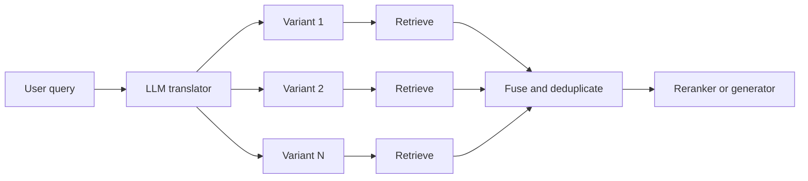

Query translation changes a user's wording before search so that retrieval sees language closer to the corpus. Someone asks, "Can partners burst above limits now?" The relevant document is titled "Q3 Quota Policy Update — Partner Tier Burst Allowance." Both describe the same policy, but a single query embedding may place them in different neighborhoods. Translation searches more of that space without changing the corpus or the [[Embeddings|embedding model]].

An LLM produces one or more variants. Depending on the technique, those variants may be paraphrases, narrower sub-questions, a broader question, or a hypothetical answer. Each one runs through [[Retrieval]]. Lists from alternative phrasings are deduplicated and fused before [[Re-ranking|reranking]] or generation, while decomposition can answer each sub-question from its own evidence and then synthesize the partial answers.

A query such as "rate limit behavior for partner tier accounts" can become "partner tier throttling policy" and "API quota enforcement for partner customers." Each wording reaches a slightly different document neighborhood. Fusion keeps the strongest candidates from both searches.

Translation can recover recall lost to vocabulary mismatch, split a multi-part request into separate searches, or add a broader background search. It cannot repair bad [[Chunking]], a weak embedding model, a broken index, or a missing source document.

# How Each Rewrite Changes Search

## Multi-Query

Multi-query generates several phrasings of one intent. Each variant retrieves independently, and the result sets are deduplicated by document ID.

The useful part is coverage. "Authentication failure" and "credential validation error" mean nearly the same thing, yet a particular embedding model may place them far enough apart to return different documents.

Original query: "How to handle connection timeouts in HttpClient?"
Translated variants:

- "HttpClient timeout configuration and retry behavior"
- "System.Net.Http connection timeout exception handling"
- ".NET HTTP client request deadline exceeded"

The first variant is likely to match guides, the second API documentation, and the third operational incident text.

Multi-query is the usual first translation technique for natural-language search. Its main failure is query drift. If "HttpClient timeout" becomes "network timeout troubleshooting," operating-system diagnostics can crowd out the .NET-specific evidence.

## RAG-Fusion

RAG-Fusion adds an explicit ranking step to multi-query. It merges all result lists with [[Re-ranking|Reciprocal Rank Fusion (RRF)]]. For each document, it sums `1 / (rank + k)` across the lists. The conventional constant is `k=60`.

A document that ranks well for three variants usually gains more fusion score than one that appears only once. Agreement across independent phrasings acts as a relevance vote. RRF does not reject a drifted variant or its documents: a result ranked highly by one bad rewrite can still survive the cutoff. This is useful in enterprise and policy search, where the same concept appears under several names, only when the variants themselves remain faithful.

The bill is predictable: N variants require N retrieval calls plus the translation call. Four sequential 100 ms searches add roughly 400 ms. Running them concurrently reduces the retrieval portion to about the slowest individual call, though the translation call still sits in front of them.

## Step-Back Prompting

Step-back prompting asks a broader version of the question and retrieves for both versions. The original search supplies the case-specific evidence. The broader search supplies the mechanism needed to interpret it.

For "Why does EF Core time out on a batch insert of 10K rows?", the broader query might ask how EF Core batches commands and manages connections.

Original query: "Why is my HNSW recall dropping after adding 5M vectors?"

Step-back question: "How does HNSW index recall scale with corpus size and what parameters affect it?"

The broader search can recover HNSW graph behavior and `ef_search` tuning, while the original query finds troubleshooting reports for large indexes. This works when a symptom only makes sense through the underlying mechanism.

But abstraction can go too far. "What are vector database best practices?" is too broad to explain a recall drop and mostly burns context tokens.

## Decomposition

Decomposition breaks a genuinely multi-part request into different questions. It retrieves for each one, then synthesizes the evidence. Multi-query keeps one intent and changes its wording. Decomposition changes the work itself.

Original query: "How does Task compare to ValueTask for high-throughput API endpoints?"

Sub-questions:

- "What is the allocation behavior of Task in async methods?"
- "When does ValueTask avoid heap allocation and what are its constraints?"
- "What are the performance characteristics of high-throughput API endpoints with frequent async completions?"

No single chunk is likely to contain `Task` internals, `ValueTask` constraints, and representative throughput evidence. Separate searches can find each piece.

The danger is context fragmentation. A sub-question about `Task` may forget that the original problem is a high-throughput endpoint. Once that constraint disappears, retrieval returns generic async guidance and the synthesis step cannot recover the lost specificity. Each sub-question therefore carries the original constraints. Decomposition adds no value when one coherent search intent is enough.

## HyDE: Hypothetical Document Embeddings

HyDE generates a hypothetical answer, embeds that text, and searches for real documents near it. Short questions often make weak dense-retrieval inputs. A paragraph shaped like an answer carries more domain vocabulary and may sit closer to the source material.

That advantage comes from invented text. If the draft assumes the wrong error code or product version, retrieval follows the mistake into the wrong neighborhood. HyDE is therefore strongest on vague, semantic questions and weakest when exact identifiers carry the meaning. Those query classes require separate measurements.

# How Translation Fails

## Query Drift and Semantic Leakage

A rewrite can stay topically related while changing the request. "HttpClient connection timeout" becoming "network infrastructure timeout diagnostics" is a classic example: the search now favors operating-system material over .NET documentation. Fusion makes this harder to notice because the drifted results still look relevant.

The original query remains one of the retrieval variants. Translation prompts preserve entities, identifiers, and version numbers verbatim. A similarity threshold can reject extreme drift, but a labeled retrieval set is the real test because semantic similarity does not prove intent preservation.

## Latency Multiplication

Translation adds a serial model call before retrieval. Even with concurrent searches, the translation-and-retrieval portion of latency is the translator plus the slowest search. That is the number the p95 budget must absorb.

A hard budget of two to four variants bounds the cost. Searches run concurrently, and stable rewrites can be reused through [[Home/AI & ML/LLM/Context Engineering/RAG/RAG Caching|caching]]. Production-like concurrency exposes queueing and tail latency that a single-query benchmark hides.

## HyDE Hallucination Amplification

HyDE puts the model's assumptions inside the search vector. A plausible but wrong draft does more than add noise: it steers retrieval toward documents that support the invented premise.

HyDE is compared with direct retrieval on a labeled set. Separate results for vague semantic queries and identifier-heavy factual queries prevent an aggregate score from hiding failures in the second group.

## Decomposition Losing Global Constraints

Decomposition often drops the words that connect the pieces. A generic `ValueTask` search is not enough when the original question is specifically about frequent synchronous completion under high load.

Every sub-question includes the original request or its material constraints. The synthesis prompt also receives the original request. For a single intent, multi-query is cheaper and keeps the context intact.

# Choosing a Technique

The recall column describes how each technique can find more evidence, not a workload-independent gain; any gain depends on the corpus and query class. Latency cost counts the model and retrieval calls in each pipeline, excluding the final answer-generation call that every row shares.

| Technique | How recall can improve | Precision risk | Latency cost | Best for |
| --- | --- | --- | --- | --- |
| No translation | Baseline -- single query only | Lowest -- no drift risk | 1 retrieval call | Simple corpora with predictable query vocabulary |
| Multi-Query | Paraphrases can reach documents that use other words for the same intent | Low-moderate -- drift from paraphrases | 1 translation call + N retrieval calls -- retrievals parallelizable | Natural-language queries with varied user phrasing |
| RAG-Fusion | As multi-query; RRF can also lift evidence that several variants retrieve | Moderate -- RRF rewards agreement but does not remove drift | 1 translation call + N retrieval calls + fusion computation | Broad questions where faithful variants surface the same evidence |
| Decomposition | Each sub-question can retrieve evidence that one combined query would miss | Moderate -- constraint loss across sub-questions | 1 decomposition call + N retrieval calls + N sub-answer calls when each sub-question is answered before synthesis | Multi-entity or multi-constraint questions requiring separate evidence |
| Step-Back | The broader question can add background context alongside the original search | Low-moderate -- overly abstract retrieval possible | 1 step-back generation call + 2 retrieval calls -- original + step-back | Questions requiring first-principles context before specifics |
| HyDE | A hypothetical answer can give a short or vague query a richer search vector | High -- hallucination can bias retrieval | 1 hypothetical-answer generation call + 1 retrieval call | Short or exploratory queries where direct embedding is too sparse |

Direct retrieval provides the control. Multi-query or RAG-Fusion earns its cost when evaluation isolates vocabulary mismatch. Decomposition fits requests with independently retrievable sub-problems, while HyDE fits vague semantic queries. A technique stays only when it beats direct retrieval for its target query class within the latency budget.

# Questions

<!-- qard-id: 53a89faf-27cb-4f67-94fe-18e9373b2852 -->
> [!qard]- What does query translation change in a RAG retrieval pipeline, and what can it not fix?
> Query translation changes only the queries sent to retrieval. A model turns the user's request into one or more retrieval inputs, such as paraphrases, a broader step-back question, sub-questions or a hypothetical answer. Each input is then searched against the existing index. Translation cannot fix problems in the corpus or in the index itself.
>
> - **What it can help:** vocabulary mismatch, where the user and the corpus describe the same idea in different words; requests whose parts need separate searches; and questions that also need broader background. For example, “Can partners burst above limits now?” and a document titled “Partner Tier Burst Allowance” describe the same policy, and a rewrite closer to the document's wording can reach it.
> - **What it cannot fix:** evidence missing from the corpus, chunks that split the needed text, a weak embedding model or a broken index. Every variant still searches the same chunks and vectors.
> 
> The work after search depends on the technique. Lists retrieved for several phrasings of one question are usually deduplicated and fused before reranking or generation. Decomposition can instead answer each sub-question from its own evidence and then synthesize the partial answers into one response. In every case, the benefit is measured against direct retrieval on the same queries.
>
> Sources:
> - [Query Rewriting for Retrieval-Augmented Large Language Models (Ma et al., EMNLP 2023)](https://arxiv.org/html/2305.14283)
> - [RAG-Fusion: a New Take on Retrieval-Augmented Generation (Rackauckas, 2024)](https://arxiv.org/html/2402.03367)
> - [Sub Question Query Engine (LlamaIndex)](https://developers.llamaindex.ai/python/examples/query_engine/sub_question_query_engine/)
> - [[Query Translation#How Each Rewrite Changes Search|Query Translation: How Each Rewrite Changes Search]]

<!-- qard-id: 63c5e250-74a4-4dec-8e14-ffd1ae425738 -->
> [!qard]- How can query translation change retrieval quality, and how should that change be evaluated?
> Translation can raise recall by searching wordings closer to the corpus's vocabulary. It can lower precision when a rewrite drifts from the request's entities or constraints. Its effect is measured by comparing translated retrieval with direct retrieval on the same labeled queries.
>
> - **Gain:** a rewrite such as “partner tier throttling policy” can match documents that use words the user did not, so relevant evidence missed by the original wording enters the results.
> - **Loss:** a rewrite can stay on topic yet change the request. When “`HttpClient` connection timeout” becomes “network timeout troubleshooting”, operating-system material can crowd out .NET-specific evidence. Fusing the result lists does not remove drift, because a document ranked highly by one bad variant can still pass the cutoff.
> 
> How the change is evaluated:
>
> 1. Direct retrieval is the control, run on the same labeled queries.
> 2. Results are split by query class, such as vague questions and identifier-heavy ones, because a technique can help one class and hurt another.
> 3. Recall@k and Precision@k are measured at the cutoffs the pipeline actually uses. A rise in Recall@20 with a fall in Precision@5 means more relevant candidates appear within 20 results while the top five carry more noise. By itself, that result does not show what survives reranking or reaches the generator.
> 
> Two common controls limit drift: the original query stays among the searched variants, and rewrites that alter entities, identifiers, versions or other material constraints are rejected.
>
> Sources:
> - [Query Rewriting for Retrieval-Augmented Large Language Models (Ma et al., EMNLP 2023)](https://arxiv.org/html/2305.14283)
> - [RAG-Fusion: a New Take on Retrieval-Augmented Generation (Rackauckas, 2024)](https://arxiv.org/html/2402.03367)
> - [RAG solution design and evaluation guide (Azure Architecture Center)](https://learn.microsoft.com/en-us/azure/architecture/ai-ml/guide/rag/rag-solution-design-and-evaluation-guide)

<!-- qard-id: b6525d64-1361-4305-987b-a389e784975d -->
> [!qard]- When should a RAG system decompose a question instead of generating multiple query phrasings?
> Decomposition fits a request whose parts need different evidence. Multiple phrasings fit a single, clear information need whose wording may not match the corpus.
>
> | Aspect | Decomposition | Multi-query |
> |---|---|---|
> | Fits when | Parts of the request need separate evidence, as in comparing two systems or assembling a timeline | One intent is clear, but the corpus may describe it in other words |
> | What is generated | Different sub-questions, each retrieving its own evidence | Several phrasings of the same question |
> | Main failure | Sub-questions drop constraints from the original request, so retrieval returns generic evidence that synthesis cannot make specific again | Paraphrases drift from the intent and pull in related but wrong material |
> | Execution | Independent sub-questions can run concurrently. Multi-hop sub-questions depend on earlier answers and run in sequence. | Variants can run concurrently, and their result lists are merged and deduplicated |
> | Added work | Generating sub-questions, one retrieval per sub-question and a synthesis step that combines the partial answers | Generating variants and one retrieval per variant |
>
> Example: “How does `Task` compare to `ValueTask` for high-throughput API endpoints?” needs evidence on `Task` allocation, `ValueTask` constraints and throughput behavior, which a single passage is unlikely to contain. Decomposition fits, provided each sub-question keeps the high-throughput constraint and the synthesis step receives the original request.
>
> Sources:
> - [Sub Question Query Engine (LlamaIndex)](https://developers.llamaindex.ai/python/examples/query_engine/sub_question_query_engine/)
> - [Retrieval-augmented generation in Azure AI Search](https://learn.microsoft.com/en-us/azure/search/retrieval-augmented-generation-overview)

# References

- [Precise Zero-Shot Dense Retrieval without Relevance Labels — the original HyDE paper (Gao et al., ACL 2023)](https://arxiv.org/abs/2212.10496)
- [Take a Step Back: Evoking Reasoning via Abstraction in Large Language Models (Zheng et al., ICLR 2024)](https://arxiv.org/abs/2310.06117)
- [RAG-Fusion: a New Take on Retrieval-Augmented Generation (Rackauckas, IJNLC 2024)](https://arxiv.org/abs/2402.03367)
- [Query Rewriting for Retrieval-Augmented Large Language Models — Rewrite-Retrieve-Read framework (Ma et al., EMNLP 2023)](https://arxiv.org/abs/2305.14283)
