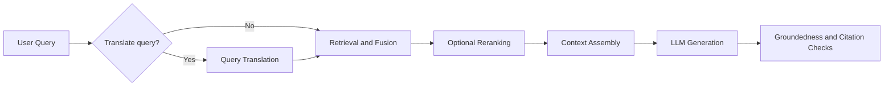

Retrieval-Augmented Generation (RAG) retrieves evidence from a corpus and gives it to the model for generation. Knowledge can then change without retraining the model, and the answer can point back to the source that supported it.

A useful RAG system is a pipeline. Query processing determines what search sees. Retrieval decides which evidence survives. Context assembly decides what the model receives. Evaluation and production controls keep those stages honest.

For a support question such as “What changed in API v2 rate limits?”, the system retrieves release notes and policy documents first. The model answers from those sections and cites them instead of relying on an old fact stored in its weights.

```datacorejsx
const { FolderStructureMap } = await dc.require("Assets/components/devbook-folder-map.jsx");
return FolderStructureMap;
```

# Core Flow



Each stage limits the next. When translation is used, retrieval cannot repair a rewrite that changed the intent, and reranking cannot promote evidence that search never returned. A baseline can send the original query directly to retrieval. Treating RAG as one large prompt hides these boundaries.

# Operational Baselines

- Each added pattern sits behind a feature flag, so its [[Monitoring#Retrieval Quality Metrics|retrieval precision]] and [[Monitoring#LLM-as-Judge Metrics|generation faithfulness]] can be compared with latency p95 and cost per query.
- Iterative and agentic retrieval run under a cap. A retry budget bounds latency. Unsupported output should fail closed instead of looping until it sounds plausible.
- Query drift can accumulate between retrieval rounds. Semantic similarity to the original query makes gradual topic changes visible.
- Expensive stable work is worth caching: query rewrites, multi-query results, contextual chunk enrichment, and read-only tool results scoped to the caller's authorization. Mutating tool calls need [[Home/Software Architecture/Distributed Systems/Idempotency|idempotency]], not response caching. [[Home/AI & ML/LLM/Context Engineering/RAG/RAG Caching|Caching]] covers keys and invalidation.
- Simple questions go through the cheapest path. Multi-hop retrieval is wasted work on a single-hop lookup.

# RAG Vs Fine-Tuning

RAG and [[Fine-tuning]] change different parts of the system. RAG supplies knowledge at request time. Fine-tuning changes behavior in the model weights. Retrieval is the safer place for facts that change.

A weekly policy change can enter RAG through reindexing. Fine-tuning would bake in another snapshot and still give weak source traceability.

| Axis | RAG | Fine-tuning |
|---|---|---|
| Knowledge freshness | Changes when the corpus is reindexed | Changes when the model is trained again |
| Source traceability | Direct when citations are retained | Weak unless supplied separately |
| Behavioral consistency | Depends on prompt and model behavior | Can improve through training examples |
| Time to first value | Usually faster | Usually slower |
| Operational complexity | Retrieval and index operations | Training, evaluation, and model release operations |

1. RAG is the first choice when facts change often or answers need citations.
2. Fine-tuning is added when format or policy behavior stays unstable after prompt work.
3. Mutable facts stay in the corpus, and learned behavior stays in the weights.

The two techniques can work together. Fine-tuning can stabilize format or refusal behavior, while RAG supplies current facts. The boundary still holds: knowledge changes through reindexing, and behavior changes through retraining.

# Questions

> [!qard]- What is retrieval-augmented generation (RAG)?
> Retrieval-augmented generation (RAG) answers a request in two steps. It first retrieves relevant evidence from an external corpus, then gives that evidence to a language model, which generates an answer grounded in it. Knowledge therefore comes from the corpus at request time, not only from what the model learned in its weights.
>
> A typical request passes through these stages:
>
> 1. **Query processing:** the question is used as is or rewritten into a better search query.
> 2. **Retrieval:** a search over an index of document chunks returns candidate passages. The search can use vector similarity, keywords or both.
> 3. **Reranking (optional):** a second stage reorders the candidates so the most relevant come first.
> 4. **Context assembly:** the best passages are placed into the prompt within a token budget.
> 5. **Generation:** the model answers from that context, ideally citing the passages it used.
> 
> Compared with relying on the model's weights alone, RAG changes two things. Knowledge can be updated by changing the corpus and its index instead of retraining, and an answer can point back to its sources. Each stage also limits the next: generation cannot use evidence that retrieval never returned.
>
> [Retrieval-Augmented Generation for Knowledge-Intensive NLP Tasks (Lewis et al.)](https://arxiv.org/abs/2005.11401)

<!-- qard-id: 19ad841c-2c3b-4042-aa7b-e7324d145b10 -->
> [!qard]- How should an advanced RAG stage, such as reranking or query rewriting, be introduced and evaluated?
> An advanced stage is introduced as a controlled experiment. It targets a specific failure measured on the current pipeline, and it stays only if it beats that baseline by enough to justify its added latency, cost and maintenance.
>
> 1. **Baseline:** the current pipeline is measured on representative cases, and the failure the new stage should fix is identified. An example is relevant evidence ranked too low to reach the prompt.
> 2. **Isolated change:** where practical, only that stage changes. A broad change to several stages can hide which component helped and which one regressed.
> 3. **Same comparison:** baseline and candidate run on the same cases. They are measured on the targeted metric, on end-to-end answer quality and on operational measures such as p95 latency and cost per query.
> 4. **Decision:** the stage is kept only when its quality gain outweighs its latency, cost and maintenance burden. Otherwise the simpler pipeline remains.
> 
> Changing exactly one thing is not always feasible. A feature flag, a controlled rollout or an ablation that removes one component at a time can still attribute an effect to a specific stage.
>
> [Rules of Machine Learning (Google)](https://developers.google.com/machine-learning/guides/rules-of-ml)

<!-- qard-id: 62a9172b-1f78-4656-8b17-50f8365f997d -->
> [!qard]- When a RAG answer is wrong, how can the failing pipeline stage be located?
> The diagnosis starts from the exact context and request the model received for that answer. Whether the needed evidence was there decides which part of the pipeline to examine, and tracing backward from there finds the stage that failed.
>
> 1. **Actual model input:** the logged prompt and assembled context for the failing request are inspected, rather than assumptions about what retrieval probably returned.
> 2. **Evidence missing or unsuitable:** the fault is upstream of generation. Tracing back through context assembly, ranking, filtering, retrieval and query transformation shows where the evidence was lost. It may have been retrieved but cut by the final top-k, removed by a filter, or never retrieved because a rewritten query changed the intent.
> 3. **Evidence present but misused:** the relevant evidence reached the model, but the answer ignored, contradicted or went beyond it. That points to generation: the prompt, the model or its settings.
> 4. **Measurement itself:** citation handling and the reference answer or evaluator are checked too, because a broken citation mapping or a wrong label can make an answer look wrong.
> 
> Component metrics, such as retrieval relevance and groundedness, narrow the hypotheses. End-to-end evaluation then confirms whether a fix improves the task outcome.
>
> [RAG evaluators (Microsoft Foundry)](https://learn.microsoft.com/en-us/azure/foundry/concepts/evaluation-evaluators/rag-evaluators?view=foundry)

# References

- [Retrieval-Augmented Generation for Knowledge-Intensive NLP Tasks](https://arxiv.org/abs/2005.11401)
- [Retrieval-Augmented Generation for Large Language Models: A Survey (Gao et al., 2024)](https://arxiv.org/abs/2312.10997)
