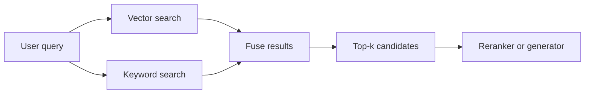

---
topic:
  - AI & ML
subtopic:
  - LLM
summary: "Decides what evidence enters the prompt, balancing recall, precision, and latency across search methods."
level:
  - "2"
priority: High
status: Done
publish: true
qard-deck: "AI & ML"
qard-topic: "LLM/Context Engineering/RAG/Retrieval"
flashcard_uid: "6dc71082"
---

Retrieval decides which evidence reaches the prompt. Missing evidence caps what a grounded answer can claim, even though prompts and generation models can still improve how fixed evidence is used. The practical problem is to recover enough relevant material without filling the context window with noise or spending the entire latency budget on search.

A query can become a vector for semantic search, weighted terms for keyword search, or both. Vector search compares it with pre-indexed chunk embeddings. BM25 searches a lexical index. The resulting candidates are fused into one ranked list and passed to [[Re-ranking|reranking]] or directly to the generator.

But no single search path handles every query shape well.

An example is the query "rate limit error 429 behavior in partner tier." Vector search recognizes the meaning around rate limiting, yet may lose the exact token `429`. Keyword search catches `429` and `partner tier`, while missing related passages that use different wording. Running both paths covers those two failure modes. Hybrid search is a sensible default, though the added path can introduce noise on some corpora.

# Retrieval Modes

## Dense Retrieval — Vector Search

The index-time and query-time work split cleanly:

- An embedding model maps each document chunk and the query into the same fixed-size vector space. Document vectors are computed once during indexing. Each request only needs a query vector.
- The [[Vector Databases|vector database]] searches an approximate index, commonly HNSW or IVF, for nearby chunk vectors. Approximation gives up some recall to avoid scanning millions of vectors one by one.
- Model choice shapes the result set. Dimensionality and training data differ, and a model that leads a general MTEB benchmark may fail on a specialized corpus or another language. Domain queries are the real test.

Dense retrieval fits:

- Semantic paraphrases and natural-language questions where user wording differs from source text.
- Multilingual corpora where the embedding model captures meaning across languages.

The main risk is specific:

- **Misses exact identifiers.** Embedding models capture meaning better than literal tokens. Error codes, API paths, and version strings can disappear inside the vector representation. Returned chunks may look topically correct while describing the wrong operation, which is harder to catch than an obviously unrelated keyword result.

## Sparse Retrieval — Keyword Search (BM25)

BM25 is the default ranking model in search engines such as Elasticsearch. PostgreSQL's native full-text search uses `to_tsvector`/`to_tsquery` for lexeme matching and `ts_rank` or `ts_rank_cd` for ranking. It does not provide BM25 as its built-in ranker. Both behave like ranked `grep` at a high level, but their scoring functions differ. A search for `NullReferenceException` in a .NET codebase hits files containing that string. A focused source file can rank above a 10,000-line log that mentions it once.

How it works:

- BM25 gives rare matching terms more weight. If only three documents contain `E4392`, they score strongly for that query. Common words contribute little.
- Repetition has diminishing returns, and a length penalty stops large documents from winning through word count alone.
- A standard keyword index is enough. No embedding model, GPU, or vector database is involved.

Where it fits:

- Queries with exact keyword constraints: error codes, product names, version numbers, configuration keys.
- Domains with specialized terminology where exact matches carry high signal.

Main risk:

- **Weak on paraphrases.** BM25 cannot connect "authentication failure" with "credential validation errors" when the words do not overlap. Stemming and synonym expansion help at the edges, but semantic variation remains its blind spot.

## Hybrid Retrieval — Vector + Keyword

Hybrid retrieval runs full-text search, such as `WHERE body @@ to_tsquery('error & 429')`, beside vector similarity search and then merges the results. RRF works from rank positions. If document A is #2 in vector search and #5 in keyword search, while document B is #1 in keyword search but #200 in vector search, the agreement around A raises it in the fused list. Linear combination instead assigns an explicit weight to each score, closer to a weighted `UNION ALL`.

How it works:

- Vector search and keyword search run in parallel against the same query, and the two ranked lists are fused into a single candidate set.
- **[[Re-ranking|Reciprocal Rank Fusion (RRF)]]** sums `1 / (k + rank)` for each document across the input lists, with k=60 in the original method. Because it uses positions instead of scores, BM25 and vector similarity do not need a shared scale. Agreement across retrievers is rewarded.
- **Linear combination** normalizes scores and computes `alpha * vector_score + (1 - alpha) * keyword_score`. It exposes more control, but alpha must be tuned for the domain. Identifier-heavy corpora may need more keyword weight. Conversational queries often favor the vector path.

Where it fits:

- Production systems with mixed query patterns. This is a safe default for many RAG systems.

Main risk:

- **Can lose to one search mode.** A homogeneous corpus may strongly favor one retriever, leaving the other to inject noise. In one [published case study](https://huggingface.co/blog/charles-azam/rag) of 156 multilingual engineering and scientific queries, vector-only reached a 69.2% hit rate while hybrid reached 63.5%. The extra keyword path hurt. Hybrid must be tested against both single-mode baselines on the actual corpus.
- **Large top-k values collect noise.** Fusing two long result lists pulls weak candidates into the tail. Without [[Re-ranking|reranking]] or deduplication, those candidates dilute the context sent to generation.

# Indexing and Filtering

The vector index sets the latency-recall curve:

- **HNSW** builds a layered graph between nearby vectors and searches from coarse connections down to local neighbors. Raising `ef_search` explores more of that graph, buying recall with latency. A value that works on a small collection may miss more neighbors after the corpus grows.
- **IVF-PQ** clusters and compresses vectors, in some configurations using far less memory than HNSW. Aggressive compression loses recall more quickly. It suits collections around 10M+ vectors when an in-memory HNSW graph is too expensive.

Filtering decides which vectors are eligible:

- **Pre-filtering** narrows the search space by metadata before vector search, so the returned candidates already satisfy the filter. Choosing it over post-filtering is a recall and cost decision. Authorization is a separate requirement: semantic similarity cannot enforce it, so tenant and ACL boundaries hold only when unauthorized chunks are excluded before any result reaches the model or the user, whichever stage performs the exclusion.
- **Post-filtering** removes candidates after ANN search. It is easier to bolt on, but selective filters may discard most of top-k and leave too little evidence.
- Index versions stay explicit, and collection aliases enable instant rollback during index rebuilds.

# Pitfalls

## ANN Operating-Point Regression

Corpus growth or distribution change can make an earlier HNSW `ef_search` setting miss more exact neighbors. The outcome depends on graph construction, filters, data distribution, implementation, and workload; latency can also move. Nothing in ordinary error-rate monitoring establishes that recall stayed stable.

Detection: scheduled [[Monitoring#Retrieval Quality Metrics|Recall@k]] checks compare ANN results with exact search on a maintained set of representative queries. Whether the response is tuning `ef_search`, rebuilding, or changing index parameters follows from the measured recall-versus-latency curve; no single response is assumed to restore the old operating point.

## Embedding Model Migration Debt

Embedding models produce incompatible vector spaces. An upgrade therefore requires re-embedding the corpus. New query vectors cannot be compared with an old index. At scale, the migration needs parallel storage and a controlled cutover, and benchmark gains do not guarantee better domain retrieval. Provider deprecations can compress that schedule.

Mitigation: embedding model selection is a long-term infrastructure decision. Each vector is stored with its model version, upgrade thresholds come from domain-specific metrics rather than MTEB deltas, and collection aliases with shadow traffic allow validation before cutover.

## Aggregate Metrics Hiding Segment Failures

An overall recall of 70% can coexist with 5% recall on a small but valuable query segment. Multi-hop or date-filtered requests may be failing while the aggregate looks acceptable. Segmentation also separates missing inventory from a retriever that cannot surface material already present.

Detection: retrieval metrics are segmented by query type, tenant, locale, and domain, and alerts fire on per-segment degradation, not just on the aggregate.

## Vector Search Failing Silently on Identifiers

For identifier-heavy queries, vector search can return chunks that are topically related and operationally wrong. The evidence looks plausible enough for the model to assemble a confident answer from the wrong material.

Mitigation: identifier-heavy corpora are a strong case for hybrid retrieval, and their evaluation includes identifier queries. If the vector path causes most failures, the fusion weights are the first place to look, because these domains often need more keyword influence.

# Tradeoffs

| Mode | Recall profile | Latency | Operational complexity | Best for |
| --- | --- | --- | --- | --- |
| Vector only | Strong on semantic paraphrases -- weak on exact identifiers | Low -- single index lookup | Moderate -- embedding model and vector database required | Homogeneous semantic corpora with natural-language queries |
| Keyword only -- BM25 | Strong on exact terms -- weak on paraphrases | Lowest -- keyword index lookup | Low -- no embedding model or vector database | Identifier-heavy domains with stable vocabulary |
| Hybrid -- RRF | Broad -- covers semantic and lexical queries | Moderate -- two parallel searches plus fusion | Higher -- two indexes and fusion logic | Mixed query patterns -- default for most production systems |
| Hybrid -- linear combination | Tunable -- weight toward dominant search mode | Moderate -- same as RRF | Highest -- requires alpha tuning per domain | When one search mode is consistently stronger and deserves explicit weighting |

Hybrid retrieval with RRF and a conservative top-k, often 5–20, is a reasonable first configuration. It is then compared with both single-mode baselines on real corpus queries, because hybrid is a good starting point, not a guaranteed winner. [[Re-ranking|Reranking]] fits after first-stage retrieval is stable and the remaining failures come from poor ordering near the top.

# Questions

> [!qard]- Why does hybrid retrieval combine keyword search and vector search?
> Hybrid retrieval combines them because they fail in complementary ways. Keyword search matches the exact terms in a query, while vector search matches meaning even when the wording differs. Running both covers queries that either one alone would miss.
> 
> | Aspect | Keyword search, such as BM25 | Vector search |
> |---|---|---|
> | What it matches | Documents that share the query's terms, with rarer terms counting more | Documents whose embeddings are close to the query's embedding, so related meanings match |
> | Strong on | Exact identifiers such as error codes, product names and version numbers | Paraphrases and natural-language questions worded differently from the source |
> | Weak on | Synonyms and rephrasing with no word overlap, such as *credential validation error* for *authentication failure* | Exact tokens, which can blur inside the embedding and surface topically similar but wrong chunks |
> | What it needs | A lexical (inverted) index | An embedding model and a vector index |
> 
> In a hybrid search, both queries run in parallel and their ranked lists are merged, commonly with Reciprocal Rank Fusion (RRF). RRF scores documents by their rank positions, so the two incompatible score scales never need to be normalized. For a query about *error 429 behavior for the partner tier*, keyword search can catch `429` while vector search finds rate-limiting passages phrased differently.
> 
> Hybrid is a common starting point rather than a guaranteed improvement over either mode alone.
> 
> [Hybrid search overview (Azure AI Search)](https://learn.microsoft.com/en-us/azure/search/hybrid-search-overview)

<!-- qard-id: 3080dee6-c717-480c-b2ba-c0be9ba83120 -->
> [!qard]- When can hybrid retrieval perform worse than single-mode retrieval?
> Hybrid retrieval can perform worse when one retrieval path is much weaker on a particular corpus and query mix. Fusing its results pulls poor candidates into the top results. There they displace good results that the stronger path would have returned on its own.
> 
> The mechanism:
> 
> 1. Keyword search, such as BM25, and vector search run in parallel for the same query.
> 2. Their ranked lists are merged, commonly with Reciprocal Rank Fusion (RRF), which scores each document from its rank positions rather than from raw scores.
> 3. Standard RRF gives each list equal influence. For documents that appear in only one list, rank 1 in the weak list scores the same as rank 1 in the strong list, and higher than rank 3 in the strong list.
> 4. With a small final cutoff, those weak candidates push relevant results out.
> 
> Whether this happens depends on the workload. In a homogeneous corpus where one mode clearly dominates, the other mode has little useful to add. A large top-k can also carry weak tail candidates into the context when no reranking or deduplication follows.
> 
> Hybrid is therefore justified by measurement rather than assumed. Keyword-only, vector-only and hybrid retrieval are compared on representative queries, using the retrieval or end-to-end metric that matches the product goal. When hybrid loses, the fusion can be weighted toward the stronger path, or the extra path can be dropped.
> 
> [Hybrid search overview (Azure AI Search)](https://learn.microsoft.com/en-us/azure/search/hybrid-search-overview)

# References

- [RAG techniques — retrieval and ranking overview (Azure AI Search)](https://learn.microsoft.com/en-us/azure/search/retrieval-augmented-generation-overview)
- [Introducing Contextual Retrieval — hybrid retrieval gains measured (Anthropic Engineering)](https://anthropic.com/engineering/contextual-retrieval)
- [When good models go bad — embedding model migration and MTEB limitations (Weaviate)](https://weaviate.io/blog/when-good-models-go-bad)
- [MTEB leaderboard — retrieval task benchmarks (Hugging Face)](https://huggingface.co/spaces/mteb/leaderboard)
