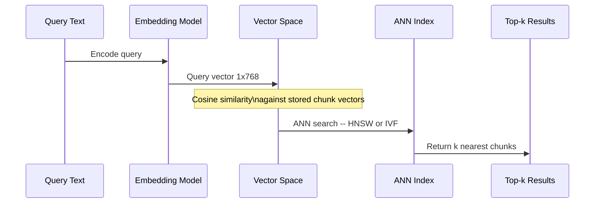

Embeddings turn text into vectors so that related meanings occupy nearby points. That geometry lets retrieval match "throttle partner API traffic" with a document about "rate limiting for partner plan" even when the wording does not overlap.

An encoder model, usually a transformer trained with a contrastive objective, reads a text span and produces a fixed-length vector. Training pulls similar pairs together and pushes unrelated pairs apart. At query time, the same model embeds the query, and the index finds nearby stored vectors with cosine similarity or dot product. Those neighbors are the candidate chunks.

Leaderboard quality is only a starting point. The useful model is the one that meets recall and latency targets on the actual corpus, at an acceptable cost. A model that tops MTEB can still mishandle internal terminology.

# Embedding Model Selection

## Model Families

Production RAG systems usually start with one of these model families.

**Proprietary API models.** OpenAI `text-embedding-3-small` (1536 dimensions) and `text-embedding-3-large` (3072 dimensions) support a `dimensions` parameter for Matryoshka truncation at inference time. Cohere `embed-v3` distinguishes `search_document` from `search_query` through `input_type` and covers more than 100 languages. Per-token rates change, so cost comparisons need current provider pricing.

**Open-source bi-encoders.** Sentence Transformers (SBERT) includes `all-MiniLM-L6-v2` (384 dimensions, 22M parameters) and `all-mpnet-base-v2` (768 dimensions, 109M parameters). Local inference removes per-token API charges, but the serving hardware and model lifecycle become an internal concern.

**Domain-finetuned models.** A base model can be adapted when internal terminology is the measured source of retrieval misses. In a Databricks FinanceBench experiment, `gte-large-en-v1.5` (0.4B parameters) fine-tuned on synthetic domain data reached [[Monitoring#Retrieval Quality Metrics|Recall@10]] of 0.552 versus 0.44 for `text-embedding-3-large`. Adaptation commonly uses continued masked-language pre-training or contrastive training on query-document pairs.

## Dimensionality

Higher dimensions give the model more room to represent fine-grained distinctions. But higher dimensions also mean more storage (4 bytes × dimensions per vector), more compute for similarity search, and higher ANN index memory.

Matryoshka Representation Learning (MRL) trains models so that prefixes of the full vector remain independently meaningful. OpenAI reports `text-embedding-3-large` at 256 dimensions outperforming `ada-002` at 1536 dimensions on the aggregate MTEB benchmark. That result motivates testing shorter vectors, but corpus-specific Recall@k must establish the retrieval tradeoff. Shorter vectors can reduce storage and search work, with full dimensions reserved for cases that need them.

A two-stage design can generate the full embedding once, normalize and index its reduced prefix for ANN search, then score the small candidate set with the retained full vector or a cross-encoder. Full vectors must live outside the ANN index or be recomputed for the candidates. Retaining them reduces ANN memory and search work but not total vector storage; recomputing them trades storage for API cost and latency.

## Similarity Metrics

The similarity metric defines what "near" means in the vector space.

**Cosine similarity** measures the angle between vectors, ignoring magnitude. Most embedding models are trained with cosine objectives, making it the default choice. Range: -1 to 1 (1 = identical direction).

**Dot product** is cosine similarity scaled by vector magnitudes. For L2-normalized vectors, dot product equals cosine similarity. Normalization is model-specific: OpenAI documents its embedding vectors as length-normalized, while another model may preserve magnitude as part of the signal. The selected model's documentation, not a general assumption about every API, determines whether its vectors are normalized.

**Euclidean (L2) distance** measures straight-line distance in vector space. For length-normalized vectors, squared L2 distance equals 2 − 2 × cosine similarity, so L2 and cosine produce identical rankings; OpenAI documents this for its normalized embeddings. For unnormalized vectors, L2 also reflects vector magnitude and can rank neighbors differently from cosine, so the metric follows the geometry the model's documentation specifies.

Cosine similarity is the safe default unless the model documentation specifies another metric.

# Pitfalls

## Distribution Shift on Internal Terminology

A model that scores well on MTEB can still fail on a specific domain. Internal acronyms or product names may be poorly represented in the training data, leaving related queries and documents far apart in vector space.

Detection: recall@k on a held-out set of domain-specific queries is compared with recall@k on generic queries. A significant gap signals distribution shift.

The repair depends on the failure. Domain adaptation can improve semantic placement, while [[Retrieval|hybrid retrieval]] lets BM25 recover exact terminology that dense retrieval misses.

## Embedding Model Swap Invalidation

Changing the embedding model — even a minor version — invalidates every stored vector. The new model produces vectors in a different geometric space. Cosine similarity between old and new vectors is meaningless.

This means re-embedding the entire corpus: for a 10M-chunk index at $0.02/1M tokens and 500 tokens/chunk average, that is ~$100 and hours of ingestion time. Keying the [[Home/AI & ML/LLM/Context Engineering/RAG/RAG Caching|embedding cache]] by model name + version prevents serving stale vectors.

## Benchmark Leaderboard Overfitting

MTEB aggregates several task families. A model can rank first overall while performing poorly on retrieval because strong classification or semantic-similarity results lift its average. RAG selection therefore uses the `Retrieval` category scores and then a test against a corpus-specific evaluation set.

## Multilingual Embedding Collapse

Models trained primarily on English text cluster non-English content into a smaller region of vector space, reducing separation between distinct concepts. A Spanish query about "seguridad informática" and one about "seguridad alimentaria" may land closer together than they should because the model undertrained on Spanish semantic distinctions.

Mitigation: models with explicit multilingual training (Cohere `embed-v3`, SBERT multilingual variants) reduce the risk, and recall is evaluated per language separately.

# Tradeoffs

| Factor | Proprietary API | Open-Source Self-Hosted | Domain-Finetuned |
| --- | --- | --- | --- |
| Cost at scale | Per-token pricing -- scales linearly | Infrastructure cost -- GPU amortized across volume | Training cost upfront -- inference same as base |
| Recall on general text | High -- trained on massive web corpora | Competitive -- top models match proprietary on MTEB | Depends on base model and training data quality |
| Recall on domain text | Can miss internal terminology | Same limitation as proprietary | Potentially higher when domain training improves held-out retrieval |
| Latency | Network round-trip + provider queue | Local inference -- no network hop | Same as self-hosted base model |
| Operational burden | Minimal -- API call | High -- GPU infra and model serving and updates | Highest -- training pipeline plus serving |
| Vendor lock-in | Model changes break vector index | Full control over versioning | Full control |
| Dimensionality control | Some models support MRL truncation | Full control via model choice | Full control |

The simplest model that establishes a credible recall baseline is the right starting point. Fine-tuning is justified only after failed queries show that domain semantics, rather than chunk boundaries or retrieval configuration, are the bottleneck. Better embeddings cannot repair bad chunks.

# Questions

<!-- qard-id: bb5874a0-b6ba-4318-ab29-25a6079c807a -->
> [!qard]- What is an embedding, and how does it support semantic retrieval?
> An embedding is a vector of numbers that a model produces for a piece of text. The model places texts with related meaning close together, so the distance between two vectors measures how related the texts are. The vector's length is set by the model and, for some models such as OpenAI's `text-embedding-3` family, by a requested output size.
>
> Semantic retrieval relies on that geometry:
>
> 1. **Indexing:** the embedding model converts each document chunk into a vector, which is stored in a vector index.
> 2. **Query:** the same model, with the same output size, converts the query into a vector in the same space.
> 3. **Ranking:** a similarity measure, such as cosine similarity, ranks the stored vectors by closeness to the query vector. The nearest chunks become retrieval candidates.
> 
> Because matching depends on meaning rather than shared words, a query about throttling partner API traffic can find a document about rate limiting for partners. A high similarity score is only a relevance signal. It does not prove that a chunk answers the question, so retrieval quality still has to be evaluated.
>
> [Vector embeddings (OpenAI)](https://developers.openai.com/api/docs/guides/embeddings) · [Vector search overview (Azure AI Search)](https://learn.microsoft.com/en-us/azure/search/vector-search-overview)

<!-- qard-id: cbeb031d-1919-44df-9d70-3df6fafd8901 -->
> [!qard]- How do Matryoshka embeddings reduce vector storage, and how should a shorter vector be validated?
> Matryoshka Representation Learning (MRL) trains an embedding so that its first dimensions already form a useful coarse representation, and later dimensions add finer detail. A prefix of the vector, such as its first 256 values, therefore still works as a lower-dimensional embedding. Storing only that prefix reduces vector storage.
>
> - **Storage:** at the same data type, 256 values instead of 1536 is one-sixth of the raw vector payload. IDs, metadata and index structures do not shrink by the same factor, so the whole index shrinks less.
> - **Search cost:** shorter vectors also reduce distance-computation work.
> - **Availability:** shortening is model-specific. OpenAI's `text-embedding-3` models accept a `dimensions` parameter. A vector truncated manually is re-normalized before cosine or dot-product search.
> - **Risk:** fewer dimensions can lower retrieval quality on a particular corpus.
> 
> A shorter vector is validated by running the same labeled queries at each candidate dimension and comparing Recall@k and latency. The preferred dimension is the smallest one that still meets the recall and latency targets. A design that re-scores candidates with full-length vectors has to store them elsewhere or recompute them, which adds storage, API cost or latency.
>
> [Embeddings guide (OpenAI)](https://developers.openai.com/api/docs/guides/embeddings) · [Matryoshka Representation Learning (arXiv)](https://arxiv.org/abs/2205.13147)

<!-- qard-id: d153db49-a943-4334-bb4e-310ba8915adb -->
> [!qard]- What happens to retrieval when queries use embeddings from a new model but the corpus still has vectors from the old model?
> Retrieval quality breaks. The query vector and the stored vectors come from different vector spaces, so the distances between them do not measure relatedness, and the ranking becomes effectively arbitrary.
>
> Each embedding model learns its own coordinate system, so the same text receives unrelated vectors from two different models. If both models produce vectors of the same length, the search can still run without any error while returning poor results. That makes the mismatch easy to miss.
>
> A model change therefore requires re-embedding the whole corpus with the new model. A safe migration builds and validates the new index first and only then switches query traffic, for example by moving a collection alias. Embedding-cache keys include the model name and version, so cached vectors from the old model are not reused with the new one.
>
> [Configure a vectorizer (Azure AI Search)](https://learn.microsoft.com/en-us/azure/search/vector-search-how-to-configure-vectorizer)

# References

- [Embeddings guide — text-embedding-3 models and MRL (OpenAI)](https://platform.openai.com/docs/guides/embeddings)
- [MTEB leaderboard — filter by Retrieval task (Hugging Face)](https://huggingface.co/spaces/mteb/leaderboard)
- [Matryoshka Representation Learning — original MRL paper (arXiv)](https://arxiv.org/abs/2205.13147)
- [Azure OpenAI embeddings — deployment and SDK usage (Microsoft Learn)](https://learn.microsoft.com/en-us/azure/ai-foundry/openai/how-to/embeddings)
