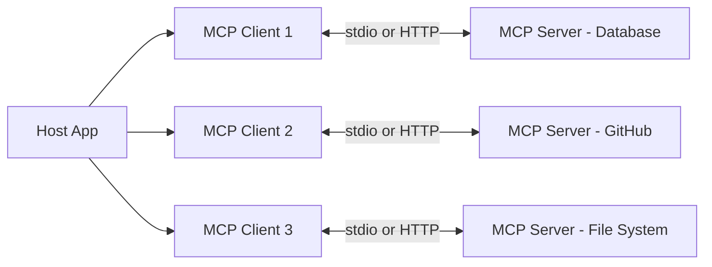

---
topic:
  - AI & ML
subtopic:
  - LLM
summary: "An open protocol standardizing how LLM apps connect to external tools and data."
level:
  - "3"
priority: Low
status: Done

publish: true
qard-deck: "AI & ML"
qard-topic: "LLM/Harness Engineering/Model Context Protocol"
flashcard_uid: "5e1d5abd"
---

Model Context Protocol (MCP) gives LLM applications a common way to connect to tools and external data. Without a shared protocol, every client-service pairing needs its own adapter. In the ideal case, that produces N×M integrations for N clients and M services. MCP moves the integration boundary: clients implement the protocol once, while each service exposes an MCP server. The rough shape becomes N+M, provided both sides implement compatible versions and capabilities.

A **host** application, such as an IDE or agent, uses an **MCP client** to communicate with each **MCP server**. A server wraps a capability, perhaps a database or a SaaS API. Under the `2026-07-28` protocol, every request is self-contained. Applications that need continuity pass an explicit handle as an ordinary tool argument. Earlier revisions used an initialization handshake and protocol-level sessions. Servers expose **tools** for actions, **resources** for contextual data, and **prompts** for reusable interaction templates. The host chooses what reaches the model. That mediation point is where approval rules and access policy belong.

For example, a desktop host might connect to PostgreSQL and GitHub servers. A request to find open issues and inspect tables referencing the customers schema may lead the host to invoke `github.list_issues` and `postgres.query` through separate clients. Neither server needs to know that the other exists. A Slack server can be added without changing those two integrations, although the host still needs to configure and trust the new server.

# Architecture

## Three Server Primitives

| Primitive | Controlled by | Purpose | Example |
| --- | --- | --- | --- |
| **Tools** | Model decides when to call | Actions with side effects or computation | `run_query`, `create_issue`, `send_message` |
| **Resources** | Application decides when to fetch | Read-only data exposure — like GET endpoints | `file://config.yaml`, `db://schema/tables` |
| **Prompts** | User selects explicitly | Reusable prompt templates with parameters | "Summarize this PR", "Review code for security" |

The control boundary differs by primitive. A model may request a tool call, the application decides when to fetch a resource, and a user can select a prompt. None of this removes the host's responsibility to authorize the resulting operation. Model choice is a proposal, not permission.

The `2026-07-28` core removed the required initialization handshake and protocol-managed sessions. Each request carries the protocol version, client information, and capabilities needed to process it. A client may call `server/discover` to inspect server capabilities first, but discovery is optional. Tools, resources, and prompts still have their own list methods, and the results include cache hints.

## Transports

MCP commonly uses two transports:

- **stdio.** The host starts the server as a child process and exchanges JSON-RPC messages over standard input and output. This fits local file, database, or CLI integrations. It needs no MCP network listener. The child process can still inherit operating-system permissions and make outbound network calls unless a separate sandbox prevents them.
- **Streamable HTTP.** The server runs behind an HTTP endpoint and may serve multiple clients. Responses may be streamed with Server-Sent Events. Remote deployments need transport security and authentication. The MCP authorization specification defines an OAuth-based flow for protected servers.

The stdio transport fits a local process owned by one host. Streamable HTTP fits a capability that is remote or shared across clients.

# When to Use MCP Vs Function Calling

Function calling is the model-facing mechanism for requesting a structured operation. MCP packages capabilities behind a reusable client-server protocol. An application may use both: it discovers a tool through MCP, then presents that tool to the model through function calling.

| | Function Calling | MCP |
| --- | --- | --- |
| Best for | App-specific business logic used by one agent | Shared integrations used across multiple clients |
| Tool definitions live in | Application code | Standalone MCP server |
| Reusability | Application-managed; shared code or services can reuse it | Any MCP-compatible client |
| Discovery | Application supplies or loads tools at runtime | Dynamic — server advertises capabilities at runtime |
| Infrastructure | None extra — part of the application's LLM API call | Server process per integration |

A useful first question is whether the integration must work across clients. Shared integrations are a good MCP fit. App-specific business logic is usually simpler as an in-process function tool. The security boundary matters too: moving a function into an MCP server adds process or network communication and a separately managed trust relationship.

# SDK Ecosystem

The MCP project groups SDKs by support tier. Tier assignment can change, so the current SDK page is the authority for language coverage and maintenance status. In .NET, the `ModelContextProtocol` packages provide client and server APIs, including ASP.NET Core integration.

# Pitfalls

## Tool Poisoning and Injection

Tool descriptions are untrusted text supplied by the server, yet clients often place that text in the model's context. A malicious description can try to redirect the model or induce calls to another connected server. Invariant Labs demonstrated this tool-poisoning pattern against clients that exposed powerful tools without adequate review or approval.

Each server carries the risk of a third-party dependency, so its source and published tool descriptions are reviewed before it receives sensitive access. High-impact calls need explicit policy checks or human approval. A blanket auto-approval setting turns a model mistake into an executed action.

## Token Inflation

Some clients place every connected tool schema in each model request, so irrelevant schemas consume context and complicate selection. MCPGauge measured whole MCP-assisted runs, including retrieved content, and observed input-token overhead as high as 236× in its benchmark and an average 9.5% accuracy drop when tool context was present. Those run-level figures do not isolate schema count as the cause, and the exact cost depends on the client and workload.

A small active tool set limits this cost. Client-side filtering or on-demand discovery can load only the definitions relevant to the current task.

## Security Model Gaps

MCP transport authorization does not, by itself, enforce per-tool permissions or validate tool inputs. Those controls remain server responsibilities. Reported server flaws have included injection, path traversal, and tenant-isolation failures. CVE-2025-49596 in MCP Inspector showed that even development tooling can become a remote-code-execution boundary.

Servers get the smallest useful set of credentials and file permissions. Every argument is validated at the server boundary, and local server processes are isolated where practical. The client schema improves model behavior. It is not a substitute for server-side validation.

# Tradeoffs

| Approach | Reusability | Setup Cost | Security Surface | Best for |
| --- | --- | --- | --- | --- |
| Direct function calling | Application-managed reuse | Lowest — inline with application code | Smallest — controlled by the application | App-specific tools and business logic |
| MCP with stdio transport | Any local MCP client | Moderate — write or install a server | Local transport — no MCP network listener | Local tools shared across editors and agents |
| MCP with HTTP transport | Any MCP client anywhere | Highest — server infra plus auth | Largest — network exposed with OAuth | Remote services and multi-user deployments |
| REST API wrapper without MCP | Any HTTP client | Moderate — standard API design | Standard web security model | When consumers are not LLM clients |

MCP earns its overhead when several clients need the same integration or when capabilities must be discovered at runtime. One application calling one internal API usually needs only function calling.

# Questions

<!-- qard-id: 45986407-9c75-4603-8105-a328b9997416 -->
> [!qard]- When should a tool remain an in-process function instead of being exposed through an MCP server?
> A tool should stay an in-process function when only one application uses it, especially when it works directly on that application's private state or business logic. An MCP server is worth its extra moving parts when several compatible clients need the same capability, managed and secured separately from any one application.
> 
> The choice concerns where the tool lives, not how the model calls it. With function calling, the model returns a structured request and the application executes it. MCP is a client/server protocol through which a server advertises tools and other capabilities to any compatible client. A host can discover an MCP tool and present it to its model as a function definition. That translation is done by the host or its SDK, not by function calling itself.
> 
> | Aspect | In-process function tool | Tool behind an MCP server |
> |---|---|---|
> | Reuse | Belongs to one application; other applications reuse it only through shared code or services | Any compatible MCP client can discover and call it |
> | Application state | Reads the application's in-memory state directly | Cannot see the host application's memory; needed context arrives in each request, for example as an explicit handle that the server must authorize |
> | Runtime cost | A local method call | A separate process or network hop, plus deployment and lifecycle for the server |
> | Trust | Runs inside the application's own security context | Runs as a separate server that each host must configure and trust |
> 
> Sources: [OpenAI: Function calling](https://developers.openai.com/api/docs/guides/function-calling) · [MCP specification 2026-07-28: Tools](https://modelcontextprotocol.io/specification/2026-07-28/server/tools) · [MCP 2026-07-28 update](https://blog.modelcontextprotocol.io/posts/2026-07-28/)

<!-- qard-id: 59308422-df66-4bad-b9ce-ca18c5608606 -->
> [!qard]- Which security checks must an MCP server still perform after HTTP authorization admits a caller?
> HTTP authorization admits a caller only as far as its access token allows: the token must be issued for this MCP server and carry the scopes the request requires. The server still decides, in its own code, whether that caller may perform the operation on the specific object and tenant involved. It also validates every tool input before using it.
> 
> - **Covered by MCP authorization for HTTP-based transports:** the server accepts only an OAuth access token issued for itself as the intended audience, and it can require particular scopes, such as a write scope for a tool that changes data. Audience and scopes decide who may reach the server and which kinds of operation the token permits.
> - **Left to application-defined authorization:** whether this caller may act on this particular object or tenant, such as deleting a specific record or reading another tenant's data. A write scope permits writing in general but does not say which records. The server also validates tool arguments, rate-limits tool calls and sanitizes tool output.
> 
> Tool names, descriptions and results are text placed in the model's context. They can influence what the model requests, but they enforce nothing, so permission checks belong in server code.
> 
> Sources: [MCP specification 2026-07-28: Authorization](https://modelcontextprotocol.io/specification/2026-07-28/basic/authorization) · [MCP specification 2026-07-28: Tools](https://modelcontextprotocol.io/specification/2026-07-28/server/tools)

# References

- [MCP Architecture — host, client, server, and capability discovery (Official)](https://modelcontextprotocol.io/docs/learn/architecture)
- [MCPGauge — benchmarking token overhead and accuracy effects of MCP-assisted LLM runs (arXiv 2508.12566)](https://arxiv.org/abs/2508.12566)
- [Invariant Labs — MCP security analysis and tool poisoning attack surface](https://invariantlabs.ai/blog/mcp-security-notification-tool-poisoning-attacks)
- [Using MCP tools with an agent — Microsoft Agent Framework (Microsoft Learn)](https://learn.microsoft.com/en-us/agent-framework/agents/tools/local-mcp-tools)
