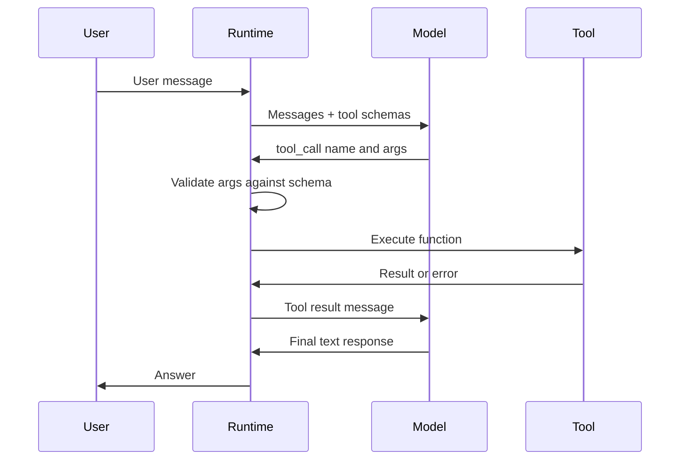

Tool design turns model output into reliable operations. A tool lets an agent read current data, run a calculation, or request a side effect that text generation cannot perform on its own. A capable model still fails when its callable interfaces are ambiguous or brittle. Anthropic's SWE-bench agent work found a small interface detail with a large effect: switching one tool from relative to absolute file paths removed a recurring failure mode.

Function calling is the usual mechanism. The runtime sends the model JSON schemas describing the available tools. The model may return a structured call containing a tool name and arguments. After validating the request, the runtime executes the function and appends its result to the conversation. The [[Agent Loop]] repeats until the model answers or the runtime stops it.



The model requests an operation. It does not execute the function. Execution authority stays in the runtime, which must validate arguments and enforce permissions before crossing a side-effect boundary. A schema guides generation, but it does not provide security on its own.

[[Model Context Protocol]] standardizes how clients discover external capabilities. [[Agent Loop]] covers repeated selection, execution, and observation inside one run.

# Tool Design Principles

Tool design is API design for a probabilistic caller that sees only the supplied schema and conversation. It cannot inspect an implementation while choosing arguments. Ambiguity that a developer would resolve by reading code becomes another model guess.

**Naming.** The name should identify the operation and its domain. `search_company_directory` carries more selection signal than `search`. `get_weather_forecast` is clearer than `get_data`. Generic names make unrelated tools look interchangeable.

**Descriptions.** A useful description states the operation, its output, and the boundary where another tool is appropriate. For example: "Search employees by name or department. Contractor records are in `search_contractor_database`." The negative boundary matters when two tools have overlapping vocabulary.

**Parameters.** A small, flat schema is easier to call correctly. An enum such as `{"type": "string", "enum": ["celsius", "fahrenheit"]}` fits when the implementation accepts a closed set. Required fields and formats need explicit descriptions. Deeply nested inputs and overlapping optional fields create more ways to produce a syntactically valid but meaningless call.

**Return values.** A result carries the fields needed for the next decision, not an entire database record by default. Stable result shapes reduce parsing work across tools. Identifiers that a later call may need stay in the result, even if they are not part of the final answer.

**Errors.** An error carries a machine-readable code plus enough detail to recover. `{"error": "invalid_date_format", "message": "Expected YYYY-MM-DD, got '12/25/2024'", "hint": "Reformat as 2024-12-25"}` gives the next [[Agent Loop|loop iteration]] a concrete repair. Internal diagnostic details stay in protected server logs, with secrets excluded or redacted before logging. The model receives a safe explanation.

In the Microsoft Agent Framework (.NET), a well-designed tool looks like this:

```csharp
// Any C# method becomes a tool via AIFunctionFactory.Create — the descriptions
// on the method and each parameter become the schema the model reads.
[Description(
    "Get current weather for a city. Returns temperature, conditions, " +
    "and humidity. Use when the user asks about weather or outdoor plans. " +
    "Do not use for historical weather data.")]
static Task<WeatherResult> GetCurrentWeather(
    [Description("City name, e.g. 'Seattle' or 'London'")] string city,
    [Description("Temperature unit")] TemperatureUnit unit = TemperatureUnit.Celsius)
{
    throw new NotImplementedException(
        "Validate input, call the weather API, and return a compact result.");
}

record WeatherResult(double Temperature, string Conditions, int HumidityPercent);
enum TemperatureUnit { Celsius, Fahrenheit }

// Register the tool on the agent via ChatOptions.Tools
AIAgent agent = new ChatClientAgent(chatClient, new ChatClientAgentOptions
{
    Name = "WeatherAssistant",
    ChatOptions = new ChatOptions
    {
        Instructions = "You answer weather questions.",
        Tools = [AIFunctionFactory.Create(GetCurrentWeather)],
    },
});
```

The `Description` attributes feed the schema used for tool selection and argument generation. A precise contract fixes failures at the shared boundary instead of compensating for them in every prompt.

# Versatility

Model-generated arguments will vary. A tool can normalize harmless representation differences before validation. Normalization changes representation, not trust: every caller still passes syntax checks, authorization, and business invariants before execution.

Useful patterns include:

- **Canonical parsing.** The tool accepts equivalent unambiguous formats, then converts them to one internal representation. Relative dates such as "tomorrow" require an explicit time zone and reference clock. Otherwise they should be rejected or resolved by the host first.
- **Defaults.** An optional search `limit` can default to 10. Defaults should be visible in the schema and safe for cost or side effects.
- **Boundary responses.** A request for page 999 of a 10-page result set can return an empty page with the valid range instead of an opaque exception.

Normalization should remove representational friction without guessing intent. Validation then rejects malformed, unsafe, or unauthorized requests regardless of whether the input was normalized. Recovery guidance belongs in the error so a correct retry does not depend on guesswork.

# Fault Tolerance

Tool failures become model input and can redirect the rest of a run. Failure must be explicit, bounded, and safe to reason about.

**Structured errors.** The runtime must translate exceptions into a stable result because the model sees only serialized messages. The result names the failed operation and whether retrying can help, without stack traces or sensitive backend details.

**Retry safety.** A timeout leaves the caller unsure whether a side effect happened. State-changing tools should accept an idempotency key or use another deduplication mechanism so a retry cannot create a second record, email, or charge.

**Timeouts.** Every external call needs a deadline. Partial results are valid only when the contract labels them clearly, for example `{"status": "partial", "results": [...], "message": "Query timed out after 5s, returning first 50 results"}`. For writes, an unknown outcome is different from failure and must be reported as such.

**Validation before execution.** Syntax, authorization, and business invariants are checked before a side effect is performed. A valid email address is not enough. The caller may also need permission to contact that recipient.

# Caching

Caching applies at two different boundaries: tool results and model-input prefixes.

**Tool results.** A read-only call may be cached by function name, normalized arguments, caller scope, and any other input that affects visibility. The TTL follows the source's freshness requirement. In the [[Agent Loop]], caching can avoid repeated I/O, but loop detection should still stop a model that keeps making the same call without progress.

**Prompt prefixes.** Stable system instructions and tool definitions are good candidates for provider prompt caching. This can reduce billed input and latency on repeated prefixes, though the exact savings depend on provider rules and cache hits. Tool order and schema text need to remain stable for the prefix to match. [[Home/AI & ML/LLM/LLM Caching#Prompt Caching|Prompt Caching]] covers boundary placement and checks that SDK serialization preserves the cache configuration.

A mutation must not be cached as if it were a read. A repeated `create_ticket` call needs idempotent execution semantics, not a cached success message. For reads, the cache key must include tenant and authorization context or it can leak data between callers.

# Pitfalls

## Over-Parameterized Tools

A tool with 15 loosely related parameters is hard to call correctly. Splitting it helps when different operations need different descriptions or permission checks. Mechanical splitting does not: hundreds of tiny tools create a selection problem of their own.

## Poor Descriptions That Mislead the Model

Descriptions such as "Processes data" provide no selection signal. A useful description names the operation, expected output, and important exclusion. If two tools sound interchangeable, the model will sometimes choose the wrong one.

## Tools with Hidden Side Effects

A `get_user_profile` tool that also updates "last accessed" is not a read, despite its name. The model may call it while gathering context and trigger an unintended write. Query tools stay free of business side effects. The separation mirrors [[CQRS]].

## Context Degradation from Large Toolsets

Large tool sets consume context and make selection harder. MCPGauge (Song et al., 2025) tested six commercial models across 30 MCP tool suites and reported an average **9.5% accuracy drop** when MCP integration was added. Code generation saw the largest drop at 17%. Input-token overhead ranged from 3.25× to 236.5× in the benchmark. These measurements cover MCP integration as a whole, including the context it brought into the window, rather than tool schemas in isolation. They are workload-specific, not universal constants, but they show that tool context can carry a real accuracy and token cost.

Several mechanisms contribute:

- **Context competition.** Schema tokens occupy space and attention that could carry task evidence. "Lost in the Middle" shows that models do not use every position in a long context equally well.
- **Conflicting descriptions.** Similar names and overlapping instructions make the correct tool harder to distinguish.
- **Passive selection.** Preloading every schema forces the model to choose from options unrelated to the current step.

**Mitigations:**

| Technique | How it works | Best for |
|---|---|---|
| **On-demand tool search** | Register tools for deferred loading, then retrieve a relevant subset per request. Anthropic reports an 85% reduction in one published example, not a general guarantee. | Worth evaluating once the catalog reaches roughly 10 tools, schema definitions exceed about 10K tokens, or selection errors appear. The evaluation measures retrieval recall and added latency. |
| **RAG over tool descriptions** | Embed descriptions and retrieve top-k by semantic similarity. | Large or changing catalogs where retrieval quality can be evaluated against labeled tool-selection cases. |
| **Middleware filtering** | Inject tools from conversation state, user role, or workflow stage. | Deterministic policy boundaries, evaluated by false exclusions and rule-maintenance cost. |
| **Tool consolidation** | Group closely related operations under one tool with an `action` enum (e.g., `github_pr` with `create\|review\|merge`). | Operations that share context and permissions without creating a wide optional-parameter schema. |
| **Two-stage routing** | Classify the request into a tool category, then expose only that category. | Separable domains where router recall and routing latency clear the task gate. |
| **Code generation** | Replace N tool schemas with a single `execute_code` tool + API docs. The model writes code that calls the available APIs. | Open-ended data/code tasks |
| **Structured output routing** | Model returns a structured action JSON. Application code dispatches it. No tool schemas needed. | Fixed action types |

# Tradeoffs

| Design choice | Option A | Option B | Decision criteria |
|---|---|---|---|
| **Tool granularity** | Few broad tools with many parameters | Many narrow tools with focused purpose | Narrow tools can simplify an individual call, while a larger catalog can increase selection difficulty; both are measured on representative tasks. Use cases that need genuinely different descriptions are split, and those that share context stay together. |
| **Representation normalization** | Accept only a canonical form | Accept safe, unambiguous variants and convert them | The choice depends on ambiguity and maintenance cost. Every caller still passes syntax, authorization, and business-invariant validation before execution. |
| **Caching strategy** | Aggressive — cache all tool results with TTL | Conservative — execute every call fresh | Aggressive caching cuts latency and cost but risks stale data. Read-only tools can be cached with short TTLs; state-mutating tools are never cached. |
| **Return verbosity** | Full result payload | Minimal fields needed for next step | Minimal returns save context tokens and reduce attention dilution. Full returns are only justified when the model needs to branch on fields that are hard to predict upfront. |

# Questions

<!-- qard-id: 1ae0756c-dd19-4930-bc8c-5588680c4326 -->
> [!qard]- When should repeated agent failures be fixed in a tool contract instead of the prompt?
> A failure belongs in the tool contract when it recurs across different requests that use the same tool: the wrong tool is selected, arguments are malformed, or errors are not recovered from. A pattern that repeats across requests points to the interface, not to one request's wording. The contract is part of every call to that tool, so a change there reaches all later calls. A prompt workaround works only when the model remembers and follows the exception.
>
> Reaching every call does not guarantee that the failure stops. Rerunning representative tool tasks and comparing selection, argument and recovery failures before and after the change shows whether it actually helps.
>
> Contract-level fixes include:
>
> - **Names and descriptions** that state what the tool does, what it returns and when a different tool fits.
> - **Parameters** with explicit formats, enums and required fields, leaving fewer ways to produce a call that parses but means nothing.
> - **Errors** that say what failed and how to correct the call, so the next attempt has a concrete repair.
> - **Results** that contain the fields the next step needs, including identifiers a later call may use.
> 
> For example, Anthropic reported that its SWE-bench agent made mistakes with relative file paths after moving out of the root directory. It also reported that those mistakes stopped once the tool was changed to always require absolute paths.
>
> The prompt remains the place for task intent and for instructions specific to one request.
>
> Sources: [Writing effective tools for AI agents (Anthropic)](https://www.anthropic.com/engineering/writing-tools-for-agents) · [Building effective agents (Anthropic)](https://www.anthropic.com/engineering/building-effective-agents)

<!-- qard-id: d192b24b-4e3d-4bd7-afe9-363b687b7d2f -->
> [!qard]- What determines whether related operations should use one broad tool or several narrower tools?
> The deciding factor is whether the operations share one contract. Operations that need different permissions, input schemas or descriptions belong in separate tools. Closely related actions that share context, permissions and arguments can stay in one tool.
>
> | Signal | Points toward | Reason |
> |---|---|---|
> | Different permission checks | Separate tools | Each tool can be authorized and exposed on its own. |
> | One schema collecting unrelated optional fields | Separate tools | Fewer argument combinations remain that are valid JSON but meaningless as a request. |
> | Actions sharing context, permissions and arguments | One tool | A single description and schema cover them without unrelated options. |
> | Many similar or overlapping tools already exposed | Fewer, clearer tools | Each additional tool is another option the model must tell apart, so selection errors can rise. |
>
> Narrower tools usually simplify each call's arguments but enlarge the set the model chooses from. The net effect depends on the real task mix and the whole exposed catalog, so it is measured rather than assumed. Tracking tool-selection accuracy and argument correctness separately on representative tasks shows which failure a change actually reduces.
>
> Source: [Writing effective tools for AI agents (Anthropic)](https://www.anthropic.com/engineering/writing-tools-for-agents)

# References

- [Function calling guide — OpenAI](https://platform.openai.com/docs/guides/function-calling)
- [Using function tools with an agent — Microsoft Agent Framework (Microsoft Learn)](https://learn.microsoft.com/en-us/agent-framework/agents/tools/function-tools)
- [Tool search tool — deferred loading for large toolsets (Anthropic)](https://docs.anthropic.com/en/docs/agents-and-tools/tool-use/tool-search-tool)
- [MCP-Zero: Active Tool Discovery — 98% token reduction via on-demand retrieval (arXiv 2506.01056)](https://arxiv.org/abs/2506.01056)
