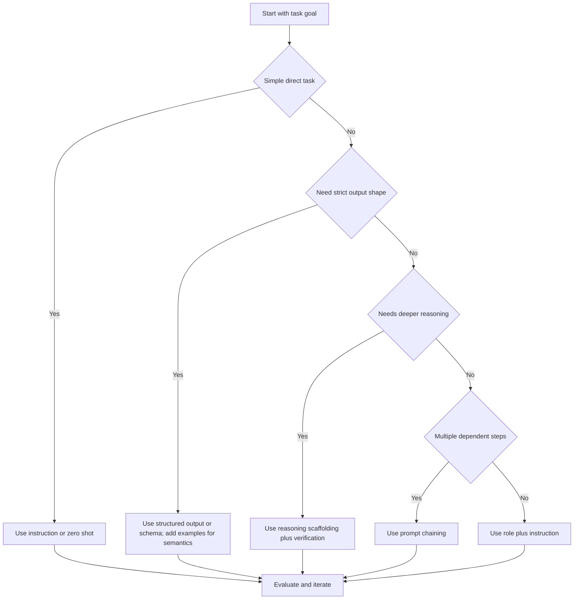

Prompt engineering turns an intention into a task the model can execute and the system can test. Small changes in wording or generation settings can shift output quality because an LLM samples from a probability distribution rather than following a fixed program.

In production, the prompt is part of the system interface. It needs explicit behavior, version control, and evaluation like any other executable contract. This hub covers the basic mechanics. Its child notes handle in-context learning, reasoning, prompt composition, and automated optimization in more depth.

```datacorejsx
const { FolderStructureMap } = await dc.require("Assets/components/devbook-folder-map.jsx");
return FolderStructureMap;
```

# Prompt Anatomy

Four elements cover most prompt contracts:

- **Instruction** names the exact task.
- **Context** supplies domain facts or constraints.
- **Input data** contains the material to process now.
- **Output indicator** defines the required answer shape.

The following prompt uses all four:

```text
Instruction: Extract security risks from the incident note.
Context: You are helping a SOC analyst. Keep findings actionable and concise.
Input data: "API keys were stored in plain text logs for 3 days in staging."
Output indicator: Return JSON with fields risk, impact, mitigation.
```

Each element removes a different ambiguity. The instruction narrows behavior, context guides interpretation, input anchors the current case, and the output indicator constrains the result.

# LLM Settings

Prompt text describes the task. Generation settings control sampling and output limits.

- **Temperature** raises or lowers sampling randomness.
- **Top-p** restricts candidate tokens to a cumulative probability mass. Lower values narrow the set.
- **Max tokens** caps generated length and therefore limits part of the cost and latency.
- **Stop sequences** terminate output when the model emits a specified string.

These starting ranges are heuristics. Production values need task-specific evaluation on the chosen model.

| Task type | Temperature | Top-p | Max tokens | Stop sequences |
|---|---:|---:|---:|---|
| Creative writing | 0.8-1.0 | 0.9-1.0 | 600-1200 | Optional section markers |
| Classification | 0.0-0.2 | 0.1-0.4 | 20-80 | Label boundary, newline |
| Code generation | 0.1-0.3 | 0.8-1.0 | 200-800 | ``` or custom delimiter |

A simple starting policy is to tune `temperature` first and leave `top-p` near its default until an evaluation shows that both need adjustment.

# Instruction Prompting

Instruction prompting states the task and result format directly. It works when the requested behavior is specific enough to observe and test.

A useful instruction usually contains:

- A task verb such as classify, extract, summarize, or transform.
- An explicit format such as a JSON schema, table columns, or a fixed label set.
- Relevant constraints on length, forbidden content, confidence, or tone.

Example 1 (name normalization):

```text
Convert the person name to this format: <Last name>, <First name>.
If suffix exists, keep it after first name.
Input: "Nikita Reshetnik"
Output:
```

Example 2 (PII redaction):

```text
Redact all personal data from the email.
Replace names with [NAME], phones with [PHONE], and emails with [EMAIL].
Return only redacted text.
Input: "Hi John, call me at 410-805-2345."
```

When outputs drift, tightening the output indicator is usually cheaper than adding another prompting technique.

# Role Prompting

Role prompting supplies a perspective that changes style, depth, or framing. The role modifies task execution. It does not replace the task.

- It fits tasks where voice or audience matters.
- Accuracy boundaries still need to be explicit.
- Concrete roles work better than vague personas.

Illustrative contrast:

```text
Standard: Write a review of this pizza place.
Role-based: You are a food critic writing for a city newspaper. Write a review of this pizza place in 120-150 words, focusing on crust texture, sauce balance, and service.
```

The second version gives the model a concrete perspective and observable review criteria. The role alone would not provide those constraints.

# Choosing a Technique

This flow is a useful first pass:



Strict output shape needs structured output or schema validation. Examples can clarify semantics that the schema cannot express. A task that cannot fit one instruction may need [[Prompt Composition]]. In both cases, representative evaluation matters more than eliciting hidden reasoning traces; meta prompting is only one way to generate candidate instructions.

# Pitfalls

- **Indirect prompt injection from retrieved content.** A document, web page, or tool result may contain malicious instructions that the model mistakes for trusted guidance. Mitigations keep trusted instructions separate from untrusted data, restrict tools by policy, and validate outputs.
- **Correct shape, wrong content.** JSON can pass schema validation while carrying invented values. Semantic checks for ranges, required relationships, and source-grounded claims catch what the schema cannot.
- **Token budget collapse.** Long context and verbose generations can crowd out critical instructions or examples. Input and output budgets are controlled together, and truncation is monitored instead of assuming the model saw everything.

# Questions

<!-- qard-id: 15c3b707-bc20-4a2a-8db8-5a3198d20844 -->
> [!qard]- Why must prompt instructions and generation settings be evaluated together?
> The prompt and the generation settings control different parts of the result, and neither can compensate for a defect in the other. The prompt defines the task, context, constraints and requested output. Where the selected model and endpoint support them, generation settings control sampling and output limits.
>
> - A low-randomness setting, such as a low temperature, makes output more repeatable but cannot resolve an ambiguous instruction. It can just produce the same misreading more consistently.
> - A clear prompt cannot make an unsupported setting take effect. Parameter support differs across models and endpoints, so values tuned on one model may not carry over to another.
> 
> Because the result depends on the combination, prompt and settings are evaluated together on a task-specific set for the selected model and endpoint. A change to either one, or a switch to another model, calls for reevaluation.
>
> Sources: [OpenAI prompt engineering](https://developers.openai.com/api/docs/guides/prompt-engineering) · [OpenAI reasoning best practices](https://developers.openai.com/api/docs/guides/reasoning-best-practices)

<!-- qard-id: b6902cab-7ab7-4955-ac30-1916ef9fbccc -->
> [!qard]- How can an output-token cap limit cost without truncating valid answers?
> An output-token cap limits cost as a hard ceiling against runaway generation, not as a way to shorten normal answers. Normal length and cost are reduced through the prompt. The cap is sized from the measured total of generated tokens plus headroom, within the room the context window leaves after the input.
>
> - **Prompt first:** repeated instructions, irrelevant context and redundant examples are removed, and the desired answer shape is stated directly, such as a label, a fixed set of fields or a length limit. This lowers cost without risking a cut-off answer.
> - **Cap as a ceiling:** generation stops when the cap is reached, whether or not the answer is complete. A cap is not a reliable request for concise wording, so a cap set near typical length truncates longer valid answers. A truncated JSON object, for example, no longer parses.
> - **Total generated tokens:** the cap is sized from the generated-token counts of valid responses on the evaluation set, plus headroom. Where a model's reasoning or other non-visible tokens count toward the output limit, they belong in that total. Hidden reasoning can then use up the cap before a short visible answer is finished, or before any visible output appears.
> - **Context capacity:** input and generated tokens share the model's context window. A long input leaves less room for output, so generation can stop at the context limit before it reaches the cap.
> - **Detecting truncation:** a response that stopped at a limit is identified from the stop or incomplete reason that the API returns. It is handled as truncated rather than complete.
> 
> Parameter names and limit reporting are endpoint- and model-specific. In OpenAI's APIs, Responses uses `max_output_tokens` and Chat Completions uses `max_completion_tokens`. On OpenAI reasoning models, reasoning tokens count toward that limit and are billed as output tokens. A Responses call that hits the limit returns an `incomplete` status with the reason `max_output_tokens`.
>
> Sources: [OpenAI token counting](https://developers.openai.com/api/docs/guides/token-counting) · [OpenAI reasoning models](https://developers.openai.com/api/docs/guides/reasoning)

# References

- [Prompt Engineering Guide](https://www.promptingguide.ai/)
- [OpenAI Prompt Engineering Guide](https://platform.openai.com/docs/guides/prompt-engineering)
- [Anthropic Prompt Engineering Overview](https://docs.anthropic.com/en/docs/build-with-claude/prompt-engineering/overview)
