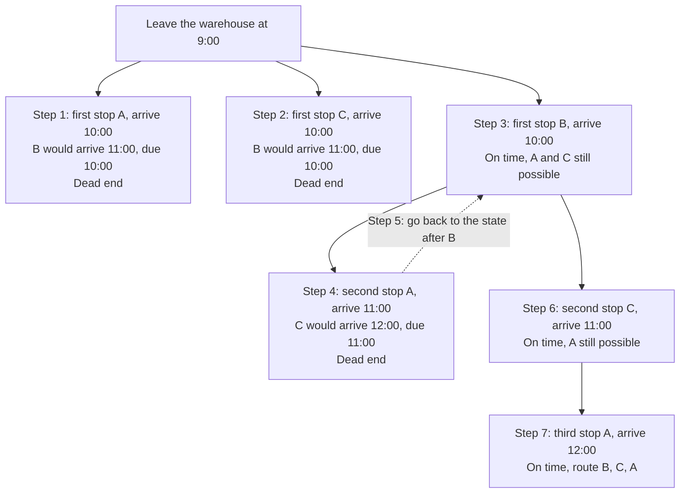

Some questions cannot be answered in one jump, because the answer depends on values that have to be worked out first: a discounted price before a total, or a first step before the steps that follow it. A model asked for the answer directly has to produce it without writing any of those values down, so it often returns a plausible number or plan that skips one of them. Reasoning techniques give that intermediate work a place to exist, and each one addresses a different way a direct answer goes wrong:

- **Chain-of-Thought.** A direct answer never works out the intermediate values. The model writes the steps before the answer, so each step can use the ones before it.
- **Self-Consistency.** A single written-out path can be the one that went wrong. The same prompt is sampled several times and the most frequent final answer wins.
- **Tree of Thoughts.** A single path cannot take back an early choice. Code runs a search around the model that judges partial solutions, drops dead ends and goes back to an earlier state.
- **Program-Aided Language Models (PAL).** A model can set a calculation up correctly and still get the digits wrong. The model writes the calculation as a program and an interpreter runs it.

Cost rises along the first three: Chain-of-Thought is one call with a longer output, Self-Consistency repeats that call once per sample, and Tree of Thoughts pays for a generation and an evaluation at every state the search visits. PAL sits beside them, because it changes who does the calculation and adds only the cost of running a program. None of the four guarantees a correct answer, because the steps, the votes and the program are all still model output, so the final answer needs a check that does not depend on them.

# Chain-of-Thought Prompting

A model asked directly for a result has to produce it as its next few tokens, with every intermediate value left unwritten. On a question that needs a discounted price before a refund can be computed, the direct answer often comes from the numbers visible in the question and skips the value in between. Chain-of-Thought (CoT) prompting has the model write the steps before the answer. Each written step becomes part of the text the model reads while producing the next one, so one hard generation turns into several smaller ones that each have the earlier results in front of them.

The zero-shot form adds only an instruction to the question, as a refund question for an online shop shows:

```text
# Question
An order has 3 T-shirts at $20 each, with a 10% coupon applied to the whole order and $5 shipping.
The customer returns 2 T-shirts. Shipping is not refunded. How much is refunded?

# Direct: the question alone
-> $40
# Wrong. 2 * 20 = 40 ignores the coupon, because the discounted price was never worked out.

# Zero-shot Chain-of-Thought: the same question plus one instruction
Let's think step by step. End with a line "Final answer: <number>".

-> The coupon takes 10% off, so each T-shirt cost 20 * 0.9 = 18 dollars.
   Two T-shirts are returned, so the refund for them is 2 * 18 = 36 dollars.
   Shipping is not refunded, so nothing is added.
   Final answer: 36
# Right. The price of 18 is on the page before the step that multiplies it.
```

The few-shot form replaces the instruction with a worked example placed before the real question, which shows both the kind of steps expected and the format of the last line:

```text
# Few-shot Chain-of-Thought: a solved question first, then the real one
Q: An order has 2 mugs at $10 each, with a 20% coupon applied to the whole order and $4 shipping.
   The customer returns 1 mug. Shipping is not refunded. How much is refunded?
A: The coupon takes 20% off, so each mug cost 10 * 0.8 = 8 dollars.
   One mug is returned, so the refund is 1 * 8 = 8 dollars.
   Shipping is not refunded, so nothing is added.
   Final answer: 8

Q: An order has 3 T-shirts at $20 each, ... How much is refunded?
A:
# The model continues the pattern: price after the coupon, refund, shipping, final line.
```

The worked example gives tighter control over the steps and the output format than the bare instruction, but it is sent with every request, and the model copies its pattern, including any mistake in it.

The written steps are working output and not part of the reply. The application reads only the `Final answer` line and does not show the steps to the customer. Some model APIs return only a summary of the model's internal reasoning, or none of it, so a system cannot depend on reading the steps either.

Writing the steps out helps only when the task has intermediate values to write. Reading an order number out of a message or looking up a delivery status has nothing in between, so the instruction adds output tokens and latency and leaves the answer unchanged. Models that reason internally before answering already do this work on their own, so the instruction usually adds nothing there.

## Pitfalls

### An early mistake carries through a convincing trace

Every step is built on the steps before it, so a wrong value written early is used by all the later steps, and the finished text reads as well as a correct one.

```text
# Same question, same instruction. The first step applies the coupon wrongly.
-> 10% of $60 is $6, so each T-shirt cost 20 - 6 = 14 dollars.
   Two T-shirts are returned, so the refund for them is 2 * 14 = 28 dollars.
   Shipping is not refunded, so nothing is added.
   Final answer: 28
# The $6 discount for the whole order was taken off a single T-shirt.
# The steps after it are correct arithmetic on the wrong price.

# Fix: code recomputes the refund from the order data, 2 * 20 * 0.9 = 36, and compares.
# 28 does not match, so the answer is rejected.
```

The check works because it never reads the steps. Where no code can recompute the result, the prompt is measured on a test set of questions with known answers before it is used. A fluent trace is not evidence, since the wrong trace above is as well written as the right one.

# Self-Consistency

A model usually picks each token with some randomness, so the same Chain-of-Thought prompt can produce the correct steps on one call and the wrong price on the next, and a single call gives no way to tell which one came back. Self-Consistency sends the same prompt several times at a temperature above zero, so that the samples differ. Code then extracts the final answer from each sample, converts the answers to one form and returns the most frequent one.

```text
# One call: whichever path is sampled is the answer
-> ... Final answer: 28

# Self-Consistency: the same prompt sent 5 times
Sample 1 -> ... Final answer: 36
Sample 2 -> ... Final answer: 36
Sample 3 -> ... Final answer: 28   # coupon taken off one T-shirt
Sample 4 -> ... Final answer: 36
Sample 5 -> ... Final answer: 40   # coupon ignored

# Code reads the final line of each sample and counts
36 -> 3 votes
28 -> 1 vote
40 -> 1 vote
-> 36
# The two wrong samples went wrong in different ways, so neither gathers votes against 36.
```

Calls and tokens grow with the number of samples. The calls can run in parallel, which shortens the wait but not the bill.

The vote needs final answers that code can compare. A refund amount is one number, so equal answers are easy to count. A free-text support reply is different, because no two samples use the same words, so there is nothing to count.

## Pitfalls

### The majority shares the same mistake

Voting removes only the mistakes that differ between samples. When the prompt itself leads most samples to the same wrong answer, that answer wins.

```text
# The prompt leaves out the sentence "Shipping is not refunded."
Sample 1 -> ... 2 * 18 = 36, plus $5 shipping. Final answer: 41
Sample 2 -> ... Final answer: 41
Sample 3 -> ... Final answer: 41
Sample 4 -> ... Final answer: 36
Sample 5 -> ... Final answer: 41

-> 41 (4 of 5)
# Wrong for this shop. Four samples made the same assumption about shipping,
# so the vote confirmed it.

# Fix: the missing rule goes into the prompt.
# More samples would only raise the count for 41.
```

Agreement between samples shows that the answer is stable and says nothing about whether it is right, so the voted answer is still compared with known answers on a test set.

### The same answer written differently splits the vote

The count compares strings unless code makes the answers comparable first, so one amount written three ways becomes three candidates.

```text
# Final lines as returned
Sample 1 -> $36
Sample 2 -> 36.00
Sample 3 -> 36 dollars
Sample 4 -> 28
Sample 5 -> 40
# Five different strings with one vote each, so there is no majority.

# Fix: the prompt fixes the last line as "Final answer: <number>",
# and code converts each answer to a number before counting.
36, 36, 36, 28, 40
-> 36 (3 of 5)
```

# Tree of Thoughts

A single completion cannot take back an early choice. When a choice proves wrong only several steps later, everything after it was already written on top of it, and sampling the whole path again repeats the gamble from the start. Tree of Thoughts (ToT) puts a search, run by code, around the model. From the current state the model proposes possible next steps. An evaluator, which can be the model or code, judges each resulting partial state. The search, which can be breadth-first, depth-first or beam search, then expands the promising states, drops the dead ends and goes back to an earlier state when a branch runs out.

A delivery route shows the search. A courier leaves the warehouse at 9:00 with three deliveries, and every drive takes 1 hour. Delivery A is due by 12:00, B by 10:00 and C by 11:00. Written as one completion, a route that starts with A or C is already lost, and nothing in the completion goes back to change the first stop. In the search below, the evaluator checks after every stop that the stop was on time and that each remaining delivery could still be on time if it came next.



Step 5 is the part a single completion does not have. The state after the first stop is kept, so the search continues from it and does not start over. The dead ends in steps 1 and 2 also cost one evaluation each, where a full route written from either would have cost a whole completion.

The search pays off only when three things hold: there are real alternatives at a step, a choice has consequences that show later, and a partial state can be judged before it is finished. Extracting fields from a message has no alternatives to explore, so there is no tree to search. The cost grows with the number of branches and the depth, because every expanded state costs a generation call to propose its next steps and an evaluation call for each state proposed. The six partial routes judged here are small next to a problem with ten options at each of five steps. The deadline checks in this example are plain arithmetic, which is cheaper to hand to code than to a model, and the next section does that for whole calculations.

## Pitfalls

### A wrong evaluation drops the branch that leads to the answer

The search continues only from the states the evaluator rates well, so a single wrong rating can remove the one branch that works, and nothing later brings it back.

```text
# Same courier problem. The model rates each first stop from 1 to 10,
# and the search keeps only the best one.
First stop A -> 2
First stop B -> 4   # wrong: B is the only first stop that still allows a full route
First stop C -> 6
# Kept: C. Dropped: A and B.

Route C, B -> B arrives 11:00, due 10:00: late
Route C, A -> A arrives 11:00, on time, but B would arrive 12:00, due 10:00: late
-> no route found
# The route B, C, A exists, but its first stop was dropped after one step.

# Fix: a deadline is arithmetic, so code does the evaluation.
# Arriving at A or C at 10:00 leaves no time to reach B, so code marks both as dead ends and keeps B.
```

Where no rule can be computed and the model has to do the evaluation, the search keeps more than one state per level. With two states kept above, B survives next to C, so one wrong rating does not end the search. This costs more calls at every level.

# Program-Aided Language Models (PAL)

A model that reasons in text can set a problem up correctly and still get the calculation wrong, because the model writes digits as likely text and does not compute them. Program-Aided Language Models (PAL) keep the model for setting the problem up and move the calculation out: the model writes the steps as a short program and an interpreter runs the program, so the arithmetic is exact.

```text
# Question
A workshop has 17 boxes with 24 screws in each box and 39 loose screws. How many screws are there?

# Reasoning in text: the model sets the problem up and does the arithmetic itself
17 boxes with 24 screws each is 17 * 24 = 398 screws.
398 + 39 = 437 screws.
-> 437
# The plan is right, but 17 * 24 is 408, so the answer is wrong.

# PAL: the model writes the same plan as a program and does no arithmetic
boxes = 17
screws_per_box = 24
loose = 39
print(boxes * screws_per_box + loose)

# An interpreter runs the program
-> 447
# The plan is the same in both versions. Only who does the calculation changed.
```

PAL helps when the hard part is arithmetic or symbol manipulation, and it does nothing for a question that needs judgment about meaning, because no program states that judgment. Tool-using agents split the work the same way: the model picks a tool and fills in its arguments, and the tool performs the exact operation.

## Pitfalls

### A wrong program gives an exact wrong answer

The interpreter is exact for the program it receives, so a program that states the problem wrongly produces a wrong answer with no sign of trouble.

```text
# Same question. The model's program adds the loose screws before multiplying.
boxes = 17
screws_per_box = 24
loose = 39
print((boxes + loose) * screws_per_box)
-> 1344
# The program ran without an error, so nothing marks 1344 as wrong.

# Fix: the answer is checked against something independent of the program,
# such as a known answer in a test set or a rough estimate (17 * 24 is about 400).
```

Model-written code also runs with whatever access the interpreter has, so the interpreter is kept away from files, network and credentials.

# Tradeoffs

The starting point is one direct call whose answer has a format that code can check. Each technique adds cost on top of that call and fails in its own way.

| Technique | Calls | Accuracy profile | Best use case | Main downside |
| --- | --- | --- | --- | --- |
| Chain-of-Thought | One call with a longer output. | Better than a direct answer when later steps depend on intermediate values. | Multi-step arithmetic and logic, such as a refund with a coupon. | An early mistake carries through a trace that still reads well. |
| Self-Consistency | One call per sample. | Better than one Chain-of-Thought call when samples go wrong in different ways. | Tasks whose final answer is one value that code can compare. | Cost grows with the sample count. A mistake shared by most samples wins the vote. |
| Tree of Thoughts | One generation call per expanded state and one evaluation call per proposed state. | Better than a single path when an early choice proves wrong only later. | Problems with real alternatives at each step and partial states that can be judged. | It is the most expensive of the four. A wrong evaluation drops the branch that leads to the answer. |
| PAL | One call plus running the program. | Exact arithmetic when the program states the problem correctly. | Calculations and symbolic steps that can be written as code. | A wrong program gives a wrong answer with no error. The program needs an isolated interpreter. |

The method to use is the cheapest one that clears the evaluation target on a test set with known answers, so the next more expensive technique is added only after the cheaper one has been measured and falls short. PAL is a separate choice from that order, because it depends on whether the hard step is a calculation and not on how much reasoning the task needs.

# Questions

<!-- qard-id: 8e316cf0-1e09-43c4-9612-3f8972f851fc -->
> [!qard]- When can Chain-of-Thought prompting help, and when can it add risk or waste?
> Chain-of-Thought prompting can help when a task carries intermediate state across several steps, such as multi-step arithmetic, and the model is large enough to use worked reasoning. It can waste tokens when the task has little intermediate state. It can also waste them on models that already reason internally and whose provider advises against explicit step-by-step prompts. It adds risk when the visible trace is trusted as proof.
>
> **Where it helped:** in Wei et al. (2022), chain-of-thought demonstrations improved some tested arithmetic, commonsense and symbolic benchmarks, and the gains depended on model scale. Writing out intermediate steps can turn one hard generation into a sequence of smaller continuations. These are results for the tested benchmarks and models, not a universal rule.
>
> **Where it can add risk or waste:**
>
> - **Cost:** longer outputs add tokens and latency. That cost is waste whenever the reasoning does not improve the answer on the selected model and task.
> - **Error propagation:** a longer trace has more steps in which an early wrong assumption can carry forward, and a fluent explanation does not show that the answer is right.
> - **Little intermediate state:** simple extraction or lookup has few steps to make explicit, so extra reasoning tokens are unlikely to improve the result.
> - **Internally reasoning models:** OpenAI's reasoning best practices advise against explicit “think step by step” instructions for its reasoning models, because those models already reason internally. Other providers and models need their own guidance and evaluation.
> 
> Whether CoT helps is settled by comparing it with a direct prompt on the selected model and task, with the final answer checked independently of the trace.
>
> Sources: [Wei et al., Chain-of-Thought Prompting](https://arxiv.org/abs/2201.11903) · [OpenAI reasoning best practices](https://developers.openai.com/api/docs/guides/reasoning-best-practices)

<!-- qard-id: 1ef10543-fe5e-41d7-bc88-d53c8e404ca5 -->
> [!qard]- When does Tree of Thoughts justify its search cost over a single reasoning path?
> Tree of Thoughts justifies its cost when a problem has a real search space. That means meaningful alternatives at intermediate steps, consequences that appear only later, and partial states that can be evaluated usefully. Without those, a single reasoning path or a direct call is cheaper.
>
> **How it works:** ToT wraps the model in a search procedure.
>
> 1. The model proposes several candidate next states, or thoughts, from the current state.
> 2. An evaluator judges how promising each state is. The evaluator can be the model itself.
> 3. A search strategy such as breadth-first or depth-first search keeps and expands the promising branches.
> 4. When a branch is judged a dead end, it is abandoned and the search backtracks to an earlier state. This replaces continuing one irreversible completion.
> 
> **Costs and limits:**
>
> - Work grows with branching and depth, because each expanded state needs generation and evaluation calls.
> - The evaluator is the weak point. A poor evaluator can keep a bad branch or prune the one that leads to the solution.
> - Straightforward extraction has no useful search tree, and plain arithmetic is cheaper with a calculator.
> - The reported gains come from the tasks tested in the original paper and are not a general guarantee.
> 
> Self-consistency sits between a single path and ToT. It samples complete paths independently and votes on their final answers, without evaluating intermediate states or backtracking from them.
>
> Sources: [Yao et al., Tree of Thoughts](https://arxiv.org/abs/2305.10601) · [Wang et al., Self-Consistency](https://arxiv.org/abs/2203.11171)

<!-- qard-id: 6e8b7fc1-a648-424a-af2d-b9769d59392b -->
> [!qard]- When does self-consistency help, and when can majority aggregation fail?
> Self-consistency helps when independent samples tend to make different mistakes and their final answers can be normalized and compared, so the correct answer is likely to be the most common one. Majority aggregation fails when errors are correlated, so that most samples share the same mistake. It also fails when correct answers cannot be matched reliably.
>
> **How it works:**
>
> 1. The same prompt is sampled several times, producing different reasoning paths instead of one greedy path.
> 2. Each path's final answer is extracted and normalized, so `67`, `67.0` and “sixty-seven” count as the same answer.
> 3. Equivalent answers are grouped, and the most frequent one is selected.
> 
> For example, three sampled paths for an age puzzle answer `67`, `67` and `35`, and the vote returns `67`.
>
> **Where it fails or costs too much:**
>
> - **Correlated errors:** if most samples repeat the same misconception, the wrong answer wins the vote.
> - **Open-ended outputs:** two correct summaries rarely match word for word, so literal string voting splits the correct answers. A meaningful comparison rule is needed, and that rule must itself be tested.
> - **Cost:** calls and tokens grow roughly with the number of samples. Parallel calls reduce elapsed time but still consume capacity.
> 
> A comparison against a single-path baseline on the target task shows whether the extra calls pay off.
>
> Sources: [Wang et al., Self-Consistency Improves Chain of Thought Reasoning](https://arxiv.org/abs/2203.11171)

# References

- [Chain-of-Thought Prompting Elicits Reasoning in Large Language Models (Wei et al., 2022)](https://arxiv.org/abs/2201.11903)
- [Large Language Models are Zero-Shot Reasoners (Kojima et al., 2022)](https://arxiv.org/abs/2205.11916)
- [Self-Consistency Improves Chain of Thought Reasoning in Language Models (Wang et al., 2022)](https://arxiv.org/abs/2203.11171)
- [Tree of Thoughts: Deliberate Problem Solving with Large Language Models (Yao et al., 2023)](https://arxiv.org/abs/2305.10601)
- [PAL: Program-Aided Language Models (Gao et al., 2022)](https://arxiv.org/abs/2211.10435)
