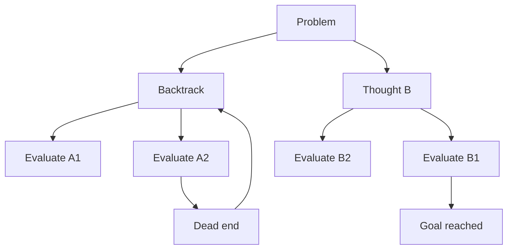

---
topic:
  - AI & ML
subtopic:
  - LLM
summary: "Making intermediate reasoning explicit with Chain-of-Thought, Self-Consistency, and Tree of Thoughts."
level:
  - "3"
priority: Medium
status: Done
publish: true
qard-deck: "AI & ML"
qard-topic: "LLM/Prompt Engineering/Reasoning Techniques"
flashcard_uid: "cd09ceaf"
---

Some tasks cannot be answered reliably in one jump. Arithmetic, logic, and planning all require state to survive across several decisions. Reasoning techniques give the model or its surrounding system more room to construct, compare, and check those decisions.

The methods form a cost ladder. Chain-of-Thought elicits one path. Self-Consistency samples several paths and aggregates their answers. Tree of Thoughts adds an explicit search procedure with branching and backtracking. None guarantees correct reasoning, and a convincing trace is still only model output.

# Chain-of-Thought Prompting

Wei et al. (2022) showed that worked reasoning examples can improve performance on sufficiently large models. Two forms became common:

1. Few-shot CoT: worked examples in the prompt show a reasoning process and final-answer format.
2. Zero-shot CoT: an instruction such as "Let's think step by step" is appended to the prompt (Kojima et al. 2022).

An external scratchpad can turn one difficult generation into a sequence of smaller continuations. That often helps on benchmark problems with explicit intermediate state. It also creates more tokens in which an early mistake can spread, so the trace needs verification rather than trust.

Example (same task, with and without CoT):

```text
Question: I buy 10 apples, give away 4, buy 5 more, then eat 1. How many remain?

Direct answer (no CoT): 11  (incorrect)

CoT-style answer:
Start with 10.
Give away 4 -> 6.
Buy 5 -> 11.
Eat 1 -> 10.
Final answer: 10  (correct)
```

Visible reasoning also has a product boundary. Some model APIs return concise answers or summaries rather than hidden internal reasoning, and exposing a long scratchpad is rarely the right user interface. Production systems usually need verifiable intermediate results, tool outputs, or a concise rationale.

# Self-Consistency

Self-Consistency (Wang et al. 2022) samples several reasoning paths instead of accepting one greedy path. The system groups equivalent final answers and selects the most frequent one.

The method helps when independent samples fail differently and the final answer can be compared mechanically. It is much weaker for open-ended outputs where two correct answers may not match and a majority can repeat the same misconception.

```text
Question: When I was 6, my sister was half my age. Now I'm 70. How old is she?

Sampled path 1 -> 67
Sampled path 2 -> 67
Sampled path 3 -> 35

Majority vote -> 67 (correct)
```

Cost and token use grow roughly with the sample count. Calls can run in parallel to reduce wall-clock latency, but they still consume capacity, and the aggregation rule becomes another part of the system to test.

# Tree of Thoughts

Tree of Thoughts (ToT), proposed by Yao et al. (2023), wraps the model in a search algorithm. The model proposes candidate states and may help score them. Breadth-first, depth-first, or beam-like search decides which branches continue. Dead ends can be abandoned instead of becoming the rest of one irreversible completion.



ToT fits problems with meaningful alternatives, delayed consequences, and a state that can be evaluated along the way. Straightforward extraction has no useful search tree. Ordinary arithmetic is usually cheaper to send to a calculator.

# Tradeoffs

| Technique | Calls | Accuracy profile | Best use case | Main downside |
| --- | --- | --- | --- | --- |
| Chain-of-Thought | 1 | Strong baseline for many reasoning tasks | Arithmetic, logic, structured step-by-step tasks | Can lock into one bad chain |
| Self-Consistency | N | Better than single CoT on many verifiable tasks | Tasks with a clear final answer suitable for voting | Higher cost and latency |
| Tree of Thoughts | Many (branching) | Can improve tasks with a useful search state | Problems needing exploration, lookahead, backtracking | Most expensive and operationally complex |

The preferred method is the cheapest one that clears the evaluation target:

1. The baseline is one direct call with an answer format that can be checked.
2. CoT-style decomposition is added when the task genuinely has intermediate state.
3. Self-consistency fits when final answers can be normalized and voted on.
4. ToT is reserved for problems that contain an actual search space.

# Questions

<!-- qard-id: 8e316cf0-1e09-43c4-9612-3f8972f851fc -->
> [!qard]- When can Chain-of-Thought prompting help, and when can it add risk or waste?
> Chain-of-Thought prompting can help when a task carries intermediate state across several steps, such as multi-step arithmetic, and the model is large enough to use worked reasoning. It can waste tokens when the task has little intermediate state. It can also waste them on models that already reason internally and whose provider advises against explicit step-by-step prompts. It adds risk when the visible trace is trusted as proof.
> 
> **Where it helped:** in Wei et al. (2022), chain-of-thought demonstrations improved some tested arithmetic, commonsense and symbolic benchmarks, and the gains depended on model scale. Writing out intermediate steps can turn one hard generation into a sequence of smaller continuations. These are results for the tested benchmarks and models, not a universal rule.
> 
> **Where it can add risk or waste:**
> 
> - **Cost:** longer outputs add tokens and latency. That cost is waste whenever the reasoning does not improve the answer on the selected model and task.
> - **Error propagation:** a longer trace has more steps in which an early wrong assumption can carry forward, and a fluent explanation does not show that the answer is right.
> - **Little intermediate state:** simple extraction or lookup has few steps to make explicit, so extra reasoning tokens are unlikely to improve the result.
> - **Internally reasoning models:** OpenAI's reasoning best practices advise against explicit “think step by step” instructions for its reasoning models, because those models already reason internally. Other providers and models need their own guidance and evaluation.
> 
> Whether CoT helps is settled by comparing it with a direct prompt on the selected model and task, with the final answer checked independently of the trace.
> 
> Sources: [Wei et al., Chain-of-Thought Prompting](https://arxiv.org/abs/2201.11903) · [OpenAI reasoning best practices](https://developers.openai.com/api/docs/guides/reasoning-best-practices)

<!-- qard-id: 1ef10543-fe5e-41d7-bc88-d53c8e404ca5 -->
> [!qard]- When does Tree of Thoughts justify its search cost over a single reasoning path?
> Tree of Thoughts justifies its cost when a problem has a real search space. That means meaningful alternatives at intermediate steps, consequences that appear only later, and partial states that can be evaluated usefully. Without those, a single reasoning path or a direct call is cheaper.
> 
> **How it works:** ToT wraps the model in a search procedure.
> 
> 1. The model proposes several candidate next states, or thoughts, from the current state.
> 2. An evaluator judges how promising each state is. The evaluator can be the model itself.
> 3. A search strategy such as breadth-first or depth-first search keeps and expands the promising branches.
> 4. When a branch is judged a dead end, it is abandoned and the search backtracks to an earlier state. This replaces continuing one irreversible completion.
> 
> **Costs and limits:**
> 
> - Work grows with branching and depth, because each expanded state needs generation and evaluation calls.
> - The evaluator is the weak point. A poor evaluator can keep a bad branch or prune the one that leads to the solution.
> - Straightforward extraction has no useful search tree, and plain arithmetic is cheaper with a calculator.
> - The reported gains come from the tasks tested in the original paper and are not a general guarantee.
> 
> Self-consistency sits between a single path and ToT. It samples complete paths independently and votes on their final answers, without evaluating intermediate states or backtracking from them.
> 
> Sources: [Yao et al., Tree of Thoughts](https://arxiv.org/abs/2305.10601) · [Wang et al., Self-Consistency](https://arxiv.org/abs/2203.11171)

<!-- qard-id: 6e8b7fc1-a648-424a-af2d-b9769d59392b -->
> [!qard]- When does self-consistency help, and when can majority aggregation fail?
> Self-consistency helps when independent samples tend to make different mistakes and their final answers can be normalized and compared, so the correct answer is likely to be the most common one. Majority aggregation fails when errors are correlated, so that most samples share the same mistake. It also fails when correct answers cannot be matched reliably.
> 
> **How it works:**
> 
> 1. The same prompt is sampled several times, producing different reasoning paths instead of one greedy path.
> 2. Each path's final answer is extracted and normalized, so `67`, `67.0` and “sixty-seven” count as the same answer.
> 3. Equivalent answers are grouped, and the most frequent one is selected.
> 
> For example, three sampled paths for an age puzzle answer `67`, `67` and `35`, and the vote returns `67`.
> 
> **Where it fails or costs too much:**
> 
> - **Correlated errors:** if most samples repeat the same misconception, the wrong answer wins the vote.
> - **Open-ended outputs:** two correct summaries rarely match word for word, so literal string voting splits the correct answers. A meaningful comparison rule is needed, and that rule must itself be tested.
> - **Cost:** calls and tokens grow roughly with the number of samples. Parallel calls reduce elapsed time but still consume capacity.
> 
> A comparison against a single-path baseline on the target task shows whether the extra calls pay off.
> 
> Sources: [Wang et al., Self-Consistency Improves Chain of Thought Reasoning](https://arxiv.org/abs/2203.11171)

# References

- [Chain-of-Thought Prompting Elicits Reasoning in Large Language Models (Wei et al., 2022)](https://arxiv.org/abs/2201.11903)
- [Large Language Models are Zero-Shot Reasoners (Kojima et al., 2022)](https://arxiv.org/abs/2205.11916)
- [Self-Consistency Improves Chain of Thought Reasoning in Language Models (Wang et al., 2022)](https://arxiv.org/abs/2203.11171)
- [Tree of Thoughts: Deliberate Problem Solving with Large Language Models (Yao et al., 2023)](https://arxiv.org/abs/2305.10601)
