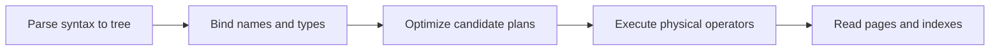

The relational model stores facts as rows, connects them through keys, and enforces declared constraints at the database boundary. SQL states the required result rather than an access path. The optimizer chooses scans, seeks, join order, and physical operators that preserve the query's semantics. A relational database is a strong default when integrity constraints, multi-row transactions, and new query combinations matter more than storing one access pattern in its final read shape.

```datacorejsx
const { FolderStructureMap } = await dc.require("Assets/components/devbook-folder-map.jsx");
return FolderStructureMap;
```

# Relational Boundary

Relational storage fits data whose validity depends on relationships the database must reject when broken. It also supports several row changes under one commit decision and lets new joins emerge without rebuilding the stored shape. Denormalization can remove an expensive join from a measured hot path, but the duplicate state creates a write-side consistency obligation. [[Home/Data Persistence/SQL/Normalization Denormalization|Normalization and denormalization]] explains how keys and dependencies set that boundary.

# Query Processing and Joins

SQL has declarative semantics and a separate physical plan. A useful logical order is `FROM`/`JOIN` → `WHERE` → `GROUP BY` → `HAVING` → `SELECT` → `ORDER BY` → `LIMIT`/`TOP`. The optimizer may push predicates or reorder joins physically only when duplicates, three-valued `NULL` logic, and the final result remain equivalent.

```sql
SELECT department, COUNT(*) AS headcount
FROM employees
WHERE hire_date >= DATE '2024-01-01'
GROUP BY department
HAVING COUNT(*) > 5
ORDER BY headcount DESC;
```

`WHERE` cannot use `headcount` because the output alias is defined later. `ORDER BY` generally can. Alias visibility is dialect-specific. PostgreSQL permits a simple output alias in `GROUP BY`, while SQL Server requires the original expression. Portable SQL repeats the grouped or aggregate expression.



Cardinality estimates connect query semantics to physical cost. If a predicate is estimated at 10 rows but returns 1,000,000, a nested loop or join order that appeared cheap can repeat millions of probes or force downstream spills. The result remains correct. The chosen work is wrong for the actual row counts.

# Join Semantics

In this example, `customers` contains Ada and Lin, while `orders` contains two rows for Ada and none for Lin. A left join returns Ada twice and fills Lin's missing order columns with `NULL`. A join combines matching rows. It does not deduplicate them.

```sql
SELECT c.name, o.total
FROM customers AS c
LEFT JOIN orders AS o ON o.customer_id = c.id
ORDER BY c.id, o.total;
```

```text
name | total
Ada  | 40
Ada  | 70
Lin  | NULL
```

Putting `o.total >= 50` in `ON` preserves Lin as an unmatched left row. Putting it in `WHERE` removes Lin because `NULL >= 50` is unknown.

![[Data Persistence/Data Persistence-SQL-18120000.png|theme-aware]]

| Physical join | Strong fit | Cost to watch |
| --- | --- | --- |
| Nested loop | Small outer input with indexed inner probes | Repeated inner work when estimates are wrong |
| Hash join | Large equality joins with enough memory | Build memory and spills |
| Merge join | Inputs already ordered on the join key | Sorting when order is absent |

No physical join is universally fastest. Input size, ordering, row width, indexes, available memory, and cache state determine which operator is cheapest for one execution.

# Transactions and Scale

[[Home/Data Persistence/SQL/Database Locks|Database locks]] and MVCC enforce isolation inside one database. That note also contrasts pessimistic locks with optimistic version predicates for stale application writes. [[Home/Data Persistence/SQL/Replication|Replication]] copies data for availability and eligible read traffic, while [[Home/Data Persistence/SQL/Sharding|sharding]] partitions ownership when one primary can no longer carry the measured write or storage load.

# Questions

> [!qard]- In what logical order are the clauses of a SQL `SELECT` query evaluated, and why does that order matter?
> Logically, a `SELECT` query is evaluated from its input outward: rows are built, filtered, grouped, filtered again as groups, projected into output columns, then sorted and limited. Each step works on the output of the previous steps, so a clause can use only what earlier steps produced.
>
> 1. `FROM` and joins build the input rows.
> 2. `WHERE` removes rows that do not satisfy its condition.
> 3. `GROUP BY` forms groups and computes aggregates.
> 4. `HAVING` removes groups.
> 5. `SELECT` computes the output columns and their aliases.
> 6. `DISTINCT` removes duplicate output rows.
> 7. `ORDER BY` sorts the output.
> 8. `LIMIT` and `OFFSET` keep a slice of the sorted rows.
> 
> Several consequences follow from this order:
>
> - `WHERE` cannot test an aggregate of its own query block, because that block's groups do not exist yet. A subquery inside `WHERE` can still compute its own aggregate for the comparison.
> - `WHERE` and `HAVING` cannot refer to an output alias defined in `SELECT`, because that alias is computed later. `ORDER BY` runs after `SELECT`, so it can.
> - `LIMIT` without `ORDER BY` returns an unpredictable subset of rows, because no order has been defined.
> 
> Alias rules vary by dialect. PostgreSQL also accepts an output column name in `GROUP BY`, while SQL Server requires the original expression there, so portable SQL repeats the expression. The order is logical: the optimizer can execute the query differently, as long as the result is the same.
>
> [PostgreSQL: SELECT](https://www.postgresql.org/docs/current/sql-select.html)

<!-- qard-id: d063901b-80b1-4d4e-8182-db595534d76a -->
> [!qard]- What is the difference between `WHERE` and `HAVING`?
> `WHERE` filters individual rows before they are grouped. `HAVING` filters the groups that `GROUP BY` produces, so its condition can test aggregate values such as `COUNT(*)` or `SUM(amount)`.
>
> ```sql
> SELECT department, COUNT(*) AS headcount
> FROM employees
> WHERE hire_date >= DATE '2024-01-01'  -- keeps recent hires only
> GROUP BY department
> HAVING COUNT(*) > 5;                  -- keeps departments with more than five recent hires
> ```
>
> | Aspect | `WHERE` | `HAVING` |
> |---|---|---|
> | What it filters | Input rows of the query, before grouping. | Groups, after grouping and aggregation. |
> | Aggregates in the condition | Cannot use an aggregate of its own query, because no groups exist yet. A subquery inside `WHERE` can still compute its own aggregate. | Can use aggregates; the condition is evaluated once per group. |
> | Effect on later work | Rows it removes never reach grouping or aggregation. | Groups are built and aggregated before it removes any. |
>
> A condition on a grouping column, such as `department = 'Sales'`, gives the same result in either clause. Written in `WHERE`, it expresses the cheaper logical order, because rows are removed before any grouping work.
>
> [PostgreSQL: SELECT](https://www.postgresql.org/docs/current/sql-select.html)

> [!qard]- In a `LEFT JOIN`, why does putting a condition on the right table in `WHERE` instead of `ON` change the result?
> A condition in `ON` decides which right-side rows match. Left rows without a match are still kept, with `NULL` in the right-side columns. A condition in `WHERE` runs after the join and keeps only the rows for which it is true. An ordinary comparison such as `o.total >= 50` is not true for those `NULL`-extended rows, so `WHERE` removes them, and the query behaves like an inner join for that condition.
>
> In this example, `customers` holds Ada and Lin. Ada has orders with totals 40 and 70, and Lin has none.
>
> ```sql
> -- Condition in ON: every customer is kept
> SELECT c.name, o.total
> FROM customers AS c
> LEFT JOIN orders AS o
>   ON o.customer_id = c.id AND o.total >= 50;
> -- Ada | 70
> -- Lin | NULL
> 
> -- Condition in WHERE: applied after the join
> SELECT c.name, o.total
> FROM customers AS c
> LEFT JOIN orders AS o ON o.customer_id = c.id
> WHERE o.total >= 50;
> -- Ada | 70
> ```
>
> In the second query, the join first produces a Lin row with a `NULL` total. `NULL >= 50` evaluates to unknown rather than true, so `WHERE` removes Lin.
>
> A right-side condition that is true for `NULL` behaves differently. With the same `ON o.customer_id = c.id` join, `WHERE o.customer_id IS NULL` is true only for the `NULL`-extended row, so it keeps Lin and returns only customers without orders.
>
> The `ON` form answers 'all customers, with their large orders if any'. The `WHERE` form answers 'customers who have a large order'. The correct placement depends on which of those questions the query is meant to answer.
>
> [PostgreSQL: SELECT](https://www.postgresql.org/docs/current/sql-select.html) · [PostgreSQL: Table expressions](https://www.postgresql.org/docs/current/queries-table-expressions.html)

<!-- qard-id: 55e3e309-6041-4b3c-8761-2ddb27b8e336 -->
> [!qard]- In SQL Server, how do stored procedures and user-defined functions differ?
> A stored procedure is a database operation called as its own statement; it can change data and return several kinds of results. A T-SQL user-defined function (UDF) computes a value for use inside a query, and SQL Server forbids it from changing database state.
>
> | Aspect | Stored procedure | T-SQL user-defined function |
> |---|---|---|
> | How it is called | As a statement with `EXEC`. It cannot be used inside a `SELECT` expression. | Inside a query: a scalar UDF in an expression such as a `SELECT` list or `WHERE` condition, a table-valued UDF in `FROM`. |
> | What it returns | Any number of result sets, output parameters and an integer return status. | One scalar value or one table. |
> | Changing data | Can insert, update and delete data and call other procedures. | Cannot modify database state; only table variables declared inside the function can change. |
> | Other restrictions | Can use dynamic SQL, temporary tables and `TRY...CATCH`. | Cannot use dynamic SQL, temporary tables or `TRY...CATCH`, and cannot call ordinary stored procedures. |
>
> Scalar UDFs carry a performance risk. Without inlining, SQL Server invokes a T-SQL scalar UDF once per qualifying row and does not run the calling query in parallel. In SQL Server 2019 (15.x) and later, at database compatibility level 150 or higher, the optimizer can inline an eligible scalar UDF by turning its body into part of the calling query's plan. Inlining applies only when the function and the calling query meet the documented eligibility requirements.
>
> [SQL Server: CREATE PROCEDURE](https://learn.microsoft.com/en-us/sql/t-sql/statements/create-procedure-transact-sql?view=sql-server-ver15) · [SQL Server: Create user-defined functions](https://learn.microsoft.com/en-us/sql/relational-databases/user-defined-functions/create-user-defined-functions-database-engine) · [SQL Server: Scalar UDF inlining](https://learn.microsoft.com/sql/relational-databases/user-defined-functions/scalar-udf-inlining)

<!-- qard-id: a9422bb2-6447-46cf-8be9-efd38e475b30 -->
> [!qard]- In SQL Server, when is a temp table a better fit than a CTE?
> A temp table is a better fit when an intermediate result is expensive to compute and is needed more than once. It also fits when later steps need indexes or statistics on that result to be planned well. A CTE is a better fit for structuring a single statement, because it adds no storage or cleanup.
>
> | Aspect | CTE | Temp table |
> |---|---|---|
> | Scope | A named result for the one statement that immediately follows it. | A real table that later statements can query until it is dropped or its session or creating procedure ends. |
> | Materialization | SQL Server does not promise to store the result. If the outer query references the CTE several times, its query can run again for each reference. | Rows are computed once and stored, so later reads reuse them. |
> | Optimization | Optimized together with the statement that uses it. | Can be indexed, and SQL Server keeps statistics on it that later queries' plans can use. |
> | Inspection | The intermediate result cannot be examined on its own. | The stored rows can be queried directly, which helps debugging. |
> | Cost | No separate write or cleanup. | Writing the rows, maintaining any indexes and dropping the table add work. The rows are a copy, so later changes to the source tables do not appear in them. |
>
> Neither option is faster by default. A temp table pays off when reuse, indexing or better row estimates save more work than writing the rows costs.
>
> [Microsoft: WITH common_table_expression](https://learn.microsoft.com/en-us/sql/t-sql/queries/with-common-table-expression-transact-sql?view=sql-server-ver17)

<!-- qard-id: 95a9a94f-63f2-474d-bcfc-7d95fad9fe76 -->
> [!qard]- How do SQL Server's transaction isolation levels differ in the read anomalies they allow?
> SQL Server provides five isolation levels. From `READ UNCOMMITTED` to `SERIALIZABLE`, each lock-based level prevents more read anomalies at the cost of more blocking. `SNAPSHOT` prevents the same read anomalies as `SERIALIZABLE` by reading row versions instead of holding read locks.
>
> The anomalies are:
>
> - **Dirty read:** reading data another transaction has changed but not committed.
> - **Nonrepeatable read:** reading the same row twice in one transaction and getting different committed values.
> - **Phantom read:** re-running a range query in one transaction and getting a different set of rows because another transaction inserted or deleted rows.
>
> | Level | How reads behave | Read anomalies still possible | Main cost |
> |---|---|---|---|
> | `READ UNCOMMITTED` | Reads take no shared data locks and do not wait for writers' exclusive data locks. | Dirty, nonrepeatable and phantom reads. | Results can include changes that are later rolled back. |
> | `READ COMMITTED` (default) | Reads see only committed data. With locking, a read waits for writers and releases its shared lock soon after reading. | Nonrepeatable and phantom reads. | Readers and writers block each other. |
> | `REPEATABLE READ` | Shared locks on rows read are held until the transaction ends. | Phantom reads. | Longer-held locks increase blocking and deadlocks. |
> | `SERIALIZABLE` | Range locks also stop other transactions from inserting into ranges already read. | None of the three. | The most blocking and deadlock risk. |
> | `SNAPSHOT` | Reads see committed data as of the start of the transaction, using row versions instead of shared data locks, so reads do not block writers' data changes. | None of the three. | Row versions add overhead. An update to a row that another transaction changed after the snapshot began fails with an update conflict. The level must be enabled with the `ALLOW_SNAPSHOT_ISOLATION` database option. |
>
> The `READ_COMMITTED_SNAPSHOT` database option changes how `READ COMMITTED` reads behave, but it is not a separate isolation level.
>
> [SQL Server: Transaction locking and row versioning guide](https://learn.microsoft.com/en-us/sql/relational-databases/sql-server-transaction-locking-and-row-versioning-guide?view=sql-server-ver17)

<!-- qard-id: c6d27674-adf1-4c3d-a32b-d2ec5fd2b3cb -->
> [!qard]- What changes about `READ COMMITTED` reads when SQL Server's Read Committed Snapshot Isolation (RCSI) is enabled?
> With RCSI enabled, a `READ COMMITTED` read no longer takes shared locks. It reads row versions instead, and each statement sees the data that was committed when that statement started. For data locks, readers therefore stop blocking writers, and writers stop blocking readers.
>
> - **How it is enabled:** RCSI is the `READ_COMMITTED_SNAPSHOT` database option. Sessions that use `READ COMMITTED`, the default level, get the new behavior without code changes.
> - **Statement-level, not transaction-level:** each statement takes a fresh view. Two statements in the same transaction can still see different committed data, so nonrepeatable and phantom reads remain possible. `SNAPSHOT` isolation, by contrast, keeps one view for the whole transaction.
> - **Writes still lock:** data modifications still take locks, so writers still block other writers.
> - **Cost:** maintaining row versions adds storage and I/O overhead.
> 
> A read no longer waits for an in-flight write. It can therefore return the last committed value of a row that another transaction is about to change. A read-then-write sequence that relied on that waiting needs explicit concurrency protection.
>
> [SQL Server: Transaction locking and row versioning guide](https://learn.microsoft.com/en-us/sql/relational-databases/sql-server-transaction-locking-and-row-versioning-guide?view=sql-server-ver17)
<!-- qard-id: 7eefc702-f9a2-474d-b88e-1fa86d8701b2 -->
> [!qard]- In SQL Server, why is the `NOLOCK` hint unsafe as a general performance fix?
> `NOLOCK` makes the read of that table behave like `READ UNCOMMITTED`. For data, the read takes no shared locks and is not blocked by other transactions' exclusive locks. It avoids waiting on concurrent writers only by giving up the guarantee that the result is correct. The hint covers only data locks: the query still takes schema-stability locks, so a concurrent schema change can still block it.
>
> While data changes concurrently, a `NOLOCK` read can return:
>
> - **Uncommitted data:** values written by a transaction that later rolls back, so the result contains data that was never committed.
> - **Missing or duplicate rows:** the scan takes no shared data locks, so rows that concurrent changes move while it runs can be skipped or read twice. A page split is one way rows move.
> 
> These anomalies need not raise an error. A scan can sometimes fail when data moves under it, but it can also finish normally with a wrong total, a missing record or a double-counted row, and nothing signals the problem.
>
> It is also not a general speed-up. A query that is slow because of its own work, such as a large scan or a missing index, does the same work under `NOLOCK`. When the real problem is readers waiting on writers' data locks, row versioning through `READ_COMMITTED_SNAPSHOT` or `SNAPSHOT` removes that waiting while still returning committed data.
>
> [SQL Server: Transaction locking and row versioning guide](https://learn.microsoft.com/en-us/sql/relational-databases/sql-server-transaction-locking-and-row-versioning-guide?view=sql-server-ver17) · [SQL Server: Table hints](https://learn.microsoft.com/en-us/sql/t-sql/queries/hints-transact-sql-table?view=sql-server-ver17)

# References

- [Intro to SQL](https://www.khanacademy.org/computing/computer-programming/sql)
- [PostgreSQL table expressions](https://www.postgresql.org/docs/current/queries-table-expressions.html)
