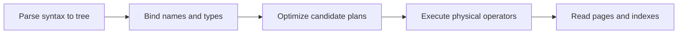

---
topic:
  - Data Persistence
subtopic:
  - SQL
summary: "The relational model, SQL's declarative query language, and the engine concepts behind it."
tags: [FolderNote]
publish: true
priority: High
level:
  - "4"
status: Creation
qard-deck: "Data Persistence"
qard-topic: "SQL/SQL"
flashcard_uid: "af026b91"
---

The relational model stores facts as rows, connects them through keys, and enforces declared constraints at the database boundary. SQL states the required result rather than an access path. The optimizer chooses scans, seeks, join order, and physical operators that preserve the query's semantics. A relational database is a strong default when integrity constraints, multi-row transactions, and new query combinations matter more than storing one access pattern in its final read shape.

```datacorejsx
const { FolderStructureMap } = await dc.require("Assets/components/devbook-folder-map.jsx");
return FolderStructureMap;
```

# Relational Boundary

Relational storage fits data whose validity depends on relationships the database must reject when broken. It also supports several row changes under one commit decision and lets new joins emerge without rebuilding the stored shape. Denormalization can remove an expensive join from a measured hot path, but the duplicate state creates a write-side consistency obligation. [[Home/Data Persistence/SQL/Normalization Denormalization|Normalization and denormalization]] explains how keys and dependencies set that boundary.

# Query Processing and Joins

SQL has declarative semantics and a separate physical plan. A useful logical order is `FROM`/`JOIN` → `WHERE` → `GROUP BY` → `HAVING` → `SELECT` → `ORDER BY` → `LIMIT`/`TOP`. The optimizer may push predicates or reorder joins physically only when duplicates, three-valued `NULL` logic, and the final result remain equivalent.

```sql
SELECT department, COUNT(*) AS headcount
FROM employees
WHERE hire_date >= DATE '2024-01-01'
GROUP BY department
HAVING COUNT(*) > 5
ORDER BY headcount DESC;
```

`WHERE` cannot use `headcount` because the output alias is defined later. `ORDER BY` generally can. Alias visibility is dialect-specific. PostgreSQL permits a simple output alias in `GROUP BY`, while SQL Server requires the original expression. Portable SQL repeats the grouped or aggregate expression.



Cardinality estimates connect query semantics to physical cost. If a predicate is estimated at 10 rows but returns 1,000,000, a nested loop or join order that appeared cheap can repeat millions of probes or force downstream spills. The result remains correct. The chosen work is wrong for the actual row counts.

# Join Semantics

Suppose `customers` contains Ada and Lin, while `orders` contains two rows for Ada and none for Lin. A left join returns Ada twice and fills Lin's missing order columns with `NULL`. A join combines matching rows. It does not deduplicate them.

```sql
SELECT c.name, o.total
FROM customers AS c
LEFT JOIN orders AS o ON o.customer_id = c.id
ORDER BY c.id, o.total;
```

```text
name | total
Ada  | 40
Ada  | 70
Lin  | NULL
```

Putting `o.total >= 50` in `ON` preserves Lin as an unmatched left row. Putting it in `WHERE` removes Lin because `NULL >= 50` is unknown.

![[Data Persistence/Data Persistence-SQL-18120000.png|theme-aware]]

| Physical join | Strong fit | Cost to watch |
| --- | --- | --- |
| Nested loop | Small outer input with indexed inner probes | Repeated inner work when estimates are wrong |
| Hash join | Large equality joins with enough memory | Build memory and spills |
| Merge join | Inputs already ordered on the join key | Sorting when order is absent |

No physical join is universally fastest. Input size, ordering, row width, indexes, available memory, and cache state determine which operator is cheapest for one execution.

# Transactions and Scale

[[Home/Data Persistence/SQL/Database Locks|Database locks]] and MVCC enforce isolation inside one database. That note also contrasts pessimistic locks with optimistic version predicates for stale application writes. [[Home/Data Persistence/SQL/Replication|Replication]] copies data for availability and eligible read traffic, while [[Home/Data Persistence/SQL/Sharding|sharding]] partitions ownership when one primary can no longer carry the measured write or storage load.

# Questions

<!-- qard-id: d063901b-80b1-4d4e-8182-db595534d76a -->
> [!qard]- What is the difference between `WHERE` and `HAVING`?
> `WHERE` filters rows before grouping; `HAVING` filters groups after grouping and can test aggregates for those groups. A `WHERE` predicate cannot use an aggregate result from its own query block, although a subquery can contain an aggregate. Put non-aggregate filters in `WHERE` when that preserves the intended result and reduces rows entering grouping. [PostgreSQL: SELECT](https://www.postgresql.org/docs/current/sql-select.html)

<!-- qard-id: 55e3e309-6041-4b3c-8761-2ddb27b8e336 -->
> [!qard]- In SQL Server, how do stored procedures and user-defined functions differ?
> A stored procedure is invoked as a database operation; it can change data and return result sets, output parameters, or a return status. A T-SQL user-defined function returns a scalar or table value for use in an expression or query, and SQL Server restricts its side effects and result behavior. Eligible scalar UDFs may be inlined by SQL Server 2019 and later, but inlining depends on eligibility and context. [SQL Server: CREATE PROCEDURE](https://learn.microsoft.com/en-us/sql/t-sql/statements/create-procedure-transact-sql?view=sql-server-ver15) · [SQL Server: Create user-defined functions](https://learn.microsoft.com/en-us/sql/relational-databases/user-defined-functions/create-user-defined-functions-database-engine) · [Scalar UDF inlining](https://learn.microsoft.com/sql/relational-databases/user-defined-functions/scalar-udf-inlining)

<!-- qard-id: a9422bb2-6447-46cf-8be9-efd38e475b30 -->
> [!qard]- In SQL Server, when is a temp table a better fit than a CTE?
> A SQL Server CTE names a result for one following statement; it does not promise materialization. Repeated outer references can cause the CTE query to be re-executed. A temp table can be inspected, indexed, reused across statements, and given its own statistics, at the cost of writing and managing an intermediate object. [Microsoft: WITH common table expression](https://learn.microsoft.com/en-us/sql/t-sql/queries/with-common-table-expression-transact-sql?view=sql-server-ver17)

<!-- qard-id: 6f3bbda3-3f75-4425-bce6-80ce372ac614 -->
> [!qard]- Which isolation levels does SQL Server provide, and what does enabling Read Committed Snapshot Isolation change about READ COMMITTED reads?
> SQL Server provides `READ UNCOMMITTED`, `READ COMMITTED`, `REPEATABLE READ`, `SERIALIZABLE`, and `SNAPSHOT`. Enabling Read Committed Snapshot Isolation changes `READ COMMITTED` reads to statement-level row versions.
<!-- qard-id: 7eefc702-f9a2-474d-b88e-1fa86d8701b2 -->
> [!qard]- In SQL Server, why is `NOLOCK` not a general performance switch, and what can it return while data changes concurrently?
> `NOLOCK` is not a general performance switch: it permits observations of rolled-back work and can return missing or duplicate rows while data changes concurrently.

# References

- [Intro to SQL](https://www.khanacademy.org/computing/computer-programming/sql)
- [PostgreSQL table expressions](https://www.postgresql.org/docs/current/queries-table-expressions.html)
