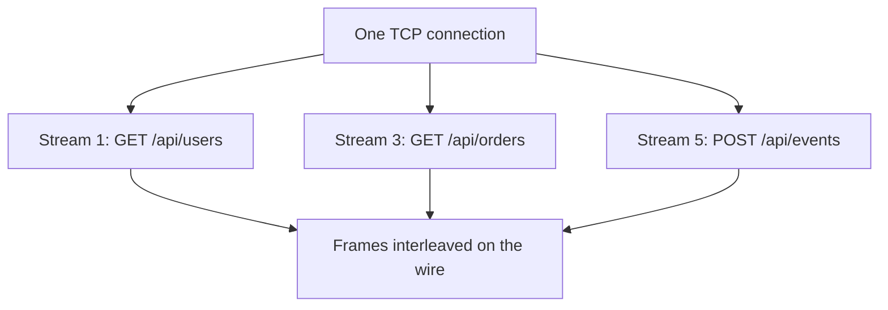

---
topic:
  - Networks
subtopic:
  - Protocols
summary: "Multiplexes many requests over one TCP connection, removing HTTP/1.1 head-of-line blocking."
level:
  - "3"
priority: Medium
status: Ready to Repeat
publish: true
qard-deck: "Networks"
qard-topic: "Protocols/HTTP 2"
flashcard_uid: "6284b907"
---

HTTP/2 carries many independent HTTP streams over one TCP connection. Its binary framing removes HTTP/1.1's response-order dependency and HPACK compresses repeated fields. TCP still delivers one ordered byte stream, so a lost segment can delay every HTTP/2 stream on that connection.

The current specification is RFC 9113, which supersedes the original RFC 7540. Methods, fields, and status semantics remain HTTP. Framing and connection behavior change.

[[HTTP]] covers the foundational HTTP concepts that HTTP/2 builds on.

# The HTTP/1.1 Bottleneck

Two HTTP/1.1 costs matter when a page or API opens many concurrent exchanges:

1. **Ordered responses on a connection:** without pipelining, a client waits for one response before sending the next request. Pipelining permits several outstanding requests, but responses must stay in request order, so a slow first response still blocks later ones. Browsers instead used several TCP connections per origin, which isolates some waiting at the cost of more connection state.

2. **Repeated fields:** HTTP/1.1 sends textual fields with each message. Cookies and other repeated metadata can outweigh a small payload.

# How HTTP/2 Works

**Binary framing layer**
HTTP/2 splits messages into typed binary frames. Each frame carries a stream ID, allowing one connection to interleave work from several exchanges.

**Multiplexing**
Multiple streams share a single TCP connection. Frames from different streams are interleaved, so stream 1's response frames can arrive between stream 3's request frames. Multiplexing removes HTTP/1.1's response-order dependency. Streams can still wait on flow-control credit, scheduling, server work, and TCP packet recovery.



**HPACK header compression**
Headers are compressed using a static table and a connection-specific dynamic table. Sensitive values such as `Authorization` credentials should be excluded from dynamic indexing according to the threat model. HPACK's never-indexed literal tells each intermediary not to add the field to its dynamic table and to preserve that treatment when re-encoding it. The field name can still use a static-table index, and the literal value's length remains observable. Never-indexed limits reuse through shared compression state rather than hiding all size information.

# Server Push and Prioritization Caveats

HTTP/2 still specifies server push: a server can send a promised request and response before the client asks. The mechanism was difficult to operate well because the server lacks the browser's complete cache state, pushed bytes compete with more urgent responses, and intermediaries handle push inconsistently. Chrome removed HTTP/2 push support, and other major browsers no longer make it a dependable web optimization. This is browser-product behavior, not an HTTP/3 deprecation of the concept. HTTP/3 also defines push.

Preload hints and ordinary cacheable responses are the more dependable choice for web delivery. They let the browser decide whether and when to fetch a resource.

The original HTTP/2 dependency tree allowed clients to express stream relationships and weights, but deployments implemented it inconsistently. RFC 9218 defines the simpler extensible-priority scheme using urgency and incremental delivery. A priority signal is advice, not a guarantee: the server, proxy, and congestion controller still decide scheduling. Relying on a priority signal for user-visible ordering requires testing the full path.

# How HTTP/2 Is Negotiated (ALPN)

For HTTPS, the TLS handshake negotiates HTTP/2 through ALPN. The `ClientHello` advertises protocol identifiers such as `h2` and `http/1.1`. The server selects one as part of the same handshake. Browsers use this TLS path for HTTP/2.

Cleartext HTTP/2 (`h2c`) is started with prior knowledge that the server supports it. RFC 9113 deprecates the older HTTP/1.1 `Upgrade: h2c` path, which was never widely deployed. Browsers do not expose cleartext HTTP/2 for ordinary web navigation. It appears mainly on controlled service hops, including some [[gRPC]] deployments behind a trusted ingress.

# HTTP/2 Vs HTTP/1.1

| Feature | HTTP/1.1 | HTTP/2 |
|---------|----------|--------|
| Connections per origin | Commonly several parallel connections | Commonly one multiplexed connection |
| Request multiplexing | No independent streams. Optional pipelining keeps responses ordered | Yes |
| Header format | Plain text, repeated in full | Binary, HPACK compressed |
| Server push | No | Yes (limited adoption) |
| Head-of-line blocking | Response ordering on a pipelined connection, plus TCP connection-wide loss recovery | TCP connection-wide loss recovery. Independent streams remove HTTP response ordering |
| TLS requirement | Optional | Required in practice (browsers enforce) |

# HTTP/2 In .NET

Kestrel supports HTTP/2 directly. A listener can offer HTTP/1.1 and HTTP/2 over TLS:

```csharp
builder.WebHost.ConfigureKestrel(options =>
{
    options.ListenAnyIP(443, listenOptions =>
    {
        listenOptions.UseHttps();
        listenOptions.Protocols = HttpProtocols.Http1AndHttp2;
    });
});
```

`HttpClient` still defaults requests to HTTP/1.1. The request version and policy state whether negotiation may move upward or fall back:

```csharp
var client = new HttpClient
{
    DefaultRequestVersion = HttpVersion.Version20,
    DefaultVersionPolicy = HttpVersionPolicy.RequestVersionOrHigher
};
```

# Pitfalls

**TCP head-of-line blocking remains**
HTTP/2 eliminates HTTP/1.1's ordered-response head-of-line blocking but not TCP-layer blocking. A single lost packet can delay data for all streams on the connection until TCP retransmits it. Under high packet loss, HTTP/2 can perform worse than HTTP/1.1 with multiple connections. HTTP/3 uses QUIC streams so loss on one request stream does not block unrelated request streams at the transport layer. Ordered delivery still blocks later bytes within the affected stream.

**One connection couples the congestion response across streams**
Each TCP connection has its own loss recovery and congestion window. A congestion response on HTTP/2's single connection reduces the sending rate for every stream on it. With several HTTP/1.1 connections, the same response slows only the affected connection. Connections that share a network path still share its congestion, and opening more connections can add to it.

**Server push cache invalidation**
Pushed resources may already be in the client's cache. The server has no way to know, so it wastes bandwidth pushing resources the client doesn't need. Most production deployments disable server push.

# HTTP/3 Boundary

HTTP/3 keeps HTTP semantics but replaces HTTP/2's framing-over-TCP with HTTP framing over QUIC. QUIC uses UDP datagrams while providing its own reliable streams, congestion control, connection IDs, and TLS 1.3 handshake.

- Loss on one QUIC stream does not block delivery on unrelated request streams. The affected stream still has ordered-delivery head-of-line blocking, and QPACK or control-stream dependencies can delay field decoding or connection progress.
- Connection IDs allow migration between network paths, such as Wi-Fi to cellular, without identifying the connection only by IP and port.
- TLS 1.3 is integrated into QUIC. There is no separate plaintext QUIC mode.
- UDP-blocking networks, middleboxes, observability tooling, CPU cost, and server/CDN support can force fallback to HTTP/2.
- HTTP/2 server push is not a reason to migrate: major browsers removed or disabled it, and HTTP/3 also has a push mechanism that applications should not assume is useful.

# Questions

> [!qard]- How does HTTP/2 differ from HTTP/1.1?
> HTTP/2 keeps HTTP's semantics but changes how messages travel on a connection. It replaces HTTP/1.1's text messages with binary frames, carries many concurrent exchanges as streams on one connection and compresses header fields.
> 
> | Aspect | HTTP/1.1 | HTTP/2 |
> |---|---|---|
> | Message format | Text messages sent one after another on the connection. | Binary frames, each tagged with a stream ID, so frames from different exchanges can be interleaved. |
> | Concurrency | Without pipelining, one request at a time per connection. Pipelining allows several outstanding requests, but responses must return in request order, so clients commonly open several connections to deliver responses independently. | Many concurrent streams on one connection, and responses need not follow request order, so a client normally needs only one connection per origin. |
> | Header fields | Sent as text in full with every message, so repeated fields such as cookies are resent each time. | Compressed with HPACK, so repeated fields cost fewer bytes. |
> | Semantics | Defined by HTTP's methods, status codes and fields. | Unchanged, so applications and APIs keep the same meaning for every request and response. |
> | Starting the protocol | Needs no negotiation and is the fallback when HTTP/2 is not agreed. | Negotiated: over TLS, both sides agree on `h2` through ALPN during the handshake. |
> 
> Both versions run over TCP, so packet loss on an HTTP/2 connection can still delay all of its streams until TCP recovers.
> 
> [RFC 9113: HTTP/2](https://www.rfc-editor.org/rfc/rfc9113.html) · [RFC 9112: HTTP/1.1](https://www.rfc-editor.org/rfc/rfc9112.html) · [RFC 9293: TCP](https://www.rfc-editor.org/rfc/rfc9293.html)

<!-- qard-id: 1da649be-c7a8-4dc7-b206-b9c15eb30f0a -->
> [!qard]- What does HTTP/2 multiplexing improve over HTTP/1.1, and what head-of-line blocking remains?
> HTTP/2 multiplexing removes HTTP/1.1's response-order head-of-line blocking: a slow response no longer has to finish before later responses on the same connection can be delivered. TCP-level head-of-line blocking remains, because all streams still share one ordered TCP byte stream.
> 
> - **What improves:** an HTTP/1.1 connection returns responses in request order. Without pipelining, the next request waits for the previous response. With pipelining, several requests can be outstanding, but a slow first response still delays the responses behind it. HTTP/2 splits requests and responses into frames tagged with a stream ID and interleaves frames from many streams on one connection, so responses no longer have to arrive in request order.
> - **What remains:** TCP delivers bytes to the receiving application strictly in order. When one TCP segment is lost, bytes that arrive after it are held back until the retransmission fills the gap, even if they belong to other streams. A lost packet can therefore stall every stream on the connection until TCP recovers.
> 
> HTTP/2 removes this ordering dependency, not every interaction between streams. Streams still share connection-level flow control, and each block of header fields must be sent as a contiguous run of frames, so one stream can still slow another.
> 
> [RFC 9113: HTTP/2](https://www.rfc-editor.org/rfc/rfc9113.html) · [RFC 9112: HTTP/1.1 pipelining](https://www.rfc-editor.org/rfc/rfc9112.html#section-9.3.2) · [RFC 9293: TCP](https://www.rfc-editor.org/rfc/rfc9293.html)

<!-- qard-id: 6555c13d-846f-48f2-9902-e58f6da8b8af -->
> [!qard]- When can HTTP/1.1 be necessary or perform better than HTTP/2?
> HTTP/1.1 is necessary when some hop on the path cannot negotiate HTTP/2. It can perform better on a lossy path, because with several HTTP/1.1 connections the delay caused by a lost packet stays on one connection. It is not generally faster, so the choice rests on measuring both versions on the real path.
> 
> - **Compatibility:** HTTP/2 is used on a hop only when both ends agree to it, for example through ALPN during the TLS handshake. If the client, server or intermediary at either end of a hop supports only HTTP/1.1, that hop uses HTTP/1.1.
> - **Loss isolation:** HTTP/2 normally carries all requests to an origin on one TCP connection, so one lost packet can delay every stream until TCP retransmits it. With several HTTP/1.1 connections, the same loss delays only the requests on the affected connection.
> - **Cost of extra connections:** pipelining lets one HTTP/1.1 connection carry several outstanding requests, but responses must return in request order. Delivering responses independently of each other therefore takes several connections. Each needs its own TCP setup, plus TLS setup when encrypted, and its own state on clients, servers and intermediaries. Connections that share a path also compete for its capacity, and opening more of them can add to congestion.
> 
> [RFC 9112: HTTP/1.1](https://www.rfc-editor.org/rfc/rfc9112.html) · [RFC 9113: HTTP/2](https://www.rfc-editor.org/rfc/rfc9113.html) · [RFC 9293: TCP](https://www.rfc-editor.org/rfc/rfc9293.html)

# References

- [HTTP/2](https://www.rfc-editor.org/rfc/rfc9113)
- [HPACK: Header Compression for HTTP/2](https://www.rfc-editor.org/rfc/rfc7541)
- [Extensible Prioritization Scheme for HTTP](https://www.rfc-editor.org/rfc/rfc9218)
- [HTTP/2 in ASP.NET Core](https://learn.microsoft.com/aspnet/core/fundamentals/servers/kestrel/http2)
