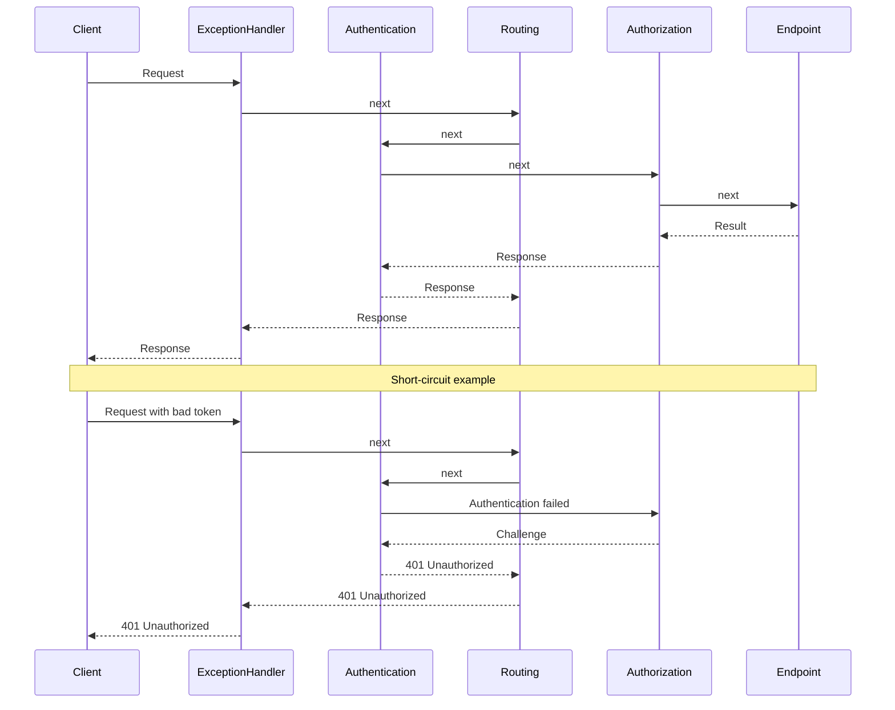

ASP.NET Core middleware forms an ordered chain around endpoint execution. Each component can inspect the inbound request, call the next delegate, and then observe the outbound response. This is the right boundary for behavior that spans many endpoint types, such as exception handling, request logging, CORS, or authentication.

Every component receives `HttpContext` and a delegate for the rest of the chain. Calling `next` passes control inward. Returning without it short-circuits the request. Authentication normally tries to establish `HttpContext.User` and continues. Authorization is the component that challenges or forbids access when endpoint policy requires it.



In the 401 branch, authentication records the failed credential and the pipeline reaches authorization. Authorization triggers the unauthenticated challenge, and the configured authentication handler produces the scheme-specific 401 response.

Registration order is control flow. The first component runs first for the request and last while the response unwinds. A common API pipeline looks like this, with environment-specific pieces such as HSTS enabled only where appropriate:

```csharp
app.UseExceptionHandler("/error");
app.UseHsts();
app.UseHttpsRedirection();
app.UseStaticFiles();
app.UseRouting();
app.UseCors();
app.UseAuthentication();
app.UseAuthorization();
app.MapControllers();
```

# Writing Custom Middleware

An inline lambda is enough for one local concern:

```csharp
app.Use(async (ctx, next) =>
{
    var sw = System.Diagnostics.Stopwatch.StartNew();
    try
    {
        await next(ctx);
    }
    finally
    {
        sw.Stop();
        app.Logger.LogInformation("{Method} {Path} -> {StatusCode} in {ElapsedMs} ms",
            ctx.Request.Method,
            ctx.Request.Path,
            ctx.Response.StatusCode,
            sw.ElapsedMilliseconds);
    }
});
```

A reusable conventional middleware class receives the next delegate through its constructor and exposes `Invoke` or `InvokeAsync`:

```csharp
public sealed class CorrelationIdMiddleware
{
    private readonly RequestDelegate _next;
    private readonly ILogger<CorrelationIdMiddleware> _logger;

    public CorrelationIdMiddleware(RequestDelegate next, ILogger<CorrelationIdMiddleware> logger)
    {
        _next = next;
        _logger = logger;
    }

    public async Task InvokeAsync(HttpContext context)
    {
        var correlationId = context.Request.Headers["X-Correlation-Id"].FirstOrDefault()
            ?? Guid.NewGuid().ToString("N");

        context.Response.Headers["X-Correlation-Id"] = correlationId;
        using (_logger.BeginScope(new Dictionary<string, object> { ["CorrelationId"] = correlationId }))
        {
            await _next(context);
        }
    }
}

// Registration
app.UseMiddleware<CorrelationIdMiddleware>();
```

> [!WARNING]
> **Conventional middleware is constructed once.** Constructor dependencies therefore need lifetimes compatible with the application-long instance. Scoped services belong in `InvokeAsync` parameters, where the framework resolves them from the current request scope. `IMiddleware` plus DI registration is the alternative when the middleware object itself needs a scoped or transient lifetime.

# Branching the Pipeline

The pipeline can branch as well as continue linearly:

- **`app.Map("/admin", branch => ...)`** and **`MapWhen(predicate, ...)`** select a terminal sub-pipeline by path or predicate.
- **`app.UseWhen(predicate, branch => ...)`** runs a conditional branch and then rejoins the main chain when that branch reaches its end.
- **`app.Run(handler)`** installs a terminal delegate that never calls `next`.

```csharp
app.UseWhen(
    ctx => ctx.Request.Path.StartsWithSegments("/api"),
    api => api.UseMiddleware<ApiKeyMiddleware>()); // only /api gets the API-key check
```

# Pitfalls

**Wrong registration order.** Authorization placed before authentication evaluates an anonymous principal. CORS placed after authorization may miss challenged preflights. The exact pipeline varies, but dependencies between components do not.

**Changing a started response.** Once `Response.HasStarted` is true, the status and headers may already be on the wire. Post-`next` code must check that state before attempting changes.

**Blocking I/O.** `Thread.Sleep` and synchronous database or file calls hold a thread-pool thread while the request waits. Middleware wrapping I/O should remain asynchronous through the whole call chain.

**Swallowing exceptions.** Logging and returning 200 converts a failure into a false success. An exception boundary should either rethrow or deliberately write the API's error contract.

**Reading endpoint metadata before routing.** `context.GetEndpoint()` is populated only after endpoint selection. Middleware that depends on authorization or custom endpoint metadata must run after routing and before endpoint execution.

# Tradeoffs

| Option | Best for | Weakness |
|---|---|---|
| Middleware | App-wide cross-cutting concerns (logging, auth, exception handling, CORS) | No direct controller action context. Coverage depends on registration order and branches; static-file middleware can short-circuit later components |
| Controller action filters | Concerns tied to Web API controllers/actions and model/action context | Their stages do not apply to Minimal API handlers |
| Endpoint filters | Minimal API handler behavior, or explicit attachment to mapped controller actions | Invocation context differs from controller model-state and action-result context |

Middleware fits a concern that belongs outside a particular endpoint model or must cover several request types. Filters fit logic that needs controller action context or endpoint-handler invocation context.

# Questions

<!-- qard-id: 044cb1c8-912a-42fc-82d3-f9e2167680f6 -->
> [!qard]- How does middleware differ from a controller action filter in ASP.NET Core?
> The difference is how close each one sits to the controller's action method. Middleware sits in the HTTP pipeline, outside the controllers, so it runs for every request that reaches it but knows only the raw request and response, which is why request logging and CORS live there. An action filter sits inside the controller part of the framework, directly around a Web API controller's action method, and runs after model binding has filled the action's parameters. The filter therefore runs only for controller actions but knows the action's arguments and `ModelState`, and can read or replace the action result before it is written to the response.
>
> So the two are not interchangeable. A filter never runs for a request that no controller handles, and middleware is given only `HttpContext`, so it never sees the action's arguments, `ModelState` or the action result.
>
> [Microsoft: Filters in ASP.NET Core](https://learn.microsoft.com/en-us/aspnet/core/mvc/controllers/filters?view=aspnetcore-10.0) · [Microsoft: ASP.NET Core middleware](https://learn.microsoft.com/en-us/aspnet/core/fundamentals/middleware/?view=aspnetcore-10.0)

<!-- qard-id: 8d463f18-1072-4f4b-b785-c13f213e9fc9 -->
> [!qard]- How can exceptions be handled globally in ASP.NET Core?
> Unhandled exceptions can be caught in one place for the whole application, by a middleware registered first in the pipeline. An exception from any later component or the endpoint travels back to that middleware, which logs the exception and returns one consistent error response, so endpoints do not handle errors themselves.
>
> The ways to do it:
>
> - **`UseExceptionHandler`:** the built-in middleware, usually with `AddProblemDetails()` for a standard error body.
> - **`IExceptionHandler`:** a class that the built-in middleware calls to map specific exceptions to responses.
> - **Custom middleware:** a hand-written `try`/`catch` around `await next(context)`, which gives full control over the response.
> - **Exception filters:** they catch exceptions only from controller actions, so they are not truly global.
>
> [Microsoft: Handle errors in ASP.NET Core](https://learn.microsoft.com/en-us/aspnet/core/fundamentals/error-handling?view=aspnetcore-10.0)

<!-- qard-id: b38ff0ad-a54f-4c82-ba97-6f472c68d084 -->
> [!qard]- How does a request move through the ASP.NET Core middleware pipeline?
> A request goes through the middleware components one by one, in the order they were registered, until it reaches the endpoint, which produces the response. The response then goes back through the same components in the opposite order, so the component registered first sees the request first and the response last.
>
> Each component gets a `next` delegate and the same `HttpContext` object, which holds both the request and the response for that one request. Calling `next` runs everything registered after the component, so code written before the call runs while the request is going in, and code written after the call runs while the response is coming back.
>
> ```csharp
> app.Use(async (context, next) =>
> {
>     // 1. first on the way in
>     await next(context);
>     // 5. last on the way out
> });
>
> app.Use(async (context, next) =>
> {
>     // 2. second on the way in
>     await next(context);
>     // 4. first on the way out
> });
>
> app.MapGet("/", () => "Hello"); // 3. the endpoint produces the response
> ```
>
> A component can also stop the request by writing the response itself and not calling `next`, for example by setting status 401 when the API key is missing. The components after it and the endpoint then never run, and the response goes back through only the components registered before it. This is called short-circuiting the pipeline.
>
> [Microsoft: ASP.NET Core middleware](https://learn.microsoft.com/en-us/aspnet/core/fundamentals/middleware/?view=aspnetcore-10.0)

# References

- [Middleware in ASP.NET Core](https://learn.microsoft.com/en-us/aspnet/core/fundamentals/middleware/)
