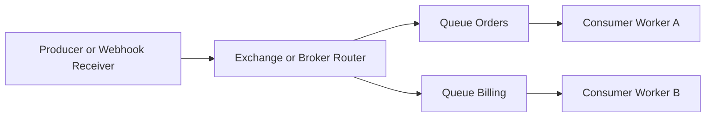

---
topic:
  - Software Architecture
subtopic:
  - Distributed Systems
summary: "Message queues decouple producers from consumers by buffering messages until consumers are ready, absorbing spikes and isolating failures."
tags: [FolderNote]
publish: true
priority: High
level:
  - "2"
status: Done
qard-deck: "Software Architecture"
qard-topic: "Distributed Systems/Message Queues/Message Queues"
flashcard_uid: "15a348c0"
---

Message queues decouple producers from consumers by buffering messages until consumers are ready. They absorb spikes, isolate failures, and keep systems working when downstream services slow. Queues suit webhook ingestion and background work.

```datacorejsx
const { FolderStructureMap } = await dc.require("Assets/components/devbook-folder-map.jsx");
return FolderStructureMap;
```

# Core Concepts

- **Queue vs Topic**
- `Queue` (point-to-point): one message is consumed by one worker in a competing-consumer group.
- `Topic` (pub/sub): one event is consumed by multiple independent subscriber groups.
- Terminology varies: RabbitMQ uses exchanges, Kafka uses topics/partitions, and Service Bus uses subscriptions.



- **Delivery guarantees**
- `At-most-once`: possible loss, no redelivery.
- `At-least-once`: an unacknowledged delivery is retried, so duplicates are expected.
- A bounded retry policy may terminate in an owned DLQ. Retention or TTL expiry is a separate loss boundary, not part of the at-least-once guarantee.
- `Effectively-once` for one side effect is usually `at-least-once + idempotency + transactional boundary`.
- End-to-end exactly-once across external systems is generally not realistic.

- **Ordering and partitioning**
- Ordering is usually per partition/queue shard, not global.
- More partitions improve throughput but weaken global order guarantees.
- If per-entity ordering matters (for example `OrderId`), a stable key routes all of that entity's events to one partition.
- Retries/redelivery and competing consumers can reorder events.
- Kafka rebalances can cause duplicate processing when offsets were not committed. Out-of-order effects usually come from multi-partition reads or concurrent handlers.

# Reliability Patterns

- **DLQ for poison messages**
- A DLQ fits when messages repeatedly fail and block healthy traffic.
- Broker specifics: Service Bus uses `MaxDeliveryCount`. RabbitMQ uses DLX + TTL/retry queues. Kafka has no broker DLQ and uses an app dead-letter topic.
- A DLQ is operated as a first-class system: alerts, replay tooling, retention ownership.

- **Retry with backoff**
- Transient failures are retried with exponential backoff + jitter.
- If the broker supports delayed delivery, broker-managed delay is preferable. Otherwise retry queues/topics provide the delay.

- **Idempotency keys**
- A durable idempotency key (`MessageId` or business key) is persisted.
- Check-then-act races, so the key is reserved or upserted atomically (unique index or transactional insert) before side effects are applied.
- The business write and idempotency completion commit in one database transaction. Broker ack/offset commit follows after success.

- **Ack modes and offset commits**
- Auto-ack favors throughput but risks loss on mid-processing crashes.
- Manual ack after successful side effects favors correctness.
- RabbitMQ `nack`/requeue and Service Bus `Abandon` cause retry/redelivery. Dead-lettering is separate.
- Kafka uses offset commits instead of ack/nack: the offset is committed after processing, and idempotency provides duplicate safety.
- Lock or visibility expiration can also trigger redelivery, so long handlers need lock renewal/extension.

- **Backpressure**
- Prefetch/QoS limits in-flight work.
- Queue depth, lag, and oldest-message age are tracked to avoid memory and latency collapse.

# .NET Worker Implementation

A worker acknowledges only after the business effect or an owned quarantine record is durable:

```csharp
public sealed class InvoiceWorker(
    IQueueConsumer consumer,
    IInvoiceHandler handler,
    IDeadLetterPublisher deadLetters) : BackgroundService
{
    protected override async Task ExecuteAsync(
        CancellationToken stoppingToken)
    {
        await foreach (var delivery in consumer.ReadAllAsync(stoppingToken))
        {
            try
            {
                await handler.HandleAsync(
                    delivery.Message,
                    stoppingToken);
                await delivery.AckAsync(stoppingToken);
            }
            catch (InvalidMessageException error)
            {
                await deadLetters.PublishAsync(
                    delivery,
                    error.Code,
                    stoppingToken);
                await delivery.AckAsync(stoppingToken);
            }
            catch (TransientDependencyException)
            {
                await delivery.RetryAsync(stoppingToken);
            }
        }
    }
}
```

`HandleAsync` should reserve a unique message or business-operation key in the same transaction as its state change. A crash after that commit but before `AckAsync` then produces a harmless redelivery. Dead-letter or quarantine publication must succeed before the original delivery is acknowledged.

Concurrency is bounded by downstream capacity, intake stops during shutdown, and monitoring tracks oldest-message age, in-flight count, handler latency, retries, dead-letter rate, and idempotency conflicts. A short queue can still be unhealthy when one old message never completes.
# .NET Platform Choices

[[Home/Software Architecture/Distributed Systems/Message Queues/RabbitMQ]] fits routing-heavy queues and latency-sensitive tasks. [[Home/Software Architecture/Distributed Systems/Message Queues/Kafka]] fits replayable event streams. Azure Service Bus fits managed messaging with queues/topics and dead-lettering.

| Option | Strengths | Tradeoffs | Typical .NET fit |
|---|---|---|---|
| [[Home/Software Architecture/Distributed Systems/Message Queues/RabbitMQ]] | Rich routing, easy work queues, low latency | Cluster operations remain the team's responsibility unless managed | Background jobs, webhook pipelines, command dispatch |
| [[Home/Software Architecture/Distributed Systems/Message Queues/Kafka]] | High throughput, durable log, strong replay | Partition model and ops complexity | Event streaming, analytics, event sourcing feeds |
| Azure Service Bus | Fully managed with enterprise messaging features | Cost and platform coupling | Azure-native workflows and integration |

- `IDistributedCache` is not a queue.
- Cache stores key-value state. Queues store ordered work items/events with ack/retry semantics.

# Delivery Attempts, Processing Effects, and Idempotency

Broker guarantees describe delivery attempts at a boundary. They do not automatically guarantee business effects. An at-least-once broker may redeliver after a consumer commits `ChargeCustomer` but crashes before acknowledgement. The second attempt is correct broker behavior and a dangerous duplicate unless the charge operation uses a stable idempotency key.

| Broker behavior | Consumer sequence | Result |
|---|---|---|
| At-most-once | Acknowledge, then process | A crash can lose work |
| At-least-once | Process, then acknowledge | A crash can repeat work |
| Transactional broker scope | Atomically consume and publish inside one broker | External database or HTTP effects remain outside that transaction |

For `InvoicePaid { EventId = 91, InvoiceId = 42 }`, the consumer reserves `EventId=91` with a unique constraint in the same database transaction that marks invoice 42 paid. A redelivery then observes the completed reservation and acknowledges without applying the transition twice. This produces one durable effect even though delivery was attempted more than once.

# Messaging Patterns

Ownership and fan-out determine the pattern, not broker terminology:

- **Competing consumers:** several workers share one logical subscription. Each message is handled by one worker. It suits scaling work such as image processing.
- **Publish/subscribe:** each subscription receives the event independently. It fits when `OrderPlaced` drives billing, email, and analytics.
- **Request/reply:** a request carries a correlation ID and a reply address. It fits only when asynchronous transport is required but the caller still needs a response. It preserves temporal coupling.
- **Priority queue:** urgent work is selected first. Lower-priority work needs protection from starvation, and not every broker offers strict priority.
- **Dead-letter channel:** terminally failed messages leave the hot path with failure metadata and an owned replay process.
- **Claim check:** a large payload is stored in object storage, and its identifier, checksum, and authorization context travel through the broker.

Patterns combine. A video upload can publish a claim-check message to a competing-consumer queue, then emit `VideoProcessed` to multiple subscribers.

# Choosing a Broker

![[Software Architecture/Software Architecture-Message Queues-18120000.png|theme-aware]]

The choice follows replay, routing, ordering, delivery, retention, managed-service, and operating requirements rather than popularity.

| Need | [[Home/Software Architecture/Distributed Systems/Message Queues/RabbitMQ]] classic/quorum queues | [[Home/Software Architecture/Distributed Systems/Message Queues/Kafka]] |
| --- | --- | --- |
| Work distribution | Strong fit with acknowledgements and exchanges | Possible through consumer groups, but retained-log semantics dominate |
| Replay | Consumed messages normally leave the queue. Replay needs republishing or a retained design | Native offset replay within retention |
| Routing | Exchanges, bindings, topics, and headers | Topic and partition selection |
| Ordering | Per queue, affected by redelivery and competing consumers | Per partition |
| Operations | Queue depth, unacked messages, redelivery, node health | Partitions, replication, rebalances, lag, retention |

## RabbitMQ Streams

RabbitMQ Streams adds a replicated append-only log with non-destructive consumers and offset/timestamp replay. A super stream partitions traffic and preserves order only within each partition. Streams fit when RabbitMQ is already the operational center and the workload needs large fan-out, replay, or large backlogs. Kafka fits when retained logs, partitioned consumer groups, and its ecosystem are the primary model.

RabbitMQ classic or quorum queues fit `GenerateInvoice` jobs that need acknowledgements and flexible routing. Kafka fits `OrderPlaced` events consumed by billing, fraud, analytics, and replayable projections.

Managed services such as Azure Service Bus, Amazon SQS/SNS, and Google Pub/Sub are often better when the team does not want to operate brokers. Their exact ordering, deduplication, dead-letter, size, retention, and throughput contracts need direct comparison rather than an assumption of open-source semantics.

# Pitfalls

## Assuming Global Order

Most brokers guarantee order only within a partition, and retries, prefetch, or competing consumers can still reorder effects. When an entity's transitions must stay ordered, its events are partitioned by the entity key, concurrency for that key is limited, and the consumer discards already-applied duplicates and, for full-state events, superseded versions, but does not skip a missing earlier change.

## Retrying a Poison Message Forever

A message that always fails can consume worker capacity and starve healthy traffic. Retries are bounded, the failure moves to a dead-letter path, its owner is alerted, and enough metadata is kept to replay it after repair.

## Applying an At-least-once Effect Twice

Redelivery is expected after an acknowledgement is lost. A charge, email, or external call therefore needs a stable idempotency key reserved atomically with the local state change.

## Letting Backlog Age Go Unseen

Queue depth alone hides whether one old message is stuck or fresh traffic is arriving faster than consumers can drain it. Oldest-message age, in-flight work, redelivery, and consumer throughput show when backpressure or added capacity is needed before memory or latency limits fail.

# Questions

> [!qard]- What is the difference between at-most-once, at-least-once and exactly-once message delivery?
> The three guarantees describe what a failure can do to a message within a stated boundary, such as a consumer reading from a broker. At-most-once never redelivers, so a message can be lost but never repeated. At-least-once redelivers until progress is recorded, so no message is lost but one can be processed more than once. Exactly-once means each message's result is committed once, with neither loss nor duplication. It holds only inside a boundary that commits the result together with the consumer's progress. Delivery attempts can still repeat after a failure, but only one durable outcome survives.
> 
> | Guarantee | Consumer sequence | After a crash |
> |---|---|---|
> | At-most-once | The consumer records its progress, by acknowledging or saving its position, and then processes the message. | A crash after recording progress loses the message, because it is not delivered again. |
> | At-least-once | The consumer processes the message, then records its progress. | A crash before progress is recorded causes redelivery, so the work can happen twice. |
> | Exactly-once | The result and the consumer's progress commit atomically. Examples are output topics and consumer offsets committed in one Kafka transaction and read with `read_committed` isolation, or a database write committed in the same transaction as the message's offset or ID. | Either both commit or neither does. An aborted attempt leaves no visible result and is retried. After a restart, the consumer resumes from the committed position or recognizes an already recorded ID, so the result is not applied twice. |
> 
> The guarantee covers only what that atomic commit includes. Kafka transactions make consuming and producing between Kafka topics exactly-once only when the output and the consumer offsets commit in one transaction and downstream consumers are configured with `read_committed`. The default `read_uncommitted` setting can expose records from aborted transactions. A database write, email or HTTP call outside the transaction is not covered. Such a side effect needs the external system's cooperation, typically an idempotency key or the message position recorded atomically with the local state change. End-to-end exactly-once across arbitrary external systems is therefore generally not available. Retry limits that move a message to a dead-letter queue, and retention or TTL expiry, are separate limits outside these guarantees.
> 
> [Apache Kafka: Message delivery semantics](https://kafka.apache.org/41/design/design/#message-delivery-semantics)

<!-- qard-id: 01ecda04-9e78-4b1a-b6af-f99dc23aad40 -->
> [!qard]- How do Kafka, RabbitMQ classic or quorum queues, and RabbitMQ Streams differ in workload fit, ordering and operational factors?
> RabbitMQ classic or quorum queues fit work items that are processed and then removed. Kafka fits high-throughput event streams that are retained so many independent consumers can read and replay them, when its partitioned log and ecosystem are central to the design. RabbitMQ Streams provide similar log-style replay and fan-out for systems that already run RabbitMQ. None of the three orders messages globally: order holds only within one queue, partition or stream partition. Operating cost and the team's experience with each platform also shape the choice.
> 
> | Aspect | RabbitMQ classic/quorum queues | Kafka | RabbitMQ Streams |
> |---|---|---|---|
> | After consumption | An acknowledged message leaves the queue, so the queue holds only pending work. Quorum queues replicate their contents across nodes for data safety. | Events stay in a partitioned log for the retention period. Each consumer group tracks its own position in that log. | Messages stay in a replicated append-only log. Consumers read them without removing them. |
> | Replay | Not built in. Reprocessing needs republishing or a copy kept elsewhere. | A consumer can move its offset back within retention and process events again. | A consumer can start reading from an offset or a timestamp. |
> | Ordering boundary | One queue. Redelivery and competing consumers can still change processing order. | One partition, not the whole topic. | One stream. A super stream preserves order only within each partition. |
> | Operations | Health is watched through queue depth, unacknowledged messages, redelivery and node health. | Partitions, replication, consumer rebalances, consumer lag and retention all need planning and monitoring. | Streams are a RabbitMQ feature, so a team that already operates RabbitMQ gains log-style consumption without running a second broker platform. |
> | Typical workload | Latency-sensitive commands and background jobs such as `GenerateInvoice`, with acknowledgements, retries and flexible routing through exchanges. | High-throughput events such as `OrderPlaced`, consumed independently by billing, analytics and rebuildable projections. | Large fan-out, replay or large backlogs in a system that already operates RabbitMQ. |
> 
> [Apache Kafka: Introduction](https://kafka.apache.org/documentation/#introduction) · [RabbitMQ: Quorum Queues](https://www.rabbitmq.com/docs/quorum-queues) · [RabbitMQ: Streams](https://www.rabbitmq.com/docs/streams) · [RabbitMQ: Super Streams](https://www.rabbitmq.com/docs/streams#super-streams)

> [!qard]- How can a message-based system keep one entity's events in order?
> Most brokers order messages only within one partition or queue, not across a whole topic. One entity's events therefore stay in order only under three conditions: they all travel through the same partition, they are processed one at a time for that entity, and the consumer applies them by a per-entity sequence rather than by arrival.
> 
> 1. **Route by a stable key:** the producer sends every event for the entity with the same key, such as `OrderId`. In Kafka, events with the same key go to the same partition, and consumers read each partition in the order it was written.
> 2. **Process each key sequentially:** concurrent handlers for one partition, or competing consumers sharing one RabbitMQ queue, can finish an entity's events in a different order than they arrived.
> 3. **Apply by version or sequence number:** retries, redelivery and prefetch can still deliver an event twice or late. The consumer stores the last version it applied for the entity and compares each arriving event with it:
>    - **At or below the applied version:** a duplicate whose change is already in place, so it is acknowledged and skipped.
>    - **The next version:** applied, and the stored version advances.
>    - **Further ahead:** an earlier change has not arrived yet. Applying this event now would build on missing state, and discarding the earlier one when it arrives would lose its change. The consumer holds or retries the later event, or recovers the gap from the source, until the missing event is applied.
> 
> The rule differs when each event carries the entity's complete state rather than a change. A newer snapshot then supersedes every older one, so it can be applied across a gap, and a late older snapshot can be discarded without losing anything.
> 
> Adding partitions increases parallelism but creates no order between partitions. RabbitMQ super streams follow the same rule and preserve order only within each partition.
> 
> [Apache Kafka: Introduction](https://kafka.apache.org/documentation/#introduction) · [RabbitMQ: Super Streams](https://www.rabbitmq.com/docs/streams#super-streams) · [Microsoft: Event Sourcing pattern](https://learn.microsoft.com/en-us/azure/architecture/patterns/event-sourcing)

# References

- [Messaging technology choices](https://learn.microsoft.com/en-us/azure/architecture/guide/technology-choices/messaging)
- [Enterprise Integration Patterns](https://www.enterpriseintegrationpatterns.com/patterns/messaging/)
