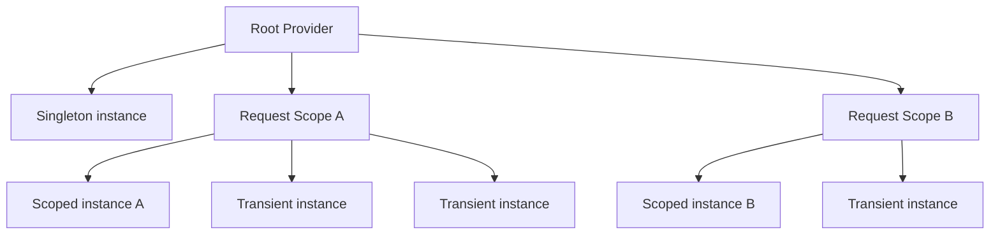

Dependency Injection (DI) moves object construction to a composition boundary. A class declares the services it needs, and something outside the class supplies them. This is a practical form of Inversion of Control (IoC): business code describes the collaboration while the application decides which implementations participate. The result is explicit dependencies and components that can be replaced without rewriting their consumers.

DI does not require a container. The composition root is the application startup boundary, typically `Program.cs` in .NET, where object graphs are assembled. It may connect objects directly with constructors and factories or delegate that work to a container. ASP.NET Core uses its built-in container at this boundary. [[Home/Programming/NET/ASP NET Web API/Dependency Injection|ASP.NET Core Dependency Injection]] covers the framework-specific mechanics.

# How It Works
The container has three jobs: record registrations, build object graphs, and release the instances it owns.

## 1) Registration (`builder.Services.Add*`)

Registration says which implementation satisfies a service type and how long its instances live.

```csharp
var builder = WebApplication.CreateBuilder(args);

// Registration
builder.Services.AddScoped<IOrderRepository, SqlOrderRepository>();
builder.Services.AddSingleton<IClock, SystemClock>();
builder.Services.AddTransient<IEmailSender, SmtpEmailSender>();
```

Each call adds a service descriptor containing the service type, its implementation, and its lifetime. Registration usually records a recipe. It does not create the service yet.

## 2) Resolution (Constructor Injection, `[FromServices]`, `IServiceProvider`)

Resolution follows constructor dependencies recursively and builds the required object graph.

```csharp
public class OrderService(IOrderRepository repo, IClock clock)
{
    public async Task<Order> PlaceOrder(CreateOrderDto dto)
    {
        var order = new Order(dto.CustomerId, clock.UtcNow);
        await repo.SaveAsync(order);
        return order;
    }
}
```

```csharp
app.MapGet("/time", ([FromServices] IClock clock) => Results.Ok(clock.UtcNow));
```

Constructor injection fits business logic because the constructor exposes every required collaborator. `[FromServices]` is useful at framework boundaries such as endpoint handlers. Direct `IServiceProvider` access belongs in factories, middleware, or infrastructure code that manages scopes. Application and domain services should keep their dependencies visible.

## 3) Disposal

The container disposes the `IDisposable` and `IAsyncDisposable` instances it creates at their lifetime boundary:

- `Transient`: disposed when the owning scope is disposed (if container-created)
- `Scoped`: disposed when the scope ends (request end in ASP.NET Core)
- `Singleton`: disposed when host/root provider shuts down

An injected service is not owned by its consumer, so a controller or application service should not dispose it.

# Service Lifetimes (Mechanics + Usage)

## Transient

`AddTransient<TService, TImpl>()`: new instance every resolution.

Good fits include:

- Lightweight stateless services
- Pure mappers/formatters/strategies without cross-request state

The important mechanics are simple:

- Every resolve call gets a fresh instance.
- A transient captured by a singleton constructor remains attached to that singleton and effectively gains the singleton's lifetime.

## Scoped

`AddScoped<TService, TImpl>()`: one instance per scope.

Good fits include:

- `DbContext`
- Unit-of-work/request-consistent operations

Within a web application:

- ASP.NET Core creates one scope per HTTP request.
- All scoped resolutions in the same request share the same object.
- Background services have no request scope, so scoped work needs an explicit scope.

## Singleton

`AddSingleton<TService, TImpl>()`: one instance for app lifetime.

Good fits include:

- Thread-safe caches
- Configuration/time abstractions
- `IHttpClientFactory` (factory is singleton)

The lifetime changes the design constraints:

- The root provider owns the instance and shares it across requests.
- Concurrent callers require thread-safe behavior.
- Capturing a scoped dependency breaks the shorter lifetime.

# Lifetime Scope Diagram



The root provider owns the singleton. Each request scope gets its own scoped instance, while transient services are created on demand.

# Captive Dependency (Critical Pitfall)

Captive dependency occurs when a long-lived service, usually a singleton, stores a shorter-lived service such as a scoped dependency.

That capture breaks the shorter lifetime's guarantees:

- Request state can cross its intended boundary.
- A shared `DbContext` may expose stale tracking state to concurrent work.
- Cleanup moves from the end of the scope to the end of the longer lifetime.

ASP.NET Core's default Development configuration enables scope validation, which rejects a scoped service resolved from the root provider or injected into a singleton with `InvalidOperationException`.

## Anti-pattern: Singleton Directly Depends on Scoped Service

```csharp
public sealed class CacheWarmupService(AppDbContext db) : IHostedService
{
    public async Task StartAsync(CancellationToken cancellationToken)
    {
        // BAD: hosted service is singleton, AppDbContext is scoped
        var count = await db.Orders.CountAsync(cancellationToken);
    }

    public Task StopAsync(CancellationToken cancellationToken) => Task.CompletedTask;
}
```

## Fix: Resolve the Scoped Service inside an Explicit Scope

```csharp
public sealed class CacheWarmupService(IServiceScopeFactory scopeFactory) : IHostedService
{
    public async Task StartAsync(CancellationToken cancellationToken)
    {
        await using var scope = scopeFactory.CreateAsyncScope();
        var db = scope.ServiceProvider.GetRequiredService<AppDbContext>();
        var count = await db.Orders.CountAsync(cancellationToken);
    }

    public Task StopAsync(CancellationToken cancellationToken) => Task.CompletedTask;
}
```

# Service Locator Anti-pattern

Service Locator replaces declared dependencies with runtime lookups from `IServiceProvider` (`GetService<T>()` or `GetRequiredService<T>()`).

Inside business logic, this causes three concrete problems:

- The constructor no longer describes what the class needs.
- Missing registrations fail during execution rather than when the object graph is checked.
- Unit tests must reproduce container setup instead of passing collaborators directly.

```csharp
public sealed class CheckoutService(IServiceProvider provider)
{
    public async Task ProcessAsync()
    {
        var repo = provider.GetRequiredService<IOrderRepository>();
        var sender = provider.GetRequiredService<IEmailSender>();
        await repo.SaveChangesAsync();
        await sender.SendAsync("done");
    }
}
```

Application and business services should declare their collaborators in constructors.

Runtime lookup still has a narrow place:

- Factory patterns choosing implementation at runtime
- Middleware/infrastructure activation code
- Explicit scope management in background jobs

# Keyed Services (.NET 8+)

Keyed services register several implementations of one abstraction under distinct keys. The key makes the selection explicit at the resolution boundary.

```csharp
builder.Services.AddKeyedScoped<ICache, RedisCache>("redis");
builder.Services.AddKeyedScoped<ICache, MemoryCacheAdapter>("memory");

app.MapGet("/cache/ping", ([FromKeyedServices("redis")] ICache cache) =>
{
    return Results.Ok(new { cache = cache.GetType().Name, status = "ok" });
});
```

Keys work well when the set of choices is small and stable. Once domain code starts branching on strings and resolving services itself, the design has slipped back toward Service Locator.

# Pitfalls

## 1) Registering `DbContext` as Singleton

`DbContext` is a short-lived unit of work and is not thread-safe. A singleton registration shares its change tracker across concurrent operations and delays cleanup. The default scoped registration from `AddDbContext<TContext>()` should be kept. Workers should create a scope per operation.

## 2) Circular Dependencies (`A -> B -> A`)

The container cannot construct a graph in which `A` requires `B` and `B` requires `A`. The cycle usually exposes a confused responsibility boundary. It can be broken by moving the shared work to one side or by replacing the direct callback with a message.

# Tradeoffs

- **Built-in or external container:** the built-in container covers the normal lifetime and constructor-injection model with no extra operational surface. An external container earns its place only when a required feature is missing.
- **Constructor injection or runtime resolution:** constructor injection keeps dependencies visible and makes tests ordinary object construction. Method injection (`[FromServices]`) fits endpoint boundaries, while locator-style resolution stays in infrastructure.

# Questions

> [!qard]- What is dependency injection, and what problem does it solve?
> Dependency injection (DI) means a class receives the objects it depends on from outside, usually through its constructor, instead of creating them itself. It is a form of Inversion of Control: the class declares what it needs, and the application decides which implementations to supply.
>
> Without DI, a class that calls `new SmtpEmailSender()` is tied to that implementation. Replacing it requires editing the class, the class must also know how to build the sender's own dependencies, and a unit test cannot substitute a fake.
>
> With DI:
>
> 1. The class depends on an abstraction, such as `IEmailSender`, and lists it as a constructor parameter.
> 2. At the composition root, typically `Program.cs`, the application chooses the implementation, either by constructing the object graph directly or by registering it in a container.
> 3. When a container is used, it builds the class's dependencies recursively and manages their lifetime and disposal.
> 
> The result is explicit dependencies, implementations that can change without editing their consumers, and tests that pass collaborators directly. DI does not require a container; a container automates wiring and lifetime management.
>
> [.NET dependency injection overview](https://learn.microsoft.com/en-us/dotnet/core/extensions/dependency-injection/overview)

<!-- qard-id: ddb3e38c-cabb-4743-ac37-f7414aa541dd -->
> [!qard]- What do the `Transient`, `Scoped`, and `Singleton` service lifetimes mean in .NET dependency injection, and what is a typical use for each?
> The lifetime controls how often the container creates a service and which consumers share an instance: `Transient` creates one per resolution, `Scoped` shares one within a scope, and `Singleton` shares one across the whole application.
>
> | Lifetime | Instances and sharing | Disposal of container-created instances | Typical use |
> |---|---|---|---|
> | `Transient` | A new instance every time the service is resolved, even twice within the same scope. | When the scope that resolved it ends. | Lightweight stateless services, such as a mapper or formatter. |
> | `Scoped` | One instance per scope, shared by everything resolved in that scope. ASP.NET Core creates a scope for each HTTP request. | When the scope ends, such as at the end of the request. | Per-request or unit-of-work state, such as an EF Core `DbContext`, which `AddDbContext` registers as scoped by default. |
> | `Singleton` | One instance shared by every scope and every concurrent caller until the root provider is disposed. | When the root provider is disposed at application shutdown. | Services that are safe for concurrent use, such as a clock abstraction or a thread-safe, size-bounded cache. |
>
> The uses are typical fits, not guarantees from the container: a singleton is safe only if its implementation is thread-safe.
>
> Lifetimes also interact when one service holds another:
>
> - **Singleton holding a scoped service:** a lifetime violation, because the scoped instance would outlive its scope.
> - **Longer-lived service holding a transient:** valid, but the captured instance lives as long as the service that holds it. It must suit that effective lifetime: thread-safe if a singleton's concurrent callers use it, and acceptable to dispose only when that longer lifetime ends.
> 
> [.NET: service lifetimes](https://learn.microsoft.com/en-us/dotnet/core/extensions/dependency-injection/service-lifetimes) · [.NET DI guidelines: thread safety](https://learn.microsoft.com/en-us/dotnet/core/extensions/dependency-injection/guidelines#thread-safety)

<!-- qard-id: 023bd48a-3a64-4c74-a852-7f2cc4f897af -->
> [!qard]- What is a captive dependency, and how can it be fixed?
> A captive dependency occurs when a longer-lived service holds a shorter-lived one, so the shorter-lived instance stays in use beyond its intended lifetime. The typical case is a singleton, such as a hosted service, that receives a scoped `DbContext` through its constructor.
>
> **Consequences:**
>
> - Request- or operation-specific state carries over into later, unrelated work.
> - A scoped service that is not designed for concurrent use, such as `DbContext`, can be shared by concurrent operations and expose stale tracked state.
> - Cleanup moves from the end of the scope to the end of the longer lifetime.
> 
> **Fix:** the long-lived service depends on `IServiceScopeFactory` instead of the scoped service. For each unit of work, it creates a scope, resolves the scoped service from that scope, uses it and disposes the scope. A worker that processes independent items creates a new scope per item rather than one scope for its whole lifetime.
>
> ```csharp
> await using var scope = scopeFactory.CreateAsyncScope();
> var db = scope.ServiceProvider.GetRequiredService<AppDbContext>();
> await ProcessItemAsync(db, item, cancellationToken);
> ```
>
> **Detection:** when the host is built in the Development environment, scope validation rejects a scoped service injected into a singleton or resolved from the root provider. It does not catch every lifetime mistake. A transient captured by a singleton, for example, also lives as long as the singleton, and its transient registration does not make it thread-safe when concurrent callers share it.
>
> [.NET: use scoped services within a BackgroundService](https://learn.microsoft.com/en-us/dotnet/core/extensions/scoped-service) · [.NET DI guidelines](https://learn.microsoft.com/en-us/dotnet/core/extensions/dependency-injection/guidelines) · [.NET service lifetimes](https://learn.microsoft.com/en-us/dotnet/core/extensions/dependency-injection/service-lifetimes) · [.NET dependency injection overview](https://learn.microsoft.com/en-us/dotnet/core/extensions/dependency-injection/overview)

> [!qard]- Why is Service Locator considered an anti-pattern in business code?
> Service Locator hides a class's dependencies. Instead of declaring them in its constructor, the class asks a container such as `IServiceProvider` for them at runtime with `GetService<T>()` or `GetRequiredService<T>()`. In business code, this causes three problems:
>
> - **Hidden requirements:** the constructor no longer shows what the class needs, so its dependencies are discovered only by reading the implementation.
> - **Late failures:** a missing registration fails when that code path runs, not when the object graph is built or validated.
> - **Harder tests:** a unit test must configure a container or fake provider instead of passing collaborators to the constructor.
> 
> ```csharp
> public sealed class CheckoutService(IServiceProvider provider)
> {
>     public Task ProcessAsync() =>
>         provider.GetRequiredService<IOrderRepository>().SaveChangesAsync();
> }
> ```
>
> Runtime lookup still has a narrow place in infrastructure: factories that choose an implementation at runtime, middleware or framework activation code, and background services that create explicit scopes. Application and domain services declare their collaborators in their constructors instead.
>
> [.NET DI guidelines](https://learn.microsoft.com/en-us/dotnet/core/extensions/dependency-injection/guidelines) · [[Home/Software Architecture/Patterns/Dependency Injection#Service Locator Anti-pattern|Service Locator anti-pattern]]

# References

- [Dependency injection in .NET](https://learn.microsoft.com/en-us/dotnet/core/extensions/dependency-injection)
