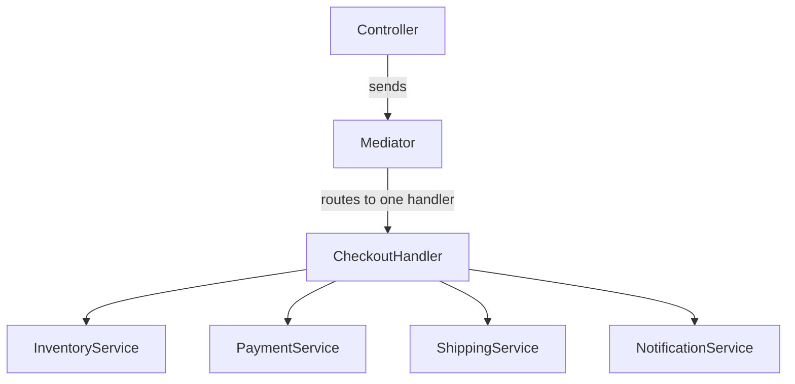

Air traffic control is a useful Mediator analogy. Pilots coordinate through the tower instead of maintaining direct conversations with every aircraft nearby. A new plane joins one coordination system rather than a web of peer relationships.

The classic Mediator pattern places interaction rules behind one coordination boundary. Colleague objects notify the mediator, which decides which other colleagues should react. This turns a many-to-many dependency graph into hub-and-spoke coordination.

MediatR uses the same decoupling direction for request dispatch, but it is a narrower mechanism: `IMediator.Send(command)` resolves one handler, and that handler owns the workflow. It does not coordinate a set of peer colleagues by itself.



# Problem

`CheckoutController` coordinates four services directly. That makes the transport layer the owner of the checkout workflow:

```csharp
[ApiController]
public class CheckoutController(
    IInventoryService inventory,
    IPaymentService payment,
    IShippingService shipping,
    INotificationService notification) : ControllerBase
{
    // ⚠️ Controller knows about all services and their coordination
    [HttpPost]
    public async Task<IActionResult> CheckoutAsync(CheckoutRequest request)
    {
        if (!await inventory.CheckStockAsync(request.Items))
            return BadRequest("Out of stock");

        var paymentResult = await payment.ChargeAsync(request.Total, request.PaymentMethod);
        if (!paymentResult.Success) return BadRequest("Payment failed");

        var shipment = await shipping.CreateLabelAsync(request.Items, request.Address);
        await notification.SendConfirmationAsync(request.CustomerId, shipment.TrackingNumber);

        return Ok(new { shipment.TrackingNumber });
    }
    // ⚠️ Adding analytics tracking requires editing this controller
    // ⚠️ Mobile API controller duplicates the same coordination logic
}
```

Fraud detection must then be added to every transport that copied this sequence. The workflow has no single owner.

# Solution

The controller sends `CheckoutCommand`. One handler owns the service coordination:

```csharp
// Command — data only, no behavior
public record CheckoutCommand(
    Guid CustomerId,
    IReadOnlyList<OrderItem> Items,
    Address ShippingAddress,
    PaymentMethod PaymentMethod) : IRequest<CheckoutResult>;

public record CheckoutResult(string TrackingNumber);

// Handler — knows how to process the command
public class CheckoutCommandHandler(
    IInventoryService inventory,
    IPaymentService payment,
    IShippingService shipping,
    INotificationService notification) : IRequestHandler<CheckoutCommand, CheckoutResult>
{
    public async Task<CheckoutResult> Handle(CheckoutCommand cmd, CancellationToken ct)
    {
        // ✅ Coordination logic in one place — all callers use the same handler
        if (!await inventory.CheckStockAsync(cmd.Items))
            throw new OutOfStockException();

        var paymentResult = await payment.ChargeAsync(cmd.Items.Sum(i => i.Total), cmd.PaymentMethod);
        if (!paymentResult.Success)
            throw new PaymentFailedException(paymentResult.Reason);

        var shipment = await shipping.CreateLabelAsync(cmd.Items, cmd.ShippingAddress);
        await notification.SendConfirmationAsync(cmd.CustomerId, shipment.TrackingNumber);

        return new CheckoutResult(shipment.TrackingNumber);
    }
}

// ✅ Controller has one dependency — IMediator
[ApiController]
public class CheckoutController(IMediator mediator) : ControllerBase
{
    [HttpPost]
    public async Task<IActionResult> CheckoutAsync(CheckoutRequest request)
    {
        try
        {
            var result = await mediator.Send(new CheckoutCommand(
                request.CustomerId, request.Items, request.Address, request.PaymentMethod));
            return Ok(result);
        }
        catch (OutOfStockException) { return BadRequest("Out of stock"); }
        catch (PaymentFailedException ex) { return BadRequest(ex.Message); }
    }
}

// DI registration
builder.Services.AddMediatR(cfg => cfg.RegisterServicesFromAssembly(typeof(Program).Assembly));
```

Cross-cutting fraud screening can sit in a pipeline behavior shared by every relevant command. The controller stays an adapter.

# In-Process Dispatch and Message Routing

**MediatR `IMediator`** is request dispatch related to Mediator. It routes `Send(command)` to one registered `IRequestHandler<TCommand, TResult>`, while pipeline behaviors wrap that dispatch with shared policies. The handler, not MediatR, coordinates its dependencies.

**SignalR `IHubContext<T>`** is a related decoupled broadcaster. A sender targets a client group without holding individual connection references, but the hub context does not encode colleague interaction rules.

**MassTransit / NServiceBus** provide related message routing. Producers address contracts and the bus resolves consumers. This is brokered dispatch rather than the classic object-level pattern.

# Tradeoffs

**Classic Mediator fits when** peer dependencies have become tangled and their interaction rules need one owner. MediatR fits a separate command/handler problem when several transports need the same dispatch boundary or shared pipeline behaviors justify the indirection.

**It is a poor fit when** a direct call already expresses the relationship. Routing every two-class interaction through MediatR makes the execution path harder to find. The mediator also fails when it becomes a god object instead of dispatching to focused handlers.

**Related patterns.** MediatR's `Send` routes one request to one handler. An **[[Home/Software Architecture/Patterns/Event Bus]]** or **[[Home/Software Architecture/Patterns/Design Patterns/Behavioral/Observer]]** fans one event out to many subscribers. A **[[Home/Software Architecture/Patterns/Design Patterns/Structural/Facade]]** exposes a simpler subsystem API without coordinating peers.

# Questions

> [!qard]- What is the Mediator pattern, and how does MediatR's request dispatch differ from it?
> The Mediator pattern moves the rules for how a group of objects interact into one mediator object. The participants, called colleagues, notify the mediator instead of calling each other, and the mediator decides which other colleagues react. A many-to-many web of dependencies becomes hub-and-spoke coordination, so a colleague can be changed or added without the others knowing about it. Air traffic control is the usual analogy: pilots coordinate through the tower rather than with every nearby aircraft.
>
> MediatR follows the same decoupling direction but solves a narrower problem:
>
> | Aspect | Classic Mediator | MediatR `Send` |
> |---|---|---|
> | What it connects | A set of peer colleagues that react to one another. | One sender and the single handler registered for a request type. |
> | Where interaction rules live | In the mediator, which knows the colleagues and coordinates them. | In the handler. MediatR only locates and invokes it, with pipeline behaviors around the call. |
> | What stops depending on what | Colleagues stop referring to each other. | The sender stops referring to the handler and the services it uses. |
>
> A MediatR handler that calls several services coordinates them itself; MediatR does not coordinate peers on its behalf.
>
> [GoF: Design Patterns](https://www.oreilly.com/library/view/design-patterns-elements/0201633612/) · [[Home/Software Architecture/Patterns/Design Patterns/Behavioral/Mediator#In-Process Dispatch and Message Routing|Mediator: MediatR dispatch]]

<!-- qard-id: 9213f8d0-8fbd-499c-910e-e820fc7509f7 -->
> [!qard]- What are the signs that a mediator is adding indirection without reducing coupling?
> A mediator adds only indirection when it routes calls without providing a useful shared boundary: no common dispatch for several callers, no cross-cutting policy and no real coordination between participants. Typical signs:
>
> - **Callers still know the participants:** senders still reference concrete handlers or the services behind them, so the mediator removed no dependency.
> - **Coordination is still duplicated:** several callers repeat the same sequence around their mediator calls instead of one place owning it.
> - **Fixed two-party calls go through it:** a request has one caller, one handler and no shared behavior, so the route only makes the execution path harder to find.
> - **The mediator becomes a god object:** one central mediator or handler accumulates unrelated rules instead of dispatching to focused handlers.
> 
> Moving a workflow into a handler can decouple the caller from the services it uses, but the workflow itself is no simpler. Direct calls fit simple, stable interactions. The indirection pays off when several transports share an operation or when pipeline behaviors apply shared policies.
>
> [[Home/Software Architecture/Patterns/Design Patterns/Behavioral/Mediator#Tradeoffs|Mediator: tradeoffs]] · [[Home/Software Architecture/Patterns/Design Patterns/Behavioral/Mediator#Problem|Mediator: duplicated coordination]]

<!-- qard-id: 6810a433-655b-49d5-b427-e57a278149ba -->
> [!qard]- How do MediatR pipeline behaviors implement the Chain of Responsibility pattern?
> Pipeline behaviors form a chain of wrappers that ends at the request handler. Each `IPipelineBehavior<TRequest, TResponse>` receives the request and a `next` delegate for the rest of the chain, and decides whether to pass the request on.
>
> 1. `Send` nests the behaviors registered for the request type around the handler.
> 2. The outermost behavior runs its code before `next`, such as logging or validating the request.
> 3. Calling `next` invokes the following behavior, and the innermost `next` invokes the handler.
> 4. As calls return, each behavior can run code after `next`, such as recording elapsed time or adjusting the response.
> 5. A behavior can short-circuit by returning a response or throwing without calling `next`, as a caching behavior does when it returns a stored result. Later behaviors and the handler then never run.
> 
> Registration order determines the nesting, so it changes what happens. A logging behavior outside a validation behavior records rejected requests; inside it, rejected requests never reach the logger. Order that matters for correctness should be explicit and covered by tests rather than left to incidental registration order.
>
> [MediatR: behaviors](https://github.com/LuckyPennySoftware/MediatR/wiki/Behaviors)

# References

- [Mediator pattern](https://refactoring.guru/design-patterns/mediator)
- [MediatR — GitHub](https://github.com/jbogard/MediatR)
