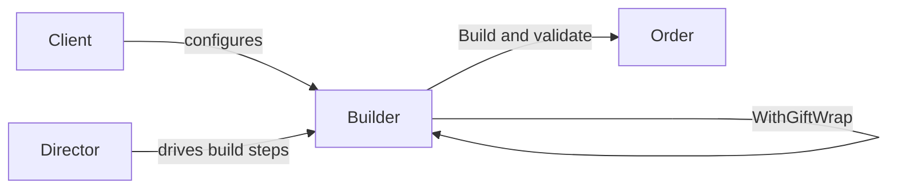

A complex object often cannot be created sensibly in one constructor call. Some inputs are optional, others interact, and derived values should never be supplied by callers.

Builder gives that construction process a temporary home. Its methods collect intent through named operations, and `Build()` checks the complete configuration before creating the product. Fluent chaining is common, but it is syntax rather than the pattern's purpose. A builder is justified when construction has real sequencing, derivation, or cross-field invariants. For a simple data object, `required` members and `init` setters are smaller and provide more compile-time help.



# Problem

`OrderService.CreateOrder()` takes a growing parameter list. Every new requirement adds another parameter:

```csharp
public class OrderService
{
    // ⚠️ 12-parameter constructor — callers must know the correct order
    public Order CreateOrder(
        Customer customer,
        List<OrderItem> items,
        Address shippingAddress,
        Address? billingAddress,      // ⚠️ null means "same as shipping" — implicit convention
        string? discountCode,
        bool giftWrap,
        string? giftMessage,
        DateTime? requestedDeliveryDate,
        string shippingCarrier,
        bool signatureRequired,
        string? specialInstructions,
        bool isBusinessOrder)
    {
        // ⚠️ Validation scattered — which combinations are invalid?
        if (giftWrap && string.IsNullOrEmpty(giftMessage))
            throw new ArgumentException("Gift wrap requires a message");
        if (requestedDeliveryDate.HasValue && requestedDeliveryDate < DateTime.UtcNow.AddDays(1))
            throw new ArgumentException("Delivery date must be at least tomorrow");

        var order = new Order
        {
            Id = Guid.NewGuid(),
            Customer = customer,
            Items = items,
            // ⚠️ Computed fields mixed with assignment — easy to miss one
            Total = items.Sum(i => i.UnitPrice * i.Quantity),
            ShippingAddress = shippingAddress,
            BillingAddress = billingAddress ?? shippingAddress,
            // ... 8 more assignments
        };
        return order;
    }
}

// ⚠️ Call site — what does 'true, null, false, true' mean?
var order = orderService.CreateOrder(customer, items, shipping, null, "SAVE10",
    true, "Happy Birthday!", null, "FedEx", false, null, false);
```

A priority-shipping flag would extend an already opaque call and can force unrelated callers to pass another placeholder value.

# Solution

`OrderBuilder` accumulates configuration through named methods and validates on `Build()`:

```csharp
public class Order
{
    public Guid Id { get; init; }
    public Customer Customer { get; init; } = null!;
    public IReadOnlyList<OrderItem> Items { get; init; } = [];
    public decimal Subtotal { get; init; }
    public decimal DiscountAmount { get; init; }
    public decimal Total { get; init; }
    public Address ShippingAddress { get; init; } = null!;
    public Address BillingAddress { get; init; } = null!;
    public ShippingOptions Shipping { get; init; } = null!;
    public GiftOptions? Gift { get; init; }
    public string? SpecialInstructions { get; init; }
    public bool IsBusinessOrder { get; init; }
}

public class OrderBuilder(Customer customer)
{
    private readonly List<OrderItem> _items = [];
    private Address? _shippingAddress;
    private Address? _billingAddress;
    private string? _discountCode;
    private GiftOptions? _gift;
    private ShippingOptions _shipping = ShippingOptions.Standard;
    private string? _specialInstructions;
    private bool _isBusinessOrder;

    public OrderBuilder AddItem(Product product, int quantity)
    {
        if (quantity <= 0) throw new ArgumentOutOfRangeException(nameof(quantity));
        _items.Add(new OrderItem(product.Id, quantity, product.Price));
        return this; // ✅ fluent — enables chaining
    }

    public OrderBuilder ShipTo(Address address)
    {
        _shippingAddress = address;
        return this;
    }

    public OrderBuilder BillTo(Address address)
    {
        _billingAddress = address;
        return this;
    }

    public OrderBuilder WithDiscount(string code)
    {
        _discountCode = code;
        return this;
    }

    public OrderBuilder WithGiftWrap(string message) // ✅ gift wrap and message are one concept
    {
        _gift = new GiftOptions(message);
        return this;
    }

    public OrderBuilder WithShipping(ShippingOptions options)
    {
        _shipping = options;
        return this;
    }

    public OrderBuilder WithSpecialInstructions(string instructions)
    {
        _specialInstructions = string.IsNullOrWhiteSpace(instructions)
            ? null
            : instructions.Trim();
        return this;
    }

    public OrderBuilder AsBusinessOrder()
    {
        _isBusinessOrder = true;
        return this;
    }

    public Order Build()
    {
        // ✅ All validation in one place
        if (_shippingAddress is null)
            throw new InvalidOperationException("Shipping address is required");
        if (_items.Count == 0)
            throw new InvalidOperationException("Order must contain at least one item");
        if (_shipping.RequestedDeliveryDate.HasValue &&
            _shipping.RequestedDeliveryDate < DateTime.UtcNow.AddDays(1))
            throw new InvalidOperationException("Delivery date must be at least tomorrow");

        var subtotal = _items.Sum(i => i.UnitPrice * i.Quantity);
        var discount = _discountCode is not null ? CalculateDiscount(subtotal, _discountCode) : 0m;

        return new Order
        {
            Id = Guid.NewGuid(),
            Customer = customer,
            Items = _items.ToArray(), // snapshot; later builder changes cannot mutate this order
            Subtotal = subtotal,
            DiscountAmount = discount,
            Total = subtotal - discount,                    // ✅ computed field, not caller's responsibility
            ShippingAddress = _shippingAddress,
            BillingAddress = _billingAddress ?? _shippingAddress, // ✅ default logic encapsulated
            Shipping = _shipping,
            Gift = _gift,
            SpecialInstructions = _specialInstructions,
            IsBusinessOrder = _isBusinessOrder
        };
    }

    private static decimal CalculateDiscount(decimal subtotal, string code) =>
        code == "SAVE10" ? subtotal * 0.10m : 0m;
}

// ✅ Call site is self-documenting
var order = new OrderBuilder(customer)
    .AddItem(laptop, 1)
    .AddItem(mouse, 2)
    .ShipTo(shippingAddress)
    .WithDiscount("SAVE10")
    .WithGiftWrap("Happy Birthday!")
    .WithShipping(ShippingOptions.Express)
    .Build();
```

Priority shipping can become a named builder operation without changing callers that use the default. The builder still has to reject combinations that the final `Order` cannot represent safely.

# Framework examples

**`WebApplicationBuilder` and `IHostBuilder`** collect services, configuration sources, and hosting options before `Build()` creates the host. `Program.cs` may coordinate those steps, though it is ordinary composition code rather than necessarily a formal Director.

**`StringBuilder`** accumulates mutable text and materializes a string with `ToString()`. It is useful for repeated or conditional assembly. Small interpolated strings remain clearer and may be optimized adequately by the compiler.

**`IQueryable<T>` chains** accumulate an expression tree before a terminal operation executes it. This resembles staged construction, but the result is query execution rather than a classic built product.

**`UriBuilder`** exposes named URI components and produces a `Uri`, avoiding manual delimiter assembly.

# Pitfalls

**Simple products.** A builder is unnecessary when it only mirrors independent assignments, because an object initializer already expresses them. `required` members fit when presence is the main invariant.

**Leaked mutable state.** Returning the builder's internal collection lets later builder changes mutate an already built product. The built product needs its own copy of each mutable collection, because `AsReadOnly()` is only a wrapper over the same underlying list, not a snapshot.

**Partial validation.** Local argument checks can run in individual methods, but cross-field invariants need the complete state available at `Build()`. The product should not emerge invalid merely because one construction path forgot a check.

# Tradeoffs

| Concern | Builder | Object initializer (`required`/`init`) | Telescoping constructors |
|---|---|---|---|
| Required field enforcement | Runtime for inputs checked only in `Build()`; compile-time for inputs taken by the builder's own constructor, such as `customer` in `new OrderBuilder(customer)` | Compile-time (`required` keyword) | Compile-time |
| Optional parameters | Named methods, self-documenting | Named properties, self-documenting | Combinatorial explosion |
| Validation | Centralized in `Build()` | Must use custom setter or factory | Can be centralized in one constructor; scattered when overloads validate separately |
| Computed fields | Encapsulated in `Build()` | Caller-supplied unless a setter, factory or other construction boundary computes them | Can be computed in the constructor |
| Fluent chaining | Optional; common when step methods return the builder | No | No |
| Complexity | High | Low | Medium |

A constructor or object initializer is the default. Builder earns a separate type when `Build()` performs meaningful work across several inputs or when a reusable construction sequence needs a stable API.

# Questions

<!-- qard-id: 7ef0df00-358b-46be-9bed-4de8aff6ce01 -->
> [!qard]- When is a Builder worth using instead of a constructor?
> A Builder is worth its extra type when constructing the object is a process rather than one call. This holds when inputs arrive through several steps, often with many of them optional, or when the finished object needs validation or derived values that depend on the complete set of inputs. A constructor, or an object initializer with `required` members, stays clearer when the values fit in one readable call and the constructor or initializer can enforce the same invariants.
>
> What a Builder adds over a long constructor:
>
> - **Named steps instead of positional arguments:** calls such as `ShipTo(address)` and `WithGiftWrap(message)` replace a parameter list whose call site reads like `true, null, false`. A new option becomes another named method instead of another placeholder argument for every caller.
> - **Cross-field validation in one place:** `Build()` sees the whole configuration. A rule such as requiring a shipping address and at least one item is therefore checked once, before the object exists.
> - **Derived values and defaults:** `Build()` computes values such as the order total and applies defaults. One example is using the shipping address for billing when no billing address was given. Callers no longer have to do this themselves.
> 
> The costs are an extra type that mirrors the product's API and, for any required input that is checked only in `Build()`, runtime rather than compile-time enforcement of its presence, which `required` members provide. Mandatory inputs taken through the builder's own constructor, such as the customer in `new OrderBuilder(customer)`, must still be passed when the builder is created. A builder around independent property assignments only duplicates an object initializer.
>
> [[Home/Software Architecture/Patterns/Design Patterns/Creational/Builder#Tradeoffs|Builder tradeoffs]] · [[Home/Software Architecture/Patterns/Design Patterns/Creational/Builder#Solution|Builder implementation]] · [Microsoft: required modifier (C# reference)](https://learn.microsoft.com/en-us/dotnet/csharp/language-reference/keywords/required)

<!-- qard-id: a219c123-c1e0-4eae-96fc-228367900e40 -->
> [!qard]- Why does `WebApplicationBuilder` use a builder instead of a constructor with parameters?
> An ASP.NET Core application is configured by many independent setup steps, not by one fixed set of arguments. `WebApplicationBuilder` collects that setup in stages, and `Build()` creates the `WebApplication` only after everything has been contributed.
>
> How the stages work:
>
> 1. `WebApplication.CreateBuilder(args)` creates the builder with preconfigured defaults, such as the standard configuration sources.
> 2. Setup code adds to the builder's properties:
>    - configuration through `builder.Configuration`
>    - service registrations through `builder.Services`, including registrations contributed by library extension methods
>    - host and web-server settings through `builder.Host` and `builder.WebHost`
> 3. `builder.Build()` creates the `WebApplication` from the accumulated configuration and registrations.
> 
> A constructor with parameters would require callers to assemble the complete set of services and settings before a single call. That set is open-ended, because the application and its libraries both contribute to it. The builder therefore gives every contributor a shared place to add its part before anything is assembled. Staging also lets later setup steps read earlier results, such as configuration values that decide which services to register. A constructor is still used at the end: in ASP.NET Core 10, `Build()` builds the underlying host and passes it to the `WebApplication` constructor.
>
> [Microsoft: WebApplicationBuilder class](https://learn.microsoft.com/en-us/dotnet/api/microsoft.aspnetcore.builder.webapplicationbuilder?view=aspnetcore-10.0) · [Microsoft: Configuration in ASP.NET Core](https://learn.microsoft.com/en-us/aspnet/core/fundamentals/configuration/?view=aspnetcore-10.0) · [Microsoft: .NET dependency injection](https://learn.microsoft.com/en-us/dotnet/core/extensions/dependency-injection/overview) · [ASP.NET Core 10: WebApplicationBuilder source](https://github.com/dotnet/aspnetcore/blob/v10.0.0/src/DefaultBuilder/src/WebApplicationBuilder.cs)

# References

- [Builder pattern](https://refactoring.guru/design-patterns/builder)
- [WebApplicationBuilder — .NET's primary Builder in production use](https://learn.microsoft.com/en-us/dotnet/api/microsoft.aspnetcore.builder.webapplicationbuilder)
- [StringBuilder — the original .NET Builder for string construction](https://learn.microsoft.com/en-us/dotnet/api/system.text.stringbuilder)
- [Required members (C# reference) — modern C# alternative for simple object construction](https://learn.microsoft.com/en-us/dotnet/csharp/language-reference/keywords/required)
