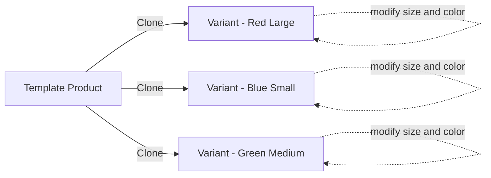

Prototype creates an object from an existing instance. It fits when construction starts from a configured template or when the concrete runtime type must decide how to copy itself.

The copy contract matters more than the `Clone` method. A shallow copy creates a new outer object but shares referenced objects. A deep copy duplicates the mutable parts that must vary independently. C# records and `with` expressions make shallow copies concise. Explicit copy constructors are clearer when selected members need deeper copying. `ICloneable` is a weak public contract because it does not state which semantics callers receive.



# Problem

Manual property assignment makes each copy site responsible for tracking the entire type:

```csharp
public class ProductService
{
    public Product CreateVariant(Product baseProduct, string size, string color, decimal priceAdjustment)
    {
        // ⚠️ Manual property copy — adding a new field to Product means updating this method
        var variant = new Product
        {
            Id = Guid.NewGuid(),
            Name = baseProduct.Name,
            Sku = $"{baseProduct.Sku}-{size}-{color}",
            Price = baseProduct.Price + priceAdjustment,
            Category = baseProduct.Category,
            // ⚠️ Shallow copy of Tags — mutating variant.Tags mutates baseProduct.Tags
            Tags = baseProduct.Tags,
            // ⚠️ Forgot to copy Description — variant has null description
            // Description = baseProduct.Description,  <-- missed!
            Variants = new List<ProductVariant>() // ⚠️ intentionally empty? or forgot to copy?
        };
        return variant;
    }
}
```

Adding `ShippingConstraints` now requires finding every manual copy site. A missed assignment produces a valid-looking object with incomplete state, while shared mutable members can make two variants change each other.

# Solution

A `with` expression makes a shallow record copy and sets only the members its initializer names, so the initializer must explicitly override every member that needs fresh identity or independent mutable state. An explicit copy constructor fits when those rules should be visible in one place.

```csharp
// Modern approach: record with {} — the idiomatic C# Prototype
public record Product
{
    public Guid Id { get; init; }
    public string Name { get; init; } = "";
    public string Sku { get; init; } = "";
    public decimal Price { get; init; }
    public string Description { get; init; } = "";
    public ProductCategory Category { get; init; } = null!;
    public IReadOnlyList<string> Tags { get; init; } = [];
    public ShippingConstraints Shipping { get; init; } = ShippingConstraints.Default;
}

public class ProductService
{
    public Product CreateVariant(Product baseProduct, string size, string color, decimal priceAdjustment)
    {
        // ✅ 'with' expression copies all fields, then overrides only what changes
        // Adding a new field to Product automatically includes it — no manual update needed
        return baseProduct with
        {
            Id = Guid.NewGuid(),                                    // ✅ new identity
            Sku = $"{baseProduct.Sku}-{size}-{color}",             // ✅ variant-specific
            Price = baseProduct.Price + priceAdjustment,           // ✅ adjusted price
            Tags = [..baseProduct.Tags, $"size:{size}", $"color:{color}"] // ✅ new list, not shared reference
        };
        // All other fields (Name, Description, Category, Shipping) are copied automatically
    }
}

// Classical approach: explicit copy constructor for classes (when record isn't appropriate)
public class Order
{
    public Guid Id { get; set; }
    public Customer Customer { get; set; } = null!;
    public List<OrderItem> Items { get; set; } = [];
    public Address ShippingAddress { get; set; } = null!;
    public decimal Total { get; set; }

    // ✅ Copy constructor — explicit about what gets deep-copied
    public Order(Order source)
    {
        Id = Guid.NewGuid();                                    // new identity
        Customer = source.Customer;                             // shallow — Customer is shared
        Items = source.Items.Select(i => new OrderItem(i)).ToList(); // ✅ deep copy items
        ShippingAddress = new Address(source.ShippingAddress);  // ✅ deep copy address
        Total = source.Total;
    }

    // Factory method using the copy constructor
    public Order Clone() => new(this);
}

// Usage: create a draft order from a template
var templateOrder = orderRepository.GetTemplate("B2B_STANDARD");
var draftOrder = templateOrder.Clone();
draftOrder.Customer = currentCustomer;
```

New record fields participate in the compiler-generated copy automatically. Referenced objects are still shared unless the initializer replaces them. The example replaces `Tags` for that reason.

# .NET Forms

**`record with {}`** creates a modified shallow copy. It works well for value-like models whose referenced members are immutable or replaced explicitly.

**Copy constructors or named copy methods** can state exactly which members remain shared and which are duplicated. They are usually the clearest choice for mutable object graphs.

**`MemberwiseClone()`** performs the outer shallow copy used by many classical implementations. A protected primitive is safer than promising unspecified semantics through `ICloneable`.

# Pitfalls

**Shared mutable references.** `with` does not recursively copy a list, array, or child entity. `IReadOnlyList<T>` restricts the exposed API but does not prove that the underlying collection is immutable. A safe copy replaces such mutable members or holds them in an immutable collection.

**Ambiguous identity.** A cloned entity usually needs a new identifier, while shared value objects may keep their values. Copying persistence identifiers, event subscriptions, locks, or caches can create two objects that claim to be the same entity or share runtime-only state.

**Stale explicit copy logic.** Copy constructors must be reviewed when the source type gains a member. That cost is acceptable when the alternative is an implicit deep-copy policy nobody can see.

# Questions

<!-- qard-id: 39dce427-e0c5-4393-9c82-0bdbd4a467c2 -->
> [!qard]- When is Prototype useful instead of constructing an object directly?
> Prototype is useful when a new object should start as a copy of an existing instance rather than be built from scratch. Two situations justify it:
>
> - **A configured template exists:** many objects differ from a base in only a few values. Product variants, for example, share the base product's name, description, category and shipping rules. Copying the template and overriding the differences avoids manual copy code that lists every member, which silently produces incomplete objects when a newly added member is missed.
> - **The caller does not know the concrete runtime type:** code that holds an object through a base type cannot call the right constructor, but the object knows its own type and can copy itself through its own copy method.
> 
> Direct construction is clearer when the type and the values are already known and no template carries useful state.
>
> A prototype still needs a defined copy contract:
>
> - which members stay shared
> - which are duplicated
> - which get fresh values, such as a new identifier
> 
> In C#, `record with { }` makes a shallow copy with selected members replaced, and an explicit copy constructor states deeper copy rules.
>
> [[Home/Software Architecture/Patterns/Design Patterns/Creational/Prototype#Solution|Prototype solution]] · [[Home/Software Architecture/Patterns/Design Patterns/Creational/Prototype#Pitfalls|Prototype pitfalls]] · [Microsoft: Records (C# reference)](https://learn.microsoft.com/en-us/dotnet/csharp/language-reference/builtin-types/record)

<!-- qard-id: ceccd6bd-3ed8-4f4d-80fa-9b805e5ee7a9 -->
> [!qard]- What separates a shallow copy from a deep copy, and which nested objects must a deep copy duplicate?
> A shallow copy creates a new outer object, but its reference-type fields still point to the same nested objects as the original. A deep copy also duplicates nested objects, so changing them through the copy does not affect the original. A practical deep copy duplicates the mutable nested state that must evolve independently, not everything reachable.
>
> | Aspect | Shallow copy | Deep copy |
> |---|---|---|
> | Outer object | A new instance. | A new instance. |
> | Value-type fields | Copied bit by bit. | Copied. |
> | Reference-type fields | Only the reference is copied, so both objects share the same nested instance. | Members covered by the copy policy get new instances. |
> | Adding an item to a nested `List<T>` | The change is visible through both objects. | Only the object that was changed sees it. |
> | .NET mechanisms | `Object.MemberwiseClone()` and `record with { }`. | A copy constructor or copy method that duplicates chosen members. |
>
> Where the boundary goes:
>
> - **Duplicated:** mutable state that the copy owns and changes independently, such as an order's line items and its shipping address.
> - **Shared:** immutable objects, such as immutable collections, because neither copy can change them.
> - **Shared deliberately:** objects that are meant to be common, such as the `Customer` an order refers to.
> - **Left out or reset:** runtime-only state such as event subscriptions, locks and caches. A cloned entity usually also needs a new identifier.
> 
> A member typed as `IReadOnlyList<T>` only limits the exposed API. The underlying list may still be mutable and shared.
>
> [Microsoft: Object.MemberwiseClone](https://learn.microsoft.com/en-us/dotnet/api/system.object.memberwiseclone?view=net-10.0) · [Microsoft: Records (C# reference)](https://learn.microsoft.com/en-us/dotnet/csharp/language-reference/builtin-types/record) · [[Home/Software Architecture/Patterns/Design Patterns/Creational/Prototype#Pitfalls|Prototype pitfalls]]

# References

- [Prototype pattern](https://refactoring.guru/design-patterns/prototype)
- [Records (C# reference) — `record with {}` as the modern C# Prototype](https://learn.microsoft.com/en-us/dotnet/csharp/language-reference/builtin-types/record)
- [Object.MemberwiseClone — classical shallow copy mechanism](https://learn.microsoft.com/en-us/dotnet/api/system.object.memberwiseclone)
