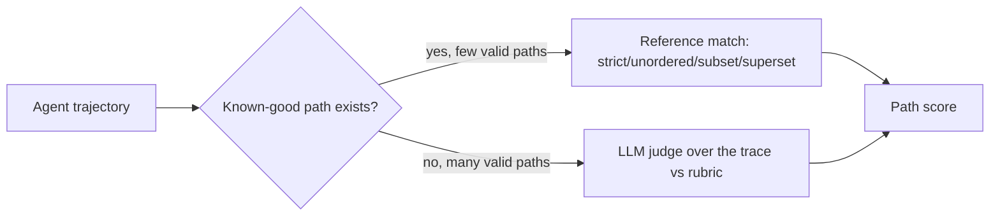

Trajectory evaluation scores the path from task to result: tool calls, observations, and intermediate decisions in order. Outcome scoring cannot distinguish a four-step solve from a lucky recovery after six wrong calls. [[Tool-Call Evaluation|tool-call scoring]] can flag individual mistakes, but it does not explain whether the sequence as a whole was sensible.

Two scorer families cover that gap. Reference matching compares the trace with a known-good path. A trace judge reads the transcript against a rubric. The second approach reuses [[LLM-as-a-Judge]] machinery, but feeds it agent decisions instead of a final answer.

# Reference-trajectory Match

A reference path records the calls a correct solve should contain. The comparison mode defines how much variation remains valid:

- **Strict** requires the same tools, arguments, and order. It fits a task with one valid procedure.
- **Unordered** requires the same calls but ignores order. It fits independent reads.
- **Subset** requires every agent call to belong to the allowed reference set (`agent ⊆ reference`). It is useful for safety boundaries, such as proving a read-only task never invoked a write tool.
- **Superset** requires every reference step to appear in the trace (`agent ⊇ reference`) while allowing exploration. It confirms that required calls appear in the recorded trajectory.

Reference matching is cheap and objective once the paths exist. Its coverage is narrow. An unanticipated but correct solution fails, while a bloated superset trace passes as long as the required calls appear somewhere.

# LLM-as-judge over the Trace

When many paths can work, a judge can score the transcript against a rubric covering plan quality, tool choice, wasted work, and recovery. This captures reasoning that no fixed path can enumerate. It costs a model call per trajectory.



# Step-level Vs Episode-level

Episode-level scoring assigns one verdict to the run. It is cheap enough for a release gate, but a failure only says the path was bad.

Step-level scoring asks whether each next action made sense given the state at that point. It localizes the first bad decision and the recovery that followed. The price is one judgment per step plus enough running context to judge it. A practical setup gates every run at episode level, then expands failed or high-risk traces into step-level analysis.

# Example

Two evaluations of the same support task, run as reference-match plus judge:

```text
Reference (superset mode): {lookup_order, issue_refund, send_email} must all appear

Agent A path: lookup_order -> issue_refund -> send_email
  - Superset match: PASS (all required present)
  - Judge (1-5): 5  "minimal, correct order, no wasted calls"

Agent B path: search_orders -> lookup_order -> lookup_order -> issue_refund -> send_email
  - Superset match: PASS (all required present)   <- match alone hides the waste
  - Judge (1-5): 3  "redundant lookup_order, unnecessary initial search"

Same outcome, same superset verdict; the judge separates the clean path from the wasteful one.
```

# Tradeoffs

| Approach | Catches | Cost | Breaks when |
| --- | --- | --- | --- |
| Reference match (strict) | Any deviation from the one correct path | Lowest to run | More than one valid path exists |
| Reference match (subset/superset) | Missing required work / out-of-bounds actions | Low | Path quality within bounds (bloat, detours) |
| LLM judge over the trace | Plan quality, redundancy, recovery | High — judge call per run, long context | Traces exceed the judge's reliable context window |

Reference matching fits when the valid procedures are few and knowable. Subset mode is especially effective as a hard safety gate because forbidden tools fail deterministically. A judge fits when decomposition is open-ended. In either case, outcome and efficiency metrics from [[AI & ML/LLM/Agents/Evaluation/Evaluation|Agent Evaluation]] belong beside the path score. A polished trajectory that missed the task is still a failure.

# Pitfalls

## Reference Brittleness Penalizes Valid Alternate Paths

A strict match can reject a correct solve because it used `search` followed by `filter` instead of one `query`. At that point the metric measures conformity to the author’s path. Unordered matching tolerates a different order of the same calls, and superset matching tolerates extra calls, but neither accepts `search` and `filter` in place of `query`. That decomposition passes only when it is listed as another reference path or accepted by a custom rule. A judge fits tasks where valid decompositions cannot be listed.

## Judge Degrades on Long Traces

When trace length passes the range where the judge has been validated against human labels, the trace is chunked or scored at step level instead. Agreement on short traces does not establish that boundary.

## Outcome Leakage Inflates Path Scores

Visible task success can make a judge rationalize a messy path. Reliable path scoring therefore hides the outcome from the trajectory scorer or evaluates path and outcome in separate calls. Otherwise a lucky recovery becomes evidence of good process.

# Questions

<!-- qard-id: 520c7686-9751-4f5d-b51e-53db694c08ed -->

> [!qard]- When is reference matching a better way to score an agent's trajectory than an LLM judge?
> Reference matching is the better scorer when the acceptable tool-call paths are few enough to write down and the rule for comparing them is clear. It is then cheap, deterministic and repeatable. An LLM judge fits better when many different paths can be correct, because it scores the trace against a rubric instead of a list of paths. The cost is an extra model call and less deterministic scores.
>
> | Aspect | Reference matching | LLM judge over the trace |
> |---|---|---|
> | What it needs | One or more known-good tool-call paths and a comparison mode. | A rubric describing good behavior, such as plan quality, tool choice, wasted work and recovery. |
> | Alternative valid paths | Accepted only if listed or tolerated by the mode; an unanticipated correct path fails. | Can be accepted without being listed, because the rubric describes qualities rather than one path. |
> | Cost and repeatability | No model call; the same trace always gets the same score. | A model call per scored trajectory; scores for the same trace can vary between runs. |
>
> The comparison mode sets how much variation counts as acceptable:
>
> - **Strict:** same calls in the same order; fits a task with one valid procedure.
> - **Unordered:** same calls in any order; fits independent reads.
> - **Subset:** every agent call must appear in the reference, so unlisted tools fail. This can forbid writes in a read-only task.
> - **Superset:** every reference call must appear in the trace, and extra calls are allowed. This enforces required steps, but a wasteful trace that contains them still passes.
>
> Several valid paths do not automatically require a judge. A richer set of references, or a hybrid rule such as a subset gate plus a judge for path quality, may be enough.
>
> [Trajectory evaluation (LangSmith)](https://docs.langchain.com/langsmith/trajectory-evals)

# References

- [Trajectory evaluations -- reference-match modes and LLM-judge scoring of agent trajectories (LangSmith docs)](https://docs.langchain.com/langsmith/trajectory-evals)
- [AgentBench -- evaluating LLMs as agents across eight interactive environments (Liu et al., 2023)](https://arxiv.org/abs/2308.03688)
