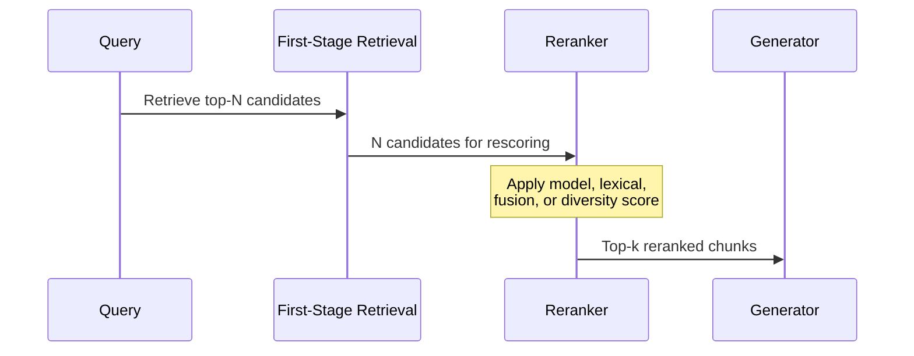
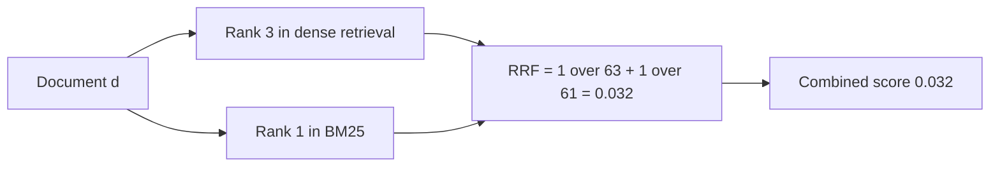

Re-ranking is a second-stage rescoring or reordering pass over candidates returned by [[Retrieval]]. It may use a cross-encoder or LLM, lexical scores such as BM25, rank fusion such as RRF, or a diversity rule such as MMR. First-stage retrieval is built for fast recall across a large corpus. The second stage has a narrower job: improve the short list before context reaches the generator.

But it cannot recover evidence that the first stage missed.

First-stage retrieval, whether dense, sparse, or hybrid, might return 20–100 chunks under its initial score. A second stage applies the chosen model, lexical, fusion, or diversity signal. Only the reordered top-k continues to the generator.



Example: hybrid retrieval returns 50 candidates for "what are the SLA penalties for tier-2 partners." Ten discuss SLAs in general. Three contain the tier-2 terms, while much of the remaining material concerns partner onboarding. A cross-encoder reads each candidate beside the query and can move the three specific documents into positions 1–3. Without that pass, generic SLA text may crowd the useful clauses out of the prompt.

# Reranking Approaches

## Cross-Encoder Reranking

A cross-encoder concatenates the query with one document, runs the pair through a transformer, and emits a relevance score. Bi-encoders embed the two texts independently. Cross-encoders instead allow full token-level attention across the pair, so wording such as negation or a narrow qualifier can change the score in ways a single embedding may miss.

That accuracy costs time. Scoring 50 candidates requires 50 query-document inference passes, which rules cross-encoders out for a first-stage scan over millions of chunks. They fit after retrieval because the candidate set is already small.

SBERT provides pretrained cross-encoder models trained on MS MARCO across a speed-quality spectrum. The model card for `cross-encoder/ms-marco-MiniLM-L12-v2` reports [[Monitoring#Retrieval Quality Metrics|nDCG@10]] on TREC Deep Learning 2019 and [[Monitoring#Retrieval Quality Metrics|MRR@10]] on the MS MARCO dev set, with throughput measured on a V100 GPU. In that setup, `cross-encoder/ms-marco-TinyBERT-L2-v2` processes about 9000 docs/sec with lower ranking quality, while `cross-encoder/ms-marco-MiniLM-L12-v2` processes about 960 docs/sec with higher scores on both metrics. Deployed throughput depends on hardware, batch size and sequence length, so it needs its own benchmark.

**Cohere Rerank** packages cross-encoder reranking as a managed API. Models such as `rerank-v3.5` and the `rerank-v4.0` family accept JSON or semi-structured data and handle multilingual queries. This removes model hosting from the application, while adding a provider call, per-query cost, and network latency.

## Late Interaction — ColBERT

ColBERT (Contextualized Late Interaction over BERT) produces one embedding per token for both query and document. MaxSim then finds the best document-token match for each query token and sums those similarities. The encoders remain independent. Token-level interaction happens later during scoring.

Document token embeddings can be computed once at index time. A request only encodes the query, then runs MaxSim over stored vectors. This separates document encoding from query-time scoring.

ColBERTv2 adds residual compression that cuts its late-interaction storage footprint by 6–10x. Its paper reports state-of-the-art [[Monitoring#Retrieval Quality Metrics|nDCG]] quality among standalone retrievers across in-domain and out-of-domain benchmarks.

Storage is the harder part. ColBERT keeps one vector per document token, and ordinary single-vector indexes cannot represent that layout. It needs an engine such as PLAID, ColBERTv2's retrieval engine, or a vector store with multi-vector support.

## BM25 Lexical Reranking

BM25 matches query terms against document terms and adjusts the score for term frequency, document length, and how rare each term is across the corpus. It usually serves as a sparse first-stage retriever. It can also provide a cheap lexical pass over dense results when exact wording matters.

Example: a user asks for "SOC 2 Type II retention exception." Dense retrieval may surface semantically similar compliance chunks about audits and data retention. A BM25 pass rewards chunks that contain the exact tokens `SOC`, `2`, `Type II`, `retention`, and `exception`, pushing the policy clause with the real exception language above more generic compliance explanations.

BM25 is particularly good with named entities, error codes, product SKUs, and legal terms. Its weakness is vocabulary brittleness. It does not know that "customer-managed key" and "CMK" may denote the same concept unless both forms appear or query expansion connects them. In semantic workloads it works best as a lexical guardrail beside dense retrieval.

## MMR — Maximal Marginal Relevance

Maximal Marginal Relevance balances query relevance against similarity to documents already selected. Plain top-k may spend several prompt slots on nearly identical chunks. MMR gives some of that space to evidence that adds a different angle.

The scoring idea is: `MMR = lambda * relevance_to_query - (1 - lambda) * similarity_to_selected_docs`. A high lambda behaves like normal relevance ranking. A lower lambda increases diversity and reduces duplicate context.

Example: retrieval returns ten chunks from the same incident report because all of them mention "vector index timeout." Plain top-k may spend the entire prompt budget on near-duplicate paragraphs. MMR can keep the strongest incident chunk, then select a configuration page and a monitoring runbook because they add different evidence for the same query.

MMR helps when overlapping chunks or template-heavy pages crowd out coverage. When lambda is too low, though, diversity starts displacing strong supporting evidence. It belongs in pipelines where the generator receives repetitive context. It is a poor fit when an answer depends on several adjacent chunks from one source.

## LLM-as-Reranker

An LLM reranker judges candidate relevance directly, usually by scoring each chunk or selecting from a small set. Unlike a fixed cross-encoder, it can apply domain rules such as "prefer current policy over archived policy" or "penalize snippets without dollar amounts."

Example prompt shape:

```text
Query: What SLA credits apply to tier-2 partners?

Candidate A: Tier-2 partners receive a 5 percent service credit after two missed monthly uptime targets...
Candidate B: Our partner program has three support tiers...

Return JSON with relevance scores from 0 to 5 and a one-sentence reason for each score.
```

The model can read longer evidence than a small cross-encoder, apply business rules, and explain a ranking decision. It also adds substantial latency and cost, and repeated calls may disagree. That makes LLM reranking reasonable for low-volume or high-stakes queries. At high QPS, a trained reranker or managed rerank API is usually the steadier choice. LLM judging can remain an evaluation tool or a difficult-case fallback.

## Score Fusion — RRF and Alternatives

Score fusion merges ranked lists from several retrievers. No new model reads the candidates, so this differs from cross-encoder reranking. The output is still a new order for the generator.

**Reciprocal Rank Fusion (RRF)** is the most common fusion method. It scores each document by summing the reciprocal of its rank in each input list, with each rank offset by a constant k:



The formula is `RRF_score = sum of 1 / (k + rank_i)`, with k=60 in the original paper. RRF works from positions rather than raw scores. Dense similarity and BM25 values can therefore be combined without forcing them onto a shared scale.

**Linear combination** normalizes scores from each retriever to a common range and computes a weighted sum: `score = alpha * dense_score + (1 - alpha) * sparse_score`. This preserves score magnitude but requires choosing alpha and handling score distributions that shift across query types.

RRF is the safer default because it only depends on rank order. Linear combination becomes useful when one retriever is consistently better and deserves an explicit weight. Fusion and model-based reranking can be stacked: the input lists are merged first, and the fused candidates are then reranked.

# Pitfalls

## Latency Budget Exhaustion

Cross-encoder reranking may add 50–200ms per query, depending on model size and candidate count. Against a 500ms total SLA, that is 10–40% of the entire budget. A quality gain in an offline benchmark can arrive with a p95 regression under production concurrency.

A hard candidate cap, often 20–50 documents, bounds the added work, and the model is chosen against the latency budget as well as quality. Measurements use realistic batch sizes and concurrency. A single-query benchmark is too clean.

## Candidate Count Reduction Under Load

Under load, reducing the reranker input from 100 candidates to 20 is an easy way to protect latency. It can also erase recall. A relevant document at position 35 never reaches the second stage.

Detection: first-stage recall@N is monitored at the candidate count actually passed to the reranker, rather than at a theoretical maximum. If recall@20 is significantly lower than recall@100, the candidate cut is the bottleneck.

## Reranker-Retriever Distribution Mismatch

A reranker trained on short English web passages from MS MARCO may underperform on long technical or multilingual material. Its relevance judgments reflect the training distribution, and unfamiliar document shapes can receive unreliable scores.

Mitigation: the reranker is evaluated on domain query-document pairs before adoption. A drop in domain recall means the reranker is demoting relevant material. A domain-adapted or multilingual model may fit better.

## Over-Reliance on Reranking to Fix Retrieval

Reranking can only reorder what retrieval found. When the relevant document never enters the candidate set, the fix belongs in [[Chunking]], [[Embeddings|embedding model selection]], query expansion, or another first-stage decision. A stronger reranker cannot recover missing evidence.

Diagnostic: low first-stage candidate Recall@N establishes an upstream ceiling. If Recall@N is high, demotion is established only when relevant evidence inside the first-stage top-k falls outside the reranked top-k at the same k. Low post-rerank Recall@k alone does not establish demotion: evidence can stay beyond k in both orders even after its rank improves, and such exclusion can occur even when the query needs no more relevant evidence than k can hold; on its own it does not show whether a larger k or a better ranking is the right repair.

# Tradeoffs

| Approach | Quality | Latency per query | Infrastructure | Best for |
| --- | --- | --- | --- | --- |
| No reranking | Baseline -- retrieval order only | Lowest -- no extra scoring | None | Simple corpora where first-stage ranking is sufficient |
| BM25 lexical reranking | Moderate -- exact term precision | Low -- sparse scoring over candidates | Sparse index or BM25 scorer | Queries with identifiers, acronyms, policy terms, error codes |
| Score fusion only -- RRF | Moderate -- better ordering from multiple signals | Minimal -- arithmetic on ranks | None -- works with any retriever pair | Hybrid retrieval where dense and sparse complement each other |
| MMR diversity reranking | Moderate -- less redundant context | Low to moderate -- pairwise similarity over selected chunks | Embeddings or similarity scores for candidates | Context windows crowded by near-duplicate chunks |
| Cross-encoder -- small model | Often stronger than first-stage scores, but the gain needs measurement on the domain | One model pass per candidate pair; actual cost depends on model, hardware, sequence length, and batch size and needs benchmarking | GPU or CPU inference | Quality-sensitive pipelines with moderate latency budgets |
| Cross-encoder -- large model | More capacity, not a guaranteed quality win | Higher pair-scoring cost; actual cost needs benchmarking in the deployed configuration | Usually GPU inference | High-stakes domains where measured gains justify latency |
| ColBERT late interaction | Token-level alignment with pre-computed documents | Query encoding plus MaxSim over stored document vectors | Multi-vector storage -- specialized index | Latency-sensitive pipelines where held-out retrieval improves over a bi-encoder |
| LLM-as-reranker | High but variable -- instruction-following judgment | Highest -- model call over candidate text | LLM API or hosted model plus output validation | Low-volume, high-stakes queries needing explainable ranking rules |
| Managed API -- Cohere or Azure | High -- no infrastructure | Network round-trip + provider latency | None -- API call | Teams without ML infrastructure or needing fast integration |

A pipeline without a reranker is the baseline, and its measured failures show what to add. BM25 or RRF helps when lexical and dense signals cover different queries. MMR earns its place when duplicate chunks waste prompt space. A model-based reranker is justified when the right evidence is already present but ordered badly. If recall is broken, the fix belongs in retrieval, not in a reranker. LLM reranking belongs only where business judgment or an explained decision is worth the extra latency and cost.

# Questions

> [!qard]- Why does a RAG pipeline retrieve candidates first and then rerank them with a cross-encoder?
> The two stages split the work between a fast scorer that can cover the whole corpus and a slower, finer-grained scorer that can only afford a short list. First-stage retrieval cheaply finds candidates across the corpus. A cross-encoder then rescores only those candidates; running it over every document would be far too slow.
>
> | Aspect | Bi-encoder (first-stage retrieval) | Cross-encoder (reranker) |
> |---|---|---|
> | How it scores | Embeds the query and each document separately. Document vectors are computed once at indexing time and compared with one query vector | Reads the query and one candidate together in a single model pass and outputs a relevance score |
> | Relevance judgment | Coarser, because query and document are encoded without seeing each other | Can be finer, because attention spans both texts, so a qualifier or negation in the query can change the score. This often ranks better, but the gain depends on the model and the domain |
> | Cost per query | One query encoding plus a fast index search | One model inference per candidate |
> | Role | Recall: getting the relevant evidence into a candidate list, often tens of items | Precision: putting the best candidates into the small top-k that reaches the prompt |
>
> Keyword search such as BM25 can also fill the first-stage role. Whatever the first stage is, the reranker only reorders what it returned: if the relevant document is not among the candidates, no reranker can recover it. Because the ranking gain is not guaranteed, it is confirmed on domain queries against the first-stage order before the reranker is adopted.
>
> [Retrieve & Re-Rank (Sentence Transformers)](https://sbert.net/examples/sentence_transformer/applications/retrieve_rerank/README.html)

<!-- qard-id: 466ddf4f-9bc8-46dc-82f6-34b0e669789f -->

> [!qard]- Why can a reranker improve retrieval metrics without improving the generated answer?
> A retrieval metric can improve in ranking positions that never reach the generator. Even when better evidence does reach the generator, the model still has to use it correctly.
>
> - **Outside the final cutoff:** a ranking metric is often computed over more results than the pipeline puts into the prompt. In this example, only the top 5 reranked chunks are assembled. Moving a relevant chunk from position 15 to position 8 raises a rank-sensitive metric such as nDCG@20, but the model input stays identical.
> - **Generation-side limits:** retrieval and generation fail independently. If the needed evidence was already in the prompt, reordering it may not change the answer. If the model ignores, misreads or contradicts the evidence, better retrieval does not fix that.
>
> Finding where the gain lands therefore requires following the same queries through each stage. The stages are candidate Recall@N before reranking, the ranking after reranking at the cutoff actually used, and the assembled context. Answer quality is then evaluated on representative queries. A retrieval metric gain alone does not establish a user-visible benefit.
>
> [Retrieve & Re-Rank (Sentence Transformers)](https://sbert.net/examples/sentence_transformer/applications/retrieve_rerank/README.html) · [Optimizing LLM accuracy (OpenAI)](https://developers.openai.com/api/docs/guides/optimizing-llm-accuracy)

<!-- qard-id: 2525edd1-368e-4d10-a58a-4bc82c562674 -->

> [!qard]- When can reranking worsen retrieval quality, and when can it fail to improve it?
> A reranker trained on short web passages may misjudge long technical documents or unfamiliar terminology. It can then worsen results by pushing relevant evidence from inside the first-stage top-k to below that cutoff. A small candidate set or low first-stage recall causes a different failure. A reranker only reorders the candidates it receives, so it cannot add relevant evidence that is missing from them.
>
> Domain queries tell these cases apart when [[Monitoring#Retrieval Quality Metrics|recall and precision]] are measured at matched points:
>
> - **Missing candidates:** low candidate Recall@N before reranking means the evidence was absent before reranking began. That is a first-stage limit.
> - **Demotion:** the comparison cuts the first-stage order and the reranked order at the same final k. Demotion means relevant evidence was inside the first-stage top-k but falls outside the reranked top-k. A net drop in Recall@k between the two orders signals it in aggregate. A low absolute Precision@k does not show demotion. With one relevant document ranked first in both orders, Recall@N and Recall@10 are both 1.0, yet Precision@10 is only 0.1, and nothing was demoted.
> - **No promotion into top-k:** when relevant candidates fall outside top-k in both orders, their ranks in the two orders show whether reranking helped. A move from rank 50 to rank 11 at k = 10 is a partial improvement that still misses the final cutoff. An unchanged or worse rank means the reranker did not help that evidence. Exclusion in both orders does not by itself show that k is too small. Cutoff capacity matters only when the query needs more distinct relevant pieces than k can hold.

# References

- [Retrieve and rerank pipeline — bi-encoder retrieval plus cross-encoder reranking (SBERT)](https://sbert.net/examples/applications/retrieve_rerank/README.html)
- [ColBERTv2 — residual compression and denoised supervision (NAACL 2022)](https://arxiv.org/abs/2112.01488)
- [The Probabilistic Relevance Framework BM25 and beyond — lexical ranking model background (Foundations and Trends in Information Retrieval)](https://www.staff.city.ac.uk/~sbrp622/papers/foundations_bm25_review.pdf)
- [The use of MMR, diversity-based reranking for reordering documents and producing summaries (SIGIR 1998)](https://dl.acm.org/doi/10.1145/290941.291025)
- [RankGPT — LLM-based passage reranking with permutation generation (arXiv)](https://arxiv.org/abs/2304.09542)
- [Reciprocal Rank Fusion outperforms Condorcet and individual rank learning methods (SIGIR 2009)](https://plg.uwaterloo.ca/~gvcormac/cormacksigir09-rrf.pdf)
