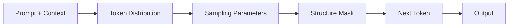

Generation turns a prompt and its context into output. Producing text is easy. Producing text that is reliable, grounded, and usable by the next system is the engineering problem. Sampling controls affect token choice, evidence limits what the answer may claim, and structure determines whether another program can consume it.

At each step, the model predicts a probability distribution over its vocabulary. The sampler chooses one token, appends it, and repeats until a stop condition fires. Temperature rescales the distribution, top-p trims its tail, and penalties push down repeated tokens. The prompt and context shape the distribution before any of those controls apply. Structured-output constraints can then mask tokens that would break the required form.

# Generation Parameters

Generation parameters change how the next token is selected. Their effects show up as randomness, repetition, output length, and limited reproducibility.

**`temperature`** scales logits before softmax. A value at or near zero usually selects the highest-probability token. But provider infrastructure can still prevent exact reproducibility. At 1.0, sampling follows the model's learned probabilities. Higher values flatten the distribution, which increases variety and admits more low-probability tokens. Factual tasks usually start near 0–0.3. Creative work often needs a wider range such as 0.7–1.0. These are evaluation starting points, not universal settings.

**`top_p`** (nucleus sampling) keeps the smallest token set whose cumulative probability reaches the threshold. With `top_p=0.9`, sampling happens inside the first 90% of probability mass and ignores the long tail. It is another randomness control. Provider guidance commonly recommends tuning either temperature or top-p while leaving the other at its default, which keeps cause and effect legible.

**`top_k`** limits sampling to the K most probable tokens, regardless of their cumulative mass. Anthropic and many open-source inference stacks expose it. OpenAI's API does not. A fixed K is less adaptive than top-p because the same cutoff can be cramped for one distribution and loose for another.

**`frequency_penalty`** and **`presence_penalty`** discourage repetition in different ways. Frequency penalty grows as a token reappears. Presence penalty applies a flat bias once a token has appeared at all, which can push the output toward new topics. OpenAI accepts values from -2.0 to 2.0. Moderate positive values such as 0.3–0.8 are reasonable starting points for loops, followed by task evaluation.

**`max_tokens`** / **`max_completion_tokens`** caps response length. The limit needs enough room for the expected answer plus a margin. Hitting it can truncate a sentence, so `finish_reason` belongs in response handling. For o-series reasoning models, `max_completion_tokens` covers internal reasoning tokens as well as visible output.

**`stop`** sequences terminate generation when the model produces a matching string. Useful for structured prompts where a delimiter signals the end of the useful output.

**`seed`** requests best-effort repeatability. The same seed and identical inputs may reproduce an output, but provider infrastructure changes can still alter it. Drift becomes diagnosable when each response is recorded with the exact model identifier and any provider-supplied backend metadata.

**`logprobs`** / **`top_logprobs`** expose token-level probabilities. They help explain ambiguous classifications and unstable token choices. They are signals from the model's distribution, not calibrated confidence in factual truth.

Some reasoning-focused models fix or omit sampling controls. Model-specific API documentation decides whether `temperature` or `top_p` is accepted. An unsupported field may be ignored or rejected.

# Grounding and Citations

Grounding ties model output to evidence in the supplied context instead of leaving claims to parametric memory. Fluent text can still be fabricated. An explicit evidence link makes that failure testable, as covered more broadly in [[Hallucinations]].

The grounding contract defines the rules the model must follow:

- Use only the provided sources to answer
- Attach a citation to each factual claim
- If evidence is insufficient or conflicting, abstain rather than guess
- Do not combine source material with parametric knowledge

**Citation generation:** the model tags a claim with its supporting source. Anthropic's Citations API returns structured locations whose form depends on the document: character ranges for plain text, page ranges for PDFs, and block ranges for custom content. Other providers may require citation tags in the output followed by post-processing validation.

**Claim verification:** generation is followed by splitting the answer into claims and checking each one against its cited source. Natural Language Inference (NLI) is one practical approach: a smaller model classifies each claim-source pair as entailed, neutral, or contradicted. Azure AI Content Safety offers managed groundedness detection, while MiniCheck provides an open-source verifier.

**Abstention:** insufficient evidence should produce an explicit non-answer. The system prompt needs a stable form, such as "I don't have enough information to answer this," so downstream code can distinguish abstention from vague hedging.

Grounding is central to [[AI & ML/LLM/Context Engineering/RAG/RAG|RAG]], where the answer must stay faithful to retrieved documents. The same contract applies when evidence comes from a tool, database result, or user-provided document.

# Context Assembly

Context assembly decides which evidence enters the prompt and where it appears. That is the core of [[AI & ML/LLM/Context Engineering/Context Engineering|Context Engineering]]. “Lost in the Middle” (Liu et al., 2023) found a U-shaped performance pattern in long contexts, with information near the beginning and end used more reliably than information in the middle.

Practical implications:

- The most relevant evidence goes at the start of the context window. With multiple chunks, the highest-ranked chunks come first.
- In long contexts, a summary or key evidence placed at both the start and end can take advantage of primacy and recency effects.
- A compact context usually works better. A few complete, high-quality chunks often beat a large pile of partial fragments because extra context also adds noise.
- Source identifiers (document IDs, section markers) in the context payload let the model produce traceable citations.
- When the total evidence exceeds the context window, lower-ranked chunks are dropped instead of every chunk being truncated. A complete chunk with full context is more useful than fragments of many chunks.

[[AI & ML/LLM/Context Engineering/RAG/RAG|RAG]] covers RAG-specific context assembly patterns.

# Structured Output

Structured output asks the model for data another program can parse, such as JSON, function arguments, or an enum value. The available mechanisms solve different problems.

**Constrained decoding (Structured Outputs):** the provider masks tokens that would violate a JSON schema during decoding. A completed, non-refusal response is constrained to the supported schema; refusals and incomplete responses need separate handling. OpenAI's `response_format: { type: "json_schema" }` and Azure's equivalent use this approach. The schema may still encode the wrong contract, and valid JSON can carry nonsense values. Deeply nested schemas can also hurt output quality.

**JSON mode:** produces valid JSON without enforcing a particular schema when generation completes normally; incomplete responses still need handling. It fits exploratory output whose shape can vary. A consumer expecting fixed fields still needs validation because any JSON object satisfies the mode.

**Function calling:** the model selects a function from a supplied list and returns structured arguments. It fits tool use because the decision includes which action to take. Schema-valid arguments can still name the wrong function or carry semantically wrong values.

Constrained decoding fits when a specific response schema must be enforced. Function calling fits a choice among tools. JSON mode is the loose option when parseability matters but the exact shape does not.

# Pitfalls

## Temperature Miscalibration

High temperature adds token-level randomness to factual tasks, which can surface as invented details or broken formatting. Very low values can make creative work repetitive. A setting chosen during prototyping often survives long after the task or model has changed.

Mitigation: the production setting comes from comparing several values on the actual task, and evaluation continues afterward because a model update can change behavior at the same temperature.

## Lost-in-the-Middle Attention Failure

Evidence in the middle of a long context may receive less attention than evidence near either edge. The model can therefore miss supplied information. The cited study observed the failure across multi-document contexts. The exact threshold depends on the model and task.

Mitigation: chunks are ordered by relevance, most relevant first. High-stakes queries can place key evidence at both the start and end of the context. Filtering out lower-quality chunks keeps the context smaller than including everything.

## Grounding Bypass Under Conflicting Evidence

Conflicting sources can lead a model to choose one version silently. The answer may look grounded while hiding the contradiction, especially when the documents describe different dates or jurisdictions.

Mitigation: the prompt explicitly asks the model to surface conflicts rather than resolve them silently, and a post-generation check compares claims against every provided source, including sources the model did not cite.

## Structured Output Schema Mismatch

Valid JSON can pass schema validation while carrying wrong values: fields may be swapped, an allowed enum may be chosen without evidence, or a well-formed array may contain the wrong records. Schema compliance proves shape. It does not prove meaning.

Mitigation: semantic content is validated in addition to schema compliance. Critical fields get explicit value constraints or post-generation checks. Adversarial test inputs check whether the model distinguishes structurally similar but semantically different schemas.

# Tradeoffs

| Factor | Low temperature with strict grounding | High temperature with loose grounding | Structured output | Free-text output |
| --- | --- | --- | --- | --- |
| Reliability | Lower sampling variance; evidence-bound only when claims are verified | Lowest -- creative and less predictable | High -- schema-enforced format | Low -- format varies per response |
| Expressiveness | Limited -- constrained by source material | Highest -- explores beyond evidence | Limited -- constrained by schema | Highest -- natural language |
| Hallucination risk | Lower when evidence enforcement and claim verification reject unsupported text; citations alone do not | High -- broader sampling admits more unsupported continuations | Not reduced by the schema alone -- shape is enforced, but field values can still be unsupported unless checked against evidence | Not increased by the free form alone -- depends on the same evidence and verification as structured output |
| Cost and latency | Higher only when a separate verification pass is used | Lower -- single generation | Provider-dependent constrained-decoding overhead | Lowest -- single unconstrained generation |
| Best for | Factual QA and RAG and compliance | Brainstorming and creative writing and exploration | API responses and data extraction and tool integration | Conversational and explanatory and long-form |

# Questions

<!-- qard-id: 62368673-03b1-4384-a272-2b350d505198 -->

> [!qard]- Why is adjusting `temperature` and `top_p` at the same time discouraged?
> Both settings control sampling randomness by reshaping the same next-token distribution. When both change at once, a change in output cannot be attributed to either setting. Tuning is therefore clearer when one setting moves while the other stays at its default.
>
> - `temperature` rescales the logits before sampling. Lower values concentrate probability on the most likely tokens; higher values flatten the distribution and admit more unlikely tokens.
> - `top_p` (nucleus sampling) samples only from the smallest set of tokens whose cumulative probability reaches the threshold, cutting off the low-probability tail.
>
> Both settings change how often low-probability tokens appear, so their effects overlap rather than controlling separate properties. OpenAI's API reference currently recommends altering one or the other, not both. This is tuning guidance, not a hard limit. Advice differs across providers, and some models fix or reject these parameters, so the deployed model's documentation and task evaluation decide the final settings.
>
> Sources: [OpenAI API reference: Create chat completion](https://developers.openai.com/api/reference/go/resources/chat/subresources/completions/methods/create) · [Hugging Face Transformers: Generation](https://huggingface.co/docs/transformers/main_classes/text_generation)

<!-- qard-id: 353c5f64-fbcc-46f9-9fc3-3b72603bb9ee -->

> [!qard]- Why can a response with valid citation markers still contain unsupported claims?
> A citation marker only links a claim to a source location. It does not show that the cited passage supports the claim. Markers on some sentences also say nothing about sentences that have none.
>
> - **Wrong support:** the model generates the citation as well as the claim, so it can attach a real, on-topic passage to a statement that the passage does not entail. For example, a passage describing a refund policy may not contain the refund limit that the answer attributes to it.
> - **Missing support:** a response can mix cited sentences with uncited claims drawn from the model's own memory.
>
> Citation validity and claim support are therefore separate checks. Support is checked after generation by splitting the answer into claims and testing each claim against its cited passage, through human review or an automated verifier matched to the risk. Natural Language Inference classifiers and fact-checking models such as MiniCheck are automated options. They also make errors, so their decisions need validation against labeled examples.
>
> Sources: [Anthropic: Citations](https://platform.claude.com/docs/en/build-with-claude/citations) · [Tang et al.: MiniCheck](https://aclanthology.org/2024.emnlp-main.499/)

# References

- [Chat Completions API reference (OpenAI)](https://developers.openai.com/api/reference/resources/chat)
- [Citations API — source-grounded responses with citation objects (Anthropic)](https://docs.anthropic.com/en/docs/build-with-claude/citations)
- [Groundedness detection — NLI-based claim verification (Azure AI Content Safety)](https://learn.microsoft.com/azure/ai-services/content-safety/concepts/groundedness)
- [Lost in the Middle — how language models use long contexts (Liu et al. 2023)](https://arxiv.org/abs/2307.03172)
- [MiniCheck — efficient fact-checking of LLMs on grounding documents (EMNLP 2024)](https://aclanthology.org/2024.emnlp-main.499)
