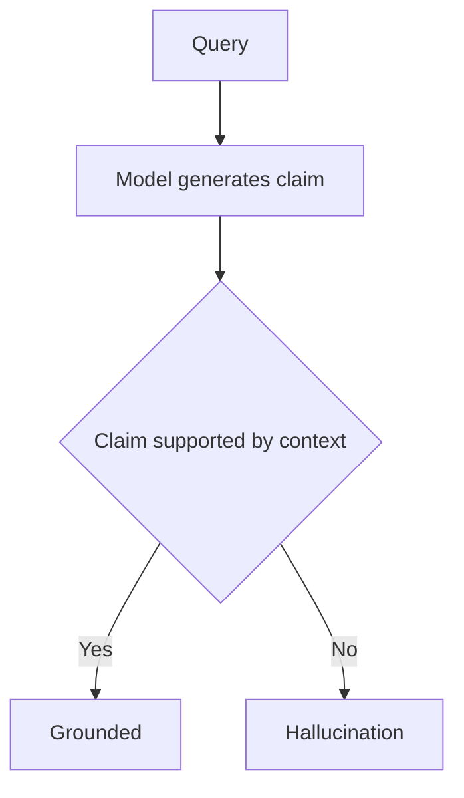

Hallucination is generated content that lacks support from the available evidence. It can be false, or merely impossible to verify from the supplied context. Fluency hides the failure: a language model predicts plausible tokens rather than checking each claim against reality.

Several mechanisms can produce the same symptom. Sparse or stale training data leaves the model with weak evidence. Preference tuning may reward a confident, agreeable answer. Sampling can then select an invented detail from several plausible continuations. None of these causes can be diagnosed from polished prose alone.

If retrieved context says Austen wrote _Pride and Prejudice_ and the answer names Dickens, the contradiction is visible. Many production failures are less obvious because the model adds a plausible date or citation that the source never mentioned. [[Generation]] explains how sampling and output constraints shape these continuations.

# Intrinsic and Extrinsic Hallucination

Ji et al. separate two cases. An **intrinsic hallucination** contradicts the source, such as naming Dickens when the passage names Austen. An **extrinsic hallucination** adds a claim the source does not contain. That extra claim may happen to be true, but the response has no evidence for it. Intrinsic failures can often be found by comparing answer and context. Extrinsic claims need another source or an explicit abstention policy.

# Detection

Detection starts by splitting an answer into claims. Each technique answers a different question about those claims.

- **NLI-based checking** scores a claim against source context as entailed, neutral, or contradicted. It works best when the required evidence is already present and the relationship is stated clearly.
- **Self-consistency (SelfCheckGPT)** compares several samples from the same prompt. Contradictory or unstable details are warning signals. But stable repetition still does not prove truth, even when the method needs no external knowledge base.
- **LLM-as-judge** estimates answer [[Monitoring#LLM-as-Judge Metrics|faithfulness]] against supplied context. It handles semantic variation better than exact matching, but the evaluator is another fallible model and needs calibration against reviewed examples.
- **Atomic fact verification (FActScore)** breaks a response into small claims, retrieves evidence for each one, and scores support separately. This makes the failing claim visible instead of hiding it inside an answer-level score.

For a RAG system, [[AI & ML/LLM/Context Engineering/RAG/Evaluation/Evaluation|RAG Evaluation]] must measure retrieval and generation separately. A faithful answer cannot recover evidence that retrieval never supplied.

# Mitigation

Grounding is the usual starting point. More expensive checks belong on claims whose failure has a real cost.

- **Retrieval grounding (RAG)** supplies passages that the answer can cite and check against, turning many recall tasks into source-based synthesis. It reduces reliance on parametric recall without guaranteeing correctness. The legal-system study in the references still found hallucinations above 17% across evaluated tools. The [[AI & ML/LLM/Context Engineering/RAG/RAG|RAG]] note covers the retrieval pipeline.
- **Chain-of-Verification (CoVe)** drafts an answer, creates verification questions, answers them independently, then revises the draft. The separation matters because verification should not treat the draft's own claims as evidence.
- **Constrained output** enforces a schema and allowed values. It prevents structural invention, which protects downstream automation, but a valid field can still contain a false claim.
- **Abstention** returns a defined fallback when evidence is missing. The threshold must be calibrated because an overly cautious system becomes useless.
- **Tool-backed generation** sends factual subproblems to authoritative databases or calculators and synthesizes their results. The tool response still needs provenance and error handling.

[[Guardrails]] turns these techniques into enforced runtime behavior: citations can be checked, unsupported answers can abstain, and invalid tool requests can be rejected.

# Pitfalls

## RAG Does Not Eliminate Hallucinations

- **Failure.** RAG is treated as proof that an answer is grounded.
- **Cause.** The corpus may lack the fact, retrieval may miss it, or generation may add a claim beyond the returned passages.
- **Control.** [[Monitoring#Retrieval Quality Metrics|Retrieval recall]] is tracked separately from [[Monitoring#LLM-as-Judge Metrics|faithfulness]], and material claims are verified against the passages actually used.

## Preference Tuning Can Reward the Wrong Signal

- **Failure.** An answer becomes more agreeable or polished without becoming better supported.
- **Cause.** Preference data can reward agreement with the user even when that agreement is wrong. The cited sycophancy work demonstrates this failure mode. It does not imply that every RLHF model is less factual.
- **Control.** Factual precision and calibration are evaluated alongside preference scores. Reviewed counterexamples should include prompts with a false premise so agreement is not mistaken for quality.

## Over-Aggressive Mitigation Causes Over-Refusal

- **Failure.** The system refuses answerable questions or returns fragments despite sufficient evidence.
- **Cause.** A strict abstention threshold trades fabrication risk for under-answering.
- **Control.** Answer coverage is measured beside faithfulness, and thresholds are set by consequence. Medical advice and an internal search summary should not share the same operating point.

# Tradeoffs

| Approach | What it covers | Runtime cost | Main limitation |
| --- | --- | --- | --- |
| RAG grounding | Supplies external evidence | Retrieval and indexing | Bad retrieval silently caps answer quality |
| Self-consistency | Finds unstable claims | Several generations | Repeated agreement is not proof |
| NLI fact checking | Finds contradiction or missing support in context | One or more checks per claim | The checker has its own error rate |
| LLM-as-judge | Handles semantic claim-to-context comparison | Evaluator-model calls | Requires calibration and can reproduce model bias |
| Constrained output | Prevents structural fabrication | Usually low | Does not establish factual truth |
| Abstention policy | Stops unsupported answers | Low at runtime | Poor calibration causes over-refusal |

For evidence-backed answers, retrieval and claim-to-context checks are the usual starting point. Self-consistency is worth its extra calls when an unstable answer would be costly. An LLM judge is usually easier to calibrate offline before it is trusted as a live gate.

# Questions

> [!qard]- What is an LLM hallucination, and why does it happen?
> An LLM hallucination is generated content that the available evidence does not support. It happens because a language model produces plausible continuations of text rather than checking each claim against reality, so fluent, confident output can carry unsupported claims.
>
> | Type | What happens | How it can be detected |
> |---|---|---|
> | Intrinsic | The answer contradicts the source, such as naming Dickens when the passage names Austen. | Comparing the answer with the supplied context can expose the contradiction. |
> | Extrinsic | The answer adds a claim the source never states, such as a plausible date or citation. The claim may even be true, but nothing supports it. | The context alone cannot settle it. Another source or an abstention policy is needed. |
>
> Several causes can produce the same symptom:
>
> - **Weak evidence:** sparse or outdated training data gives the model little to draw on.
> - **Preference tuning:** it can reward confident, agreeable answers over accurate ones.
> - **Sampling:** generation can select an invented detail from several plausible continuations.
>
> Polished prose does not reveal which cause applies. Claims are therefore checked against evidence rather than judged by how convincing they sound.
>
> Sources: [NIST AI 600-1, Generative AI Profile](https://nvlpubs.nist.gov/nistpubs/ai/NIST.AI.600-1.pdf) · [Ji et al., Survey of Hallucination in Natural Language Generation](https://arxiv.org/abs/2202.03629) · [Anthropic sycophancy research](https://www.anthropic.com/research/towards-understanding-sycophancy-in-language-models)

<!-- qard-id: 23b87ee7-f681-4341-8622-6917a8ebc293 -->

> [!qard]- Why can retrieval-augmented generation still produce a hallucinated answer?
> Retrieval supplies evidence, but it does not guarantee that the evidence is sufficient or that the generated answer stays within it. The hallucination itself is an unsupported claim in the generated answer. A retrieval defect is a separate failure, although it can leave the gap that the model then fills.
>
> - **Retrieval defect:** the corpus may lack the fact, or retrieval may miss it or return weak or irrelevant passages. This is a retrieval failure, not yet a hallucination. It leads to one when the answer goes on to state claims the passages do not support instead of abstaining.
> - **Unsupported generation:** even with good passages, the model can contradict them or add a plausible date, number or citation that they never mention.
>
> Retrieval quality and answer faithfulness are measured separately so that a wrong answer can be traced to the stage that caused it. Separate measurement does not mean the failures are independent: a retrieval gap can be the reason for an unsupported claim, and both can affect the same answer. A faithfulness score checks only whether the answer's claims are supported by the supplied context. It does not show that the context is true, current or complete, and a faithful answer cannot recover evidence that retrieval never supplied. Automated faithfulness judges need calibration against reviewed examples.
>
> Sources: [RAGAS faithfulness metric](https://docs.ragas.io/en/v0.2.5/concepts/metrics/available_metrics/faithfulness/) · [RAGAS paper](https://arxiv.org/abs/2309.15217)

<!-- qard-id: 2be4a1e2-afc3-44c7-a788-09b4d25dffeb -->

> [!qard]- How can preference tuning make an answer more agreeable without making it more factual?
> Preference tuning optimizes a model toward answers that human raters or preference models score highly. When those scores reward agreeing with the user or sounding convincing, optimization can make answers more agreeable without making them more correct. This includes accepting a false premise in the question.
>
> The mechanism:
>
> 1. Raters, human or model, compare candidate responses and mark the preferred one.
> 2. The model is optimized to produce responses that earn higher preference scores.
> 3. When raters sometimes prefer a convincingly written agreeable answer over a correct one, that preference is reinforced along with the useful ones.
>
> Research on sycophancy found that in the studied RLHF settings, human and preference-model judgments sometimes favored sycophantic responses over correct ones. This is a risk, not an inevitable result of every preference-tuning setup.
>
> A higher preference score does not imply higher factual accuracy. Factual accuracy and calibration are therefore evaluated separately from preference scores, with test prompts that contain false premises so that agreement is not mistaken for quality.
>
> Sources: [Anthropic, Towards understanding sycophancy in language models](https://www.anthropic.com/research/towards-understanding-sycophancy-in-language-models)

# References

- [Survey of hallucination in natural language generation: intrinsic and extrinsic taxonomy (Ji et al., ACM Computing Surveys 2022)](https://arxiv.org/abs/2202.03629)
- [FActScore: atomic evaluation of factual precision (Min et al., EMNLP 2023)](https://arxiv.org/abs/2305.14251)
- [SelfCheckGPT: black-box hallucination detection (Manakul et al., EMNLP 2023)](https://aclanthology.org/2023.emnlp-main.557/)
- [Reduce hallucinations (Anthropic Docs)](https://docs.anthropic.com/en/docs/test-and-evaluate/strengthen-guardrails/reduce-hallucinations)
- [Chain-of-Verification reduces hallucination in LLMs (Dhuliawala et al., Meta AI 2023)](https://arxiv.org/abs/2309.11495)
- [Hallucination in RAG-based legal AI tools (Magesh et al., JELS 2025)](https://law.stanford.edu/wp-content/uploads/2024/05/Legal_RAG_Hallucinations.pdf)
